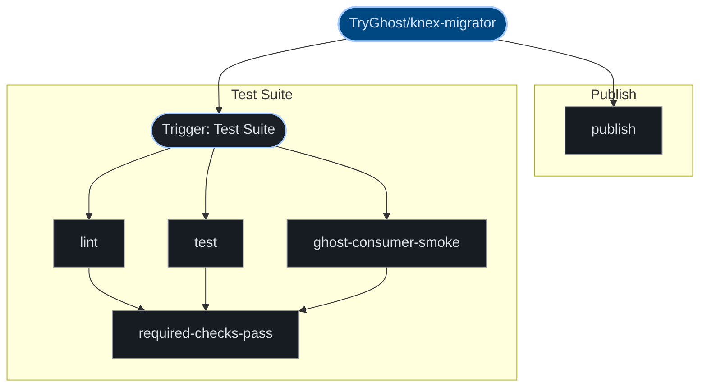

# Repository Architecture Analysis: TryGhost/knex-migrator

## Metadata
- **SHA**: `cb6c132ff7645f6b57b2e7e376a591e32570ddc5`
- **Primary Ecosystem**: JavaScript/TypeScript

## Quality Metrics
- **ast_engine**: tree-sitter
- **avg_cognitive_complexity**: 1.73
- **avg_cyclomatic_complexity**: 2.39
- **component_count**: 1
- **dead_code_count**: 11
- **dead_code_symbols**: 11 entry(ies)
- **duplication_pct**: 85.26
- **file_complexities**: 25 entry(ies)
- **files_analyzed**: 80
- **fitness_passed**: False
- **fitness_violation_count**: 3
- **framework**: TypeScript
- **import_edges**: 100 entry(ies)
- **loc**: 8052
- **max_cognitive_complexity**: 39
- **max_cyclomatic_complexity**: 33
- **sloc**: 6339
- **test_file_count**: 79

# Architecture: TryGhost/knex-migrator

## Context
- **Repository**: `TryGhost/knex-migrator`
- **SHA**: `cb6c132ff7645f6b57b2e7e376a591e32570ddc5`
- **Ecosystem**: JavaScript/TypeScript
- **Framework**: TypeScript

## Building Block View

## Component Details
- **knex-migrator** (`package.json`): MODULE

## 6-Dimension Repository Scorecard

- **Overall Grade**: `D` (60.25/100)
- **Technical Debt Score**: 39.75
- **Estimated Remediation Effort**: 47.24h

| Dimension | Grade | Score | Weight | Details |
| :--- | :---: | :---: | :---: | :--- |
| Code Quality | `F` | 30.00 | 0.20 | avg_cc=2.39, max_cc=33, duplication=85.26%, dead_code=11 |
| Dependency Health | `B` | 85.00 | 0.15 | dependencies=19, outdated=0, vulnerable=0, has_lockfile=False |
| Maintainability | `F` | 42.00 | 0.15 | avg_cognitive=1.73, max_cognitive=39, fitness_violations=3, oversized_files=3 |
| Pipeline Health | `F` | 58.00 | 0.15 | workflows=2, operational_antipatterns=8, parallel_branches=True |
| Security | `B` | 80.00 | 0.20 | vulnerabilities=0, secrets=0, pipeline_security_findings=1 |
| Test Coverage | `C` | 70.00 | 0.15 | coverage=unavailable, ci_test_job=True, test_files_detected=True |

## Architecture Fitness & Workspace Boundaries

- **[MEDIUM] `ATRUSS-ARCH-005` (COMPLEXITY_THRESHOLD)**: Repository duplication_pct (85.26) exceeds policy threshold (15.0).
- **[MEDIUM] `ATRUSS-ARCH-005` (COMPLEXITY_THRESHOLD)**: Repository max_cognitive_complexity (39.0) exceeds policy threshold (25.0).
- **[MEDIUM] `ATRUSS-ARCH-005` (COMPLEXITY_THRESHOLD)**: Repository max_cyclomatic_complexity (33.0) exceeds policy threshold (20.0).

## Supply Chain Dependencies, Vulnerabilities & Secrets

- **Dependencies Parsed**: 19 | **Vulnerabilities**: 0 | **Secrets**: 0

### Inventory Sample
- `@tryghost/database-info` `2.3.19` (npm, `package.json`)
- `@tryghost/errors` `3.4.5` (npm, `package.json`)
- `@tryghost/logging` `5.4.8` (npm, `package.json`)
- `@tryghost/pro-ship` `1.1.9` (npm, `package.json`)
- `@types/node` `26.6.6` (npm, `package.json`)
- `@vitest/coverage-v8` `5.1.0` (npm, `package.json`)
- `commander` `15.1.0` (npm, `package.json`)
- `debug` `4.4.3` (npm, `package.json`)
- `knex` `3.3.0` (npm, `package.json`)
- `knex2` `2.4.2` (npm, `package.json`)
- `mysql2` `3.24.6` (npm, `package.json`)
- `nconf` `0.13.0` (npm, `package.json`)
- `oxfmt` `0.78.0` (npm, `package.json`)
- `oxlint` `1.93.0` (npm, `package.json`)
- `rimraf` `6.1.4` (npm, `package.json`)
- `semver` `7.8.6` (npm, `package.json`)
- `sinon` `22.1.0` (npm, `package.json`)
- `typescript` `7.0.2` (npm, `package.json`)
- `vitest` `5.1.0` (npm, `package.json`)

## CI/CD Pipeline Topology

