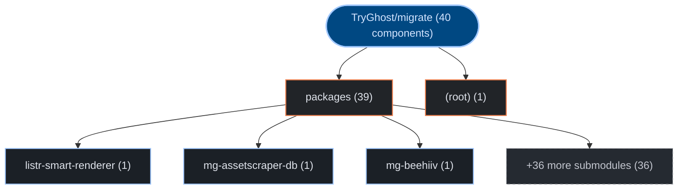
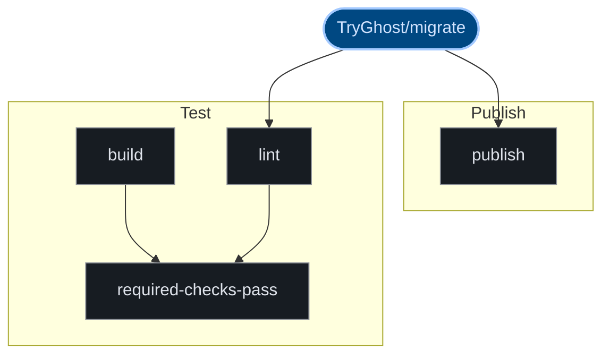

# Repository Architecture Analysis: TryGhost/migrate

## Metadata
- **SHA**: `c107687d87552cd03ed5adf40f018728f74029a6`
- **Primary Ecosystem**: JavaScript/TypeScript

## Quality Metrics
- **ast_engine**: tree-sitter
- **avg_cognitive_complexity**: 4.42
- **avg_cyclomatic_complexity**: 3.87
- **component_count**: 40
- **dead_code_count**: 11
- **dead_code_symbols**: 11 entry(ies)
- **duplication_pct**: 89.4
- **file_complexities**: 25 entry(ies)
- **files_analyzed**: 520
- **fitness_passed**: False
- **fitness_violation_count**: 3
- **framework**: TypeScript
- **import_edges**: 100 entry(ies)
- **loc**: 100457
- **max_cognitive_complexity**: 211
- **max_cyclomatic_complexity**: 145
- **sloc**: 84657
- **test_file_count**: 308

# Architecture: TryGhost/migrate

## Context
- **Repository**: `TryGhost/migrate`
- **SHA**: `c107687d87552cd03ed5adf40f018728f74029a6`
- **Ecosystem**: JavaScript/TypeScript
- **Framework**: TypeScript

## Building Block View

## Component Details
- **0c19b36e-8aa2-4d57-9763-e10bb6da2e13** (`package.json`): MODULE
- **@tryghost/listr-smart-renderer** (`packages/listr-smart-renderer/package.json`): MODULE
- **@tryghost/mg-assetscraper-db** (`packages/mg-assetscraper-db/package.json`): MODULE
- **@tryghost/mg-beehiiv** (`packages/mg-beehiiv/package.json`): MODULE
- **@tryghost/mg-beehiiv-api** (`packages/mg-beehiiv-api/package.json`): MODULE
- **@tryghost/mg-beehiiv-api-members** (`packages/mg-beehiiv-api-members/package.json`): MODULE
- **@tryghost/mg-beehiiv-members** (`packages/mg-beehiiv-members/package.json`): MODULE
- **@tryghost/mg-blogger** (`packages/mg-blogger/package.json`): MODULE
- **@tryghost/mg-buttondown** (`packages/mg-buttondown/package.json`): MODULE
- **@tryghost/mg-chorus** (`packages/mg-chorus/package.json`): MODULE
- **@tryghost/mg-clean-html** (`packages/mg-clean-html/package.json`): MODULE
- **@tryghost/mg-context** (`packages/mg-context/package.json`): MODULE
- **@tryghost/mg-curated-export** (`packages/mg-curated-export/package.json`): MODULE
- **@tryghost/mg-curated-members-csv** (`packages/mg-curated-members-csv/package.json`): MODULE
- **@tryghost/mg-fs-utils** (`packages/mg-fs-utils/package.json`): MODULE
- **@tryghost/mg-ghost-api** (`packages/mg-ghost-api/package.json`): MODULE
- **@tryghost/mg-ghost-authors** (`packages/mg-ghost-authors/package.json`): MODULE
- **@tryghost/mg-html-lexical** (`packages/mg-html-lexical/package.json`): MODULE
- **@tryghost/mg-jekyll-export** (`packages/mg-jekyll-export/package.json`): MODULE
- **@tryghost/mg-json** (`packages/mg-json/package.json`): MODULE
- **@tryghost/mg-letterdrop** (`packages/mg-letterdrop/package.json`): MODULE
- **@tryghost/mg-libsyn** (`packages/mg-libsyn/package.json`): MODULE
- **@tryghost/mg-linkfixer** (`packages/mg-linkfixer/package.json`): MODULE
- **@tryghost/mg-mailchimp-members** (`packages/mg-mailchimp-members/package.json`): MODULE
- **@tryghost/mg-medium-export** (`packages/mg-medium-export/package.json`): MODULE
- **@tryghost/mg-medium-members** (`packages/mg-medium-members/package.json`): MODULE
- **@tryghost/mg-queue** (`packages/mg-queue/package.json`): MODULE
- **@tryghost/mg-shortcodes** (`packages/mg-shortcodes/package.json`): MODULE
- **@tryghost/mg-squarespace-xml** (`packages/mg-squarespace-xml/package.json`): MODULE
- **@tryghost/mg-stripe** (`packages/mg-stripe/package.json`): MODULE
- **@tryghost/mg-substack** (`packages/mg-substack/package.json`): MODULE
- **@tryghost/mg-substack-members-csv** (`packages/mg-substack-members-csv/package.json`): MODULE
- **@tryghost/mg-tinynews** (`packages/mg-tinynews/package.json`): MODULE
- **@tryghost/mg-tinynews-members** (`packages/mg-tinynews-members/package.json`): MODULE
- **@tryghost/mg-utils** (`packages/mg-utils/package.json`): MODULE
- **@tryghost/mg-webscraper** (`packages/mg-webscraper/package.json`): MODULE
- **@tryghost/mg-wix-csv** (`packages/mg-wix-csv/package.json`): MODULE
- **@tryghost/mg-wp-api** (`packages/mg-wp-api/package.json`): MODULE
- **@tryghost/mg-wp-xml** (`packages/mg-wp-xml/package.json`): MODULE
- **@tryghost/migrate** (`packages/migrate/package.json`): MODULE

## 6-Dimension Repository Scorecard

- **Overall Grade**: `D` (65.05/100)
- **Technical Debt Score**: 34.95
- **Estimated Remediation Effort**: 51.37h

| Dimension | Grade | Score | Weight | Details |
| :--- | :---: | :---: | :---: | :--- |
| Code Quality | `F` | 26.52 | 0.20 | avg_cc=3.87, max_cc=145, duplication=89.40%, dead_code=11 |
| Dependency Health | `B` | 85.00 | 0.15 | dependencies=354, outdated=0, vulnerable=0, has_lockfile=False |
| Maintainability | `F` | 37.00 | 0.15 | avg_cognitive=4.42, max_cognitive=211, fitness_violations=3, oversized_files=9 |
| Pipeline Health | `C` | 73.00 | 0.15 | workflows=2, operational_antipatterns=5, parallel_branches=True |
| Security | `A` | 100.00 | 0.20 | vulnerabilities=0, secrets=0, pipeline_security_findings=0 |
| Test Coverage | `C` | 70.00 | 0.15 | coverage=unavailable, ci_test_job=True, test_files_detected=True |

## Architecture Fitness & Workspace Boundaries

- **[MEDIUM] `ATRUSS-ARCH-005` (COMPLEXITY_THRESHOLD)**: Repository duplication_pct (89.4) exceeds policy threshold (15.0).
- **[MEDIUM] `ATRUSS-ARCH-005` (COMPLEXITY_THRESHOLD)**: Repository max_cognitive_complexity (211.0) exceeds policy threshold (25.0).
- **[MEDIUM] `ATRUSS-ARCH-005` (COMPLEXITY_THRESHOLD)**: Repository max_cyclomatic_complexity (145.0) exceeds policy threshold (20.0).

### Workspace Packages
- **@tryghost/listr-smart-renderer** (`packages/listr-smart-renderer`, react_ts_js, pnpm)
- **@tryghost/mg-assetscraper-db** (`packages/mg-assetscraper-db`, react_ts_js, pnpm) -> internal deps: `@tryghost/listr-smart-renderer, @tryghost/mg-fs-utils`
- **@tryghost/mg-beehiiv** (`packages/mg-beehiiv`, react_ts_js, pnpm) -> internal deps: `@tryghost/mg-context, @tryghost/mg-fs-utils, @tryghost/mg-ghost-authors, @tryghost/mg-utils`
- **@tryghost/mg-beehiiv-api** (`packages/mg-beehiiv-api`, react_ts_js, pnpm) -> internal deps: `@tryghost/mg-beehiiv, @tryghost/mg-context, @tryghost/mg-ghost-authors, @tryghost/mg-utils`
- **@tryghost/mg-beehiiv-api-members** (`packages/mg-beehiiv-api-members`, react_ts_js, pnpm)
- **@tryghost/mg-beehiiv-members** (`packages/mg-beehiiv-members`, react_ts_js, pnpm) -> internal deps: `@tryghost/mg-fs-utils`
- **@tryghost/mg-blogger** (`packages/mg-blogger`, react_ts_js, pnpm) -> internal deps: `@tryghost/mg-context, @tryghost/mg-ghost-authors, @tryghost/mg-utils`
- **@tryghost/mg-buttondown** (`packages/mg-buttondown`, react_ts_js, pnpm) -> internal deps: `@tryghost/mg-context, @tryghost/mg-fs-utils, @tryghost/mg-utils`
- **@tryghost/mg-chorus** (`packages/mg-chorus`, react_ts_js, pnpm) -> internal deps: `@tryghost/mg-context, @tryghost/mg-fs-utils, @tryghost/mg-ghost-authors, @tryghost/mg-utils`
- **@tryghost/mg-clean-html** (`packages/mg-clean-html`, react_ts_js, pnpm) -> internal deps: `@tryghost/mg-utils`
- **@tryghost/mg-context** (`packages/mg-context`, react_ts_js, pnpm) -> internal deps: `@tryghost/listr-smart-renderer, @tryghost/mg-queue`
- **@tryghost/mg-curated-export** (`packages/mg-curated-export`, react_ts_js, pnpm) -> internal deps: `@tryghost/mg-context, @tryghost/mg-fs-utils, @tryghost/mg-ghost-authors, @tryghost/mg-utils`
- **@tryghost/mg-curated-members-csv** (`packages/mg-curated-members-csv`, react_ts_js, pnpm) -> internal deps: `@tryghost/mg-fs-utils`
- **@tryghost/mg-fs-utils** (`packages/mg-fs-utils`, react_ts_js, pnpm)
- **@tryghost/mg-ghost-api** (`packages/mg-ghost-api`, react_ts_js, pnpm) -> internal deps: `@tryghost/mg-context`
- **@tryghost/mg-ghost-authors** (`packages/mg-ghost-authors`, react_ts_js, pnpm)
- **@tryghost/mg-html-lexical** (`packages/mg-html-lexical`, react_ts_js, pnpm) -> internal deps: `@tryghost/listr-smart-renderer`
- **@tryghost/mg-jekyll-export** (`packages/mg-jekyll-export`, react_ts_js, pnpm) -> internal deps: `@tryghost/mg-context, @tryghost/mg-fs-utils, @tryghost/mg-ghost-authors, @tryghost/mg-utils`
- **@tryghost/mg-json** (`packages/mg-json`, react_ts_js, pnpm) -> internal deps: `@tryghost/mg-utils`
- **@tryghost/mg-letterdrop** (`packages/mg-letterdrop`, react_ts_js, pnpm) -> internal deps: `@tryghost/mg-context, @tryghost/mg-ghost-authors, @tryghost/mg-utils`
- **@tryghost/mg-libsyn** (`packages/mg-libsyn`, react_ts_js, pnpm) -> internal deps: `@tryghost/mg-context, @tryghost/mg-ghost-authors, @tryghost/mg-utils`
- **@tryghost/mg-linkfixer** (`packages/mg-linkfixer`, react_ts_js, pnpm) -> internal deps: `@tryghost/listr-smart-renderer, @tryghost/mg-json, @tryghost/mg-utils`
- **@tryghost/mg-mailchimp-members** (`packages/mg-mailchimp-members`, react_ts_js, pnpm) -> internal deps: `@tryghost/mg-fs-utils`
- **@tryghost/mg-medium-export** (`packages/mg-medium-export`, react_ts_js, pnpm) -> internal deps: `@tryghost/mg-context, @tryghost/mg-fs-utils, @tryghost/mg-ghost-authors, @tryghost/mg-utils`
- **@tryghost/mg-medium-members** (`packages/mg-medium-members`, react_ts_js, pnpm)
- **@tryghost/mg-queue** (`packages/mg-queue`, react_ts_js, pnpm) -> internal deps: `@tryghost/mg-context`
- **@tryghost/mg-shortcodes** (`packages/mg-shortcodes`, react_ts_js, pnpm)
- **@tryghost/mg-squarespace-xml** (`packages/mg-squarespace-xml`, react_ts_js, pnpm) -> internal deps: `@tryghost/mg-context, @tryghost/mg-ghost-authors, @tryghost/mg-utils`
- **@tryghost/mg-stripe** (`packages/mg-stripe`, react_ts_js, pnpm)
- **@tryghost/mg-substack** (`packages/mg-substack`, react_ts_js, pnpm) -> internal deps: `@tryghost/mg-context, @tryghost/mg-fs-utils, @tryghost/mg-ghost-authors, @tryghost/mg-utils`
- **@tryghost/mg-substack-members-csv** (`packages/mg-substack-members-csv`, react_ts_js, pnpm) -> internal deps: `@tryghost/mg-fs-utils`
- **@tryghost/mg-tinynews** (`packages/mg-tinynews`, react_ts_js, pnpm) -> internal deps: `@tryghost/mg-context, @tryghost/mg-fs-utils, @tryghost/mg-ghost-authors, @tryghost/mg-utils`
- **@tryghost/mg-tinynews-members** (`packages/mg-tinynews-members`, react_ts_js, pnpm) -> internal deps: `@tryghost/mg-fs-utils`
- **@tryghost/mg-utils** (`packages/mg-utils`, react_ts_js, pnpm)
- **@tryghost/mg-webscraper** (`packages/mg-webscraper`, react_ts_js, pnpm)
- **@tryghost/mg-wix-csv** (`packages/mg-wix-csv`, react_ts_js, pnpm) -> internal deps: `@tryghost/mg-context, @tryghost/mg-fs-utils, @tryghost/mg-ghost-authors, @tryghost/mg-utils`
- **@tryghost/mg-wp-api** (`packages/mg-wp-api`, react_ts_js, pnpm) -> internal deps: `@tryghost/mg-context, @tryghost/mg-fs-utils, @tryghost/mg-ghost-authors, @tryghost/mg-shortcodes, @tryghost/mg-utils, @tryghost/mg-webscraper`
- **@tryghost/mg-wp-xml** (`packages/mg-wp-xml`, react_ts_js, pnpm) -> internal deps: `@tryghost/mg-context, @tryghost/mg-fs-utils, @tryghost/mg-ghost-authors, @tryghost/mg-utils, @tryghost/mg-wp-api`
- **@tryghost/migrate** (`packages/migrate`, react_ts_js, pnpm) -> internal deps: `@tryghost/listr-smart-renderer, @tryghost/mg-assetscraper-db, @tryghost/mg-beehiiv, @tryghost/mg-beehiiv-api, @tryghost/mg-beehiiv-api-members, @tryghost/mg-beehiiv-members, @tryghost/mg-blogger, @tryghost/mg-buttondown, @tryghost/mg-chorus, @tryghost/mg-context, @tryghost/mg-curated-export, @tryghost/mg-curated-members-csv, @tryghost/mg-fs-utils, @tryghost/mg-ghost-api, @tryghost/mg-ghost-authors, @tryghost/mg-html-lexical, @tryghost/mg-jekyll-export, @tryghost/mg-json, @tryghost/mg-letterdrop, @tryghost/mg-libsyn, @tryghost/mg-linkfixer, @tryghost/mg-mailchimp-members, @tryghost/mg-medium-export, @tryghost/mg-medium-members, @tryghost/mg-squarespace-xml, @tryghost/mg-stripe, @tryghost/mg-substack, @tryghost/mg-substack-members-csv, @tryghost/mg-tinynews, @tryghost/mg-tinynews-members, @tryghost/mg-utils, @tryghost/mg-webscraper, @tryghost/mg-wix-csv, @tryghost/mg-wp-api, @tryghost/mg-wp-xml`

## Supply Chain Dependencies, Vulnerabilities & Secrets

- **Dependencies Parsed**: 354 | **Vulnerabilities**: 0 | **Secrets**: 0

### Inventory Sample
- `@inquirer/input` `5.2.0` (npm, `packages/mg-stripe/package.json`)
- `@inquirer/prompts` `8.8.0` (npm, `packages/mg-stripe/package.json`)
- `@inquirer/select` `5.2.8` (npm, `packages/mg-stripe/package.json`)
- `@nx/js` `24.0.5` (npm, `package.json`)
- `@tryghost/admin-api` `*` (npm, `packages/mg-ghost-api/package.json`)
- `@tryghost/admin-api` `*` (npm, `packages/mg-ghost-authors/package.json`)
- `@tryghost/debug` `*` (npm, `packages/mg-substack/package.json`)
- `@tryghost/errors` `*` (npm, `packages/mg-assetscraper-db/package.json`)
- `@tryghost/errors` `*` (npm, `packages/mg-beehiiv-api-members/package.json`)
- `@tryghost/errors` `*` (npm, `packages/mg-beehiiv-api/package.json`)
- `@tryghost/errors` `*` (npm, `packages/mg-blogger/package.json`)
- `@tryghost/errors` `*` (npm, `packages/mg-context/package.json`)
- `@tryghost/errors` `*` (npm, `packages/mg-fs-utils/package.json`)
- `@tryghost/errors` `*` (npm, `packages/mg-ghost-api/package.json`)
- `@tryghost/errors` `*` (npm, `packages/mg-ghost-authors/package.json`)
- `@tryghost/errors` `*` (npm, `packages/mg-html-lexical/package.json`)
- `@tryghost/errors` `*` (npm, `packages/mg-letterdrop/package.json`)
- `@tryghost/errors` `*` (npm, `packages/mg-libsyn/package.json`)
- `@tryghost/errors` `*` (npm, `packages/mg-medium-members/package.json`)
- `@tryghost/errors` `*` (npm, `packages/mg-substack-members-csv/package.json`)
- `@tryghost/errors` `*` (npm, `packages/mg-utils/package.json`)
- `@tryghost/errors` `*` (npm, `packages/mg-webscraper/package.json`)
- `@tryghost/errors` `*` (npm, `packages/mg-wp-api/package.json`)
- `@tryghost/errors` `*` (npm, `packages/mg-wp-xml/package.json`)
- `@tryghost/image-transform` `1.4.19` (npm, `packages/mg-fs-utils/package.json`)
- `@tryghost/kg-default-cards` `*` (npm, `packages/mg-utils/package.json`)
- `@tryghost/kg-default-cards` `*` (npm, `packages/mg-wix-csv/package.json`)
- `@tryghost/kg-html-to-lexical` `*` (npm, `packages/mg-html-lexical/package.json`)
- `@tryghost/listr-smart-renderer` `*` (npm, `packages/mg-assetscraper-db/package.json`)
- `@tryghost/listr-smart-renderer` `*` (npm, `packages/mg-context/package.json`)
- ... (+324 more dependencies)

## CI/CD Pipeline Topology

