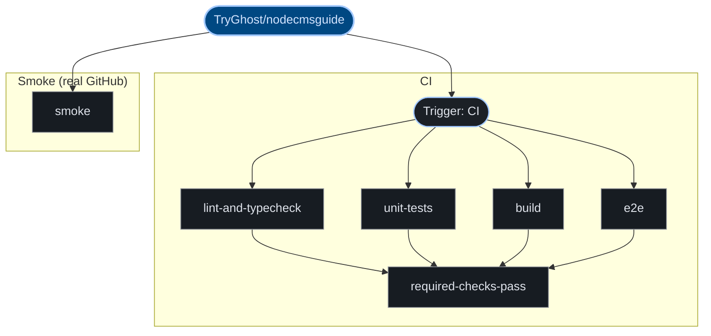

# Repository Architecture Analysis: TryGhost/nodecmsguide

## Metadata
- **SHA**: `da7da21f787c33451735486b99b19bc63b49a424`
- **Primary Ecosystem**: JavaScript/TypeScript

## Quality Metrics
- **ast_engine**: tree-sitter
- **avg_cognitive_complexity**: 2.32
- **avg_cyclomatic_complexity**: 3.1
- **component_count**: 4
- **dead_code_count**: 0
- **dead_code_symbols**: 0 entry(ies)
- **duplication_pct**: 69.18
- **file_complexities**: 16 entry(ies)
- **files_analyzed**: 16
- **fitness_passed**: False
- **fitness_violation_count**: 3
- **framework**: Astro
- **import_edges**: 94 entry(ies)
- **loc**: 1770
- **max_cognitive_complexity**: 29
- **max_cyclomatic_complexity**: 25
- **sloc**: 1470
- **test_file_count**: 7

# Architecture: TryGhost/nodecmsguide

## Context
- **Repository**: `TryGhost/nodecmsguide`
- **SHA**: `da7da21f787c33451735486b99b19bc63b49a424`
- **Ecosystem**: JavaScript/TypeScript
- **Framework**: Astro

## Building Block View

## Component Details
- **nodecmsguide** (`package.json`): MODULE
- **nodecmsguide-typecheck** (`tools/typecheck/package.json`): MODULE
- **ProjectFilter** (`src/components/ProjectFilter.tsx`): UI_COMPONENT
- **ShareButtons** (`src/components/ShareButtons.tsx`): UI_COMPONENT

## 6-Dimension Repository Scorecard

- **Overall Grade**: `C` (79.69/100)
- **Technical Debt Score**: 20.31
- **Estimated Remediation Effort**: 25.41h

| Dimension | Grade | Score | Weight | Details |
| :--- | :---: | :---: | :---: | :--- |
| Code Quality | `F` | 59.60 | 0.20 | avg_cc=3.10, max_cc=25, duplication=69.18%, dead_code=0 |
| Dependency Health | `B` | 85.00 | 0.15 | dependencies=25, outdated=0, vulnerable=0, has_lockfile=False |
| Maintainability | `D` | 63.50 | 0.15 | avg_cognitive=2.32, max_cognitive=29, fitness_violations=3, oversized_files=1 |
| Pipeline Health | `A` | 100.00 | 0.15 | workflows=2, operational_antipatterns=1, parallel_branches=True |
| Security | `A` | 100.00 | 0.20 | vulnerabilities=0, secrets=0, pipeline_security_findings=0 |
| Test Coverage | `C` | 70.00 | 0.15 | coverage=unavailable, ci_test_job=True, test_files_detected=True |

## Architecture Fitness & Workspace Boundaries

- **[MEDIUM] `ATRUSS-ARCH-005` (COMPLEXITY_THRESHOLD)**: Repository duplication_pct (69.18) exceeds policy threshold (15.0).
- **[MEDIUM] `ATRUSS-ARCH-005` (COMPLEXITY_THRESHOLD)**: Repository max_cognitive_complexity (29.0) exceeds policy threshold (25.0).
- **[MEDIUM] `ATRUSS-ARCH-005` (COMPLEXITY_THRESHOLD)**: Repository max_cyclomatic_complexity (25.0) exceeds policy threshold (20.0).

### Workspace Packages
- **nodecmsguide-typecheck** (`tools/typecheck`, react_ts_js, pnpm)

## Supply Chain Dependencies, Vulnerabilities & Secrets

- **Dependencies Parsed**: 25 | **Vulnerabilities**: 0 | **Secrets**: 0

### Inventory Sample
- `@astrojs/check` `0.9.12` (npm, `tools/typecheck/package.json`)
- `@astrojs/react` `7.1.8` (npm, `package.json`)
- `@octokit/rest` `22.0.1` (npm, `package.json`)
- `@playwright/test` `1.65.0` (npm, `package.json`)
- `@types/fs-extra` `11.0.4` (npm, `package.json`)
- `@types/lodash-es` `4.17.12` (npm, `package.json`)
- `@types/node` `26.6.6` (npm, `package.json`)
- `@types/react` `19.3.0` (npm, `package.json`)
- `@types/react-dom` `19.3.0` (npm, `package.json`)
- `@vitest/coverage-v8` `5.1.0` (npm, `package.json`)
- `astro` `7.4.11` (npm, `package.json`)
- `astro` `7.4.11` (npm, `tools/typecheck/package.json`)
- `date-fns` `4.4.0` (npm, `package.json`)
- `dotenv` `18.0.10` (npm, `package.json`)
- `fs-extra` `11.4.1` (npm, `package.json`)
- `lodash-es` `4.18.1` (npm, `package.json`)
- `oxfmt` `0.78.0` (npm, `package.json`)
- `oxlint` `1.93.0` (npm, `package.json`)
- `react` `19.3.1` (npm, `package.json`)
- `react-dom` `19.3.1` (npm, `package.json`)
- `react-share` `6.1.0` (npm, `package.json`)
- `slug` `12.0.1` (npm, `package.json`)
- `typescript` `6.0.3` (npm, `tools/typecheck/package.json`)
- `typescript` `7.0.2` (npm, `package.json`)
- `vitest` `5.1.0` (npm, `package.json`)

## CI/CD Pipeline Topology

