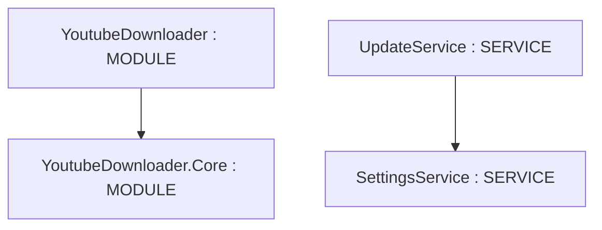

# Repository Architecture Analysis: Tyrrrz/YoutubeDownloader

## Metadata
- **SHA**: `a419ef2be70392e57d31bd5103f1d6d0d20b3919`
- **Primary Ecosystem**: .NET

## Quality Metrics
- **avg_cyclomatic_complexity**: 4.16
- **component_count**: 6
- **files_analyzed**: 136
- **framework**: ASP.NET Core
- **loc**: 10102
- **max_cyclomatic_complexity**: 32
- **sloc**: 8270

# Architecture: Tyrrrz/YoutubeDownloader

## Context
- **Repository**: `Tyrrrz/YoutubeDownloader`
- **SHA**: `a419ef2be70392e57d31bd5103f1d6d0d20b3919`
- **Ecosystem**: .NET
- **Framework**: Unknown

## Building Block View

## Component Details
- **YoutubeDownloader** (`YoutubeDownloader/YoutubeDownloader.csproj`): MODULE (deps: YoutubeDownloader.Core)
- **YoutubeDownloader.Core** (`YoutubeDownloader.Core/YoutubeDownloader.Core.csproj`): MODULE
- **SettingsService** (`YoutubeDownloader/Services/SettingsService.AuthCookiesEncryptionConverter.cs`): SERVICE
- **SettingsService** (`YoutubeDownloader/Services/SettingsService.ContainerConverter.cs`): SERVICE
- **SettingsService** (`YoutubeDownloader/Services/SettingsService.cs`): SERVICE
- **UpdateService** (`YoutubeDownloader/Services/UpdateService.cs`): SERVICE (deps: SettingsService)

## CI/CD Pipeline Topology

