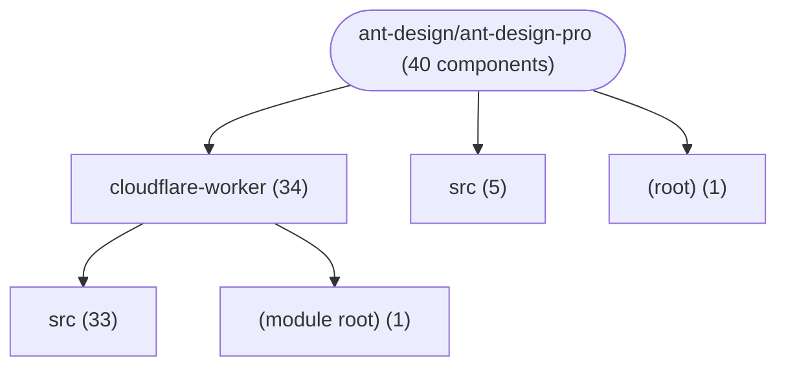
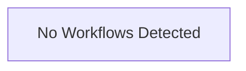

# Repository Architecture Analysis: ant-design/ant-design-pro

## Metadata
- **SHA**: `42f2cb1d303380909ea04c73b5e60679d09c321a`
- **Primary Ecosystem**: JavaScript/TypeScript

## Quality Metrics
- **avg_cyclomatic_complexity**: 2.83
- **component_count**: 40
- **files_analyzed**: 296
- **framework**: React (Vite)
- **loc**: 72068
- **max_cyclomatic_complexity**: 57
- **sloc**: 70217

# Architecture: ant-design/ant-design-pro

## Context
- **Repository**: `ant-design/ant-design-pro`
- **SHA**: `42f2cb1d303380909ea04c73b5e60679d09c321a`
- **Ecosystem**: JavaScript/TypeScript
- **Framework**: Unknown

## Building Block View

## Component Details
- **pro-api** (`cloudflare-worker/package.json`): MODULE
- **ant-design-pro** (`package.json`): MODULE
- **GET_api_auth_routes** (`cloudflare-worker/src/index.ts`): API_ROUTE (deps: GET_401, GET_403, GET_404, GET_500, GET_accountSettingCurrentUser, GET_activities, GET_advanced, GET_basic, GET_card_fake_list, GET_city_:province, GET_currentUser, GET_currentUserDetail, GET_fake_analysis_chart_data, GET_fake_list, GET_fake_list_Detail, GET_fake_workplace_chart_data, GET_get_list, GET_login_captcha, GET_map-geo, GET_map-grid, GET_notices, GET_project_notice, GET_province, GET_rule, GET_tags, GET_users, POST_login_account, POST_login_outLogin, POST_post_fake_list, POST_register, POST_rule)
- **GET_fake_analysis_chart_data** (`cloudflare-worker/src/routes/dashboard.ts`): API_ROUTE
- **GET_fake_workplace_chart_data** (`cloudflare-worker/src/routes/dashboard.ts`): API_ROUTE
- **GET_project_notice** (`cloudflare-worker/src/routes/dashboard.ts`): API_ROUTE
- **GET_activities** (`cloudflare-worker/src/routes/dashboard.ts`): API_ROUTE
- **GET_500** (`cloudflare-worker/src/routes/errors.ts`): API_ROUTE
- **GET_404** (`cloudflare-worker/src/routes/errors.ts`): API_ROUTE
- **GET_403** (`cloudflare-worker/src/routes/errors.ts`): API_ROUTE
- **GET_401** (`cloudflare-worker/src/routes/errors.ts`): API_ROUTE
- **GET_province** (`cloudflare-worker/src/routes/geographic.ts`): API_ROUTE
- **GET_city_:province** (`cloudflare-worker/src/routes/geographic.ts`): API_ROUTE
- **GET_get_list** (`cloudflare-worker/src/routes/list.ts`): API_ROUTE
- **POST_post_fake_list** (`cloudflare-worker/src/routes/list.ts`): API_ROUTE
- **GET_fake_list** (`cloudflare-worker/src/routes/list.ts`): API_ROUTE
- **GET_card_fake_list** (`cloudflare-worker/src/routes/list.ts`): API_ROUTE
- **GET_tags** (`cloudflare-worker/src/routes/list.ts`): API_ROUTE
- **GET_fake_list_Detail** (`cloudflare-worker/src/routes/list.ts`): API_ROUTE
- **GET_currentUserDetail** (`cloudflare-worker/src/routes/list.ts`): API_ROUTE
- **GET_tags** (`cloudflare-worker/src/routes/monitor.ts`): API_ROUTE
- **GET_map-geo** (`cloudflare-worker/src/routes/monitor.ts`): API_ROUTE
- **GET_map-grid** (`cloudflare-worker/src/routes/monitor.ts`): API_ROUTE
- **GET_notices** (`cloudflare-worker/src/routes/notices.ts`): API_ROUTE
- **GET_basic** (`cloudflare-worker/src/routes/profile.ts`): API_ROUTE
- **GET_advanced** (`cloudflare-worker/src/routes/profile.ts`): API_ROUTE
- **GET_accountSettingCurrentUser** (`cloudflare-worker/src/routes/settings.ts`): API_ROUTE
- **GET_rule** (`cloudflare-worker/src/routes/table.ts`): API_ROUTE
- **POST_rule** (`cloudflare-worker/src/routes/table.ts`): API_ROUTE
- **POST_login_account** (`cloudflare-worker/src/routes/user.ts`): API_ROUTE
- **POST_login_outLogin** (`cloudflare-worker/src/routes/user.ts`): API_ROUTE
- **GET_login_captcha** (`cloudflare-worker/src/routes/user.ts`): API_ROUTE
- **POST_register** (`cloudflare-worker/src/routes/user.ts`): API_ROUTE
- **GET_currentUser** (`cloudflare-worker/src/routes/user.ts`): API_ROUTE
- **GET_users** (`cloudflare-worker/src/routes/user.ts`): API_ROUTE
- **AvatarDropdown** (`src/components/RightContent/AvatarDropdown.tsx`): UI_COMPONENT
- **LangDropdown** (`src/components/RightContent/LangDropdown.tsx`): UI_COMPONENT
- **VersionDropdown** (`src/components/RightContent/VersionDropdown.tsx`): UI_COMPONENT
- **DocLink** (`src/components/RightContent/index.tsx`): UI_COMPONENT (deps: LangDropdown, VersionDropdown)
- **MonitorMap** (`src/pages/dashboard/monitor/components/Map/index.tsx`): UI_COMPONENT

## CI/CD Pipeline Topology

