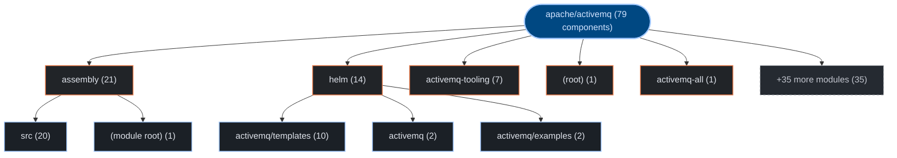
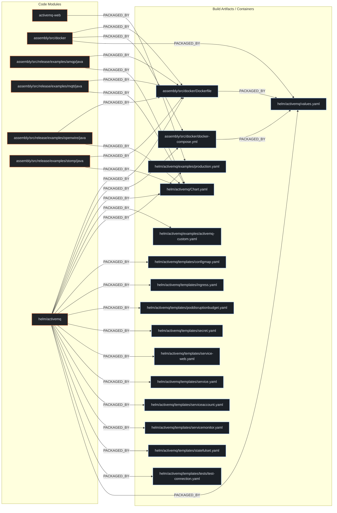
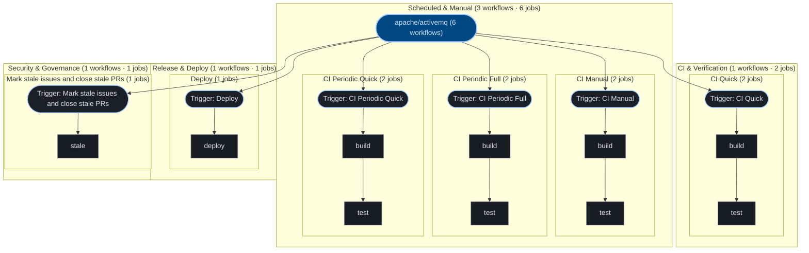

# Repository Architecture Analysis: apache/activemq

## Metadata
- **SHA**: `03a17a7f4c2a3136289141c29e5324fa033529d6`
- **Primary Ecosystem**: Java

## Quality Metrics
- **ast_engine**: tree-sitter
- **avg_cognitive_complexity**: 1.29
- **avg_cyclomatic_complexity**: 1.69
- **component_count**: 79
- **dead_code_count**: 24
- **dead_code_symbols**: 24 entry(ies)
- **duplication_pct**: 92.96
- **file_complexities**: 25 entry(ies)
- **files_analyzed**: 4613
- **fitness_passed**: False
- **fitness_violation_count**: 3
- **framework**: Java Maven/Gradle
- **import_edges**: 100 entry(ies)
- **loc**: 767705
- **max_cognitive_complexity**: 144
- **max_cyclomatic_complexity**: 68
- **sloc**: 474471
- **test_file_count**: 2692

# Architecture: apache/activemq

## Context
- **Repository**: `apache/activemq`
- **SHA**: `03a17a7f4c2a3136289141c29e5324fa033529d6`
- **Ecosystem**: Java
- **Framework**: Java Maven/Gradle

## Building Block View

## Component Details

Showing top 60 representative components out of 79 across 40 module group(s):

- **Module `assembly`** (21 components — MODULE: 20, module: 1)
- **Module `helm`** (14 components — module: 14)
- **Module `activemq-tooling`** (7 components — MODULE: 7)
- **Module `(root)`** (1 components — MODULE: 1)
- **Module `activemq-all`** (1 components — MODULE: 1)
- **Module `activemq-amqp`** (1 components — MODULE: 1)
- **Module `activemq-blueprint`** (1 components — MODULE: 1)
- **Module `activemq-broker`** (1 components — MODULE: 1)
- **Module `activemq-cf`** (1 components — MODULE: 1)
- **Module `activemq-client`** (1 components — MODULE: 1)
- **Module `activemq-console`** (1 components — MODULE: 1)
- **Module `activemq-http`** (1 components — MODULE: 1)

- **Chart** (`helm/activemq/Chart.yaml`): module
- **Listener** (`assembly/src/release/examples/openwire/csharp/ActiveMQExamples/Listener/Listener.csproj`): MODULE
- **Listener** (`assembly/src/release/examples/stomp/csharp/ActiveMQExamples/Listener/Listener.csproj`): MODULE
- **Publisher** (`assembly/src/release/examples/openwire/csharp/ActiveMQExamples/Publisher/Publisher.csproj`): MODULE
- **Publisher** (`assembly/src/release/examples/stomp/csharp/ActiveMQExamples/Publisher/Publisher.csproj`): MODULE
- **activemq-all** (`activemq-all/pom.xml`): MODULE
- **activemq-amqp** (`activemq-amqp/pom.xml`): MODULE
- **activemq-blueprint** (`activemq-blueprint/pom.xml`): MODULE
- **activemq-bom** (`bom/pom.xml`): MODULE
- **activemq-broker** (`activemq-broker/pom.xml`): MODULE
- **activemq-cf** (`activemq-cf/pom.xml`): MODULE
- **activemq-client** (`activemq-client/pom.xml`): MODULE
- **activemq-console** (`activemq-console/pom.xml`): MODULE
- **activemq-custom** (`helm/activemq/examples/activemq-custom.yaml`): module
- **activemq-http** (`activemq-http/pom.xml`): MODULE
- **activemq-jaas** (`activemq-jaas/pom.xml`): MODULE
- **activemq-jaas-oauth2** (`activemq-jaas-oauth2/pom.xml`): MODULE
- **activemq-jakarta-messaging-tck** (`activemq-tooling/activemq-jakarta-messaging-tck/pom.xml`): MODULE
- **activemq-jdbc-store** (`activemq-jdbc-store/pom.xml`): MODULE
- **activemq-jms-pool** (`activemq-jms-pool/pom.xml`): MODULE
- **activemq-joram-jms-tests** (`activemq-tooling/activemq-joram-jms-tests/pom.xml`): MODULE
- **activemq-junit** (`activemq-tooling/activemq-junit/pom.xml`): MODULE
- **activemq-kahadb-store** (`activemq-kahadb-store/pom.xml`): MODULE
- **activemq-karaf** (`activemq-karaf/pom.xml`): MODULE
- **activemq-karaf-itest** (`activemq-karaf-itest/pom.xml`): MODULE
- **activemq-log4j-appender** (`activemq-log4j-appender/pom.xml`): MODULE
- **activemq-maven-plugin** (`activemq-tooling/activemq-maven-plugin/pom.xml`): MODULE
- **activemq-memtest-maven-plugin** (`activemq-tooling/activemq-memtest-maven-plugin/pom.xml`): MODULE
- **activemq-mqtt** (`activemq-mqtt/pom.xml`): MODULE
- **activemq-opentelemetry** (`activemq-opentelemetry/pom.xml`): MODULE
- **activemq-openwire-generator** (`activemq-openwire-generator/pom.xml`): MODULE
- **activemq-openwire-legacy** (`activemq-openwire-legacy/pom.xml`): MODULE
- **activemq-osgi** (`activemq-osgi/pom.xml`): MODULE
- **activemq-parent** (`pom.xml`): MODULE
- **activemq-perf-maven-plugin** (`activemq-tooling/activemq-perf-maven-plugin/pom.xml`): MODULE
- **activemq-pool** (`activemq-pool/pom.xml`): MODULE
- **activemq-protobuf** (`activemq-protobuf/pom.xml`): MODULE
- **activemq-protobuf-test** (`activemq-protobuf-test/pom.xml`): MODULE
- **activemq-ra** (`activemq-ra/pom.xml`): MODULE
- **activemq-rar** (`activemq-rar/pom.xml`): MODULE
- **activemq-run** (`activemq-run/pom.xml`): MODULE
- **activemq-runtime-config** (`activemq-runtime-config/pom.xml`): MODULE
- **activemq-shiro** (`activemq-shiro/pom.xml`): MODULE
- **activemq-spring** (`activemq-spring/pom.xml`): MODULE
- **activemq-stomp** (`activemq-stomp/pom.xml`): MODULE
- **activemq-tooling** (`activemq-tooling/pom.xml`): MODULE
- **activemq-unit-tests** (`activemq-unit-tests/pom.xml`): MODULE
- **activemq-web** (`activemq-web/pom.xml`): MODULE
- **activemq-web-console** (`activemq-web-console/pom.xml`): MODULE
- **activemq-web-demo** (`activemq-web-demo/pom.xml`): MODULE
- **advanced-openwire-example** (`assembly/src/release/examples/openwire/advanced-scenarios/pom.xml`): MODULE
- **amqp-example** (`assembly/src/release/examples/amqp/java/pom.xml`): MODULE
- **apache-activemq** (`assembly/pom.xml`): MODULE
- **configmap** (`helm/activemq/templates/configmap.yaml`): module
- **docker-compose** (`assembly/src/docker/docker-compose.yml`): module
- **ingress** (`helm/activemq/templates/ingress.yaml`): module
- **jms-example-composite-destinations** (`assembly/src/release/examples/openwire/advanced-scenarios/jms-example-composite-destinations/pom.xml`): MODULE
- **jms-example-durable-sub** (`assembly/src/release/examples/openwire/advanced-scenarios/jms-example-durable-sub/pom.xml`): MODULE
- **jms-example-exclusive-consumer** (`assembly/src/release/examples/openwire/advanced-scenarios/jms-example-exclusive-consumer/pom.xml`): MODULE
- **jms-example-message-browser** (`assembly/src/release/examples/openwire/advanced-scenarios/jms-example-message-browser/pom.xml`): MODULE

## 6-Dimension Repository Scorecard

- **Overall Grade**: `D` (61.55/100)
- **Technical Debt Score**: 38.45
- **Estimated Remediation Effort**: 82.70h

| Dimension | Grade | Score | Weight | Details |
| :--- | :---: | :---: | :---: | :--- |
| Code Quality | `F` | 30.00 | 0.20 | avg_cc=1.69, max_cc=68, duplication=92.96%, dead_code=24 |
| Dependency Health | `B` | 85.00 | 0.15 | dependencies=639, outdated=0, vulnerable=0, has_lockfile=False |
| Maintainability | `F` | 37.00 | 0.15 | avg_cognitive=1.29, max_cognitive=144, fitness_violations=3, oversized_files=25 |
| Pipeline Health | `C` | 77.00 | 0.15 | workflows=6, operational_antipatterns=2, parallel_branches=False |
| Security | `C` | 76.00 | 0.20 | vulnerabilities=0, secrets=0, pipeline_security_findings=4 |
| Test Coverage | `C` | 70.00 | 0.15 | coverage=unavailable, ci_test_job=True, test_files_detected=True |

## Architecture Fitness & Workspace Boundaries

- **[MEDIUM] `ATRUSS-ARCH-005` (COMPLEXITY_THRESHOLD)**: Repository duplication_pct (92.96) exceeds policy threshold (15.0).
- **[MEDIUM] `ATRUSS-ARCH-005` (COMPLEXITY_THRESHOLD)**: Repository max_cognitive_complexity (144.0) exceeds policy threshold (25.0).
- **[MEDIUM] `ATRUSS-ARCH-005` (COMPLEXITY_THRESHOLD)**: Repository max_cyclomatic_complexity (68.0) exceeds policy threshold (20.0).

## Supply Chain Dependencies, Vulnerabilities & Secrets

- **Dependencies Parsed**: 639 | **Vulnerabilities**: 0 | **Secrets**: 0

### Inventory Sample
- `${project.groupId}:activemq-all` `*` (Maven, `activemq-web/pom.xml`)
- `${project.groupId}:activemq-all` `*` (Maven, `assembly/pom.xml`)
- `${project.groupId}:activemq-amqp` `*` (Maven, `activemq-all/pom.xml`)
- `${project.groupId}:activemq-amqp` `*` (Maven, `activemq-osgi/pom.xml`)
- `${project.groupId}:activemq-amqp` `*` (Maven, `assembly/pom.xml`)
- `${project.groupId}:activemq-broker` `*` (Maven, `activemq-console/pom.xml`)
- `${project.groupId}:activemq-broker` `*` (Maven, `activemq-http/pom.xml`)
- `${project.groupId}:activemq-broker` `*` (Maven, `activemq-jms-pool/pom.xml`)
- `${project.groupId}:activemq-broker` `*` (Maven, `activemq-kahadb-store/pom.xml`)
- `${project.groupId}:activemq-broker` `*` (Maven, `activemq-mqtt/pom.xml`)
- `${project.groupId}:activemq-broker` `*` (Maven, `activemq-opentelemetry/pom.xml`)
- `${project.groupId}:activemq-broker` `*` (Maven, `activemq-opentelemetry/pom.xml`)
- `${project.groupId}:activemq-broker` `*` (Maven, `activemq-osgi/pom.xml`)
- `${project.groupId}:activemq-broker` `*` (Maven, `activemq-pool/pom.xml`)
- `${project.groupId}:activemq-broker` `*` (Maven, `activemq-pool/pom.xml`)
- `${project.groupId}:activemq-broker` `*` (Maven, `activemq-shiro/pom.xml`)
- `${project.groupId}:activemq-broker` `*` (Maven, `activemq-shiro/pom.xml`)
- `${project.groupId}:activemq-broker` `*` (Maven, `activemq-spring/pom.xml`)
- `${project.groupId}:activemq-broker` `*` (Maven, `activemq-stomp/pom.xml`)
- `${project.groupId}:activemq-broker` `*` (Maven, `activemq-stomp/pom.xml`)
- `${project.groupId}:activemq-broker` `*` (Maven, `activemq-unit-tests/pom.xml`)
- `${project.groupId}:activemq-broker` `*` (Maven, `activemq-web-console/pom.xml`)
- `${project.groupId}:activemq-broker` `*` (Maven, `activemq-web-demo/pom.xml`)
- `${project.groupId}:activemq-broker` `*` (Maven, `activemq-web/pom.xml`)
- `${project.groupId}:activemq-broker` `*` (Maven, `assembly/pom.xml`)
- `${project.groupId}:activemq-client` `*` (Maven, `activemq-jaas-oauth2/pom.xml`)
- `${project.groupId}:activemq-client` `*` (Maven, `activemq-pool/pom.xml`)
- `${project.groupId}:activemq-client` `*` (Maven, `assembly/pom.xml`)
- `${project.groupId}:activemq-console` `*` (Maven, `activemq-all/pom.xml`)
- `${project.groupId}:activemq-console` `*` (Maven, `activemq-osgi/pom.xml`)
- ... (+609 more dependencies)

## Section 7: Code-to-Cloud Deployment Traceability

- `activemq-web` (code_module) --[PACKAGED_BY]--> `helm/activemq/examples/production.yaml` (iac)
- `assembly/src/docker` (code_module) --[PACKAGED_BY]--> `assembly/src/docker/Dockerfile` (container)
- `assembly/src/docker` (code_module) --[PACKAGED_BY]--> `assembly/src/docker/docker-compose.yml` (container)
- `assembly/src/docker` (code_module) --[PACKAGED_BY]--> `helm/activemq/values.yaml` (iac)
- `assembly/src/release/examples/amqp/java` (code_module) --[PACKAGED_BY]--> `assembly/src/docker/Dockerfile` (container)
- `assembly/src/release/examples/amqp/java` (code_module) --[PACKAGED_BY]--> `helm/activemq/Chart.yaml` (iac)
- `assembly/src/release/examples/mqtt/java` (code_module) --[PACKAGED_BY]--> `assembly/src/docker/Dockerfile` (container)
- `assembly/src/release/examples/mqtt/java` (code_module) --[PACKAGED_BY]--> `helm/activemq/Chart.yaml` (iac)
- `assembly/src/release/examples/openwire/java` (code_module) --[PACKAGED_BY]--> `assembly/src/docker/Dockerfile` (container)
- `assembly/src/release/examples/openwire/java` (code_module) --[PACKAGED_BY]--> `helm/activemq/Chart.yaml` (iac)
- `assembly/src/release/examples/stomp/java` (code_module) --[PACKAGED_BY]--> `assembly/src/docker/Dockerfile` (container)
- `assembly/src/release/examples/stomp/java` (code_module) --[PACKAGED_BY]--> `helm/activemq/Chart.yaml` (iac)
- `helm/activemq` (code_module) --[PACKAGED_BY]--> `assembly/src/docker/Dockerfile` (container)
- `helm/activemq` (code_module) --[PACKAGED_BY]--> `assembly/src/docker/docker-compose.yml` (container)
- `helm/activemq` (code_module) --[PACKAGED_BY]--> `helm/activemq/Chart.yaml` (iac)
- `helm/activemq` (code_module) --[PACKAGED_BY]--> `helm/activemq/examples/activemq-custom.yaml` (iac)
- `helm/activemq` (code_module) --[PACKAGED_BY]--> `helm/activemq/examples/production.yaml` (iac)
- `helm/activemq` (code_module) --[PACKAGED_BY]--> `helm/activemq/templates/configmap.yaml` (iac)
- `helm/activemq` (code_module) --[PACKAGED_BY]--> `helm/activemq/templates/ingress.yaml` (iac)
- `helm/activemq` (code_module) --[PACKAGED_BY]--> `helm/activemq/templates/poddisruptionbudget.yaml` (iac)
- `helm/activemq` (code_module) --[PACKAGED_BY]--> `helm/activemq/templates/secret.yaml` (iac)
- `helm/activemq` (code_module) --[PACKAGED_BY]--> `helm/activemq/templates/service-web.yaml` (iac)
- `helm/activemq` (code_module) --[PACKAGED_BY]--> `helm/activemq/templates/service.yaml` (iac)
- `helm/activemq` (code_module) --[PACKAGED_BY]--> `helm/activemq/templates/serviceaccount.yaml` (iac)
- `helm/activemq` (code_module) --[PACKAGED_BY]--> `helm/activemq/templates/servicemonitor.yaml` (iac)
- `helm/activemq` (code_module) --[PACKAGED_BY]--> `helm/activemq/templates/statefulset.yaml` (iac)
- `helm/activemq` (code_module) --[PACKAGED_BY]--> `helm/activemq/templates/tests/test-connection.yaml` (iac)
- `helm/activemq` (code_module) --[PACKAGED_BY]--> `helm/activemq/values.yaml` (iac)
- `assembly/src/docker/Dockerfile` (container) --[PACKAGED_BY]--> `helm/activemq/values.yaml` (iac)
- `assembly/src/docker/docker-compose.yml` (container) --[PACKAGED_BY]--> `helm/activemq/values.yaml` (iac)

## CI/CD Pipeline Topology

