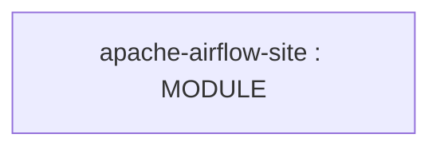
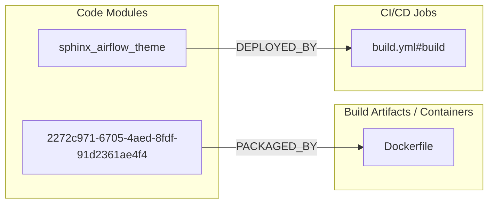
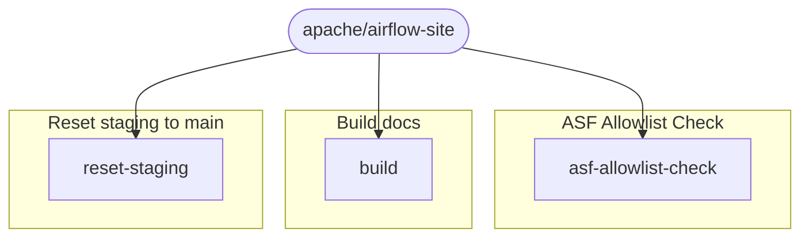

# Repository Architecture Analysis: apache/airflow-site

## Metadata
- **SHA**: `6da43e3d9ad9ccdd3c7505e457e1d9c6f9e31594`
- **Primary Ecosystem**: JavaScript/TypeScript

## Quality Metrics
- **ast_engine**: tree-sitter
- **avg_cognitive_complexity**: 3.4
- **avg_cyclomatic_complexity**: 3.5
- **component_count**: 1
- **dead_code_count**: 16
- **dead_code_symbols**: 16 entry(ies)
- **duplication_pct**: 77.21
- **file_complexities**: 25 entry(ies)
- **files_analyzed**: 38
- **fitness_passed**: False
- **fitness_violation_count**: 3
- **framework**: Unknown
- **import_edges**: 100 entry(ies)
- **loc**: 2384
- **max_cognitive_complexity**: 133
- **max_cyclomatic_complexity**: 64
- **sloc**: 1443

# Architecture: apache/airflow-site

## Context
- **Repository**: `apache/airflow-site`
- **SHA**: `6da43e3d9ad9ccdd3c7505e457e1d9c6f9e31594`
- **Ecosystem**: JavaScript/TypeScript
- **Framework**: Unknown

## Building Block View

## Component Details
- **apache-airflow-site** (`landing-pages/package.json`): MODULE

## 6-Dimension Repository Scorecard

- **Overall Grade**: `D` (65.80/100)
- **Technical Debt Score**: 34.20
- **Estimated Remediation Effort**: 39.49h

| Dimension | Grade | Score | Weight | Details |
| :--- | :---: | :---: | :---: | :--- |
| Code Quality | `F` | 28.00 | 0.20 | avg_cc=3.50, max_cc=64, duplication=77.21%, dead_code=16 |
| Dependency Health | `A` | 100.00 | 0.15 | dependencies=1058, outdated=0, vulnerable=0, has_lockfile=True |
| Maintainability | `F` | 57.00 | 0.15 | avg_cognitive=3.40, max_cognitive=133, fitness_violations=3, oversized_files=0 |
| Pipeline Health | `D` | 65.00 | 0.15 | workflows=3, operational_antipatterns=5, parallel_branches=False |
| Security | `B` | 82.00 | 0.20 | vulnerabilities=0, secrets=0, pipeline_security_findings=2 |
| Test Coverage | `C` | 70.00 | 0.15 | coverage=unavailable, ci_test_job=True, test_files_detected=False |

## Architecture Fitness & Workspace Boundaries

- **[MEDIUM] `ATRUSS-ARCH-005` (COMPLEXITY_THRESHOLD)**: Repository duplication_pct (77.21) exceeds policy threshold (15.0).
- **[MEDIUM] `ATRUSS-ARCH-005` (COMPLEXITY_THRESHOLD)**: Repository max_cognitive_complexity (133.0) exceeds policy threshold (25.0).
- **[MEDIUM] `ATRUSS-ARCH-005` (COMPLEXITY_THRESHOLD)**: Repository max_cyclomatic_complexity (64.0) exceeds policy threshold (20.0).

## Supply Chain Dependencies, Vulnerabilities & Secrets

- **Dependencies Parsed**: 1058 | **Vulnerabilities**: 0 | **Secrets**: 0

### Inventory Sample
- `sphinx` `7` (PyPI, `sphinx_airflow_theme/pyproject.toml`)
- `sphinx` `7.4.7` (PyPI, `sphinx_airflow_theme/uv.lock`)
- `sphinx` `8.1.3` (PyPI, `sphinx_airflow_theme/uv.lock`)
- `sphinx` `8.2.3` (PyPI, `sphinx_airflow_theme/uv.lock`)
- `@babel/core` `8.1.0` (npm, `landing-pages/package-lock.json`)
- `@babel/core` `8.1.0` (npm, `landing-pages/package.json`)
- `@babel/preset-env` `8.0.7` (npm, `landing-pages/package-lock.json`)
- `@babel/preset-env` `8.0.7` (npm, `landing-pages/package.json`)
- `@babel/register` `8.0.6` (npm, `landing-pages/package-lock.json`)
- `@babel/register` `8.0.6` (npm, `landing-pages/package.json`)
- `@eslint/js` `10.0.1` (npm, `landing-pages/package-lock.json`)
- `@eslint/js` `10.0.1` (npm, `landing-pages/package.json`)
- `assets-webpack-plugin` `7.1.1` (npm, `landing-pages/package-lock.json`)
- `assets-webpack-plugin` `7.1.1` (npm, `landing-pages/package.json`)
- `autoprefixer` `10.6.2` (npm, `landing-pages/package-lock.json`)
- `autoprefixer` `10.6.2` (npm, `landing-pages/package.json`)
- `babel-loader` `10.1.1` (npm, `landing-pages/package-lock.json`)
- `babel-loader` `10.1.1` (npm, `landing-pages/package.json`)
- `clean-webpack-plugin` `4.0.0` (npm, `landing-pages/package-lock.json`)
- `clean-webpack-plugin` `4.0.0` (npm, `landing-pages/package.json`)
- `cross-env` `10.1.0` (npm, `landing-pages/package-lock.json`)
- `cross-env` `10.1.0` (npm, `landing-pages/package.json`)
- `css-loader` `7.1.5` (npm, `landing-pages/package-lock.json`)
- `css-loader` `7.1.5` (npm, `landing-pages/package.json`)
- `css-minimizer-webpack-plugin` `8.0.0` (npm, `landing-pages/package-lock.json`)
- `css-minimizer-webpack-plugin` `8.0.0` (npm, `landing-pages/package.json`)
- `eslint` `10.14.0` (npm, `landing-pages/package-lock.json`)
- `eslint` `10.14.0` (npm, `landing-pages/package.json`)
- `eslint-plugin-import` `2.32.0` (npm, `landing-pages/package-lock.json`)
- `eslint-plugin-import` `2.32.0` (npm, `landing-pages/package.json`)
- ... (+1028 more dependencies)

## Section 7: Code-to-Cloud Deployment Traceability

- `2272c971-6705-4aed-8fdf-91d2361ae4f4` (code_module) --[PACKAGED_BY]--> `Dockerfile` (container)
- `sphinx_airflow_theme` (code_module) --[DEPLOYED_BY]--> `build.yml#build` (ci_job)

## CI/CD Pipeline Topology

