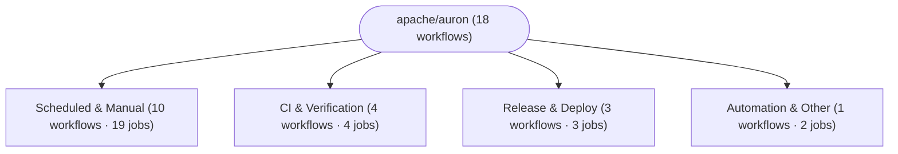

# Repository Architecture Analysis: apache/auron

## Metadata
- **SHA**: `40a7b7febe8cfe3201ef5e954b3a08c3cdb8c9cd`
- **Primary Ecosystem**: Java

## Quality Metrics
- **ast_engine**: tree-sitter
- **avg_cognitive_complexity**: 0.59
- **avg_cyclomatic_complexity**: 1.47
- **component_count**: 232
- **dead_code_count**: 0
- **dead_code_symbols**: 0 entry(ies)
- **duplication_pct**: 19.53
- **file_complexities**: 25 entry(ies)
- **files_analyzed**: 343
- **fitness_passed**: False
- **fitness_violation_count**: 3
- **framework**: Java Maven/Gradle
- **import_edges**: 100 entry(ies)
- **loc**: 96806
- **max_cognitive_complexity**: 40
- **max_cyclomatic_complexity**: 34
- **sloc**: 74680
- **test_file_count**: 591

# Architecture: apache/auron

## Context
- **Repository**: `apache/auron`
- **SHA**: `40a7b7febe8cfe3201ef5e954b3a08c3cdb8c9cd`
- **Ecosystem**: Java
- **Framework**: Java Maven/Gradle

## Building Block View

```mermaid
graph TD;
    repo_root(["apache/auron (232 components)"])
    dir_0_native_engine["native-engine (201)"]
    repo_root --> dir_0_native_engine
    sub_0_0_datafusion_ext_plans["datafusion-ext-plans (109)"]
    dir_0_native_engine --> sub_0_0_datafusion_ext_plans
    sub_0_1_datafusion_ext_commons["datafusion-ext-commons (29)"]
    dir_0_native_engine --> sub_0_1_datafusion_ext_commons
    sub_0_2_datafusion_ext_functions["datafusion-ext-functions (24)"]
    dir_0_native_engine --> sub_0_2_datafusion_ext_functions
    sub_0_more["+5 more submodules (39)"]
    dir_0_native_engine --> sub_0_more
    dir_1_auron_spark_tests["auron-spark-tests (9)"]
    repo_root --> dir_1_auron_spark_tests
    sub_1_0__module_root_["(module root) (1)"]
    dir_1_auron_spark_tests --> sub_1_0__module_root_
    sub_1_1_common["common (1)"]
    dir_1_auron_spark_tests --> sub_1_1_common
    sub_1_2_spark31["spark31 (1)"]
    dir_1_auron_spark_tests --> sub_1_2_spark31
    sub_1_more["+6 more submodules (6)"]
    dir_1_auron_spark_tests --> sub_1_more
    dir_2_thirdparty["thirdparty (6)"]
    repo_root --> dir_2_thirdparty
    dir_3_auron_flink_extension["auron-flink-extension (4)"]
    repo_root --> dir_3_auron_flink_extension
    dir_4_dev["dev (4)"]
    repo_root --> dir_4_dev
    dir_other_modules["+8 more modules (8)"]
    repo_root --> dir_other_modules
```

## Component Details

Showing top 60 representative components out of 232 across 13 module group(s):

- **Module `native-engine`** (201 components — module: 201)
- **Module `auron-spark-tests`** (9 components — MODULE: 9)
- **Module `thirdparty`** (6 components — MODULE: 6)
- **Module `auron-flink-extension`** (4 components — MODULE: 4)
- **Module `dev`** (4 components — MODULE: 3, module: 1)
- **Module `(root)`** (1 components — MODULE: 1)
- **Module `auron-core`** (1 components — MODULE: 1)
- **Module `auron-spark-ui`** (1 components — MODULE: 1)
- **Module `common`** (1 components — MODULE: 1)
- **Module `hadoop-shim`** (1 components — MODULE: 1)
- **Module `spark-extension`** (1 components — MODULE: 1)
- **Module `spark-extension-shims-spark`** (1 components — MODULE: 1)

- **acc** (`native-engine/datafusion-ext-plans/src/agg/acc.rs`): module
- **adapters** (`native-engine/datafusion-ext-functions/src/adapters.rs`): module
- **agg** (`native-engine/datafusion-ext-plans/src/agg/agg.rs`): module
- **agg_ctx** (`native-engine/datafusion-ext-plans/src/agg/agg_ctx.rs`): module
- **agg_exec** (`native-engine/datafusion-ext-plans/src/agg_exec.rs`): module
- **agg_hash_map** (`native-engine/datafusion-ext-plans/src/agg/agg_hash_map.rs`): module
- **agg_idx_cache** (`native-engine/datafusion-ext-plans/benches/agg_idx_cache.rs`): module
- **agg_processor** (`native-engine/datafusion-ext-plans/src/window/processors/agg_processor.rs`): module
- **agg_table** (`native-engine/datafusion-ext-plans/src/agg/agg_table.rs`): module
- **alloc** (`native-engine/auron/src/alloc.rs`): module
- **array_size** (`native-engine/datafusion-ext-commons/src/arrow/array_size.rs`): module
- **array_union** (`native-engine/datafusion-ext-functions/src/brickhouse/array_union.rs`): module
- **auron-${shimName}_${scalaVersion}** (`dev/mvn-build-helper/assembly/pom.xml`): MODULE
- **auron-celeborn_${scalaVersion}** (`thirdparty/auron-celeborn-0.5/pom.xml`): MODULE
- **auron-celeborn_${scalaVersion}** (`thirdparty/auron-celeborn-0.6/pom.xml`): MODULE
- **auron-common_${scalaVersion}** (`common/pom.xml`): MODULE
- **auron-core** (`auron-core/pom.xml`): MODULE
- **auron-flink-assembly** (`auron-flink-extension/auron-flink-assembly/pom.xml`): MODULE
- **auron-flink-extension** (`auron-flink-extension/pom.xml`): MODULE
- **auron-flink-planner** (`auron-flink-extension/auron-flink-planner/pom.xml`): MODULE
- **auron-flink-runtime** (`auron-flink-extension/auron-flink-runtime/pom.xml`): MODULE
- **auron-hudi_${scalaVersion}** (`thirdparty/auron-hudi/pom.xml`): MODULE
- **auron-iceberg_${scalaVersion}** (`thirdparty/auron-iceberg/pom.xml`): MODULE
- **auron-it-${shimName}_${scalaVersion}** (`dev/auron-it/pom.xml`): MODULE
- **auron-paimon_${scalaVersion}** (`thirdparty/auron-paimon/pom.xml`): MODULE
- **auron-parent_${scalaVersion}** (`pom.xml`): MODULE
- **auron-spark-tests** (`auron-spark-tests/pom.xml`): MODULE
- **auron-spark-tests-common** (`auron-spark-tests/common/pom.xml`): MODULE
- **auron-spark-tests-spark31** (`auron-spark-tests/spark31/pom.xml`): MODULE
- **auron-spark-tests-spark32** (`auron-spark-tests/spark32/pom.xml`): MODULE
- **auron-spark-tests-spark33** (`auron-spark-tests/spark33/pom.xml`): MODULE
- **auron-spark-tests-spark34** (`auron-spark-tests/spark34/pom.xml`): MODULE
- **auron-spark-tests-spark35** (`auron-spark-tests/spark35/pom.xml`): MODULE
- **auron-spark-tests-spark40** (`auron-spark-tests/spark40/pom.xml`): MODULE
- **auron-spark-tests-spark41** (`auron-spark-tests/spark41/pom.xml`): MODULE
- **auron-spark-ui_${scalaVersion}** (`auron-spark-ui/pom.xml`): MODULE
- **auron-uniffle_${scalaVersion}** (`thirdparty/auron-uniffle/pom.xml`): MODULE
- **avg** (`native-engine/datafusion-ext-plans/src/agg/avg.rs`): module
- **batch_serde** (`native-engine/datafusion-ext-commons/src/io/batch_serde.rs`): module
- **bloom_filter** (`native-engine/datafusion-ext-plans/src/agg/bloom_filter.rs`): module
- **bloom_filter_might_contain** (`native-engine/datafusion-ext-exprs/src/bloom_filter_might_contain.rs`): module
- **boolean** (`native-engine/datafusion-ext-commons/src/arrow/boolean.rs`): module
- **broadcast_join_build_hash_map_exec** (`native-engine/datafusion-ext-plans/src/broadcast_join_build_hash_map_exec.rs`): module
- **broadcast_join_exec** (`native-engine/datafusion-ext-plans/src/broadcast_join_exec.rs`): module
- **bucket_repartitioner** (`native-engine/datafusion-ext-plans/src/joins/bucket_repartitioner.rs`): module
- **bucketed_group** (`native-engine/datafusion-ext-plans/src/joins/bucketed_group.rs`): module
- **buffered_data** (`native-engine/datafusion-ext-plans/src/shuffle/buffered_data.rs`): module
- **build** (`native-engine/auron-planner/build.rs`): module
- **cached_exprs_evaluator** (`native-engine/datafusion-ext-plans/src/common/cached_exprs_evaluator.rs`): module
- **cast** (`native-engine/datafusion-ext-commons/src/arrow/cast.rs`): module
- **cast** (`native-engine/datafusion-ext-exprs/src/cast.rs`): module
- **coalesce** (`native-engine/datafusion-ext-commons/src/arrow/coalesce.rs`): module
- **collect** (`native-engine/datafusion-ext-plans/src/agg/brickhouse/collect.rs`): module
- **collect** (`native-engine/datafusion-ext-plans/src/agg/collect.rs`): module
- **column_pruning** (`native-engine/datafusion-ext-plans/src/common/column_pruning.rs`): module
- **combine_unique** (`native-engine/datafusion-ext-plans/src/agg/brickhouse/combine_unique.rs`): module
- **conf** (`native-engine/auron-jni-bridge/src/conf.rs`): module
- **count** (`native-engine/datafusion-ext-plans/src/agg/count.rs`): module
- **cume_dist_processor** (`native-engine/datafusion-ext-plans/src/window/processors/cume_dist_processor.rs`): module
- **debug_exec** (`native-engine/datafusion-ext-plans/src/debug_exec.rs`): module

## 6-Dimension Repository Scorecard

- **Overall Grade**: `F` (44.20/100)
- **Technical Debt Score**: 55.80
- **Estimated Remediation Effort**: 96.36h

| Dimension | Grade | Score | Weight | Details |
| :--- | :---: | :---: | :---: | :--- |
| Code Quality | `F` | 50.00 | 0.20 | avg_cc=1.47, max_cc=34, duplication=19.53%, dead_code=0 |
| Dependency Health | `A` | 100.00 | 0.15 | dependencies=851, outdated=0, vulnerable=0, has_lockfile=True |
| Maintainability | `F` | 37.00 | 0.15 | avg_cognitive=0.59, max_cognitive=40, fitness_violations=3, oversized_files=5 |
| Pipeline Health | `F` | 21.00 | 0.15 | workflows=18, operational_antipatterns=28, parallel_branches=True |
| Security | `F` | 0.00 | 0.20 | vulnerabilities=0, secrets=0, pipeline_security_findings=36 |
| Test Coverage | `C` | 70.00 | 0.15 | coverage=unavailable, ci_test_job=True, test_files_detected=True |

## Architecture Fitness & Workspace Boundaries

- **[MEDIUM] `ATRUSS-ARCH-005` (COMPLEXITY_THRESHOLD)**: Repository duplication_pct (19.53) exceeds policy threshold (15.0).
- **[MEDIUM] `ATRUSS-ARCH-005` (COMPLEXITY_THRESHOLD)**: Repository max_cognitive_complexity (40.0) exceeds policy threshold (25.0).
- **[MEDIUM] `ATRUSS-ARCH-005` (COMPLEXITY_THRESHOLD)**: Repository max_cyclomatic_complexity (34.0) exceeds policy threshold (20.0).

### Workspace Packages
- **auron** (`native-engine/auron`, rust, cargo) -> internal deps: `auron-jni-bridge, auron-memmgr, auron-planner, datafusion-ext-commons, datafusion-ext-plans`
- **auron-jni-bridge** (`native-engine/auron-jni-bridge`, rust, cargo)
- **auron-memmgr** (`native-engine/auron-memmgr`, rust, cargo) -> internal deps: `auron-jni-bridge, datafusion-ext-commons`
- **auron-planner** (`native-engine/auron-planner`, rust, cargo) -> internal deps: `datafusion-ext-exprs, datafusion-ext-functions, datafusion-ext-plans`
- **datafusion-ext-commons** (`native-engine/datafusion-ext-commons`, rust, cargo) -> internal deps: `auron-jni-bridge`
- **datafusion-ext-exprs** (`native-engine/datafusion-ext-exprs`, rust, cargo) -> internal deps: `auron-jni-bridge, datafusion-ext-commons`
- **datafusion-ext-functions** (`native-engine/datafusion-ext-functions`, rust, cargo) -> internal deps: `auron-jni-bridge, datafusion-ext-commons`
- **datafusion-ext-plans** (`native-engine/datafusion-ext-plans`, rust, cargo) -> internal deps: `auron-jni-bridge, auron-memmgr, datafusion-ext-commons, datafusion-ext-exprs, datafusion-ext-functions`

## Supply Chain Dependencies, Vulnerabilities & Secrets

- **Dependencies Parsed**: 851 | **Vulnerabilities**: 0 | **Secrets**: 0

### Inventory Sample
- `com.github.scopt:scopt_${scalaVersion}` `4.1.0` (Maven, `dev/auron-it/pom.xml`)
- `com.google.code.findbugs:jsr305` `1.3.9` (Maven, `auron-core/pom.xml`)
- `com.google.protobuf:protobuf-java` `*` (Maven, `dev/mvn-build-helper/proto/pom.xml`)
- `io.netty:netty-buffer` `*` (Maven, `dev/mvn-build-helper/assembly/pom.xml`)
- `io.netty:netty-buffer` `*` (Maven, `spark-extension/pom.xml`)
- `io.netty:netty-common` `*` (Maven, `dev/mvn-build-helper/assembly/pom.xml`)
- `io.netty:netty-common` `*` (Maven, `spark-extension/pom.xml`)
- `net.bytebuddy:byte-buddy` `*` (Maven, `auron-spark-tests/spark31/pom.xml`)
- `net.bytebuddy:byte-buddy` `*` (Maven, `auron-spark-tests/spark32/pom.xml`)
- `net.bytebuddy:byte-buddy` `*` (Maven, `auron-spark-tests/spark33/pom.xml`)
- `net.bytebuddy:byte-buddy` `*` (Maven, `auron-spark-tests/spark34/pom.xml`)
- `net.bytebuddy:byte-buddy` `*` (Maven, `auron-spark-tests/spark35/pom.xml`)
- `net.bytebuddy:byte-buddy` `*` (Maven, `auron-spark-tests/spark40/pom.xml`)
- `net.bytebuddy:byte-buddy` `*` (Maven, `auron-spark-tests/spark41/pom.xml`)
- `net.bytebuddy:byte-buddy` `*` (Maven, `spark-extension-shims-spark/pom.xml`)
- `net.bytebuddy:byte-buddy-agent` `*` (Maven, `auron-spark-tests/spark31/pom.xml`)
- `net.bytebuddy:byte-buddy-agent` `*` (Maven, `auron-spark-tests/spark32/pom.xml`)
- `net.bytebuddy:byte-buddy-agent` `*` (Maven, `auron-spark-tests/spark33/pom.xml`)
- `net.bytebuddy:byte-buddy-agent` `*` (Maven, `auron-spark-tests/spark34/pom.xml`)
- `net.bytebuddy:byte-buddy-agent` `*` (Maven, `auron-spark-tests/spark35/pom.xml`)
- `net.bytebuddy:byte-buddy-agent` `*` (Maven, `auron-spark-tests/spark40/pom.xml`)
- `net.bytebuddy:byte-buddy-agent` `*` (Maven, `auron-spark-tests/spark41/pom.xml`)
- `net.bytebuddy:byte-buddy-agent` `*` (Maven, `spark-extension-shims-spark/pom.xml`)
- `org.apache.arrow:arrow-c-data` `*` (Maven, `auron-core/pom.xml`)
- `org.apache.arrow:arrow-c-data` `*` (Maven, `auron-flink-extension/auron-flink-planner/pom.xml`)
- `org.apache.arrow:arrow-c-data` `*` (Maven, `auron-flink-extension/auron-flink-runtime/pom.xml`)
- `org.apache.arrow:arrow-c-data` `*` (Maven, `spark-extension-shims-spark/pom.xml`)
- `org.apache.arrow:arrow-c-data` `*` (Maven, `spark-extension/pom.xml`)
- `org.apache.arrow:arrow-compression` `*` (Maven, `auron-core/pom.xml`)
- `org.apache.arrow:arrow-compression` `*` (Maven, `auron-flink-extension/auron-flink-planner/pom.xml`)
- ... (+821 more dependencies)

## Section 7: Code-to-Cloud Deployment Traceability

```mermaid
flowchart LR
    subgraph code_modules["Code Modules"]
        mod_auron_flink_extension["auron-flink-extension"]
        mod_auron_flink_extension_auron_flink_assembly["auron-flink-extension/auron-flink-assembly"]
        mod_auron_spark_tests_common["auron-spark-tests/common"]
        mod_common["common"]
        mod_dev_auron_it["dev/auron-it"]
        mod_dev_docker_build["dev/docker-build"]
        mod_dev_docker_build_azurelinux3["dev/docker-build/azurelinux3"]
        mod_dev_docker_build_centos7["dev/docker-build/centos7"]
        mod_dev_docker_build_debian11["dev/docker-build/debian11"]
        mod_dev_docker_build_rockylinux8["dev/docker-build/rockylinux8"]
        mod_dev_docker_build_ubuntu24["dev/docker-build/ubuntu24"]
        mod_dev_mvn_build_helper_assembly["dev/mvn-build-helper/assembly"]
        mod_dev_mvn_build_helper_proto["dev/mvn-build-helper/proto"]
        mod_native_engine_auron["native-engine/auron"]
        mod_spark_extension["spark-extension"]
        mod_spark_extension_shims_spark["spark-extension-shims-spark"]
        mod_thirdparty_auron_hudi["thirdparty/auron-hudi"]
        mod_thirdparty_auron_iceberg["thirdparty/auron-iceberg"]
    end
    subgraph build_artifacts["Build Artifacts / Containers"]
        art_dev_docker_build_azurelinux3_Dockerfile["dev/docker-build/azurelinux3/Dockerfile"]
        art_dev_docker_build_centos7_Dockerfile["dev/docker-build/centos7/Dockerfile"]
        art_dev_docker_build_debian11_Dockerfile["dev/docker-build/debian11/Dockerfile"]
        art_dev_docker_build_docker_compose_yml["dev/docker-build/docker-compose.yml"]
        art_dev_docker_build_rockylinux8_Dockerfile["dev/docker-build/rockylinux8/Dockerfile"]
        art_dev_docker_build_ubuntu24_Dockerfile["dev/docker-build/ubuntu24/Dockerfile"]
    end
    subgraph ci_jobs["CI/CD Jobs"]
        job_flink_yml_test_flink["flink.yml#test-flink"]
        job_hudi_yml_test_hudi["hudi.yml#test-hudi"]
        job_iceberg_yml_test_iceberg["iceberg.yml#test-iceberg"]
        job_tpcds_reusable_yml_build_auron_jar["tpcds-reusable.yml#build-auron-jar"]
        job_tpcds_reusable_yml_run_tpcds_test["tpcds-reusable.yml#run-tpcds-test"]
    end
    mod_auron_flink_extension -->|BUILT_BY| job_flink_yml_test_flink
    mod_auron_flink_extension_auron_flink_assembly -->|BUILT_BY| job_flink_yml_test_flink
    mod_auron_spark_tests_common -->|PACKAGED_BY| art_dev_docker_build_centos7_Dockerfile
    mod_auron_spark_tests_common -->|PACKAGED_BY| art_dev_docker_build_debian11_Dockerfile
    mod_auron_spark_tests_common -->|PACKAGED_BY| art_dev_docker_build_ubuntu24_Dockerfile
    mod_common -->|DEPLOYED_BY| job_tpcds_reusable_yml_run_tpcds_test
    mod_common -->|PACKAGED_BY| art_dev_docker_build_centos7_Dockerfile
    mod_common -->|PACKAGED_BY| art_dev_docker_build_debian11_Dockerfile
    mod_common -->|PACKAGED_BY| art_dev_docker_build_ubuntu24_Dockerfile
    mod_dev_auron_it -->|BUILT_BY| job_tpcds_reusable_yml_build_auron_jar
    mod_dev_auron_it -->|DEPLOYED_BY| job_tpcds_reusable_yml_run_tpcds_test
    mod_dev_docker_build -->|PACKAGED_BY| art_dev_docker_build_docker_compose_yml
    mod_dev_docker_build_azurelinux3 -->|PACKAGED_BY| art_dev_docker_build_azurelinux3_Dockerfile
    mod_dev_docker_build_centos7 -->|PACKAGED_BY| art_dev_docker_build_centos7_Dockerfile
    mod_dev_docker_build_centos7 -->|PACKAGED_BY| art_dev_docker_build_docker_compose_yml
    mod_dev_docker_build_debian11 -->|PACKAGED_BY| art_dev_docker_build_debian11_Dockerfile
    mod_dev_docker_build_rockylinux8 -->|PACKAGED_BY| art_dev_docker_build_rockylinux8_Dockerfile
    mod_dev_docker_build_ubuntu24 -->|PACKAGED_BY| art_dev_docker_build_ubuntu24_Dockerfile
    mod_dev_mvn_build_helper_assembly -->|PACKAGED_BY| art_dev_docker_build_docker_compose_yml
    mod_dev_mvn_build_helper_proto -->|PACKAGED_BY| art_dev_docker_build_docker_compose_yml
    mod_native_engine_auron -->|PACKAGED_BY| art_dev_docker_build_azurelinux3_Dockerfile
    mod_native_engine_auron -->|PACKAGED_BY| art_dev_docker_build_debian11_Dockerfile
    mod_native_engine_auron -->|PACKAGED_BY| art_dev_docker_build_docker_compose_yml
    mod_native_engine_auron -->|PACKAGED_BY| art_dev_docker_build_rockylinux8_Dockerfile
    mod_native_engine_auron -->|PACKAGED_BY| art_dev_docker_build_ubuntu24_Dockerfile
    mod_spark_extension -->|PACKAGED_BY| art_dev_docker_build_docker_compose_yml
    mod_spark_extension_shims_spark -->|PACKAGED_BY| art_dev_docker_build_docker_compose_yml
    mod_thirdparty_auron_hudi -->|BUILT_BY| job_hudi_yml_test_hudi
    mod_thirdparty_auron_iceberg -->|BUILT_BY| job_iceberg_yml_test_iceberg
```

- `auron-flink-extension` (code_module) --[BUILT_BY]--> `flink.yml#test-flink` (ci_job)
- `auron-flink-extension/auron-flink-assembly` (code_module) --[BUILT_BY]--> `flink.yml#test-flink` (ci_job)
- `auron-spark-tests/common` (code_module) --[PACKAGED_BY]--> `dev/docker-build/centos7/Dockerfile` (container)
- `auron-spark-tests/common` (code_module) --[PACKAGED_BY]--> `dev/docker-build/debian11/Dockerfile` (container)
- `auron-spark-tests/common` (code_module) --[PACKAGED_BY]--> `dev/docker-build/ubuntu24/Dockerfile` (container)
- `common` (code_module) --[DEPLOYED_BY]--> `tpcds-reusable.yml#run-tpcds-test` (ci_job)
- `common` (code_module) --[PACKAGED_BY]--> `dev/docker-build/centos7/Dockerfile` (container)
- `common` (code_module) --[PACKAGED_BY]--> `dev/docker-build/debian11/Dockerfile` (container)
- `common` (code_module) --[PACKAGED_BY]--> `dev/docker-build/ubuntu24/Dockerfile` (container)
- `dev/auron-it` (code_module) --[BUILT_BY]--> `tpcds-reusable.yml#build-auron-jar` (ci_job)
- `dev/auron-it` (code_module) --[DEPLOYED_BY]--> `tpcds-reusable.yml#run-tpcds-test` (ci_job)
- `dev/docker-build` (code_module) --[PACKAGED_BY]--> `dev/docker-build/docker-compose.yml` (container)
- `dev/docker-build/azurelinux3` (code_module) --[PACKAGED_BY]--> `dev/docker-build/azurelinux3/Dockerfile` (container)
- `dev/docker-build/centos7` (code_module) --[PACKAGED_BY]--> `dev/docker-build/centos7/Dockerfile` (container)
- `dev/docker-build/centos7` (code_module) --[PACKAGED_BY]--> `dev/docker-build/docker-compose.yml` (container)
- `dev/docker-build/debian11` (code_module) --[PACKAGED_BY]--> `dev/docker-build/debian11/Dockerfile` (container)
- `dev/docker-build/rockylinux8` (code_module) --[PACKAGED_BY]--> `dev/docker-build/rockylinux8/Dockerfile` (container)
- `dev/docker-build/ubuntu24` (code_module) --[PACKAGED_BY]--> `dev/docker-build/ubuntu24/Dockerfile` (container)
- `dev/mvn-build-helper/assembly` (code_module) --[PACKAGED_BY]--> `dev/docker-build/docker-compose.yml` (container)
- `dev/mvn-build-helper/proto` (code_module) --[PACKAGED_BY]--> `dev/docker-build/docker-compose.yml` (container)
- `native-engine/auron` (code_module) --[PACKAGED_BY]--> `dev/docker-build/azurelinux3/Dockerfile` (container)
- `native-engine/auron` (code_module) --[PACKAGED_BY]--> `dev/docker-build/debian11/Dockerfile` (container)
- `native-engine/auron` (code_module) --[PACKAGED_BY]--> `dev/docker-build/docker-compose.yml` (container)
- `native-engine/auron` (code_module) --[PACKAGED_BY]--> `dev/docker-build/rockylinux8/Dockerfile` (container)
- `native-engine/auron` (code_module) --[PACKAGED_BY]--> `dev/docker-build/ubuntu24/Dockerfile` (container)
- `spark-extension` (code_module) --[PACKAGED_BY]--> `dev/docker-build/docker-compose.yml` (container)
- `spark-extension-shims-spark` (code_module) --[PACKAGED_BY]--> `dev/docker-build/docker-compose.yml` (container)
- `thirdparty/auron-hudi` (code_module) --[BUILT_BY]--> `hudi.yml#test-hudi` (ci_job)
- `thirdparty/auron-iceberg` (code_module) --[BUILT_BY]--> `iceberg.yml#test-iceberg` (ci_job)

## CI/CD Pipeline Topology

