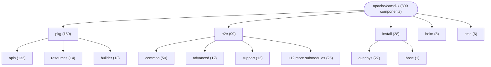
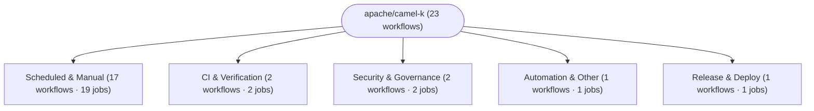

# Repository Architecture Analysis: apache/camel-k

## Metadata
- **SHA**: `d37175cd7a0ffe02e1629eddb86ccc014b66fda5`
- **Primary Ecosystem**: Go

## Quality Metrics
- **ast_engine**: fallback
- **avg_cognitive_complexity**: 0.0
- **avg_cyclomatic_complexity**: 0.0
- **component_count**: 300
- **dead_code_count**: 0
- **dead_code_symbols**: 0 entry(ies)
- **duplication_pct**: 0.0
- **file_complexities**: 0 entry(ies)
- **files_analyzed**: 910
- **fitness_passed**: True
- **fitness_violation_count**: 0
- **framework**: Go Service
- **import_edges**: 0 entry(ies)
- **loc**: 217235
- **max_cognitive_complexity**: 0
- **max_cyclomatic_complexity**: 0
- **sloc**: 181549
- **test_file_count**: 260

# Architecture: apache/camel-k

## Context
- **Repository**: `apache/camel-k`
- **SHA**: `d37175cd7a0ffe02e1629eddb86ccc014b66fda5`
- **Ecosystem**: Go
- **Framework**: Go Service

## Building Block View

## Component Details

Showing top 60 representative components out of 300 across 5 module group(s):

- **Module `pkg`** (159 components — module: 159)
- **Module `e2e`** (99 components — module: 99)
- **Module `install`** (28 components — module: 28)
- **Module `helm`** (8 components — module: 8)
- **Module `cmd`** (6 components — module: 6)

- **Chart** (`helm/camel-k/Chart.yaml`): module
- **addtoscheme_arkmq_duck_v1beta1** (`pkg/apis/addtoscheme_arkmq_duck_v1beta1.go`): module
- **addtoscheme_camel_monitor** (`pkg/apis/addtoscheme_camel_monitor.go`): module
- **addtoscheme_camel_v1** (`pkg/apis/addtoscheme_camel_v1.go`): module
- **addtoscheme_certmanager_duck_v1** (`pkg/apis/addtoscheme_certmanager_duck_v1.go`): module
- **addtoscheme_gateway** (`pkg/apis/addtoscheme_gateway.go`): module
- **addtoscheme_keda_duck_v1alpha1** (`pkg/apis/addtoscheme_keda_duck_v1alpha1.go`): module
- **addtoscheme_knative_eventing** (`pkg/apis/addtoscheme_knative_eventing.go`): module
- **addtoscheme_knative_serving** (`pkg/apis/addtoscheme_knative_serving.go`): module
- **addtoscheme_monitoring** (`pkg/apis/addtoscheme_monitoring.go`): module
- **addtoscheme_olm** (`pkg/apis/addtoscheme_olm.go`): module
- **addtoscheme_openshift** (`pkg/apis/addtoscheme_openshift.go`): module
- **addtoscheme_strimzi_duck_v1** (`pkg/apis/addtoscheme_strimzi_duck_v1.go`): module
- **affinity** (`pkg/apis/camel/v1/trait/affinity.go`): module
- **affinity_test** (`e2e/common/traits/affinity_test.go`): module
- **all_namespaces_test** (`e2e/install/kustomize/all_namespaces_test.go`): module
- **apis** (`pkg/apis/apis.go`): module
- **arkmq_binding_test** (`e2e/arkmq/arkmq_binding_test.go`): module
- **base** (`pkg/apis/camel/v1/trait/base.go`): module
- **bind_test** (`e2e/common/cli/bind_test.go`): module
- **binding_test** (`e2e/common/binding/binding_test.go`): module
- **build_max_pipelines_test** (`e2e/advanced/build_max_pipelines_test.go`): module
- **build_order_strategy_test** (`e2e/advanced/build_order_strategy_test.go`): module
- **build_type_support_test** (`pkg/apis/camel/v1/build_type_support_test.go`): module
- **build_types** (`pkg/apis/camel/v1/build_types.go`): module
- **build_types_support** (`pkg/apis/camel/v1/build_types_support.go`): module
- **builder** (`pkg/apis/camel/v1/trait/builder.go`): module
- **builder** (`pkg/builder/builder.go`): module
- **builder_support_test** (`pkg/builder/builder_support_test.go`): module
- **builder_test** (`e2e/advanced/builder_test.go`): module
- **builder_test** (`e2e/common/traits/builder_test.go`): module
- **builder_test** (`pkg/builder/builder_test.go`): module
- **camel** (`pkg/apis/camel/v1/trait/camel.go`): module
- **camel-k-crds** (`helm/camel-k/crds/camel-k-crds.yaml`): module
- **camel.apache.org_builds** (`pkg/resources/config/crd/bases/camel.apache.org_builds.yaml`): module
- **camel.apache.org_camelcatalogs** (`pkg/resources/config/crd/bases/camel.apache.org_camelcatalogs.yaml`): module
- **camel.apache.org_integrationkits** (`pkg/resources/config/crd/bases/camel.apache.org_integrationkits.yaml`): module
- **camel.apache.org_integrationplatforms** (`pkg/resources/config/crd/bases/camel.apache.org_integrationplatforms.yaml`): module
- **camel.apache.org_integrationprofiles** (`pkg/resources/config/crd/bases/camel.apache.org_integrationprofiles.yaml`): module
- **camel.apache.org_integrations** (`pkg/resources/config/crd/bases/camel.apache.org_integrations.yaml`): module
- **camel.apache.org_kamelets** (`pkg/resources/config/crd/bases/camel.apache.org_kamelets.yaml`): module
- **camel.apache.org_pipes** (`pkg/resources/config/crd/bases/camel.apache.org_pipes.yaml`): module
- **camel_monitor_test** (`e2e/camelmonitor/camel_monitor_test.go`): module
- **camel_test** (`e2e/common/traits/camel_test.go`): module
- **camelcatalog_types** (`pkg/apis/camel/v1/camelcatalog_types.go`): module
- **camelcatalog_types_support** (`pkg/apis/camel/v1/camelcatalog_types_support.go`): module
- **certmanager_test** (`e2e/cert-manager/certmanager_test.go`): module
- **common** (`pkg/builder/common.go`): module
- **common_test** (`pkg/builder/common_test.go`): module
- **common_types** (`pkg/apis/camel/v1/common_types.go`): module
- **common_types_support** (`pkg/apis/camel/v1/common_types_support.go`): module
- **common_types_support_test** (`pkg/apis/camel/v1/common_types_support_test.go`): module
- **config_reload_test** (`e2e/common/config/config_reload_test.go`): module
- **config_test** (`e2e/common/config/config_test.go`): module
- **container** (`pkg/apis/camel/v1/trait/container.go`): module
- **container_test** (`e2e/common/traits/container_test.go`): module
- **cron** (`pkg/apis/camel/v1/trait/cron.go`): module
- **cron_test** (`e2e/common/traits/cron_test.go`): module
- **csv** (`e2e/support/csv.go`): module
- **custom_component_test** (`e2e/common/misc/custom_component_test.go`): module

## 6-Dimension Repository Scorecard

- **Overall Grade**: `F` (58.25/100)
- **Technical Debt Score**: 41.75
- **Estimated Remediation Effort**: 63.94h

| Dimension | Grade | Score | Weight | Details |
| :--- | :---: | :---: | :---: | :--- |
| Code Quality | `A` | 100.00 | 0.20 | avg_cc=0.00, max_cc=0, duplication=0.00%, dead_code=0 |
| Dependency Health | `B` | 85.00 | 0.15 | dependencies=126, outdated=0, vulnerable=0, has_lockfile=False |
| Maintainability | `A` | 100.00 | 0.15 | avg_cognitive=0.00, max_cognitive=0, fitness_violations=0, oversized_files=0 |
| Pipeline Health | `F` | 0.00 | 0.15 | workflows=23, operational_antipatterns=31, parallel_branches=True |
| Security | `F` | 0.00 | 0.20 | vulnerabilities=0, secrets=1, pipeline_security_findings=21 |
| Test Coverage | `C` | 70.00 | 0.15 | coverage=unavailable, ci_test_job=True, test_files_detected=True |

## Supply Chain Dependencies, Vulnerabilities & Secrets

- **Dependencies Parsed**: 126 | **Vulnerabilities**: 0 | **Secrets**: 1

### Secret Findings (Redacted)
- **[CRITICAL] `ATRUSS-SEC-004`** at `pkg/trait/route_test.go:44` (`-----BEGIN ... PRIVATE KEY----- [REDACTED]`)

### Inventory Sample
- `org.apache.camel.k:camel-k-runtime` `*` (Maven, `script/camel-k-runtime-archetype/pom.xml`)
- `org.apache.camel.quarkus:camel-quarkus-core` `*` (Maven, `script/camel-k-runtime-archetype/pom.xml`)
- `dario.cat/mergo` `1.0.2` (golang, `go.mod`)
- `github.com/Masterminds/semver` `1.5.0` (golang, `go.mod`)
- `github.com/camel-tooling/camel-monitor-operator` `1.0.0` (golang, `go.mod`)
- `github.com/evanphx/json-patch` `5.9.11+incompatible` (golang, `go.mod`)
- `github.com/gertd/go-pluralize` `0.2.1` (golang, `go.mod`)
- `github.com/go-git/go-git/v5` `5.19.3` (golang, `go.mod`)
- `github.com/go-logr/logr` `1.4.4` (golang, `go.mod`)
- `github.com/go-viper/mapstructure/v2` `2.5.0` (golang, `go.mod`)
- `github.com/google/go-github/v72` `72.0.0` (golang, `go.mod`)
- `github.com/google/uuid` `1.6.0` (golang, `go.mod`)
- `github.com/jpillora/backoff` `1.1.0` (golang, `go.mod`)
- `github.com/magiconair/properties` `1.18.12` (golang, `go.mod`)
- `github.com/mattn/go-shellwords` `1.0.16` (golang, `go.mod`)
- `github.com/onsi/gomega` `1.44.0` (golang, `go.mod`)
- `github.com/openshift/api` `0.0.0-20260708103422-b1cc68a860b3` (golang, `go.mod`)
- `github.com/operator-framework/api` `0.46.0` (golang, `go.mod`)
- `github.com/prometheus-operator/prometheus-operator/pkg/apis/monitoring` `0.95.1` (golang, `go.mod`)
- `github.com/prometheus/client_golang` `1.25.0` (golang, `go.mod`)
- `github.com/prometheus/client_model` `0.6.3` (golang, `go.mod`)
- `github.com/prometheus/common` `0.73.1` (golang, `go.mod`)
- `github.com/rs/xid` `1.6.0` (golang, `go.mod`)
- `github.com/sirupsen/logrus` `1.10.2` (golang, `go.mod`)
- `github.com/spf13/cobra` `1.10.2` (golang, `go.mod`)
- `github.com/spf13/pflag` `1.1.0` (golang, `go.mod`)
- `github.com/spf13/viper` `1.21.0` (golang, `go.mod`)
- `github.com/stoewer/go-strcase` `1.3.1` (golang, `go.mod`)
- `github.com/stretchr/testify` `1.12.1` (golang, `go.mod`)
- `go.uber.org/automaxprocs` `1.6.0` (golang, `go.mod`)
- ... (+96 more dependencies)

## Section 7: Code-to-Cloud Deployment Traceability

```mermaid
flowchart LR
    subgraph code_modules["Code Modules"]
        mod_helm_camel_k["helm/camel-k"]
        mod_install_base["install/base"]
        mod_install_overlays_all_namespaces["install/overlays/all-namespaces"]
        mod_install_overlays_multi_namespace_operator["install/overlays/multi-namespace/operator"]
        mod_install_overlays_platform["install/overlays/platform"]
        mod_install_overlays_single_namespace_operator["install/overlays/single-namespace/operator"]
        mod_pkg_resources_config_helm_namespaced["pkg/resources/config/helm/namespaced"]
        mod_pkg_resources_config_manager["pkg/resources/config/manager"]
        mod_pkg_resources_config_prometheus["pkg/resources/config/prometheus"]
        mod_pkg_resources_config_rbac["pkg/resources/config/rbac"]
        mod_pkg_resources_config_rbac_namespaced["pkg/resources/config/rbac/namespaced"]
    end
    subgraph build_artifacts["Build Artifacts / Containers"]
        art_helm_camel_k_Chart_yaml["helm/camel-k/Chart.yaml"]
        art_helm_camel_k_crds_camel_k_crds_yaml["helm/camel-k/crds/camel-k-crds.yaml"]
        art_helm_camel_k_templates_operator_deployment_yaml["helm/camel-k/templates/operator-deployment.yaml"]
        art_helm_camel_k_templates_operator_svcs_yaml["helm/camel-k/templates/operator-svcs.yaml"]
        art_helm_camel_k_templates_rbacs_common_yaml["helm/camel-k/templates/rbacs-common.yaml"]
        art_helm_camel_k_templates_rbacs_descoped_yaml["helm/camel-k/templates/rbacs-descoped.yaml"]
        art_helm_camel_k_templates_rbacs_namespaced_yaml["helm/camel-k/templates/rbacs-namespaced.yaml"]
        art_helm_camel_k_values_yaml["helm/camel-k/values.yaml"]
    end
    subgraph ci_jobs["CI/CD Jobs"]
        job_arkmq_yml_arkmq_test["arkmq.yml#arkmq-test"]
        job_camel_monitor_yml_camel_monitor["camel-monitor.yml#camel-monitor"]
        job_cert_manager_yml_test["cert-manager.yml#test"]
        job_common_yml_common["common.yml#common"]
        job_gateway_yml_test["gateway.yml#test"]
        job_kafka_yml_kafka_test["kafka.yml#kafka-test"]
        job_keda_yml_keda_test["keda.yml#keda-test"]
        job_knative_yml_knative_test["knative.yml#knative-test"]
        job_native_yml_quarkus_native["native.yml#quarkus-native"]
        job_network_policy_yml_network_policy["network-policy.yml#network-policy"]
        job_nightly_install_olm_yml_install["nightly-install-olm.yml#install"]
        job_nightly_multi_yml_common_arm64["nightly-multi.yml#common-arm64"]
        job_nightly_multi_yml_common_jdk_21["nightly-multi.yml#common-jdk-21"]
        job_telemetry_yml_telemetry_it["telemetry.yml#telemetry-it"]
        job_upgrade_yml_upgrade["upgrade.yml#upgrade"]
    end
    subgraph runtime_envs["Runtime Environments"]
        env_kubernetes["kubernetes"]
    end
    job_arkmq_yml_arkmq_test -->|DEPLOYS_TO| env_kubernetes
    job_camel_monitor_yml_camel_monitor -->|DEPLOYS_TO| env_kubernetes
    job_cert_manager_yml_test -->|DEPLOYS_TO| env_kubernetes
    job_common_yml_common -->|DEPLOYS_TO| env_kubernetes
    job_gateway_yml_test -->|DEPLOYS_TO| env_kubernetes
    job_kafka_yml_kafka_test -->|DEPLOYS_TO| env_kubernetes
    job_keda_yml_keda_test -->|DEPLOYS_TO| env_kubernetes
    job_knative_yml_knative_test -->|DEPLOYS_TO| env_kubernetes
    job_native_yml_quarkus_native -->|DEPLOYS_TO| env_kubernetes
    job_network_policy_yml_network_policy -->|DEPLOYS_TO| env_kubernetes
    job_nightly_install_olm_yml_install -->|DEPLOYS_TO| env_kubernetes
    job_nightly_multi_yml_common_arm64 -->|DEPLOYS_TO| env_kubernetes
    job_nightly_multi_yml_common_jdk_21 -->|DEPLOYS_TO| env_kubernetes
    job_telemetry_yml_telemetry_it -->|DEPLOYS_TO| env_kubernetes
    job_upgrade_yml_upgrade -->|DEPLOYS_TO| env_kubernetes
    mod_helm_camel_k -->|PACKAGED_BY| art_helm_camel_k_Chart_yaml
    mod_helm_camel_k -->|PACKAGED_BY| art_helm_camel_k_crds_camel_k_crds_yaml
    mod_helm_camel_k -->|PACKAGED_BY| art_helm_camel_k_templates_operator_deployment_yaml
    mod_helm_camel_k -->|PACKAGED_BY| art_helm_camel_k_templates_operator_svcs_yaml
    mod_helm_camel_k -->|PACKAGED_BY| art_helm_camel_k_templates_rbacs_common_yaml
    mod_helm_camel_k -->|PACKAGED_BY| art_helm_camel_k_templates_rbacs_descoped_yaml
    mod_helm_camel_k -->|PACKAGED_BY| art_helm_camel_k_templates_rbacs_namespaced_yaml
    mod_helm_camel_k -->|PACKAGED_BY| art_helm_camel_k_values_yaml
    mod_install_base -->|DEPLOYED_BY| job_nightly_multi_yml_common_arm64
    mod_install_base -->|PACKAGED_BY| art_helm_camel_k_crds_camel_k_crds_yaml
    mod_install_overlays_all_namespaces -->|DEPLOYED_BY| job_arkmq_yml_arkmq_test
    mod_install_overlays_all_namespaces -->|DEPLOYED_BY| job_camel_monitor_yml_camel_monitor
    mod_install_overlays_all_namespaces -->|DEPLOYED_BY| job_cert_manager_yml_test
    mod_install_overlays_all_namespaces -->|DEPLOYED_BY| job_common_yml_common
    mod_install_overlays_all_namespaces -->|DEPLOYED_BY| job_gateway_yml_test
    mod_install_overlays_all_namespaces -->|DEPLOYED_BY| job_kafka_yml_kafka_test
    mod_install_overlays_all_namespaces -->|DEPLOYED_BY| job_keda_yml_keda_test
    mod_install_overlays_all_namespaces -->|DEPLOYED_BY| job_knative_yml_knative_test
    mod_install_overlays_all_namespaces -->|DEPLOYED_BY| job_native_yml_quarkus_native
    mod_install_overlays_all_namespaces -->|DEPLOYED_BY| job_network_policy_yml_network_policy
    mod_install_overlays_all_namespaces -->|DEPLOYED_BY| job_nightly_multi_yml_common_arm64
    mod_install_overlays_all_namespaces -->|DEPLOYED_BY| job_nightly_multi_yml_common_jdk_21
    mod_install_overlays_all_namespaces -->|DEPLOYED_BY| job_telemetry_yml_telemetry_it
    mod_install_overlays_multi_namespace_operator -->|PACKAGED_BY| art_helm_camel_k_crds_camel_k_crds_yaml
    mod_install_overlays_multi_namespace_operator -->|PACKAGED_BY| art_helm_camel_k_templates_operator_deployment_yaml
    mod_install_overlays_multi_namespace_operator -->|PACKAGED_BY| art_helm_camel_k_templates_operator_svcs_yaml
    mod_install_overlays_multi_namespace_operator -->|PACKAGED_BY| art_helm_camel_k_templates_rbacs_common_yaml
    mod_install_overlays_multi_namespace_operator -->|PACKAGED_BY| art_helm_camel_k_templates_rbacs_descoped_yaml
    mod_install_overlays_multi_namespace_operator -->|PACKAGED_BY| art_helm_camel_k_templates_rbacs_namespaced_yaml
    mod_install_overlays_multi_namespace_operator -->|PACKAGED_BY| art_helm_camel_k_values_yaml
    mod_install_overlays_platform -->|PACKAGED_BY| art_helm_camel_k_Chart_yaml
    mod_install_overlays_platform -->|PACKAGED_BY| art_helm_camel_k_crds_camel_k_crds_yaml
    mod_install_overlays_platform -->|PACKAGED_BY| art_helm_camel_k_templates_rbacs_descoped_yaml
    mod_install_overlays_platform -->|PACKAGED_BY| art_helm_camel_k_templates_rbacs_namespaced_yaml
    mod_install_overlays_platform -->|PACKAGED_BY| art_helm_camel_k_values_yaml
    mod_install_overlays_single_namespace_operator -->|PACKAGED_BY| art_helm_camel_k_crds_camel_k_crds_yaml
    mod_install_overlays_single_namespace_operator -->|PACKAGED_BY| art_helm_camel_k_templates_operator_deployment_yaml
    mod_install_overlays_single_namespace_operator -->|PACKAGED_BY| art_helm_camel_k_templates_operator_svcs_yaml
    mod_install_overlays_single_namespace_operator -->|PACKAGED_BY| art_helm_camel_k_templates_rbacs_common_yaml
    mod_install_overlays_single_namespace_operator -->|PACKAGED_BY| art_helm_camel_k_templates_rbacs_descoped_yaml
    mod_install_overlays_single_namespace_operator -->|PACKAGED_BY| art_helm_camel_k_templates_rbacs_namespaced_yaml
    mod_install_overlays_single_namespace_operator -->|PACKAGED_BY| art_helm_camel_k_values_yaml
    mod_pkg_resources_config_helm_namespaced -->|PACKAGED_BY| art_helm_camel_k_crds_camel_k_crds_yaml
    mod_pkg_resources_config_manager -->|PACKAGED_BY| art_helm_camel_k_templates_rbacs_descoped_yaml
    mod_pkg_resources_config_manager -->|PACKAGED_BY| art_helm_camel_k_templates_rbacs_namespaced_yaml
    mod_pkg_resources_config_prometheus -->|PACKAGED_BY| art_helm_camel_k_values_yaml
    mod_pkg_resources_config_rbac -->|PACKAGED_BY| art_helm_camel_k_templates_rbacs_common_yaml
    mod_pkg_resources_config_rbac -->|PACKAGED_BY| art_helm_camel_k_templates_rbacs_descoped_yaml
    mod_pkg_resources_config_rbac -->|PACKAGED_BY| art_helm_camel_k_templates_rbacs_namespaced_yaml
    mod_pkg_resources_config_rbac_namespaced -->|PACKAGED_BY| art_helm_camel_k_crds_camel_k_crds_yaml
```

- `arkmq.yml#arkmq-test` (ci_job) --[DEPLOYS_TO]--> `kubernetes` (environment)
- `camel-monitor.yml#camel-monitor` (ci_job) --[DEPLOYS_TO]--> `kubernetes` (environment)
- `cert-manager.yml#test` (ci_job) --[DEPLOYS_TO]--> `kubernetes` (environment)
- `common.yml#common` (ci_job) --[DEPLOYS_TO]--> `kubernetes` (environment)
- `gateway.yml#test` (ci_job) --[DEPLOYS_TO]--> `kubernetes` (environment)
- `kafka.yml#kafka-test` (ci_job) --[DEPLOYS_TO]--> `kubernetes` (environment)
- `keda.yml#keda-test` (ci_job) --[DEPLOYS_TO]--> `kubernetes` (environment)
- `knative.yml#knative-test` (ci_job) --[DEPLOYS_TO]--> `kubernetes` (environment)
- `native.yml#quarkus-native` (ci_job) --[DEPLOYS_TO]--> `kubernetes` (environment)
- `network-policy.yml#network-policy` (ci_job) --[DEPLOYS_TO]--> `kubernetes` (environment)
- `nightly-install-olm.yml#install` (ci_job) --[DEPLOYS_TO]--> `kubernetes` (environment)
- `nightly-multi.yml#common-arm64` (ci_job) --[DEPLOYS_TO]--> `kubernetes` (environment)
- `nightly-multi.yml#common-jdk-21` (ci_job) --[DEPLOYS_TO]--> `kubernetes` (environment)
- `telemetry.yml#telemetry-it` (ci_job) --[DEPLOYS_TO]--> `kubernetes` (environment)
- `upgrade.yml#upgrade` (ci_job) --[DEPLOYS_TO]--> `kubernetes` (environment)
- `helm/camel-k` (code_module) --[PACKAGED_BY]--> `helm/camel-k/Chart.yaml` (iac)
- `helm/camel-k` (code_module) --[PACKAGED_BY]--> `helm/camel-k/crds/camel-k-crds.yaml` (iac)
- `helm/camel-k` (code_module) --[PACKAGED_BY]--> `helm/camel-k/templates/operator-deployment.yaml` (iac)
- `helm/camel-k` (code_module) --[PACKAGED_BY]--> `helm/camel-k/templates/operator-svcs.yaml` (iac)
- `helm/camel-k` (code_module) --[PACKAGED_BY]--> `helm/camel-k/templates/rbacs-common.yaml` (iac)
- `helm/camel-k` (code_module) --[PACKAGED_BY]--> `helm/camel-k/templates/rbacs-descoped.yaml` (iac)
- `helm/camel-k` (code_module) --[PACKAGED_BY]--> `helm/camel-k/templates/rbacs-namespaced.yaml` (iac)
- `helm/camel-k` (code_module) --[PACKAGED_BY]--> `helm/camel-k/values.yaml` (iac)
- `install/base` (code_module) --[DEPLOYED_BY]--> `nightly-multi.yml#common-arm64` (ci_job)
- `install/base` (code_module) --[PACKAGED_BY]--> `helm/camel-k/crds/camel-k-crds.yaml` (iac)
- `install/overlays/all-namespaces` (code_module) --[DEPLOYED_BY]--> `arkmq.yml#arkmq-test` (ci_job)
- `install/overlays/all-namespaces` (code_module) --[DEPLOYED_BY]--> `camel-monitor.yml#camel-monitor` (ci_job)
- `install/overlays/all-namespaces` (code_module) --[DEPLOYED_BY]--> `cert-manager.yml#test` (ci_job)
- `install/overlays/all-namespaces` (code_module) --[DEPLOYED_BY]--> `common.yml#common` (ci_job)
- `install/overlays/all-namespaces` (code_module) --[DEPLOYED_BY]--> `gateway.yml#test` (ci_job)
- `install/overlays/all-namespaces` (code_module) --[DEPLOYED_BY]--> `kafka.yml#kafka-test` (ci_job)
- `install/overlays/all-namespaces` (code_module) --[DEPLOYED_BY]--> `keda.yml#keda-test` (ci_job)
- `install/overlays/all-namespaces` (code_module) --[DEPLOYED_BY]--> `knative.yml#knative-test` (ci_job)
- `install/overlays/all-namespaces` (code_module) --[DEPLOYED_BY]--> `native.yml#quarkus-native` (ci_job)
- `install/overlays/all-namespaces` (code_module) --[DEPLOYED_BY]--> `network-policy.yml#network-policy` (ci_job)
- `install/overlays/all-namespaces` (code_module) --[DEPLOYED_BY]--> `nightly-multi.yml#common-arm64` (ci_job)
- `install/overlays/all-namespaces` (code_module) --[DEPLOYED_BY]--> `nightly-multi.yml#common-jdk-21` (ci_job)
- `install/overlays/all-namespaces` (code_module) --[DEPLOYED_BY]--> `telemetry.yml#telemetry-it` (ci_job)
- `install/overlays/multi-namespace/operator` (code_module) --[PACKAGED_BY]--> `helm/camel-k/crds/camel-k-crds.yaml` (iac)
- `install/overlays/multi-namespace/operator` (code_module) --[PACKAGED_BY]--> `helm/camel-k/templates/operator-deployment.yaml` (iac)

## CI/CD Pipeline Topology

