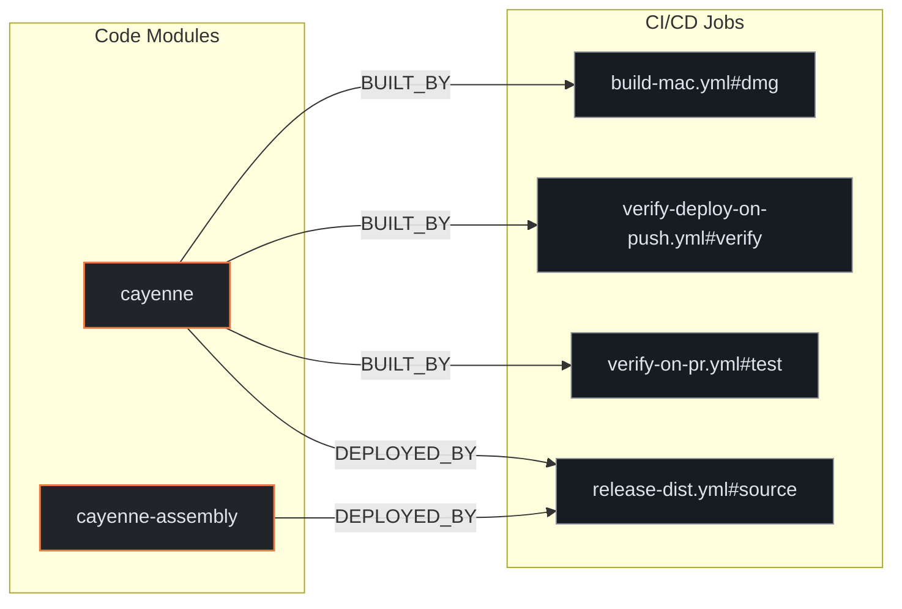
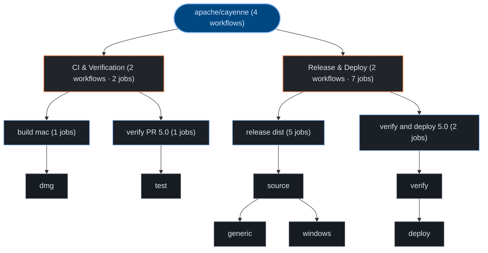

# Repository Architecture Analysis: apache/cayenne

## Metadata
- **SHA**: `db4e883ee1caa7ab343b7f638f8c0b1ee923af8a`
- **Primary Ecosystem**: Java

## Quality Metrics
- **ast_engine**: tree-sitter
- **avg_cognitive_complexity**: 1.42
- **avg_cyclomatic_complexity**: 1.91
- **component_count**: 25
- **dead_code_count**: 154
- **dead_code_symbols**: 50 entry(ies)
- **duplication_pct**: 93.88
- **file_complexities**: 25 entry(ies)
- **files_analyzed**: 3473
- **fitness_passed**: False
- **fitness_violation_count**: 3
- **framework**: Spring Boot
- **import_edges**: 100 entry(ies)
- **loc**: 411095
- **max_cognitive_complexity**: 1691
- **max_cyclomatic_complexity**: 516
- **sloc**: 252739
- **test_file_count**: 2079

# Architecture: apache/cayenne

## Context
- **Repository**: `apache/cayenne`
- **SHA**: `db4e883ee1caa7ab343b7f638f8c0b1ee923af8a`
- **Ecosystem**: Java
- **Framework**: Spring Boot

## Building Block View

## Component Details
- **cayenne-legal** (`build-tools/cayenne-legal/pom.xml`): MODULE
- **cayenne-test-utilities** (`build-tools/cayenne-test-utilities/pom.xml`): MODULE
- **build-tools-parent** (`build-tools/pom.xml`): MODULE
- **cayenne** (`cayenne/pom.xml`): MODULE
- **cayenne-ant** (`cayenne-ant/pom.xml`): MODULE
- **cayenne-assembly** (`cayenne-assembly/pom.xml`): MODULE
- **cayenne-cache-invalidation** (`cayenne-cache-invalidation/pom.xml`): MODULE
- **cayenne-cgen** (`cayenne-cgen/pom.xml`): MODULE
- **cayenne-crypto** (`cayenne-crypto/pom.xml`): MODULE
- **cayenne-dbsync** (`cayenne-dbsync/pom.xml`): MODULE
- **cayenne-di** (`cayenne-di/pom.xml`): MODULE
- **cayenne-gradle-plugin** (`cayenne-gradle-plugin/pom.xml`): MODULE
- **cayenne-jcache** (`cayenne-jcache/pom.xml`): MODULE
- **cayenne-maven-plugin** (`cayenne-maven-plugin/pom.xml`): MODULE
- **project-to-test** (`cayenne-maven-plugin/src/test/resources/cgen/project-to-test/pom.xml`): MODULE
- **cayenne-mcp-server** (`cayenne-mcp-server/pom.xml`): MODULE
- **cayenne-modeler** (`cayenne-modeler/pom.xml`): MODULE
- **cayenne-modeler-prefs** (`cayenne-modeler-prefs/pom.xml`): MODULE
- **cayenne-project-tools** (`cayenne-project-tools/pom.xml`): MODULE
- **cayenne-velocity** (`cayenne-velocity/pom.xml`): MODULE
- **cayenne-wocompat** (`cayenne-wocompat/pom.xml`): MODULE
- **cayenne-guide** (`docs/cayenne-guide/pom.xml`): MODULE
- **getting-started-guide** (`docs/getting-started-guide/pom.xml`): MODULE
- **cayenne-docs-parent** (`docs/pom.xml`): MODULE
- **cayenne-parent** (`pom.xml`): MODULE

## 6-Dimension Repository Scorecard

- **Overall Grade**: `F` (55.55/100)
- **Technical Debt Score**: 44.45
- **Estimated Remediation Effort**: 117.89h

| Dimension | Grade | Score | Weight | Details |
| :--- | :---: | :---: | :---: | :--- |
| Code Quality | `F` | 30.00 | 0.20 | avg_cc=1.91, max_cc=516, duplication=93.88%, dead_code=154 |
| Dependency Health | `B` | 85.00 | 0.15 | dependencies=145, outdated=0, vulnerable=0, has_lockfile=False |
| Maintainability | `F` | 37.00 | 0.15 | avg_cognitive=1.42, max_cognitive=1691, fitness_violations=3, oversized_files=22 |
| Pipeline Health | `F` | 37.00 | 0.15 | workflows=4, operational_antipatterns=9, parallel_branches=True |
| Security | `C` | 76.00 | 0.20 | vulnerabilities=0, secrets=0, pipeline_security_findings=2 |
| Test Coverage | `C` | 70.00 | 0.15 | coverage=unavailable, ci_test_job=True, test_files_detected=True |

## Architecture Fitness & Workspace Boundaries

- **[MEDIUM] `ATRUSS-ARCH-005` (COMPLEXITY_THRESHOLD)**: Repository duplication_pct (93.88) exceeds policy threshold (15.0).
- **[MEDIUM] `ATRUSS-ARCH-005` (COMPLEXITY_THRESHOLD)**: Repository max_cognitive_complexity (1691.0) exceeds policy threshold (25.0).
- **[MEDIUM] `ATRUSS-ARCH-005` (COMPLEXITY_THRESHOLD)**: Repository max_cyclomatic_complexity (516.0) exceeds policy threshold (20.0).

## Supply Chain Dependencies, Vulnerabilities & Secrets

- **Dependencies Parsed**: 145 | **Vulnerabilities**: 0 | **Secrets**: 0

### Inventory Sample
- `ch.qos.logback:logback-classic` `*` (Maven, `cayenne-mcp-server/pom.xml`)
- `com.fifesoft:rsyntaxtextarea` `*` (Maven, `cayenne-modeler/pom.xml`)
- `com.formdev:flatlaf` `*` (Maven, `cayenne-modeler/pom.xml`)
- `com.h2database:h2` `2.2.220` (Maven, `pom.xml`)
- `com.ibm.db2:jcc` `11.5.7.0` (Maven, `pom.xml`)
- `com.jgoodies:forms` `*` (Maven, `cayenne-modeler/pom.xml`)
- `com.microsoft.sqlserver:mssql-jdbc` `12.10.2.jre11` (Maven, `pom.xml`)
- `com.mysql:mysql-connector-j` `9.5.0` (Maven, `pom.xml`)
- `com.oracle.database.jdbc:ojdbc11` `21.8.0.0` (Maven, `pom.xml`)
- `com.sun.xml.bind:jaxb-impl` `*` (Maven, `cayenne-jcache/pom.xml`)
- `com.sun.xml.bind:jaxb-impl` `*` (Maven, `docs/cayenne-guide/pom.xml`)
- `io.modelcontextprotocol.sdk:mcp` `*` (Maven, `cayenne-mcp-server/pom.xml`)
- `javax.cache:cache-api` `*` (Maven, `cayenne-jcache/pom.xml`)
- `javax.xml.bind:jaxb-api` `*` (Maven, `cayenne-jcache/pom.xml`)
- `javax.xml.bind:jaxb-api` `*` (Maven, `docs/cayenne-guide/pom.xml`)
- `org.apache.ant:ant` `*` (Maven, `cayenne-ant/pom.xml`)
- `org.apache.cayenne.build-tools:cayenne-test-utilities` `*` (Maven, `cayenne-ant/pom.xml`)
- `org.apache.cayenne.build-tools:cayenne-test-utilities` `*` (Maven, `cayenne-cache-invalidation/pom.xml`)
- `org.apache.cayenne.build-tools:cayenne-test-utilities` `*` (Maven, `cayenne-crypto/pom.xml`)
- `org.apache.cayenne.build-tools:cayenne-test-utilities` `*` (Maven, `cayenne-dbsync/pom.xml`)
- `org.apache.cayenne.build-tools:cayenne-test-utilities` `*` (Maven, `cayenne-jcache/pom.xml`)
- `org.apache.cayenne.build-tools:cayenne-test-utilities` `*` (Maven, `cayenne-maven-plugin/pom.xml`)
- `org.apache.cayenne.build-tools:cayenne-test-utilities` `*` (Maven, `cayenne-project-tools/pom.xml`)
- `org.apache.cayenne.build-tools:cayenne-test-utilities` `*` (Maven, `cayenne-velocity/pom.xml`)
- `org.apache.cayenne.build-tools:cayenne-test-utilities` `*` (Maven, `cayenne/pom.xml`)
- `org.apache.cayenne:cayenne` `*` (Maven, `cayenne-ant/pom.xml`)
- `org.apache.cayenne:cayenne` `*` (Maven, `cayenne-assembly/pom.xml`)
- `org.apache.cayenne:cayenne` `*` (Maven, `cayenne-cache-invalidation/pom.xml`)
- `org.apache.cayenne:cayenne` `*` (Maven, `cayenne-cache-invalidation/pom.xml`)
- `org.apache.cayenne:cayenne` `*` (Maven, `cayenne-cgen/pom.xml`)
- ... (+115 more dependencies)

## Section 7: Code-to-Cloud Deployment Traceability

- `cayenne` (code_module) --[BUILT_BY]--> `build-mac.yml#dmg` (ci_job)
- `cayenne` (code_module) --[BUILT_BY]--> `verify-deploy-on-push.yml#verify` (ci_job)
- `cayenne` (code_module) --[BUILT_BY]--> `verify-on-pr.yml#test` (ci_job)
- `cayenne` (code_module) --[DEPLOYED_BY]--> `release-dist.yml#source` (ci_job)
- `cayenne-assembly` (code_module) --[DEPLOYED_BY]--> `release-dist.yml#source` (ci_job)

## CI/CD Pipeline Topology

