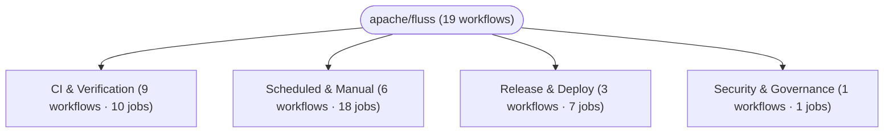

# Repository Architecture Analysis: apache/fluss

## Metadata
- **SHA**: `0c022131f943ce9fc36cad5431bfc78b9c6a9556`
- **Primary Ecosystem**: Java

## Quality Metrics
- **ast_engine**: tree-sitter
- **avg_cognitive_complexity**: 1.5
- **avg_cyclomatic_complexity**: 1.79
- **component_count**: 437
- **dead_code_count**: 45
- **dead_code_symbols**: 45 entry(ies)
- **duplication_pct**: 75.44
- **file_complexities**: 25 entry(ies)
- **files_analyzed**: 3737
- **fitness_passed**: False
- **fitness_violation_count**: 3
- **framework**: Java Maven/Gradle
- **import_edges**: 100 entry(ies)
- **loc**: 831795
- **max_cognitive_complexity**: 98
- **max_cyclomatic_complexity**: 51
- **sloc**: 599864
- **test_file_count**: 1394

# Architecture: apache/fluss

## Context
- **Repository**: `apache/fluss`
- **SHA**: `0c022131f943ce9fc36cad5431bfc78b9c6a9556`
- **Ecosystem**: Java
- **Framework**: Java Maven/Gradle

## Building Block View

```mermaid
graph TD;
    repo_root(["apache/fluss (437 components)"])
    dir_0_fluss_rust["fluss-rust (290)"]
    repo_root --> dir_0_fluss_rust
    sub_0_0_crates["crates (218)"]
    dir_0_fluss_rust --> sub_0_0_crates
    sub_0_1_bindings["bindings (71)"]
    dir_0_fluss_rust --> sub_0_1_bindings
    sub_0_2_website["website (1)"]
    dir_0_fluss_rust --> sub_0_2_website
    dir_1_fluss_gateway["fluss-gateway (30)"]
    repo_root --> dir_1_fluss_gateway
    sub_1_0_src["src (26)"]
    dir_1_fluss_gateway --> sub_1_0_src
    sub_1_1_tests["tests (4)"]
    dir_1_fluss_gateway --> sub_1_1_tests
    dir_2_helm["helm (30)"]
    repo_root --> dir_2_helm
    sub_2_0_tests["tests (17)"]
    dir_2_helm --> sub_2_0_tests
    sub_2_1_templates["templates (11)"]
    dir_2_helm --> sub_2_1_templates
    sub_2_2__module_root_["(module root) (2)"]
    dir_2_helm --> sub_2_2__module_root_
    dir_3_website["website (24)"]
    repo_root --> dir_3_website
    sub_3_0_src["src (23)"]
    dir_3_website --> sub_3_0_src
    sub_3_1__module_root_["(module root) (1)"]
    dir_3_website --> sub_3_1__module_root_
    dir_4_devkit["devkit (11)"]
    repo_root --> dir_4_devkit
    sub_4_0_compose["compose (5)"]
    dir_4_devkit --> sub_4_0_compose
    sub_4_1_profiles["profiles (5)"]
    dir_4_devkit --> sub_4_1_profiles
    sub_4_2__module_root_["(module root) (1)"]
    dir_4_devkit --> sub_4_2__module_root_
    dir_other_modules["+19 more modules (52)"]
    repo_root --> dir_other_modules
```



## Component Details

Showing top 60 representative components out of 437 across 24 module group(s):

- **Module `fluss-rust`** (290 components — module: 289, MODULE: 1)
- **Module `fluss-gateway`** (30 components — module: 30)
- **Module `helm`** (30 components — module: 30)
- **Module `website`** (24 components — UI_COMPONENT: 23, MODULE: 1)
- **Module `devkit`** (11 components — module: 11)
- **Module `fluss-filesystems`** (10 components — MODULE: 10)
- **Module `fluss-flink`** (8 components — MODULE: 8)
- **Module `fluss-lake`** (7 components — MODULE: 7)
- **Module `fluss-spark`** (6 components — MODULE: 6)
- **Module `fluss-metrics`** (4 components — MODULE: 4)
- **Module `fluss-protogen`** (4 components — MODULE: 4)
- **Module `(root)`** (1 components — MODULE: 1)

- **UserStory** (`website/src/components/UserStory/index.tsx`): UI_COMPONENT (deps: BrandLogo)
- **.formatter** (`fluss-rust/bindings/elixir/.formatter.exs`): module
- **BlogListPage** (`website/src/theme/BlogListPage/index.tsx`): UI_COMPONENT
- **BlogPostPageWrapper** (`website/src/theme/BlogPostPage/index.tsx`): UI_COMPONENT
- **BrandLogo** (`website/src/components/UserStory/BrandLogo.tsx`): UI_COMPONENT
- **Chart** (`helm/Chart.yaml`): module
- **ColorModeToggleWrapper** (`website/src/theme/ColorModeToggle/index.js`): UI_COMPONENT
- **DocsVersionDropdownNavbarItemWrapper** (`website/src/theme/NavbarItem/DocsVersionDropdownNavbarItem.js`): UI_COMPONENT
- **GoogleCalendarConsent** (`website/src/components/GoogleCalendarConsent/index.tsx`): UI_COMPONENT
- **Home** (`website/src/pages/index.tsx`): UI_COMPONENT
- **HomepageFeatures** (`website/src/components/HomepageFeatures/index.tsx`): UI_COMPONENT
- **Story** (`website/src/pages/user-stories/alibaba-cloud.tsx`): UI_COMPONENT
- **Story** (`website/src/pages/user-stories/alibaba.tsx`): UI_COMPONENT
- **Story** (`website/src/pages/user-stories/ant-group.tsx`): UI_COMPONENT
- **Story** (`website/src/pages/user-stories/cisco.tsx`): UI_COMPONENT
- **Story** (`website/src/pages/user-stories/doris.tsx`): UI_COMPONENT
- **Story** (`website/src/pages/user-stories/fresha.tsx`): UI_COMPONENT
- **Story** (`website/src/pages/user-stories/iqiyi.tsx`): UI_COMPONENT
- **Story** (`website/src/pages/user-stories/jd.tsx`): UI_COMPONENT
- **Story** (`website/src/pages/user-stories/rednote.tsx`): UI_COMPONENT
- **Story** (`website/src/pages/user-stories/starrocks.tsx`): UI_COMPONENT
- **Story** (`website/src/pages/user-stories/ververica.tsx`): UI_COMPONENT
- **UserLogoBand** (`website/src/components/UserLogoBand/index.tsx`): UI_COMPONENT
- **UserStories** (`website/src/pages/user-stories/index.tsx`): UI_COMPONENT
- **YouTubeConsent** (`website/src/components/YouTubeConsent/index.tsx`): UI_COMPONENT
- **accumulator** (`fluss-rust/crates/fluss/src/client/write/accumulator.rs`): module
- **acl** (`fluss-rust/crates/fluss/src/metadata/acl.rs`): module
- **acquire_kv_snapshot_lease** (`fluss-rust/crates/fluss/src/rpc/message/acquire_kv_snapshot_lease.rs`): module
- **add_server_tag** (`fluss-rust/crates/fluss/src/rpc/message/add_server_tag.rs`): module
- **admin** (`fluss-rust/bindings/elixir/lib/fluss/admin.ex`): module
- **admin** (`fluss-rust/bindings/elixir/native/fluss_nif/src/admin.rs`): module
- **admin** (`fluss-rust/bindings/python/src/admin.rs`): module
- **admin** (`fluss-rust/crates/fluss/src/client/admin.rs`): module
- **admin** (`fluss-rust/crates/fluss/tests/integration/admin.rs`): module
- **admin_test** (`fluss-rust/bindings/elixir/test/integration/admin_test.exs`): module
- **aligned_row_writer** (`fluss-rust/crates/fluss/src/row/aligned/aligned_row_writer.rs`): module
- **alter_cluster_configs** (`fluss-rust/crates/fluss/src/rpc/message/alter_cluster_configs.rs`): module
- **alter_database** (`fluss-rust/crates/fluss/src/rpc/message/alter_database.rs`): module
- **alter_table** (`fluss-rust/crates/fluss/src/rpc/message/alter_table.rs`): module
- **annotations_test** (`helm/tests/annotations_test.yaml`): module
- **api_key** (`fluss-rust/crates/fluss/src/rpc/api_key.rs`): module
- **api_version** (`fluss-rust/crates/fluss/src/rpc/api_version.rs`): module
- **api_versions** (`fluss-rust/crates/fluss/src/rpc/message/api_versions.rs`): module
- **append** (`fluss-rust/crates/fluss/src/client/table/append.rs`): module
- **append_writer** (`fluss-rust/bindings/elixir/lib/fluss/append_writer.ex`): module
- **append_writer** (`fluss-rust/bindings/elixir/native/fluss_nif/src/append_writer.rs`): module
- **arrow** (`fluss-rust/crates/fluss/src/record/arrow.rs`): module
- **arrow_compression** (`fluss-rust/crates/fluss/src/compression/arrow_compression.rs`): module
- **arrow_compression_ratio_estimator** (`fluss-rust/crates/fluss/src/compression/arrow_compression_ratio_estimator.rs`): module
- **arrow_eval** (`fluss-rust/crates/fluss/src/predicate/arrow_eval.rs`): module
- **async_nif** (`fluss-rust/bindings/elixir/native/fluss_nif/src/async_nif.rs`): module
- **atoms** (`fluss-rust/bindings/elixir/native/fluss_nif/src/atoms.rs`): module
- **authenticate** (`fluss-rust/crates/fluss/src/rpc/message/authenticate.rs`): module
- **batch** (`fluss-rust/crates/fluss/src/client/write/batch.rs`): module
- **batch_scanner** (`fluss-rust/crates/fluss/src/client/table/batch_scanner.rs`): module
- **batch_scanner** (`fluss-rust/crates/fluss/tests/integration/batch_scanner.rs`): module
- **binary_array** (`fluss-rust/crates/fluss/src/row/binary_array.rs`): module
- **binary_map** (`fluss-rust/crates/fluss/src/row/binary_map.rs`): module
- **binary_writer** (`fluss-rust/crates/fluss/src/row/binary/binary_writer.rs`): module
- **binding** (`fluss-rust/crates/fluss/src/predicate/binding.rs`): module

## 6-Dimension Repository Scorecard

- **Overall Grade**: `F` (37.05/100)
- **Technical Debt Score**: 62.95
- **Estimated Remediation Effort**: 139.58h

| Dimension | Grade | Score | Weight | Details |
| :--- | :---: | :---: | :---: | :--- |
| Code Quality | `F` | 30.00 | 0.20 | avg_cc=1.79, max_cc=51, duplication=75.44%, dead_code=45 |
| Dependency Health | `A` | 100.00 | 0.15 | dependencies=1493, outdated=0, vulnerable=0, has_lockfile=True |
| Maintainability | `F` | 37.00 | 0.15 | avg_cognitive=1.50, max_cognitive=98, fitness_violations=3, oversized_files=22 |
| Pipeline Health | `F` | 0.00 | 0.15 | workflows=19, operational_antipatterns=33, parallel_branches=True |
| Security | `F` | 0.00 | 0.20 | vulnerabilities=0, secrets=1, pipeline_security_findings=23 |
| Test Coverage | `C` | 70.00 | 0.15 | coverage=unavailable, ci_test_job=True, test_files_detected=True |

## Architecture Fitness & Workspace Boundaries

- **[MEDIUM] `ATRUSS-ARCH-005` (COMPLEXITY_THRESHOLD)**: Repository duplication_pct (75.44) exceeds policy threshold (15.0).
- **[MEDIUM] `ATRUSS-ARCH-005` (COMPLEXITY_THRESHOLD)**: Repository max_cognitive_complexity (98.0) exceeds policy threshold (25.0).
- **[MEDIUM] `ATRUSS-ARCH-005` (COMPLEXITY_THRESHOLD)**: Repository max_cyclomatic_complexity (51.0) exceeds policy threshold (20.0).

## Supply Chain Dependencies, Vulnerabilities & Secrets

- **Dependencies Parsed**: 1493 | **Vulnerabilities**: 0 | **Secrets**: 1

### Secret Findings (Redacted)
- **[CRITICAL] `ATRUSS-SEC-004`** at `fluss-filesystems/fluss-fs-gs/src/test/resources/fake-service-account.json:5` (`-----BEGIN ... PRIVATE KEY----- [REDACTED]`)

### Inventory Sample
- `${project.groupId}:fluss-client` `*` (Maven, `fluss-kafka/pom.xml`)
- `${project.groupId}:fluss-common` `*` (Maven, `fluss-kafka/pom.xml`)
- `${project.groupId}:fluss-rpc` `*` (Maven, `fluss-kafka/pom.xml`)
- `${project.groupId}:fluss-rpc` `*` (Maven, `fluss-kafka/pom.xml`)
- `${project.groupId}:fluss-server` `*` (Maven, `fluss-kafka/pom.xml`)
- `at.yawk.lz4:lz4-java` `1.10.2` (Maven, `fluss-common/pom.xml`)
- `com.aliyun.oss:aliyun-sdk-oss` `3.17.4` (Maven, `fluss-filesystems/fluss-fs-oss/pom.xml`)
- `com.fasterxml.jackson.core:jackson-annotations` `2.22` (Maven, `fluss-trino/pom.xml`)
- `com.github.ben-manes.caffeine:caffeine` `2.9.3` (Maven, `fluss-server/pom.xml`)
- `com.github.luben:zstd-jni` `1.5.7-6` (Maven, `fluss-common/pom.xml`)
- `com.github.tomakehurst:wiremock-jre8` `2.32.0` (Maven, `fluss-metrics/fluss-metrics-influxdb/pom.xml`)
- `com.google.cloud.bigdataoss:gcs-connector` `hadoop3-2.2.18` (Maven, `fluss-filesystems/fluss-fs-gs/pom.xml`)
- `com.google.cloud:google-cloud-storage` `2.29.1` (Maven, `fluss-filesystems/fluss-fs-gs/pom.xml`)
- `com.google.code.findbugs:jsr305` `*` (Maven, `fluss-filesystems/pom.xml`)
- `com.google.code.findbugs:jsr305` `*` (Maven, `fluss-flink/pom.xml`)
- `com.google.code.findbugs:jsr305` `*` (Maven, `fluss-metrics/pom.xml`)
- `com.google.code.findbugs:jsr305` `*` (Maven, `fluss-rpc/pom.xml`)
- `com.google.code.findbugs:jsr305` `1.3.9` (Maven, `pom.xml`)
- `com.google.protobuf:protobuf-java` `*` (Maven, `fluss-common/pom.xml`)
- `com.google.protobuf:protobuf-java` `*` (Maven, `fluss-protogen/fluss-protogen-tests/pom.xml`)
- `com.google.protobuf:protobuf-java` `3.25.5` (Maven, `fluss-filesystems/fluss-fs-hdfs/pom.xml`)
- `com.huaweicloud.sdk:huaweicloud-sdk-iam` `3.1.87` (Maven, `fluss-filesystems/fluss-fs-obs/pom.xml`)
- `com.huaweicloud:esdk-obs-java` `3.24.12` (Maven, `fluss-filesystems/fluss-fs-obs/pom.xml`)
- `com.influxdb:influxdb3-java` `1.8.0` (Maven, `fluss-metrics/fluss-metrics-influxdb/pom.xml`)
- `com.lancedb:lance-core` `0.33.0` (Maven, `fluss-lake/fluss-lake-lance/pom.xml`)
- `com.mashape.unirest:unirest-java` `1.4.9` (Maven, `fluss-metrics/fluss-metrics-prometheus/pom.xml`)
- `com.microsoft.azure:azure` `1.16.0` (Maven, `fluss-filesystems/fluss-fs-azure/pom.xml`)
- `com.qcloud:cos_api` `5.6.139` (Maven, `fluss-filesystems/fluss-fs-cos/pom.xml`)
- `com.tencentcloudapi:tencentcloud-sdk-java-sts` `3.1.678` (Maven, `fluss-filesystems/fluss-fs-cos/pom.xml`)
- `com.ververica:frocksdbjni` `*` (Maven, `fluss-server/pom.xml`)
- ... (+1463 more dependencies)

## Section 7: Code-to-Cloud Deployment Traceability

```mermaid
flowchart LR
    subgraph code_modules["Code Modules"]
        mod_4ba4c261_57d3_4b0d_bd2b_e6148ff2ce7e["4ba4c261-57d3-4b0d-bd2b-e6148ff2ce7e"]
        mod_devkit["devkit"]
        mod_docker_fluss["docker/fluss"]
        mod_docker_fluss_gateway["docker/fluss-gateway"]
        mod_docker_quickstart_flink["docker/quickstart-flink"]
        mod_fluss_client["fluss-client"]
        mod_fluss_common["fluss-common"]
        mod_fluss_dist["fluss-dist"]
        mod_fluss_gateway["fluss-gateway"]
        mod_fluss_lake["fluss-lake"]
        mod_fluss_metrics["fluss-metrics"]
        mod_fluss_rpc["fluss-rpc"]
        mod_fluss_rust["fluss-rust"]
        mod_fluss_rust_bindings_cpp["fluss-rust/bindings/cpp"]
        mod_fluss_rust_bindings_elixir["fluss-rust/bindings/elixir"]
        mod_fluss_rust_bindings_python["fluss-rust/bindings/python"]
        mod_fluss_rust_crates_fluss["fluss-rust/crates/fluss"]
        mod_fluss_rust_crates_fluss_gen["fluss-rust/crates/fluss/gen"]
        mod_fluss_rust_website["fluss-rust/website"]
        mod_fluss_server["fluss-server"]
        mod_fluss_test_utils["fluss-test-utils"]
        mod_fluss_trino["fluss-trino"]
        mod_helm["helm"]
        mod_tools_ci_fluss_ci_tools["tools/ci/fluss-ci-tools"]
        mod_website["website"]
    end
    subgraph build_artifacts["Build Artifacts / Containers"]
        art_devkit_docker_compose_yml["devkit/docker-compose.yml"]
        art_docker_fluss_gateway_Dockerfile["docker/fluss-gateway/Dockerfile"]
        art_docker_fluss_gateway_Dockerfile_build["docker/fluss-gateway/Dockerfile.build"]
        art_docker_fluss_Dockerfile["docker/fluss/Dockerfile"]
        art_docker_quickstart_flink_Dockerfile["docker/quickstart-flink/Dockerfile"]
        art_helm_Chart_yaml["helm/Chart.yaml"]
        art_helm_templates_configmap_jaas_template_yaml["helm/templates/configmap-jaas-template.yaml"]
        art_helm_templates_configmap_yaml["helm/templates/configmap.yaml"]
        art_helm_templates_pdb_coordinator_yaml["helm/templates/pdb-coordinator.yaml"]
        art_helm_templates_pdb_tablet_yaml["helm/templates/pdb-tablet.yaml"]
        art_helm_templates_serviceaccount_yaml["helm/templates/serviceaccount.yaml"]
        art_helm_templates_sts_coordinator_yaml["helm/templates/sts-coordinator.yaml"]
        art_helm_templates_sts_tablet_yaml["helm/templates/sts-tablet.yaml"]
        art_helm_templates_svc_coordinator_yaml["helm/templates/svc-coordinator.yaml"]
        art_helm_templates_svc_metrics_coordinator_yaml["helm/templates/svc-metrics-coordinator.yaml"]
        art_helm_templates_svc_metrics_tablet_yaml["helm/templates/svc-metrics-tablet.yaml"]
        art_helm_templates_svc_tablet_yaml["helm/templates/svc-tablet.yaml"]
        art_helm_tests_annotations_test_yaml["helm/tests/annotations_test.yaml"]
        art_helm_tests_env_test_yaml["helm/tests/env_test.yaml"]
        art_helm_tests_extra_volumes_test_yaml["helm/tests/extra_volumes_test.yaml"]
        art_helm_tests_imagepullsecrets_test_yaml["helm/tests/imagepullsecrets_test.yaml"]
        art_helm_tests_listeners_test_yaml["helm/tests/listeners_test.yaml"]
        art_helm_tests_metrics_test_yaml["helm/tests/metrics_test.yaml"]
        art_helm_tests_naming_test_yaml["helm/tests/naming_test.yaml"]
        art_helm_tests_pod_metadata_and_pdb_test_yaml["helm/tests/pod_metadata_and_pdb_test.yaml"]
        art_helm_tests_readiness_probe_test_yaml["helm/tests/readiness_probe_test.yaml"]
        art_helm_tests_resources_test_yaml["helm/tests/resources_test.yaml"]
        art_helm_tests_sasl_existing_secret_test_yaml["helm/tests/sasl_existing_secret_test.yaml"]
        art_helm_tests_scheduling_test_yaml["helm/tests/scheduling_test.yaml"]
        art_helm_tests_secrets_test_yaml["helm/tests/secrets_test.yaml"]
        art_helm_tests_secrets_validate_test_yaml["helm/tests/secrets_validate_test.yaml"]
        art_helm_tests_security_test_yaml["helm/tests/security_test.yaml"]
        art_helm_tests_services_test_yaml["helm/tests/services_test.yaml"]
        art_helm_tests_validate_test_yaml["helm/tests/validate_test.yaml"]
        art_helm_values_yaml["helm/values.yaml"]
    end
    subgraph ci_jobs["CI/CD Jobs"]
        job_ci_trino_yaml_build["ci-trino.yaml#build"]
        job_client_integration_yml_build_server_image["client-integration.yml#build-server-image"]
        job_client_integration_yml_cpp_integration["client-integration.yml#cpp-integration"]
        job_client_integration_yml_detect_changes["client-integration.yml#detect-changes"]
        job_client_integration_yml_elixir_integration["client-integration.yml#elixir-integration"]
        job_client_integration_yml_gateway_integration["client-integration.yml#gateway-integration"]
        job_client_integration_yml_python_integration["client-integration.yml#python-integration"]
        job_client_integration_yml_python_stubtest["client-integration.yml#python-stubtest"]
        job_client_integration_yml_rust_integration["client-integration.yml#rust-integration"]
        job_devkit_smoke_yaml_smoke["devkit-smoke.yaml#smoke"]
        job_docs_check_yaml_test_deploy["docs-check.yaml#test-deploy"]
        job_docs_deploy_yaml_deploy["docs-deploy.yaml#deploy"]
        job_gateway_ci_yml_check_license_and_formatting["gateway-ci.yml#check-license-and-formatting"]
        job_gateway_ci_yml_container_smoke_test["gateway-ci.yml#container-smoke-test"]
        job_helm_chart_yaml_test_helm_chart["helm-chart.yaml#test-helm-chart"]
        job_license_check_yml_build["license-check.yml#build"]
        job_python_release_yml_release["python-release.yml#release"]
        job_python_release_yml_sdist["python-release.yml#sdist"]
        job_python_release_yml_wheels["python-release.yml#wheels"]
        job_rust_build_and_test_yml_lake_msrv["rust-build-and-test.yml#lake-msrv"]
        job_rust_build_and_test_yml_proto_up_to_date["rust-build-and-test.yml#proto-up-to-date"]
        job_rust_docs_check_yml_check_documentation["rust-docs-check.yml#check-documentation"]
        job_rust_license_and_format_yml_check_license_and_formatting["rust-license-and-format.yml#check-license-and-formatting"]
    end
    subgraph runtime_envs["Runtime Environments"]
        env_azure["azure"]
        env_kubernetes["kubernetes"]
    end
    job_helm_chart_yaml_test_helm_chart -->|DEPLOYS_TO| env_azure
    job_helm_chart_yaml_test_helm_chart -->|DEPLOYS_TO| env_kubernetes
    mod_4ba4c261_57d3_4b0d_bd2b_e6148ff2ce7e -->|BUILT_BY| job_client_integration_yml_build_server_image
    mod_4ba4c261_57d3_4b0d_bd2b_e6148ff2ce7e -->|BUILT_BY| job_gateway_ci_yml_container_smoke_test
    mod_devkit -->|BUILT_BY| job_devkit_smoke_yaml_smoke
    mod_devkit -->|PACKAGED_BY| art_devkit_docker_compose_yml
    mod_docker_fluss -->|BUILT_BY| job_client_integration_yml_build_server_image
    mod_docker_fluss -->|BUILT_BY| job_client_integration_yml_detect_changes
    mod_docker_fluss -->|BUILT_BY| job_gateway_ci_yml_check_license_and_formatting
    mod_docker_fluss -->|BUILT_BY| job_gateway_ci_yml_container_smoke_test
    mod_docker_fluss -->|PACKAGED_BY| art_devkit_docker_compose_yml
    mod_docker_fluss -->|PACKAGED_BY| art_docker_fluss_gateway_Dockerfile
    mod_docker_fluss -->|PACKAGED_BY| art_docker_fluss_gateway_Dockerfile_build
    mod_docker_fluss -->|PACKAGED_BY| art_docker_fluss_Dockerfile
    mod_docker_fluss -->|PACKAGED_BY| art_helm_Chart_yaml
    mod_docker_fluss -->|PACKAGED_BY| art_helm_templates_configmap_jaas_template_yaml
    mod_docker_fluss -->|PACKAGED_BY| art_helm_templates_configmap_yaml
    mod_docker_fluss -->|PACKAGED_BY| art_helm_templates_pdb_coordinator_yaml
    mod_docker_fluss -->|PACKAGED_BY| art_helm_templates_pdb_tablet_yaml
    mod_docker_fluss -->|PACKAGED_BY| art_helm_templates_serviceaccount_yaml
    mod_docker_fluss -->|PACKAGED_BY| art_helm_templates_sts_coordinator_yaml
    mod_docker_fluss -->|PACKAGED_BY| art_helm_templates_sts_tablet_yaml
    mod_docker_fluss -->|PACKAGED_BY| art_helm_templates_svc_coordinator_yaml
    mod_docker_fluss -->|PACKAGED_BY| art_helm_templates_svc_metrics_coordinator_yaml
    mod_docker_fluss -->|PACKAGED_BY| art_helm_templates_svc_metrics_tablet_yaml
    mod_docker_fluss -->|PACKAGED_BY| art_helm_templates_svc_tablet_yaml
    mod_docker_fluss -->|PACKAGED_BY| art_helm_tests_annotations_test_yaml
    mod_docker_fluss -->|PACKAGED_BY| art_helm_tests_extra_volumes_test_yaml
    mod_docker_fluss -->|PACKAGED_BY| art_helm_tests_listeners_test_yaml
    mod_docker_fluss -->|PACKAGED_BY| art_helm_tests_metrics_test_yaml
    mod_docker_fluss -->|PACKAGED_BY| art_helm_tests_naming_test_yaml
    mod_docker_fluss -->|PACKAGED_BY| art_helm_tests_sasl_existing_secret_test_yaml
    mod_docker_fluss -->|PACKAGED_BY| art_helm_tests_scheduling_test_yaml
    mod_docker_fluss -->|PACKAGED_BY| art_helm_tests_secrets_test_yaml
    mod_docker_fluss -->|PACKAGED_BY| art_helm_tests_security_test_yaml
    mod_docker_fluss -->|PACKAGED_BY| art_helm_values_yaml
    mod_docker_fluss_gateway -->|BUILT_BY| job_client_integration_yml_build_server_image
    mod_docker_fluss_gateway -->|BUILT_BY| job_gateway_ci_yml_check_license_and_formatting
    mod_docker_fluss_gateway -->|BUILT_BY| job_gateway_ci_yml_container_smoke_test
    mod_docker_fluss_gateway -->|PACKAGED_BY| art_docker_fluss_gateway_Dockerfile
    mod_docker_fluss_gateway -->|PACKAGED_BY| art_docker_fluss_gateway_Dockerfile_build
    mod_docker_quickstart_flink -->|BUILT_BY| job_client_integration_yml_build_server_image
    mod_docker_quickstart_flink -->|PACKAGED_BY| art_docker_quickstart_flink_Dockerfile
    mod_fluss_client -->|BUILT_BY| job_ci_trino_yaml_build
    mod_fluss_client -->|PACKAGED_BY| art_helm_tests_sasl_existing_secret_test_yaml
    mod_fluss_client -->|PACKAGED_BY| art_helm_values_yaml
    mod_fluss_common -->|BUILT_BY| job_client_integration_yml_detect_changes
    mod_fluss_common -->|PACKAGED_BY| art_devkit_docker_compose_yml
    mod_fluss_dist -->|BUILT_BY| job_client_integration_yml_build_server_image
    mod_fluss_dist -->|BUILT_BY| job_client_integration_yml_detect_changes
    mod_fluss_gateway -->|BUILT_BY| job_client_integration_yml_detect_changes
    mod_fluss_gateway -->|BUILT_BY| job_client_integration_yml_gateway_integration
    mod_fluss_gateway -->|BUILT_BY| job_gateway_ci_yml_check_license_and_formatting
    mod_fluss_gateway -->|BUILT_BY| job_gateway_ci_yml_container_smoke_test
    mod_fluss_gateway -->|PACKAGED_BY| art_docker_fluss_gateway_Dockerfile
    mod_fluss_gateway -->|PACKAGED_BY| art_docker_fluss_gateway_Dockerfile_build
    mod_fluss_lake -->|BUILT_BY| job_client_integration_yml_rust_integration
    mod_fluss_lake -->|BUILT_BY| job_rust_build_and_test_yml_lake_msrv
    mod_fluss_metrics -->|PACKAGED_BY| art_helm_tests_metrics_test_yaml
    mod_fluss_rpc -->|BUILT_BY| job_client_integration_yml_detect_changes
    mod_fluss_rpc -->|BUILT_BY| job_rust_build_and_test_yml_proto_up_to_date
    mod_fluss_rpc -->|BUILT_BY| job_rust_license_and_format_yml_check_license_and_formatting
    mod_fluss_rust -->|BUILT_BY| job_client_integration_yml_cpp_integration
    mod_fluss_rust -->|BUILT_BY| job_client_integration_yml_detect_changes
    mod_fluss_rust -->|BUILT_BY| job_client_integration_yml_elixir_integration
    mod_fluss_rust -->|BUILT_BY| job_client_integration_yml_gateway_integration
    mod_fluss_rust -->|BUILT_BY| job_client_integration_yml_python_integration
    mod_fluss_rust -->|BUILT_BY| job_client_integration_yml_python_stubtest
    mod_fluss_rust -->|BUILT_BY| job_client_integration_yml_rust_integration
    mod_fluss_rust -->|BUILT_BY| job_python_release_yml_sdist
    mod_fluss_rust -->|BUILT_BY| job_python_release_yml_wheels
    mod_fluss_rust -->|BUILT_BY| job_rust_build_and_test_yml_proto_up_to_date
    mod_fluss_rust -->|DEPLOYED_BY| job_python_release_yml_release
    mod_fluss_rust -->|PACKAGED_BY| art_docker_fluss_gateway_Dockerfile_build
    mod_fluss_rust_bindings_cpp -->|BUILT_BY| job_client_integration_yml_cpp_integration
    mod_fluss_rust_bindings_cpp -->|BUILT_BY| job_client_integration_yml_detect_changes
    mod_fluss_rust_bindings_elixir -->|BUILT_BY| job_client_integration_yml_detect_changes
    mod_fluss_rust_bindings_elixir -->|BUILT_BY| job_client_integration_yml_elixir_integration
    mod_fluss_rust_bindings_python -->|BUILT_BY| job_client_integration_yml_detect_changes
    mod_fluss_rust_bindings_python -->|BUILT_BY| job_client_integration_yml_python_integration
    mod_fluss_rust_bindings_python -->|BUILT_BY| job_client_integration_yml_python_stubtest
    mod_fluss_rust_bindings_python -->|BUILT_BY| job_python_release_yml_sdist
    mod_fluss_rust_bindings_python -->|BUILT_BY| job_python_release_yml_wheels
    mod_fluss_rust_bindings_python -->|DEPLOYED_BY| job_python_release_yml_release
    mod_fluss_rust_crates_fluss -->|BUILT_BY| job_rust_build_and_test_yml_proto_up_to_date
    mod_fluss_rust_crates_fluss -->|PACKAGED_BY| art_devkit_docker_compose_yml
    mod_fluss_rust_crates_fluss -->|PACKAGED_BY| art_docker_fluss_gateway_Dockerfile
    mod_fluss_rust_crates_fluss -->|PACKAGED_BY| art_docker_fluss_gateway_Dockerfile_build
    mod_fluss_rust_crates_fluss -->|PACKAGED_BY| art_docker_fluss_Dockerfile
    mod_fluss_rust_crates_fluss -->|PACKAGED_BY| art_helm_Chart_yaml
    mod_fluss_rust_crates_fluss -->|PACKAGED_BY| art_helm_templates_configmap_jaas_template_yaml
    mod_fluss_rust_crates_fluss -->|PACKAGED_BY| art_helm_templates_configmap_yaml
    mod_fluss_rust_crates_fluss -->|PACKAGED_BY| art_helm_templates_pdb_coordinator_yaml
    mod_fluss_rust_crates_fluss -->|PACKAGED_BY| art_helm_templates_pdb_tablet_yaml
    mod_fluss_rust_crates_fluss -->|PACKAGED_BY| art_helm_templates_serviceaccount_yaml
    mod_fluss_rust_crates_fluss -->|PACKAGED_BY| art_helm_templates_sts_coordinator_yaml
    mod_fluss_rust_crates_fluss -->|PACKAGED_BY| art_helm_templates_sts_tablet_yaml
    mod_fluss_rust_crates_fluss -->|PACKAGED_BY| art_helm_templates_svc_coordinator_yaml
    mod_fluss_rust_crates_fluss -->|PACKAGED_BY| art_helm_templates_svc_metrics_coordinator_yaml
    mod_fluss_rust_crates_fluss -->|PACKAGED_BY| art_helm_templates_svc_metrics_tablet_yaml
    mod_fluss_rust_crates_fluss -->|PACKAGED_BY| art_helm_templates_svc_tablet_yaml
    mod_fluss_rust_crates_fluss -->|PACKAGED_BY| art_helm_tests_annotations_test_yaml
    mod_fluss_rust_crates_fluss -->|PACKAGED_BY| art_helm_tests_extra_volumes_test_yaml
    mod_fluss_rust_crates_fluss -->|PACKAGED_BY| art_helm_tests_listeners_test_yaml
    mod_fluss_rust_crates_fluss -->|PACKAGED_BY| art_helm_tests_metrics_test_yaml
    mod_fluss_rust_crates_fluss -->|PACKAGED_BY| art_helm_tests_naming_test_yaml
    mod_fluss_rust_crates_fluss -->|PACKAGED_BY| art_helm_tests_sasl_existing_secret_test_yaml
    mod_fluss_rust_crates_fluss -->|PACKAGED_BY| art_helm_tests_scheduling_test_yaml
    mod_fluss_rust_crates_fluss -->|PACKAGED_BY| art_helm_tests_secrets_test_yaml
    mod_fluss_rust_crates_fluss -->|PACKAGED_BY| art_helm_tests_security_test_yaml
    mod_fluss_rust_crates_fluss -->|PACKAGED_BY| art_helm_values_yaml
    mod_fluss_rust_crates_fluss_gen -->|PACKAGED_BY| art_devkit_docker_compose_yml
    mod_fluss_rust_crates_fluss_gen -->|PACKAGED_BY| art_helm_tests_naming_test_yaml
    mod_fluss_rust_crates_fluss_gen -->|PACKAGED_BY| art_helm_tests_security_test_yaml
    mod_fluss_rust_crates_fluss_gen -->|PACKAGED_BY| art_helm_tests_validate_test_yaml
    mod_fluss_rust_crates_fluss_gen -->|PACKAGED_BY| art_helm_values_yaml
    mod_fluss_rust_website -->|BUILT_BY| job_rust_docs_check_yml_check_documentation
    mod_fluss_server -->|BUILT_BY| job_ci_trino_yaml_build
    mod_fluss_server -->|BUILT_BY| job_client_integration_yml_detect_changes
    mod_fluss_test_utils -->|BUILT_BY| job_ci_trino_yaml_build
    mod_fluss_trino -->|BUILT_BY| job_ci_trino_yaml_build
    mod_helm -->|DEPLOYED_BY| job_helm_chart_yaml_test_helm_chart
    mod_helm -->|PACKAGED_BY| art_helm_Chart_yaml
    mod_helm -->|PACKAGED_BY| art_helm_templates_configmap_jaas_template_yaml
    mod_helm -->|PACKAGED_BY| art_helm_templates_configmap_yaml
    mod_helm -->|PACKAGED_BY| art_helm_templates_pdb_coordinator_yaml
    mod_helm -->|PACKAGED_BY| art_helm_templates_pdb_tablet_yaml
    mod_helm -->|PACKAGED_BY| art_helm_templates_serviceaccount_yaml
    mod_helm -->|PACKAGED_BY| art_helm_templates_sts_coordinator_yaml
    mod_helm -->|PACKAGED_BY| art_helm_templates_sts_tablet_yaml
    mod_helm -->|PACKAGED_BY| art_helm_templates_svc_coordinator_yaml
    mod_helm -->|PACKAGED_BY| art_helm_templates_svc_metrics_coordinator_yaml
    mod_helm -->|PACKAGED_BY| art_helm_templates_svc_metrics_tablet_yaml
    mod_helm -->|PACKAGED_BY| art_helm_templates_svc_tablet_yaml
    mod_helm -->|PACKAGED_BY| art_helm_tests_annotations_test_yaml
    mod_helm -->|PACKAGED_BY| art_helm_tests_env_test_yaml
    mod_helm -->|PACKAGED_BY| art_helm_tests_extra_volumes_test_yaml
    mod_helm -->|PACKAGED_BY| art_helm_tests_imagepullsecrets_test_yaml
    mod_helm -->|PACKAGED_BY| art_helm_tests_listeners_test_yaml
    mod_helm -->|PACKAGED_BY| art_helm_tests_metrics_test_yaml
    mod_helm -->|PACKAGED_BY| art_helm_tests_naming_test_yaml
    mod_helm -->|PACKAGED_BY| art_helm_tests_pod_metadata_and_pdb_test_yaml
    mod_helm -->|PACKAGED_BY| art_helm_tests_readiness_probe_test_yaml
    mod_helm -->|PACKAGED_BY| art_helm_tests_resources_test_yaml
    mod_helm -->|PACKAGED_BY| art_helm_tests_sasl_existing_secret_test_yaml
    mod_helm -->|PACKAGED_BY| art_helm_tests_scheduling_test_yaml
    mod_helm -->|PACKAGED_BY| art_helm_tests_secrets_test_yaml
    mod_helm -->|PACKAGED_BY| art_helm_tests_secrets_validate_test_yaml
    mod_helm -->|PACKAGED_BY| art_helm_tests_security_test_yaml
    mod_helm -->|PACKAGED_BY| art_helm_tests_services_test_yaml
    mod_helm -->|PACKAGED_BY| art_helm_tests_validate_test_yaml
    mod_helm -->|PACKAGED_BY| art_helm_values_yaml
    mod_tools_ci_fluss_ci_tools -->|BUILT_BY| job_license_check_yml_build
    mod_website -->|DEPLOYED_BY| job_docs_check_yaml_test_deploy
    mod_website -->|DEPLOYED_BY| job_docs_deploy_yaml_deploy
    art_devkit_docker_compose_yml -->|BUILT_BY| job_devkit_smoke_yaml_smoke
    art_docker_fluss_gateway_Dockerfile -->|BUILT_BY| job_gateway_ci_yml_check_license_and_formatting
    art_docker_fluss_gateway_Dockerfile -->|BUILT_BY| job_gateway_ci_yml_container_smoke_test
    art_docker_fluss_gateway_Dockerfile_build -->|BUILT_BY| job_gateway_ci_yml_check_license_and_formatting
    art_docker_fluss_gateway_Dockerfile_build -->|BUILT_BY| job_gateway_ci_yml_container_smoke_test
    art_docker_fluss_Dockerfile -->|BUILT_BY| job_client_integration_yml_build_server_image
    art_docker_fluss_Dockerfile -->|BUILT_BY| job_client_integration_yml_detect_changes
    art_docker_fluss_Dockerfile -->|PACKAGED_BY| art_helm_Chart_yaml
    art_docker_fluss_Dockerfile -->|PACKAGED_BY| art_helm_templates_configmap_jaas_template_yaml
    art_docker_fluss_Dockerfile -->|PACKAGED_BY| art_helm_templates_configmap_yaml
    art_docker_fluss_Dockerfile -->|PACKAGED_BY| art_helm_templates_pdb_coordinator_yaml
    art_docker_fluss_Dockerfile -->|PACKAGED_BY| art_helm_templates_pdb_tablet_yaml
    art_docker_fluss_Dockerfile -->|PACKAGED_BY| art_helm_templates_serviceaccount_yaml
    art_docker_fluss_Dockerfile -->|PACKAGED_BY| art_helm_templates_sts_coordinator_yaml
    art_docker_fluss_Dockerfile -->|PACKAGED_BY| art_helm_templates_sts_tablet_yaml
    art_docker_fluss_Dockerfile -->|PACKAGED_BY| art_helm_templates_svc_coordinator_yaml
    art_docker_fluss_Dockerfile -->|PACKAGED_BY| art_helm_templates_svc_metrics_coordinator_yaml
    art_docker_fluss_Dockerfile -->|PACKAGED_BY| art_helm_templates_svc_metrics_tablet_yaml
    art_docker_fluss_Dockerfile -->|PACKAGED_BY| art_helm_templates_svc_tablet_yaml
    art_docker_fluss_Dockerfile -->|PACKAGED_BY| art_helm_tests_annotations_test_yaml
    art_docker_fluss_Dockerfile -->|PACKAGED_BY| art_helm_tests_extra_volumes_test_yaml
    art_docker_fluss_Dockerfile -->|PACKAGED_BY| art_helm_tests_listeners_test_yaml
    art_docker_fluss_Dockerfile -->|PACKAGED_BY| art_helm_tests_metrics_test_yaml
    art_docker_fluss_Dockerfile -->|PACKAGED_BY| art_helm_tests_naming_test_yaml
    art_docker_fluss_Dockerfile -->|PACKAGED_BY| art_helm_tests_sasl_existing_secret_test_yaml
    art_docker_fluss_Dockerfile -->|PACKAGED_BY| art_helm_tests_scheduling_test_yaml
    art_docker_fluss_Dockerfile -->|PACKAGED_BY| art_helm_tests_secrets_test_yaml
    art_docker_fluss_Dockerfile -->|PACKAGED_BY| art_helm_tests_security_test_yaml
    art_docker_fluss_Dockerfile -->|PACKAGED_BY| art_helm_values_yaml
```

- `helm-chart.yaml#test-helm-chart` (ci_job) --[DEPLOYS_TO]--> `azure` (environment)
- `helm-chart.yaml#test-helm-chart` (ci_job) --[DEPLOYS_TO]--> `kubernetes` (environment)
- `4ba4c261-57d3-4b0d-bd2b-e6148ff2ce7e` (code_module) --[BUILT_BY]--> `client-integration.yml#build-server-image` (ci_job)
- `4ba4c261-57d3-4b0d-bd2b-e6148ff2ce7e` (code_module) --[BUILT_BY]--> `gateway-ci.yml#container-smoke-test` (ci_job)
- `devkit` (code_module) --[BUILT_BY]--> `devkit-smoke.yaml#smoke` (ci_job)
- `devkit` (code_module) --[PACKAGED_BY]--> `devkit/docker-compose.yml` (container)
- `docker/fluss` (code_module) --[BUILT_BY]--> `client-integration.yml#build-server-image` (ci_job)
- `docker/fluss` (code_module) --[BUILT_BY]--> `client-integration.yml#detect-changes` (ci_job)
- `docker/fluss` (code_module) --[BUILT_BY]--> `gateway-ci.yml#check-license-and-formatting` (ci_job)
- `docker/fluss` (code_module) --[BUILT_BY]--> `gateway-ci.yml#container-smoke-test` (ci_job)
- `docker/fluss` (code_module) --[PACKAGED_BY]--> `devkit/docker-compose.yml` (container)
- `docker/fluss` (code_module) --[PACKAGED_BY]--> `docker/fluss-gateway/Dockerfile` (container)
- `docker/fluss` (code_module) --[PACKAGED_BY]--> `docker/fluss-gateway/Dockerfile.build` (container)
- `docker/fluss` (code_module) --[PACKAGED_BY]--> `docker/fluss/Dockerfile` (container)
- `docker/fluss` (code_module) --[PACKAGED_BY]--> `helm/Chart.yaml` (iac)
- `docker/fluss` (code_module) --[PACKAGED_BY]--> `helm/templates/configmap-jaas-template.yaml` (iac)
- `docker/fluss` (code_module) --[PACKAGED_BY]--> `helm/templates/configmap.yaml` (iac)
- `docker/fluss` (code_module) --[PACKAGED_BY]--> `helm/templates/pdb-coordinator.yaml` (iac)
- `docker/fluss` (code_module) --[PACKAGED_BY]--> `helm/templates/pdb-tablet.yaml` (iac)
- `docker/fluss` (code_module) --[PACKAGED_BY]--> `helm/templates/serviceaccount.yaml` (iac)
- `docker/fluss` (code_module) --[PACKAGED_BY]--> `helm/templates/sts-coordinator.yaml` (iac)
- `docker/fluss` (code_module) --[PACKAGED_BY]--> `helm/templates/sts-tablet.yaml` (iac)
- `docker/fluss` (code_module) --[PACKAGED_BY]--> `helm/templates/svc-coordinator.yaml` (iac)
- `docker/fluss` (code_module) --[PACKAGED_BY]--> `helm/templates/svc-metrics-coordinator.yaml` (iac)
- `docker/fluss` (code_module) --[PACKAGED_BY]--> `helm/templates/svc-metrics-tablet.yaml` (iac)
- `docker/fluss` (code_module) --[PACKAGED_BY]--> `helm/templates/svc-tablet.yaml` (iac)
- `docker/fluss` (code_module) --[PACKAGED_BY]--> `helm/tests/annotations_test.yaml` (iac)
- `docker/fluss` (code_module) --[PACKAGED_BY]--> `helm/tests/extra_volumes_test.yaml` (iac)
- `docker/fluss` (code_module) --[PACKAGED_BY]--> `helm/tests/listeners_test.yaml` (iac)
- `docker/fluss` (code_module) --[PACKAGED_BY]--> `helm/tests/metrics_test.yaml` (iac)
- `docker/fluss` (code_module) --[PACKAGED_BY]--> `helm/tests/naming_test.yaml` (iac)
- `docker/fluss` (code_module) --[PACKAGED_BY]--> `helm/tests/sasl_existing_secret_test.yaml` (iac)
- `docker/fluss` (code_module) --[PACKAGED_BY]--> `helm/tests/scheduling_test.yaml` (iac)
- `docker/fluss` (code_module) --[PACKAGED_BY]--> `helm/tests/secrets_test.yaml` (iac)
- `docker/fluss` (code_module) --[PACKAGED_BY]--> `helm/tests/security_test.yaml` (iac)
- `docker/fluss` (code_module) --[PACKAGED_BY]--> `helm/values.yaml` (iac)
- `docker/fluss-gateway` (code_module) --[BUILT_BY]--> `client-integration.yml#build-server-image` (ci_job)
- `docker/fluss-gateway` (code_module) --[BUILT_BY]--> `gateway-ci.yml#check-license-and-formatting` (ci_job)
- `docker/fluss-gateway` (code_module) --[BUILT_BY]--> `gateway-ci.yml#container-smoke-test` (ci_job)
- `docker/fluss-gateway` (code_module) --[PACKAGED_BY]--> `docker/fluss-gateway/Dockerfile` (container)


## CI/CD Pipeline Topology


