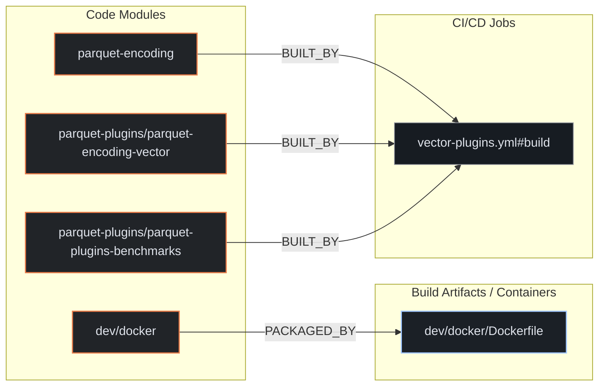

# Repository Architecture Analysis: apache/parquet-java

## Metadata
- **SHA**: `ee88e9c3d0fcd78ac59b58261ef617ff620c6b3f`
- **Primary Ecosystem**: Java

## Quality Metrics
- **ast_engine**: tree-sitter
- **avg_cognitive_complexity**: 0.95
- **avg_cyclomatic_complexity**: 1.69
- **component_count**: 18
- **dead_code_count**: 88
- **dead_code_symbols**: 50 entry(ies)
- **duplication_pct**: 93.5
- **file_complexities**: 25 entry(ies)
- **files_analyzed**: 963
- **fitness_passed**: False
- **fitness_violation_count**: 3
- **framework**: Java Maven/Gradle
- **import_edges**: 100 entry(ies)
- **loc**: 229477
- **max_cognitive_complexity**: 77
- **max_cyclomatic_complexity**: 56
- **sloc**: 162069
- **test_file_count**: 384

# Architecture: apache/parquet-java

## Context
- **Repository**: `apache/parquet-java`
- **SHA**: `ee88e9c3d0fcd78ac59b58261ef617ff620c6b3f`
- **Ecosystem**: Java
- **Framework**: Java Maven/Gradle

## Building Block View

## Component Details
- **parquet-arrow** (`parquet-arrow/pom.xml`): MODULE
- **parquet-avro** (`parquet-avro/pom.xml`): MODULE
- **parquet-benchmarks** (`parquet-benchmarks/pom.xml`): MODULE
- **parquet-cli** (`parquet-cli/pom.xml`): MODULE
- **parquet-column** (`parquet-column/pom.xml`): MODULE
- **parquet-common** (`parquet-common/pom.xml`): MODULE
- **parquet-encoding** (`parquet-encoding/pom.xml`): MODULE
- **parquet-format-structures** (`parquet-format-structures/pom.xml`): MODULE
- **parquet-generator** (`parquet-generator/pom.xml`): MODULE
- **parquet-hadoop** (`parquet-hadoop/pom.xml`): MODULE
- **parquet-hadoop-bundle** (`parquet-hadoop-bundle/pom.xml`): MODULE
- **parquet-jackson** (`parquet-jackson/pom.xml`): MODULE
- **parquet-encoding-vector** (`parquet-plugins/parquet-encoding-vector/pom.xml`): MODULE
- **parquet-plugins-benchmarks** (`parquet-plugins/parquet-plugins-benchmarks/pom.xml`): MODULE
- **parquet-protobuf** (`parquet-protobuf/pom.xml`): MODULE
- **parquet-thrift** (`parquet-thrift/pom.xml`): MODULE
- **parquet-variant** (`parquet-variant/pom.xml`): MODULE
- **parquet** (`pom.xml`): MODULE

## 6-Dimension Repository Scorecard

- **Overall Grade**: `F` (54.80/100)
- **Technical Debt Score**: 45.20
- **Estimated Remediation Effort**: 101.50h

| Dimension | Grade | Score | Weight | Details |
| :--- | :---: | :---: | :---: | :--- |
| Code Quality | `F` | 30.00 | 0.20 | avg_cc=1.69, max_cc=56, duplication=93.50%, dead_code=88 |
| Dependency Health | `B` | 85.00 | 0.15 | dependencies=168, outdated=0, vulnerable=0, has_lockfile=False |
| Maintainability | `F` | 37.00 | 0.15 | avg_cognitive=0.95, max_cognitive=77, fitness_violations=3, oversized_files=22 |
| Pipeline Health | `F` | 0.00 | 0.15 | workflows=8, operational_antipatterns=12, parallel_branches=False |
| Security | `A` | 100.00 | 0.20 | vulnerabilities=0, secrets=0, pipeline_security_findings=0 |
| Test Coverage | `C` | 70.00 | 0.15 | coverage=unavailable, ci_test_job=True, test_files_detected=True |

## Architecture Fitness & Workspace Boundaries

- **[MEDIUM] `ATRUSS-ARCH-005` (COMPLEXITY_THRESHOLD)**: Repository duplication_pct (93.5) exceeds policy threshold (15.0).
- **[MEDIUM] `ATRUSS-ARCH-005` (COMPLEXITY_THRESHOLD)**: Repository max_cognitive_complexity (77.0) exceeds policy threshold (25.0).
- **[MEDIUM] `ATRUSS-ARCH-005` (COMPLEXITY_THRESHOLD)**: Repository max_cyclomatic_complexity (56.0) exceeds policy threshold (20.0).

## Supply Chain Dependencies, Vulnerabilities & Secrets

- **Dependencies Parsed**: 168 | **Vulnerabilities**: 0 | **Secrets**: 0

### Inventory Sample
- `${jackson.datatype.groupId}:jackson-datatype-jsr310` `*` (Maven, `parquet-cli/pom.xml`)
- `${jackson.groupId}:jackson-annotations` `*` (Maven, `parquet-cli/pom.xml`)
- `${jackson.groupId}:jackson-annotations` `*` (Maven, `parquet-hadoop/pom.xml`)
- `${jackson.groupId}:jackson-annotations` `*` (Maven, `parquet-jackson/pom.xml`)
- `${jackson.groupId}:jackson-annotations` `*` (Maven, `parquet-thrift/pom.xml`)
- `${jackson.groupId}:jackson-core` `*` (Maven, `parquet-cli/pom.xml`)
- `${jackson.groupId}:jackson-core` `*` (Maven, `parquet-hadoop/pom.xml`)
- `${jackson.groupId}:jackson-core` `*` (Maven, `parquet-variant/pom.xml`)
- `${jackson.groupId}:jackson-databind` `*` (Maven, `parquet-cli/pom.xml`)
- `${jackson.groupId}:jackson-databind` `*` (Maven, `parquet-hadoop/pom.xml`)
- `${jackson.groupId}:jackson-databind` `*` (Maven, `parquet-thrift/pom.xml`)
- `com.aayushatharva.brotli4j:brotli4j` `*` (Maven, `parquet-hadoop/pom.xml`)
- `com.beust:jcommander` `*` (Maven, `parquet-cli/pom.xml`)
- `com.carrotsearch:junit-benchmarks` `0.7.2` (Maven, `parquet-column/pom.xml`)
- `com.fasterxml.jackson.core:jackson-core` `*` (Maven, `parquet-jackson/pom.xml`)
- `com.fasterxml.jackson.core:jackson-databind` `*` (Maven, `parquet-jackson/pom.xml`)
- `com.github.luben:zstd-jni` `*` (Maven, `parquet-cli/pom.xml`)
- `com.github.luben:zstd-jni` `*` (Maven, `parquet-hadoop/pom.xml`)
- `com.google.api.grpc:proto-google-common-protos` `2.79.0` (Maven, `parquet-protobuf/pom.xml`)
- `com.google.code.findbugs:jsr305` `*` (Maven, `parquet-cli/pom.xml`)
- `com.google.code.findbugs:jsr305` `*` (Maven, `parquet-protobuf/pom.xml`)
- `com.google.guava:guava` `*` (Maven, `parquet-avro/pom.xml`)
- `com.google.guava:guava` `*` (Maven, `parquet-cli/pom.xml`)
- `com.google.guava:guava` `*` (Maven, `parquet-hadoop/pom.xml`)
- `com.google.guava:guava` `*` (Maven, `parquet-protobuf/pom.xml`)
- `com.google.guava:guava` `*` (Maven, `parquet-thrift/pom.xml`)
- `com.google.guava:guava` `*` (Maven, `parquet-variant/pom.xml`)
- `com.google.protobuf:protobuf-java` `4.36.2` (Maven, `parquet-cli/pom.xml`)
- `com.google.protobuf:protobuf-java` `4.36.2` (Maven, `parquet-protobuf/pom.xml`)
- `com.google.protobuf:protobuf-java-util` `4.36.2` (Maven, `parquet-protobuf/pom.xml`)
- ... (+138 more dependencies)

## Section 7: Code-to-Cloud Deployment Traceability

- `dev/docker` (code_module) --[PACKAGED_BY]--> `dev/docker/Dockerfile` (container)
- `parquet-encoding` (code_module) --[BUILT_BY]--> `vector-plugins.yml#build` (ci_job)
- `parquet-plugins/parquet-encoding-vector` (code_module) --[BUILT_BY]--> `vector-plugins.yml#build` (ci_job)
- `parquet-plugins/parquet-plugins-benchmarks` (code_module) --[BUILT_BY]--> `vector-plugins.yml#build` (ci_job)

## CI/CD Pipeline Topology

```mermaid
graph TD;
  classDef atlasRoot fill:#004882,stroke:#a3c9ff,stroke-width:2px,color:#d3e4ff
  classDef atlasCategory fill:#212428,stroke:#E87A48,stroke-width:1.5px,color:#dfe3eb
  classDef atlasWorkflow fill:#1b2026,stroke:#a3c9ff,stroke-width:1.5px,color:#dfe3eb
  classDef atlasJob fill:#171c22,stroke:#8d9199,stroke-width:1px,color:#dfe3eb
  classDef atlasTarget fill:#005227,stroke:#8bd99b,stroke-width:1.5px,color:#a7f6b6
  classDef atlasAlert fill:#93000a,stroke:#ffb4ab,stroke-width:1.5px,color:#ffdad6
  classDef atlasMore fill:#252a31,stroke:#8d9199,stroke-dasharray:4 4,color:#c3c6cf
  pipeline_root(["apache/parquet-java (8 workflows)"]):::atlasRoot
  subgraph sg_grp_0_Release___Deploy["Release & Deploy (4 workflows · 4 jobs)"]
    direction TB
    subgraph sg_wf_1_Test_Release_Scripts["Test Release Scripts (1 jobs)"]
      direction TB
      wf_1_Test_Release_Scripts(["Trigger: Test Release Scripts"]):::atlasWorkflow
      job_1_bats["bats"]:::atlasJob
      wf_1_Test_Release_Scripts --> job_1_bats
    end
    pipeline_root --> wf_1_Test_Release_Scripts
    subgraph sg_wf_2_Release___Cancel_RC["Release - Cancel RC (1 jobs)"]
      direction TB
      wf_2_Release___Cancel_RC(["Trigger: Release - Cancel RC"]):::atlasWorkflow
      job_2_cancel_rc["cancel-rc"]:::atlasJob
      wf_2_Release___Cancel_RC --> job_2_cancel_rc
    end
    pipeline_root --> wf_2_Release___Cancel_RC
    subgraph sg_wf_3_Release___Prepare_RC["Release - Prepare RC (1 jobs)"]
      direction TB
      wf_3_Release___Prepare_RC(["Trigger: Release - Prepare RC"]):::atlasWorkflow
      job_3_prepare_rc["prepare-rc"]:::atlasJob
      wf_3_Release___Prepare_RC --> job_3_prepare_rc
    end
    pipeline_root --> wf_3_Release___Prepare_RC
    subgraph sg_wf_4_Release___Publish_After_Vote["Release - Publish After Vote (1 jobs)"]
      direction TB
      wf_4_Release___Publish_After_Vote(["Trigger: Release - Publish After Vote"]):::atlasWorkflow
      job_4_publish_release["publish-release"]:::atlasJob
      wf_4_Release___Publish_After_Vote --> job_4_publish_release
    end
    pipeline_root --> wf_4_Release___Publish_After_Vote
  end
  subgraph sg_grp_1_CI___Verification["CI & Verification (2 workflows · 2 jobs)"]
    direction TB
    subgraph sg_wf_0_CI_Hadoop_3["CI Hadoop 3 (1 jobs)"]
      direction TB
      wf_0_CI_Hadoop_3(["Trigger: CI Hadoop 3"]):::atlasWorkflow
      job_0_build["build"]:::atlasJob
      wf_0_CI_Hadoop_3 --> job_0_build
    end
    pipeline_root --> wf_0_CI_Hadoop_3
    subgraph sg_wf_6_Vector_plugins["Vector-plugins (1 jobs)"]
      direction TB
      wf_6_Vector_plugins(["Trigger: Vector-plugins"]):::atlasWorkflow
      job_6_build["build"]:::atlasJob
      wf_6_Vector_plugins --> job_6_build
    end
    pipeline_root --> wf_6_Vector_plugins
  end
  subgraph sg_grp_2_Security___Governance["Security & Governance (2 workflows · 2 jobs)"]
    direction TB
    subgraph sg_wf_5_Stale_pull_requests["Stale pull requests (1 jobs)"]
      direction TB
      wf_5_Stale_pull_requests(["Trigger: Stale pull requests"]):::atlasWorkflow
      job_5_stale["stale"]:::atlasJob
      wf_5_Stale_pull_requests --> job_5_stale
    end
    pipeline_root --> wf_5_Stale_pull_requests
    subgraph sg_wf_7_GitHub_Actions_Security_Analysis_with_zizmor__["GitHub Actions Security Analysis with zizmor 🌈 (1 jobs)"]
      direction TB
      wf_7_GitHub_Actions_Security_Analysis_with_zizmor__(["Trigger: GitHub Actions Security Analysis with zizmor 🌈"]):::atlasWorkflow
      job_7_zizmor["zizmor"]:::atlasJob
      wf_7_GitHub_Actions_Security_Analysis_with_zizmor__ --> job_7_zizmor
    end
    pipeline_root --> wf_7_GitHub_Actions_Security_Analysis_with_zizmor__
  end
```

