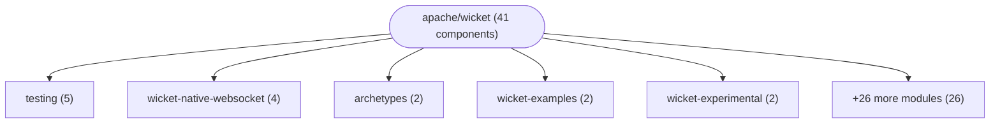
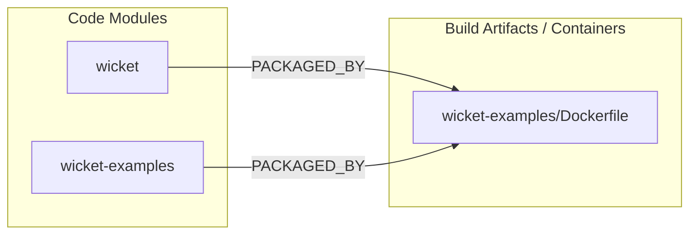
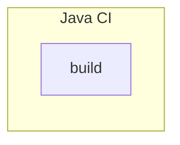

# Repository Architecture Analysis: apache/wicket

## Metadata
- **SHA**: `45a352a32ca39bd2823259d124dc2052b516f6fe`
- **Primary Ecosystem**: Java

## Quality Metrics
- **ast_engine**: tree-sitter
- **avg_cognitive_complexity**: 1.25
- **avg_cyclomatic_complexity**: 2.19
- **component_count**: 41
- **dead_code_count**: 24
- **dead_code_symbols**: 24 entry(ies)
- **duplication_pct**: 89.14
- **file_complexities**: 25 entry(ies)
- **files_analyzed**: 3404
- **fitness_passed**: False
- **fitness_violation_count**: 3
- **framework**: Spring Boot
- **import_edges**: 100 entry(ies)
- **loc**: 449531
- **max_cognitive_complexity**: 93
- **max_cyclomatic_complexity**: 56
- **sloc**: 233746
- **test_file_count**: 2716

# Architecture: apache/wicket

## Context
- **Repository**: `apache/wicket`
- **SHA**: `45a352a32ca39bd2823259d124dc2052b516f6fe`
- **Ecosystem**: Java
- **Framework**: Spring Boot

## Building Block View

## Component Details
- **wicket-archetype-quickstart** (`archetypes/quickstart/pom.xml`): MODULE
- **${artifactId}** (`archetypes/quickstart/src/main/resources/archetype-resources/pom.xml`): MODULE
- **wicket-parent** (`pom.xml`): MODULE
- **wicket-arquillian-testing** (`testing/wicket-arquillian/pom.xml`): MODULE
- **wicket-common-tests** (`testing/wicket-common-tests/pom.xml`): MODULE
- **wicket-js-tests** (`testing/wicket-js-tests/pom.xml`): MODULE
- **wicket-threadtest** (`testing/wicket-threadtest/pom.xml`): MODULE
- **wicket** (`wicket/pom.xml`): MODULE
- **wicket-auth-roles** (`wicket-auth-roles/pom.xml`): MODULE
- **wicket-bean-validation** (`wicket-bean-validation/pom.xml`): MODULE
- **wicket-benchmarks** (`wicket-benchmarks/pom.xml`): MODULE
- **wicket-cdi** (`wicket-cdi/pom.xml`): MODULE
- **wicket-cdi-tests** (`wicket-cdi-tests/pom.xml`): MODULE
- **wicket-core** (`wicket-core/pom.xml`): MODULE
- **wicket-core-tests** (`wicket-core-tests/pom.xml`): MODULE
- **wicket-coverage** (`wicket-coverage/pom.xml`): MODULE
- **wicket-devutils** (`wicket-devutils/pom.xml`): MODULE
- **wicket-eclipse-settings** (`wicket-eclipse-settings/pom.xml`): MODULE
- **wicket-examples** (`wicket-examples/pom.xml`): MODULE
- **wicket-experimental** (`wicket-experimental/pom.xml`): MODULE
- **wicket-metrics** (`wicket-experimental/wicket-metrics/pom.xml`): MODULE
- **wicket-extensions** (`wicket-extensions/pom.xml`): MODULE
- **wicket-extensions-tester** (`wicket-extensions-tester/pom.xml`): MODULE
- **wicket-guice** (`wicket-guice/pom.xml`): MODULE
- **wicket-ioc** (`wicket-ioc/pom.xml`): MODULE
- **wicket-jmx** (`wicket-jmx/pom.xml`): MODULE
- **wicket-migration** (`wicket-migration/pom.xml`): MODULE
- **wicket-native-websocket** (`wicket-native-websocket/pom.xml`): MODULE
- **wicket-native-websocket-core** (`wicket-native-websocket/wicket-native-websocket-core/pom.xml`): MODULE
- **wicket-native-websocket-javax** (`wicket-native-websocket/wicket-native-websocket-javax/pom.xml`): MODULE
- **wicket-native-websocket-tester** (`wicket-native-websocket/wicket-native-websocket-tester/pom.xml`): MODULE
- **wicket-objectsizeof-agent** (`wicket-objectsizeof-agent/pom.xml`): MODULE
- **wicket-request** (`wicket-request/pom.xml`): MODULE
- **wicket-spring** (`wicket-spring/pom.xml`): MODULE
- **wicket-tester** (`wicket-tester/pom.xml`): MODULE
- **wicket-user-guide** (`wicket-user-guide/pom.xml`): MODULE
- **wicket-util** (`wicket-util/pom.xml`): MODULE
- **wicket-velocity** (`wicket-velocity/pom.xml`): MODULE
- **Contact** (`testing/wicket-arquillian/src/main/java/org/apache/wicket/arquillian/testing/model/Contact.java`): DATA_ACCESS_LAYER
- **SpringConfig** (`wicket-examples/src/main/java/org/apache/wicket/examples/spring/common/SpringConfig.java`): CONFIG
- **wicket-minify** (`build-tools/minify/package.json`): MODULE

## 6-Dimension Repository Scorecard

- **Overall Grade**: `C` (71.60/100)
- **Technical Debt Score**: 28.40
- **Estimated Remediation Effort**: 68.93h

| Dimension | Grade | Score | Weight | Details |
| :--- | :---: | :---: | :---: | :--- |
| Code Quality | `F` | 30.00 | 0.20 | avg_cc=2.19, max_cc=56, duplication=89.14%, dead_code=24 |
| Dependency Health | `A` | 100.00 | 0.15 | dependencies=776, outdated=0, vulnerable=0, has_lockfile=True |
| Maintainability | `F` | 37.00 | 0.15 | avg_cognitive=1.25, max_cognitive=93, fitness_violations=3, oversized_files=22 |
| Pipeline Health | `A` | 97.00 | 0.15 | workflows=1, operational_antipatterns=1, parallel_branches=False |
| Security | `A` | 100.00 | 0.20 | vulnerabilities=0, secrets=0, pipeline_security_findings=0 |
| Test Coverage | `C` | 70.00 | 0.15 | coverage=unavailable, ci_test_job=False, test_files_detected=True |

## Architecture Fitness & Workspace Boundaries

- **[MEDIUM] `ATRUSS-ARCH-005` (COMPLEXITY_THRESHOLD)**: Repository duplication_pct (89.14) exceeds policy threshold (15.0).
- **[MEDIUM] `ATRUSS-ARCH-005` (COMPLEXITY_THRESHOLD)**: Repository max_cognitive_complexity (93.0) exceeds policy threshold (25.0).
- **[MEDIUM] `ATRUSS-ARCH-005` (COMPLEXITY_THRESHOLD)**: Repository max_cyclomatic_complexity (56.0) exceeds policy threshold (20.0).

## Supply Chain Dependencies, Vulnerabilities & Secrets

- **Dependencies Parsed**: 776 | **Vulnerabilities**: 0 | **Secrets**: 0

### Inventory Sample
- `com.github.axet:kaptcha` `0.0.9` (Maven, `wicket-examples/pom.xml`)
- `com.github.cage:cage` `1.0` (Maven, `wicket-examples/pom.xml`)
- `com.github.openjson:openjson` `*` (Maven, `wicket-core/pom.xml`)
- `com.google.inject:guice` `*` (Maven, `wicket-guice/pom.xml`)
- `commons-httpclient:commons-httpclient` `3.1` (Maven, `testing/wicket-threadtest/pom.xml`)
- `commons-io:commons-io` `*` (Maven, `wicket-util/pom.xml`)
- `io.dropwizard.metrics:metrics-core` `*` (Maven, `wicket-experimental/wicket-metrics/pom.xml`)
- `io.dropwizard.metrics:metrics-jmx` `*` (Maven, `wicket-experimental/wicket-metrics/pom.xml`)
- `io.github.cdi-unit:cdi-unit` `*` (Maven, `wicket-cdi-tests/pom.xml`)
- `jakarta.annotation:jakarta.annotation-api` `*` (Maven, `wicket-cdi-tests/pom.xml`)
- `jakarta.annotation:jakarta.annotation-api` `*` (Maven, `wicket-cdi/pom.xml`)
- `jakarta.el:jakarta.el-api` `*` (Maven, `wicket-bean-validation/pom.xml`)
- `jakarta.el:jakarta.el-api` `*` (Maven, `wicket-examples/pom.xml`)
- `jakarta.enterprise:jakarta.enterprise.cdi-api` `*` (Maven, `wicket-cdi-tests/pom.xml`)
- `jakarta.enterprise:jakarta.enterprise.cdi-api` `*` (Maven, `wicket-cdi/pom.xml`)
- `jakarta.enterprise:jakarta.enterprise.cdi-api` `*` (Maven, `wicket-examples/pom.xml`)
- `jakarta.inject:jakarta.inject-api` `*` (Maven, `wicket-ioc/pom.xml`)
- `jakarta.servlet.jsp:jakarta.servlet.jsp-api` `*` (Maven, `wicket-examples/pom.xml`)
- `jakarta.servlet:jakarta.servlet-api` `*` (Maven, `wicket-cdi-tests/pom.xml`)
- `jakarta.servlet:jakarta.servlet-api` `*` (Maven, `wicket-cdi/pom.xml`)
- `jakarta.servlet:jakarta.servlet-api` `*` (Maven, `wicket-core-tests/pom.xml`)
- `jakarta.servlet:jakarta.servlet-api` `*` (Maven, `wicket-examples/pom.xml`)
- `jakarta.servlet:jakarta.servlet-api` `*` (Maven, `wicket-experimental/wicket-metrics/pom.xml`)
- `jakarta.servlet:jakarta.servlet-api` `6.1.0` (Maven, `pom.xml`)
- `jakarta.validation:jakarta.validation-api` `*` (Maven, `wicket-bean-validation/pom.xml`)
- `jakarta.validation:jakarta.validation-api` `*` (Maven, `wicket-examples/pom.xml`)
- `jakarta.websocket:jakarta.websocket-api` `*` (Maven, `wicket-native-websocket/wicket-native-websocket-javax/pom.xml`)
- `jakarta.websocket:jakarta.websocket-client-api` `*` (Maven, `wicket-native-websocket/wicket-native-websocket-javax/pom.xml`)
- `net.bytebuddy:byte-buddy` `*` (Maven, `wicket-ioc/pom.xml`)
- `org.apache.commons:commons-collections4` `*` (Maven, `wicket-util/pom.xml`)
- ... (+746 more dependencies)

## Section 7: Code-to-Cloud Deployment Traceability

- `wicket` (code_module) --[PACKAGED_BY]--> `wicket-examples/Dockerfile` (container)
- `wicket-examples` (code_module) --[PACKAGED_BY]--> `wicket-examples/Dockerfile` (container)

## CI/CD Pipeline Topology

