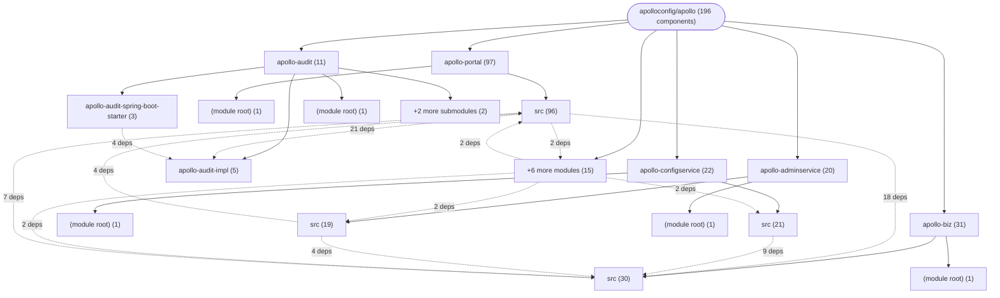

# Repository Architecture Analysis: apolloconfig/apollo

## Metadata
- **SHA**: `e31c48097be6b679fc91ea3a2c67640afc512d31`
- **Primary Ecosystem**: Java

## Quality Metrics
- **avg_cyclomatic_complexity**: 4.87
- **component_count**: 196
- **files_analyzed**: 1586
- **framework**: Spring Boot
- **loc**: 206402
- **max_cyclomatic_complexity**: 104
- **sloc**: 141473

# Architecture: apolloconfig/apollo

## Context
- **Repository**: `apolloconfig/apollo`
- **SHA**: `e31c48097be6b679fc91ea3a2c67640afc512d31`
- **Ecosystem**: Java
- **Framework**: Unknown

## Building Block View

## Component Details

Showing top 60 representative components out of 196 across 11 module group(s):

- **Module `apollo-portal`** (97 components — API_ROUTE: 41, SERVICE: 36, CONFIG: 15)
- **Module `apollo-biz`** (31 components — SERVICE: 17, CONFIG: 8, DATA_ACCESS_LAYER: 5)
- **Module `apollo-configservice`** (22 components — SERVICE: 8, CONFIG: 7, API_ROUTE: 6)
- **Module `apollo-adminservice`** (20 components — API_ROUTE: 15, CONFIG: 4, MODULE: 1)
- **Module `apollo-audit`** (11 components — MODULE: 5, CONFIG: 3, DATA_ACCESS_LAYER: 2)
- **Module `apollo-common`** (7 components — CONFIG: 4, API_ROUTE: 2, MODULE: 1)
- **Module `apollo-assembly`** (3 components — CONFIG: 2, MODULE: 1)
- **Module `e2e`** (2 components — MODULE: 2)
- **Module `(root)`** (1 components — MODULE: 1)
- **Module `apollo-build-sql-converter`** (1 components — MODULE: 1)
- **Module `apollo-buildtools`** (1 components — MODULE: 1)

- **PortalManagementController** (`apollo-portal/src/main/java/com/ctrip/framework/apollo/openapi/v1/controller/PortalManagementController.java`): API_ROUTE (deps: ApolloAuditLog, ApolloAuditProperties, AppService, CommitService, ConfigsExportService, ConfigsImportService (+8 more))
- **NamespaceService** (`apollo-biz/src/main/java/com/ctrip/framework/apollo/biz/service/NamespaceService.java`): SERVICE (deps: AppNamespaceService, AuditService, ClusterService, CommitService, InstanceService, ItemService (+4 more))
- **ReleaseService** (`apollo-biz/src/main/java/com/ctrip/framework/apollo/biz/service/ReleaseService.java`): SERVICE (deps: AuditService, ItemService, ItemSetService, NamespaceBranchService, NamespaceLock, NamespaceLockService (+2 more))
- **NamespaceService** (`apollo-portal/src/main/java/com/ctrip/framework/apollo/portal/service/NamespaceService.java`): SERVICE (deps: AdminServiceAPI, AppNamespaceService, ClusterService, InstanceService, ItemService, NamespaceBranchService (+1 more))
- **AuthFilterConfiguration** (`apollo-portal/src/main/java/com/ctrip/framework/apollo/portal/spi/configuration/AuthFilterConfiguration.java`): CONFIG (deps: AuthConfiguration, ConsumerAuditUtil, ConsumerAuthUtil, UserTokenAuditUtil, UserTokenAuthUtil, UserTokenService)
- **ConfigServiceAutoConfiguration** (`apollo-configservice/src/main/java/com/ctrip/framework/apollo/configservice/ConfigServiceAutoConfiguration.java`): CONFIG (deps: ConfigFileController, NotificationController, NotificationControllerV2, ReleaseMessageService, ReleaseMessageServiceWithCache, ReleaseService)
- **ApolloApplication** (`apollo-assembly/src/main/java/com/ctrip/framework/apollo/assembly/ApolloApplication.java`): CONFIG (deps: AdminService, AdminServiceApplication, ApolloAuditAutoConfiguration, ConfigServiceApplication, PortalApplication)
- **AppService** (`apollo-portal/src/main/java/com/ctrip/framework/apollo/portal/service/AppService.java`): SERVICE (deps: AdminServiceAPI, ApolloAuditLog, AppNamespaceService, ClusterService, FavoriteService)
- **ConfigsImportService** (`apollo-portal/src/main/java/com/ctrip/framework/apollo/portal/service/ConfigsImportService.java`): SERVICE (deps: AppNamespaceService, AppService, ClusterService, ItemService, NamespaceService)
- **LocalApolloApplication** (`apollo-assembly/src/test/java/com/ctrip/framework/apollo/assembly/LocalApolloApplication.java`): CONFIG (deps: AdminService, AdminServiceApplication, ApolloApplication, ConfigServiceApplication, PortalApplication)
- **NamespaceBranchService** (`apollo-biz/src/main/java/com/ctrip/framework/apollo/biz/service/NamespaceBranchService.java`): SERVICE (deps: AuditService, ClusterService, NamespaceService, ReleaseHistoryService, ReleaseService)
- **AdminService** (`apollo-biz/src/main/java/com/ctrip/framework/apollo/biz/service/AdminService.java`): SERVICE (deps: AppNamespaceService, AppService, ClusterService, NamespaceService)
- **AppNamespaceService** (`apollo-biz/src/main/java/com/ctrip/framework/apollo/biz/service/AppNamespaceService.java`): SERVICE (deps: ApolloAuditLog, AuditService, ClusterService, NamespaceService)
- **AuthConfiguration** (`apollo-portal/src/main/java/com/ctrip/framework/apollo/portal/spi/configuration/AuthConfiguration.java`): CONFIG (deps: Authority, LdapExtendProperties, LdapProperties, OidcExtendProperties)
- **ConfigsExportService** (`apollo-portal/src/main/java/com/ctrip/framework/apollo/portal/service/ConfigsExportService.java`): SERVICE (deps: AppNamespaceService, AppService, ClusterService, NamespaceService)
- **InstanceConfigController** (`apollo-adminservice/src/main/java/com/ctrip/framework/apollo/adminservice/controller/InstanceConfigController.java`): API_ROUTE (deps: Instance, InstanceConfig, InstanceService, ReleaseService)
- **ItemController** (`apollo-adminservice/src/main/java/com/ctrip/framework/apollo/adminservice/controller/ItemController.java`): API_ROUTE (deps: CommitService, ItemService, NamespaceService, ReleaseService)
- **ItemService** (`apollo-biz/src/main/java/com/ctrip/framework/apollo/biz/service/ItemService.java`): SERVICE (deps: AdminService, AppNamespaceService, AuditService, NamespaceService)
- **ItemSetService** (`apollo-biz/src/main/java/com/ctrip/framework/apollo/biz/service/ItemSetService.java`): SERVICE (deps: AuditService, CommitService, ItemService, NamespaceService)
- **NamespaceBranchService** (`apollo-portal/src/main/java/com/ctrip/framework/apollo/portal/service/NamespaceBranchService.java`): SERVICE (deps: AdminServiceAPI, ItemService, NamespaceService, ReleaseService)
- **NamespaceController** (`apollo-portal/src/main/java/com/ctrip/framework/apollo/portal/controller/NamespaceController.java`): API_ROUTE (deps: AdminServiceAPI, ApolloAuditLog, AppNamespaceService, NamespaceService)
- **ServerNamespaceManagementOpenApiService** (`apollo-portal/src/main/java/com/ctrip/framework/apollo/openapi/server/service/ServerNamespaceManagementOpenApiService.java`): SERVICE (deps: AdminServiceAPI, AppNamespaceService, NamespaceLockService, NamespaceService)
- **AppController** (`apollo-adminservice/src/main/java/com/ctrip/framework/apollo/adminservice/controller/AppController.java`): API_ROUTE (deps: AccessKeyService, AdminService, AppService)
- **AppController** (`apollo-portal/src/main/java/com/ctrip/framework/apollo/openapi/v1/controller/AppController.java`): API_ROUTE (deps: ApolloAuditLog, ConsumerAuthUtil, ConsumerService)
- **AppNamespaceService** (`apollo-portal/src/main/java/com/ctrip/framework/apollo/portal/service/AppNamespaceService.java`): SERVICE (deps: ApolloAuditLog, ApolloAuditLogDataInfluence, AppService)
- **ConfigServiceApplication** (`apollo-configservice/src/main/java/com/ctrip/framework/apollo/configservice/ConfigServiceApplication.java`): CONFIG (deps: ApolloBizConfig, ApolloCommonConfig, ApolloMetaServiceConfig)
- **InstanceConfigAuditUtil** (`apollo-configservice/src/main/java/com/ctrip/framework/apollo/configservice/util/InstanceConfigAuditUtil.java`): SERVICE (deps: Instance, InstanceConfig, InstanceService)
- **NamespaceBranchController** (`apollo-portal/src/main/java/com/ctrip/framework/apollo/openapi/v1/controller/NamespaceBranchController.java`): API_ROUTE (deps: ApolloAuditLog, NamespaceBranchService, ReleaseService)
- **NamespaceBranchController** (`apollo-portal/src/main/java/com/ctrip/framework/apollo/portal/controller/NamespaceBranchController.java`): API_ROUTE (deps: ApolloAuditLog, NamespaceBranchService, ReleaseService)
- **NamespaceLockController** (`apollo-adminservice/src/main/java/com/ctrip/framework/apollo/adminservice/controller/NamespaceLockController.java`): API_ROUTE (deps: NamespaceLock, NamespaceLockService, NamespaceService)
- **ReleaseController** (`apollo-adminservice/src/main/java/com/ctrip/framework/apollo/adminservice/controller/ReleaseController.java`): API_ROUTE (deps: NamespaceBranchService, NamespaceService, ReleaseService)
- **ServerAppOpenApiService** (`apollo-portal/src/main/java/com/ctrip/framework/apollo/openapi/server/service/ServerAppOpenApiService.java`): SERVICE (deps: AppController, AppService, ClusterService)
- **ServerItemOpenApiService** (`apollo-portal/src/main/java/com/ctrip/framework/apollo/openapi/server/service/ServerItemOpenApiService.java`): SERVICE (deps: AdminService, ItemService, NamespaceService)
- **AccessKeyController** (`apollo-portal/src/main/java/com/ctrip/framework/apollo/portal/controller/AccessKeyController.java`): API_ROUTE (deps: AccessKeyService, ApolloAuditLog)
- **AdminServiceApplication** (`apollo-adminservice/src/main/java/com/ctrip/framework/apollo/adminservice/AdminServiceApplication.java`): CONFIG (deps: ApolloBizConfig, ApolloCommonConfig)
- **ApolloAuditAutoConfiguration** (`apollo-audit/apollo-audit-spring-boot-starter/src/main/java/com/ctrip/framework/apollo/audit/configuration/ApolloAuditAutoConfiguration.java`): CONFIG (deps: ApolloAuditController, ApolloAuditProperties)
- **ApolloAuditNoOpAutoConfiguration** (`apollo-audit/apollo-audit-spring-boot-starter/src/main/java/com/ctrip/framework/apollo/audit/configuration/ApolloAuditNoOpAutoConfiguration.java`): CONFIG (deps: ApolloAuditController, ApolloAuditProperties)
- **AppController** (`apollo-portal/src/main/java/com/ctrip/framework/apollo/portal/controller/AppController.java`): API_ROUTE (deps: ApolloAuditLog, AppService)
- **AppNamespaceController** (`apollo-adminservice/src/main/java/com/ctrip/framework/apollo/adminservice/controller/AppNamespaceController.java`): API_ROUTE (deps: AppNamespaceService, NamespaceService)
- **AppService** (`apollo-biz/src/main/java/com/ctrip/framework/apollo/biz/service/AppService.java`): SERVICE (deps: ApolloAuditLog, AuditService)
- **BizTestConfiguration** (`apollo-biz/src/test/java/com/ctrip/framework/apollo/biz/BizTestConfiguration.java`): CONFIG (deps: ApolloBizConfig, ApolloCommonConfig)
- **ClusterController** (`apollo-portal/src/main/java/com/ctrip/framework/apollo/portal/controller/ClusterController.java`): API_ROUTE (deps: ApolloAuditLog, ClusterService)
- **ClusterService** (`apollo-biz/src/main/java/com/ctrip/framework/apollo/biz/service/ClusterService.java`): SERVICE (deps: AuditService, NamespaceService)
- **ConfigController** (`apollo-configservice/src/main/java/com/ctrip/framework/apollo/configservice/controller/ConfigController.java`): API_ROUTE (deps: AppNamespaceServiceWithCache, InstanceConfigAuditUtil)
- **ConfigFileController** (`apollo-configservice/src/main/java/com/ctrip/framework/apollo/configservice/controller/ConfigFileController.java`): API_ROUTE (deps: ConfigController, ReleaseMessage)
- **ConfigsExportController** (`apollo-portal/src/main/java/com/ctrip/framework/apollo/portal/controller/ConfigsExportController.java`): API_ROUTE (deps: ConfigsExportService, NamespaceService)
- **ConfigsImportController** (`apollo-portal/src/main/java/com/ctrip/framework/apollo/portal/controller/ConfigsImportController.java`): API_ROUTE (deps: ConfigsExportController, ConfigsImportService)
- **ConsumerAuditUtil** (`apollo-portal/src/main/java/com/ctrip/framework/apollo/openapi/util/ConsumerAuditUtil.java`): SERVICE (deps: ConsumerAudit, ConsumerService)
- **ConsumerService** (`apollo-portal/src/main/java/com/ctrip/framework/apollo/openapi/service/ConsumerService.java`): SERVICE (deps: ConsumerAudit, SystemRoleManagerService)
- **InstanceController** (`apollo-portal/src/main/java/com/ctrip/framework/apollo/openapi/v1/controller/InstanceController.java`): API_ROUTE (deps: InstanceService, ReleaseService)
- **InstanceService** (`apollo-biz/src/main/java/com/ctrip/framework/apollo/biz/service/InstanceService.java`): SERVICE (deps: Instance, InstanceConfig)
- **ItemController** (`apollo-portal/src/main/java/com/ctrip/framework/apollo/portal/controller/ItemController.java`): API_ROUTE (deps: ItemService, NamespaceService)
- **NamespaceBranchController** (`apollo-adminservice/src/main/java/com/ctrip/framework/apollo/adminservice/controller/NamespaceBranchController.java`): API_ROUTE (deps: NamespaceBranchService, NamespaceService)
- **NotificationController** (`apollo-configservice/src/main/java/com/ctrip/framework/apollo/configservice/controller/NotificationController.java`): API_ROUTE (deps: ReleaseMessage, ReleaseMessageServiceWithCache)
- **NotificationControllerV2** (`apollo-configservice/src/main/java/com/ctrip/framework/apollo/configservice/controller/NotificationControllerV2.java`): API_ROUTE (deps: ReleaseMessage, ReleaseMessageServiceWithCache)
- **PermissionController** (`apollo-portal/src/main/java/com/ctrip/framework/apollo/portal/controller/PermissionController.java`): API_ROUTE (deps: ApolloAuditLog, SystemRoleManagerService)
- **PortalApplication** (`apollo-portal/src/main/java/com/ctrip/framework/apollo/portal/PortalApplication.java`): CONFIG (deps: ApolloCommonConfig, PortalOpenApiConfig)
- **ReleaseController** (`apollo-portal/src/main/java/com/ctrip/framework/apollo/openapi/v1/controller/ReleaseController.java`): API_ROUTE (deps: NamespaceBranchService, ReleaseService)
- **ReleaseHistoryService** (`apollo-portal/src/main/java/com/ctrip/framework/apollo/portal/service/ReleaseHistoryService.java`): SERVICE (deps: AdminServiceAPI, ReleaseService)
- **ReleaseMessageServiceWithCache** (`apollo-configservice/src/main/java/com/ctrip/framework/apollo/configservice/service/ReleaseMessageServiceWithCache.java`): SERVICE (deps: ReleaseMessage, ReleaseMessageService)

## CI/CD Pipeline Topology

