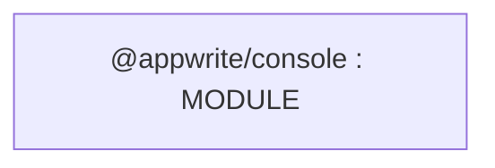
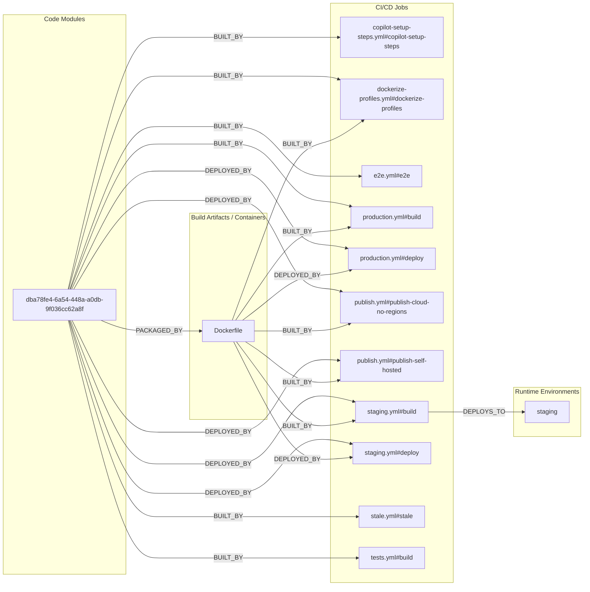
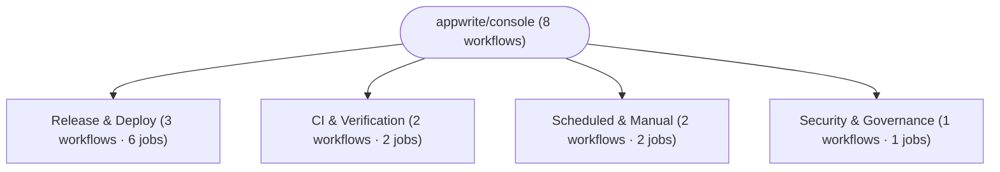

# Repository Architecture Analysis: appwrite/console

## Metadata
- **SHA**: `843f17e6e0ebe1f6c6ef01efa1ec96ae9bb2f85c`
- **Primary Ecosystem**: JavaScript/TypeScript

## Quality Metrics
- **ast_engine**: tree-sitter
- **avg_cognitive_complexity**: 2.63
- **avg_cyclomatic_complexity**: 3.27
- **component_count**: 1
- **dead_code_count**: 7
- **dead_code_symbols**: 7 entry(ies)
- **duplication_pct**: 73.43
- **file_complexities**: 25 entry(ies)
- **files_analyzed**: 424
- **fitness_passed**: False
- **fitness_violation_count**: 3
- **framework**: React (Vite)
- **import_edges**: 100 entry(ies)
- **loc**: 28645
- **max_cognitive_complexity**: 38
- **max_cyclomatic_complexity**: 54
- **sloc**: 24361
- **test_file_count**: 29

# Architecture: appwrite/console

## Context
- **Repository**: `appwrite/console`
- **SHA**: `843f17e6e0ebe1f6c6ef01efa1ec96ae9bb2f85c`
- **Ecosystem**: JavaScript/TypeScript
- **Framework**: React (Vite)

## Building Block View

## Component Details
- **@appwrite/console** (`package.json`): MODULE

## 6-Dimension Repository Scorecard

- **Overall Grade**: `F` (35.78/100)
- **Technical Debt Score**: 64.22
- **Estimated Remediation Effort**: 74.99h

| Dimension | Grade | Score | Weight | Details |
| :--- | :---: | :---: | :---: | :--- |
| Code Quality | `F` | 34.92 | 0.20 | avg_cc=3.27, max_cc=54, duplication=73.43%, dead_code=7 |
| Dependency Health | `B` | 85.00 | 0.15 | dependencies=78, outdated=0, vulnerable=0, has_lockfile=False |
| Maintainability | `F` | 37.00 | 0.15 | avg_cognitive=2.63, max_cognitive=38, fitness_violations=3, oversized_files=4 |
| Pipeline Health | `F` | 0.00 | 0.15 | workflows=8, operational_antipatterns=18, parallel_branches=True |
| Security | `F` | 0.00 | 0.20 | vulnerabilities=0, secrets=1, pipeline_security_findings=8 |
| Test Coverage | `C` | 70.00 | 0.15 | coverage=unavailable, ci_test_job=True, test_files_detected=True |

## Architecture Fitness & Workspace Boundaries

- **[MEDIUM] `ATRUSS-ARCH-005` (COMPLEXITY_THRESHOLD)**: Repository duplication_pct (73.43) exceeds policy threshold (15.0).
- **[MEDIUM] `ATRUSS-ARCH-005` (COMPLEXITY_THRESHOLD)**: Repository max_cognitive_complexity (38.0) exceeds policy threshold (25.0).
- **[MEDIUM] `ATRUSS-ARCH-005` (COMPLEXITY_THRESHOLD)**: Repository max_cyclomatic_complexity (54.0) exceeds policy threshold (20.0).

## Supply Chain Dependencies, Vulnerabilities & Secrets

- **Dependencies Parsed**: 78 | **Vulnerabilities**: 0 | **Secrets**: 1

### Secret Findings (Redacted)
- **[CRITICAL] `ATRUSS-SEC-004`** at `src/routes/(console)/project-[region]-[project]/auth/(providers)/mainOAuth.svelte:345` (`-----BEGIN ... PRIVATE KEY----- [REDACTED]`)

### Inventory Sample
- `@ai-sdk/svelte` `1.1.24` (npm, `package.json`)
- `@appwrite.io/console` `*` (npm, `package.json`)
- `@appwrite.io/pink-icons` `0.25.0` (npm, `package.json`)
- `@appwrite.io/pink-icons-svelte` `*` (npm, `package.json`)
- `@appwrite.io/pink-legacy` `1.0.3` (npm, `package.json`)
- `@appwrite.io/pink-svelte` `*` (npm, `package.json`)
- `@codemirror/autocomplete` `6.20.2` (npm, `package.json`)
- `@codemirror/commands` `6.10.3` (npm, `package.json`)
- `@codemirror/language` `6.12.3` (npm, `package.json`)
- `@codemirror/lint` `6.9.6` (npm, `package.json`)
- `@codemirror/search` `6.7.0` (npm, `package.json`)
- `@codemirror/state` `6.6.0` (npm, `package.json`)
- `@codemirror/view` `6.43.0` (npm, `package.json`)
- `@eslint/compat` `1.4.1` (npm, `package.json`)
- `@eslint/js` `9.39.4` (npm, `package.json`)
- `@faker-js/faker` `10.6.0` (npm, `package.json`)
- `@lezer/common` `1.5.2` (npm, `package.json`)
- `@lezer/highlight` `1.2.3` (npm, `package.json`)
- `@melt-ui/pp` `0.3.2` (npm, `package.json`)
- `@melt-ui/svelte` `0.86.6` (npm, `package.json`)
- `@plausible-analytics/tracker` `0.4.5` (npm, `package.json`)
- `@playwright/test` `1.60.0` (npm, `package.json`)
- `@popperjs/core` `2.11.8` (npm, `package.json`)
- `@sentry/sveltekit` `8.55.2` (npm, `package.json`)
- `@stripe/stripe-js` `3.5.0` (npm, `package.json`)
- `@sveltejs/adapter-static` `3.0.10` (npm, `package.json`)
- `@sveltejs/kit` `2.61.1` (npm, `package.json`)
- `@sveltejs/vite-plugin-svelte` `5.1.1` (npm, `package.json`)
- `@testing-library/dom` `10.4.1` (npm, `package.json`)
- `@testing-library/jest-dom` `6.9.1` (npm, `package.json`)
- ... (+48 more dependencies)

## Section 7: Code-to-Cloud Deployment Traceability

- `staging.yml#build` (ci_job) --[DEPLOYS_TO]--> `staging` (environment)
- `dba78fe4-6a54-448a-a0db-9f036cc62a8f` (code_module) --[BUILT_BY]--> `copilot-setup-steps.yml#copilot-setup-steps` (ci_job)
- `dba78fe4-6a54-448a-a0db-9f036cc62a8f` (code_module) --[BUILT_BY]--> `dockerize-profiles.yml#dockerize-profiles` (ci_job)
- `dba78fe4-6a54-448a-a0db-9f036cc62a8f` (code_module) --[BUILT_BY]--> `e2e.yml#e2e` (ci_job)
- `dba78fe4-6a54-448a-a0db-9f036cc62a8f` (code_module) --[BUILT_BY]--> `production.yml#build` (ci_job)
- `dba78fe4-6a54-448a-a0db-9f036cc62a8f` (code_module) --[BUILT_BY]--> `stale.yml#stale` (ci_job)
- `dba78fe4-6a54-448a-a0db-9f036cc62a8f` (code_module) --[BUILT_BY]--> `tests.yml#build` (ci_job)
- `dba78fe4-6a54-448a-a0db-9f036cc62a8f` (code_module) --[DEPLOYED_BY]--> `production.yml#deploy` (ci_job)
- `dba78fe4-6a54-448a-a0db-9f036cc62a8f` (code_module) --[DEPLOYED_BY]--> `publish.yml#publish-cloud-no-regions` (ci_job)
- `dba78fe4-6a54-448a-a0db-9f036cc62a8f` (code_module) --[DEPLOYED_BY]--> `publish.yml#publish-self-hosted` (ci_job)
- `dba78fe4-6a54-448a-a0db-9f036cc62a8f` (code_module) --[DEPLOYED_BY]--> `staging.yml#build` (ci_job)
- `dba78fe4-6a54-448a-a0db-9f036cc62a8f` (code_module) --[DEPLOYED_BY]--> `staging.yml#deploy` (ci_job)
- `dba78fe4-6a54-448a-a0db-9f036cc62a8f` (code_module) --[PACKAGED_BY]--> `Dockerfile` (container)
- `Dockerfile` (container) --[BUILT_BY]--> `dockerize-profiles.yml#dockerize-profiles` (ci_job)
- `Dockerfile` (container) --[BUILT_BY]--> `production.yml#build` (ci_job)
- `Dockerfile` (container) --[BUILT_BY]--> `publish.yml#publish-cloud-no-regions` (ci_job)
- `Dockerfile` (container) --[BUILT_BY]--> `publish.yml#publish-self-hosted` (ci_job)
- `Dockerfile` (container) --[BUILT_BY]--> `staging.yml#build` (ci_job)
- `Dockerfile` (container) --[DEPLOYED_BY]--> `production.yml#deploy` (ci_job)
- `Dockerfile` (container) --[DEPLOYED_BY]--> `staging.yml#deploy` (ci_job)

## CI/CD Pipeline Topology

