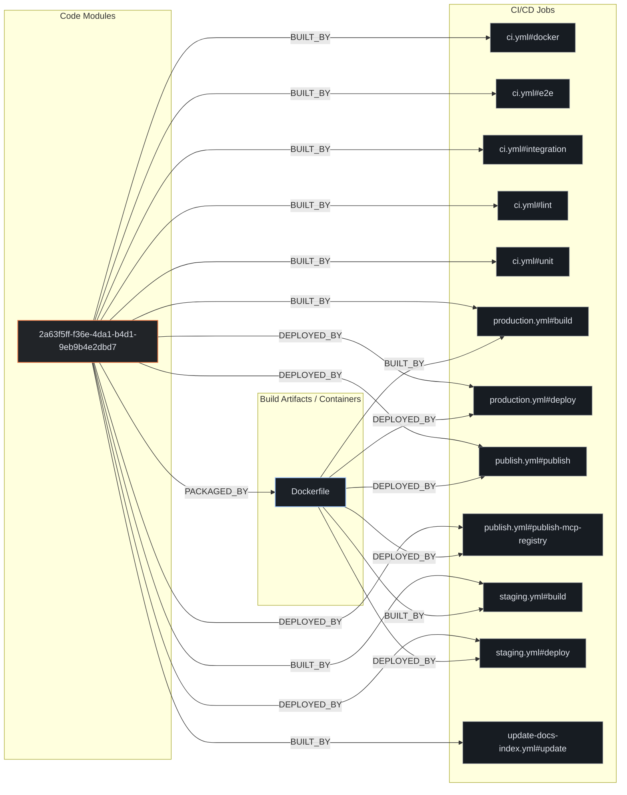
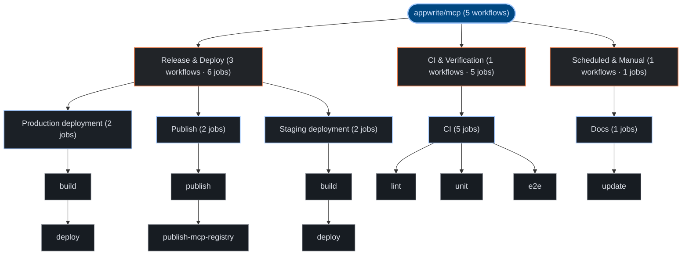

# Repository Architecture Analysis: appwrite/mcp

## Metadata
- **SHA**: `8d00c24a6b77d912631a5dd29c932b6a73dabc97`
- **Primary Ecosystem**: Python

## Quality Metrics
- **ast_engine**: tree-sitter
- **avg_cognitive_complexity**: 2.0
- **avg_cyclomatic_complexity**: 2.51
- **component_count**: 17
- **dead_code_count**: 5
- **dead_code_symbols**: 5 entry(ies)
- **duplication_pct**: 71.25
- **file_complexities**: 25 entry(ies)
- **files_analyzed**: 90
- **fitness_passed**: False
- **fitness_violation_count**: 3
- **framework**: Unknown
- **import_edges**: 100 entry(ies)
- **loc**: 29428
- **max_cognitive_complexity**: 122
- **max_cyclomatic_complexity**: 89
- **sloc**: 24730
- **test_file_count**: 53

# Architecture: appwrite/mcp

## Context
- **Repository**: `appwrite/mcp`
- **SHA**: `8d00c24a6b77d912631a5dd29c932b6a73dabc97`
- **Ecosystem**: Python
- **Framework**: Unknown

## Building Block View

```mermaid
graph TD;
  classDef atlasRoot fill:#004882,stroke:#a3c9ff,stroke-width:2px,color:#d3e4ff
  classDef atlasCategory fill:#212428,stroke:#E87A48,stroke-width:1.5px,color:#dfe3eb
  classDef atlasWorkflow fill:#1b2026,stroke:#a3c9ff,stroke-width:1.5px,color:#dfe3eb
  classDef atlasJob fill:#171c22,stroke:#8d9199,stroke-width:1px,color:#dfe3eb
  classDef atlasTarget fill:#005227,stroke:#8bd99b,stroke-width:1.5px,color:#a7f6b6
  classDef atlasAlert fill:#93000a,stroke:#ffb4ab,stroke-width:1.5px,color:#ffdad6
  classDef atlasMore fill:#252a31,stroke:#8d9199,stroke-dasharray:4 4,color:#c3c6cf
    Service["Service : SERVICE"]:::atlasJob
    ToolManager["ToolManager : SERVICE"]:::atlasJob
    Provider["Provider : DATA_ACCESS_LAYER"]:::atlasJob
    Payload["Payload : DATA_ACCESS_LAYER"]:::atlasJob
    FunctionsService["FunctionsService : SERVICE"]:::atlasJob
    FailingSdkService["FailingSdkService : SERVICE"]:::atlasJob
    SuccessfulSdkService["SuccessfulSdkService : SERVICE"]:::atlasJob
    FailingService["FailingService : SERVICE"]:::atlasJob
    SuccessfulService["SuccessfulService : SERVICE"]:::atlasJob
    FirstService["FirstService : SERVICE"]:::atlasJob
    SecondService["SecondService : SERVICE"]:::atlasJob
    AvatarService["AvatarService : SERVICE"]:::atlasJob
    StorageService["StorageService : SERVICE"]:::atlasJob
    UsersService["UsersService : SERVICE"]:::atlasJob
    ExampleService["ExampleService : SERVICE"]:::atlasJob
    BinaryService["BinaryService : SERVICE"]:::atlasJob
    QueryService["QueryService : SERVICE"]:::atlasJob
    repo_root(["appwrite/mcp"]):::atlasRoot
    repo_root --> Payload
    repo_root --> Provider
    AvatarService --> ToolManager
    BinaryService --> Service
    ExampleService --> Service
    FailingSdkService --> ToolManager
    FailingService --> ToolManager
    FirstService --> ToolManager
    FunctionsService --> ToolManager
    QueryService --> Service
    SecondService --> ToolManager
    StorageService --> ToolManager
    SuccessfulSdkService --> ToolManager
    SuccessfulService --> ToolManager
    ToolManager --> Service
    UsersService --> ToolManager
```

## Component Details
- **Service** (`src/mcp_server_appwrite/service.py`): SERVICE
- **ToolManager** (`src/mcp_server_appwrite/tool_manager.py`): SERVICE (deps: Service)
- **Provider** (`tests/unit/test_error_classification.py`): DATA_ACCESS_LAYER
- **Payload** (`tests/unit/test_error_monitoring.py`): DATA_ACCESS_LAYER
- **FunctionsService** (`tests/unit/test_server.py`): SERVICE (deps: ToolManager)
- **FailingSdkService** (`tests/unit/test_server.py`): SERVICE (deps: ToolManager)
- **SuccessfulSdkService** (`tests/unit/test_server.py`): SERVICE (deps: ToolManager)
- **FailingService** (`tests/unit/test_server.py`): SERVICE (deps: ToolManager)
- **SuccessfulService** (`tests/unit/test_server.py`): SERVICE (deps: ToolManager)
- **FirstService** (`tests/unit/test_server.py`): SERVICE (deps: ToolManager)
- **SecondService** (`tests/unit/test_server.py`): SERVICE (deps: ToolManager)
- **AvatarService** (`tests/unit/test_server.py`): SERVICE (deps: ToolManager)
- **StorageService** (`tests/unit/test_server.py`): SERVICE (deps: ToolManager)
- **UsersService** (`tests/unit/test_server.py`): SERVICE (deps: ToolManager)
- **ExampleService** (`tests/unit/test_service.py`): SERVICE (deps: Service)
- **BinaryService** (`tests/unit/test_service.py`): SERVICE (deps: Service)
- **QueryService** (`tests/unit/test_service.py`): SERVICE (deps: Service)

## 6-Dimension Repository Scorecard

- **Overall Grade**: `F` (45.85/100)
- **Technical Debt Score**: 54.15
- **Estimated Remediation Effort**: 79.04h

| Dimension | Grade | Score | Weight | Details |
| :--- | :---: | :---: | :---: | :--- |
| Code Quality | `F` | 40.00 | 0.20 | avg_cc=2.51, max_cc=89, duplication=71.25%, dead_code=5 |
| Dependency Health | `A` | 100.00 | 0.15 | dependencies=114, outdated=0, vulnerable=0, has_lockfile=True |
| Maintainability | `F` | 37.00 | 0.15 | avg_cognitive=2.00, max_cognitive=122, fitness_violations=3, oversized_files=12 |
| Pipeline Health | `F` | 0.00 | 0.15 | workflows=5, operational_antipatterns=21, parallel_branches=True |
| Security | `F` | 34.00 | 0.20 | vulnerabilities=0, secrets=3, pipeline_security_findings=1 |
| Test Coverage | `C` | 70.00 | 0.15 | coverage=unavailable, ci_test_job=True, test_files_detected=True |

## Architecture Fitness & Workspace Boundaries

- **[MEDIUM] `ATRUSS-ARCH-005` (COMPLEXITY_THRESHOLD)**: Repository duplication_pct (71.25) exceeds policy threshold (15.0).
- **[MEDIUM] `ATRUSS-ARCH-005` (COMPLEXITY_THRESHOLD)**: Repository max_cognitive_complexity (122.0) exceeds policy threshold (25.0).
- **[MEDIUM] `ATRUSS-ARCH-005` (COMPLEXITY_THRESHOLD)**: Repository max_cyclomatic_complexity (89.0) exceeds policy threshold (20.0).

## Supply Chain Dependencies, Vulnerabilities & Secrets

- **Dependencies Parsed**: 114 | **Vulnerabilities**: 0 | **Secrets**: 3

### Secret Findings (Redacted)
- **[HIGH] `ATRUSS-SEC-005`** at `tests/e2e/support.py:1875` (`"password": "$arg***REDACTED***",`)
- **[HIGH] `ATRUSS-SEC-005`** at `tests/unit/fixtures/jwe-v1.json:38` (`"secret": "whse***REDACTED***"`)
- **[HIGH] `ATRUSS-SEC-005`** at `tests/unit/fixtures/jwe-v1.json:47` (`"token": "eyJh***REDACTED***"`)

### Inventory Sample
- `anyio` `4.0.0` (PyPI, `pyproject.toml`)
- `anyio` `4.14.2` (PyPI, `uv.lock`)
- `appwrite-console` `0.16.0` (PyPI, `pyproject.toml`)
- `appwrite-console` `0.16.0` (PyPI, `uv.lock`)
- `argon2-cffi` `23.1.0` (PyPI, `pyproject.toml`)
- `argon2-cffi` `25.1.0` (PyPI, `uv.lock`)
- `bcrypt` `4.1.2` (PyPI, `pyproject.toml`)
- `bcrypt` `5.0.0` (PyPI, `uv.lock`)
- `black` `26.10.1` (PyPI, `pyproject.toml`)
- `black` `26.10.1` (PyPI, `uv.lock`)
- `cryptography` `44.0.0` (PyPI, `pyproject.toml`)
- `cryptography` `50.0.2` (PyPI, `uv.lock`)
- `docstring-parser` `0.16` (PyPI, `pyproject.toml`)
- `docstring-parser` `0.16` (PyPI, `uv.lock`)
- `httpcore` `1.0` (PyPI, `pyproject.toml`)
- `httpcore` `1.0.9` (PyPI, `uv.lock`)
- `httpx` `0.27.0` (PyPI, `pyproject.toml`)
- `httpx` `0.28.1` (PyPI, `uv.lock`)
- `jsonschema` `4.26` (PyPI, `pyproject.toml`)
- `jsonschema` `4.26.0` (PyPI, `uv.lock`)
- `mcp` `2.3` (PyPI, `pyproject.toml`)
- `mcp` `2.3.0` (PyPI, `uv.lock`)
- `mcp-event-subscriptions` `0.1.0a2` (PyPI, `pyproject.toml`)
- `mcp-event-subscriptions` `0.1.0a2` (PyPI, `uv.lock`)
- `numpy` `2.0` (PyPI, `pyproject.toml`)
- `numpy` `2.5.0` (PyPI, `uv.lock`)
- `openai` `1.40` (PyPI, `pyproject.toml`)
- `openai` `2.43.0` (PyPI, `uv.lock`)
- `opentelemetry-api` `1.28` (PyPI, `pyproject.toml`)
- `opentelemetry-api` `1.45.2` (PyPI, `uv.lock`)
- ... (+84 more dependencies)

## Section 7: Code-to-Cloud Deployment Traceability

- `2a63f5ff-f36e-4da1-b4d1-9eb9b4e2dbd7` (code_module) --[BUILT_BY]--> `ci.yml#docker` (ci_job)
- `2a63f5ff-f36e-4da1-b4d1-9eb9b4e2dbd7` (code_module) --[BUILT_BY]--> `ci.yml#e2e` (ci_job)
- `2a63f5ff-f36e-4da1-b4d1-9eb9b4e2dbd7` (code_module) --[BUILT_BY]--> `ci.yml#integration` (ci_job)
- `2a63f5ff-f36e-4da1-b4d1-9eb9b4e2dbd7` (code_module) --[BUILT_BY]--> `ci.yml#lint` (ci_job)
- `2a63f5ff-f36e-4da1-b4d1-9eb9b4e2dbd7` (code_module) --[BUILT_BY]--> `ci.yml#unit` (ci_job)
- `2a63f5ff-f36e-4da1-b4d1-9eb9b4e2dbd7` (code_module) --[BUILT_BY]--> `production.yml#build` (ci_job)
- `2a63f5ff-f36e-4da1-b4d1-9eb9b4e2dbd7` (code_module) --[BUILT_BY]--> `staging.yml#build` (ci_job)
- `2a63f5ff-f36e-4da1-b4d1-9eb9b4e2dbd7` (code_module) --[BUILT_BY]--> `update-docs-index.yml#update` (ci_job)
- `2a63f5ff-f36e-4da1-b4d1-9eb9b4e2dbd7` (code_module) --[DEPLOYED_BY]--> `production.yml#deploy` (ci_job)
- `2a63f5ff-f36e-4da1-b4d1-9eb9b4e2dbd7` (code_module) --[DEPLOYED_BY]--> `publish.yml#publish` (ci_job)
- `2a63f5ff-f36e-4da1-b4d1-9eb9b4e2dbd7` (code_module) --[DEPLOYED_BY]--> `publish.yml#publish-mcp-registry` (ci_job)
- `2a63f5ff-f36e-4da1-b4d1-9eb9b4e2dbd7` (code_module) --[DEPLOYED_BY]--> `staging.yml#deploy` (ci_job)
- `2a63f5ff-f36e-4da1-b4d1-9eb9b4e2dbd7` (code_module) --[PACKAGED_BY]--> `Dockerfile` (container)
- `Dockerfile` (container) --[BUILT_BY]--> `production.yml#build` (ci_job)
- `Dockerfile` (container) --[BUILT_BY]--> `staging.yml#build` (ci_job)
- `Dockerfile` (container) --[DEPLOYED_BY]--> `production.yml#deploy` (ci_job)
- `Dockerfile` (container) --[DEPLOYED_BY]--> `publish.yml#publish` (ci_job)
- `Dockerfile` (container) --[DEPLOYED_BY]--> `publish.yml#publish-mcp-registry` (ci_job)
- `Dockerfile` (container) --[DEPLOYED_BY]--> `staging.yml#deploy` (ci_job)

## CI/CD Pipeline Topology

