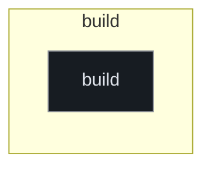

# Repository Architecture Analysis: appwrite/playground-for-android

## Metadata
- **SHA**: `41fad10524034884d12ff5397d9168c4a4ce68d0`
- **Primary Ecosystem**: Java

## Quality Metrics
- **ast_engine**: fallback
- **avg_cognitive_complexity**: 3.33
- **avg_cyclomatic_complexity**: 10.67
- **component_count**: 0
- **dead_code_count**: 0
- **dead_code_symbols**: 0 entry(ies)
- **duplication_pct**: 66.02
- **file_complexities**: 3 entry(ies)
- **files_analyzed**: 3
- **fitness_passed**: False
- **fitness_violation_count**: 2
- **framework**: Java Maven/Gradle
- **import_edges**: 0 entry(ies)
- **loc**: 537
- **max_cognitive_complexity**: 9
- **max_cyclomatic_complexity**: 23
- **sloc**: 489

## 6-Dimension Repository Scorecard

- **Overall Grade**: `C` (73.55/100)
- **Technical Debt Score**: 26.45
- **Estimated Remediation Effort**: 22.82h

| Dimension | Grade | Score | Weight | Details |
| :--- | :---: | :---: | :---: | :--- |
| Code Quality | `F` | 33.00 | 0.20 | avg_cc=10.67, max_cc=23, duplication=66.02%, dead_code=0 |
| Dependency Health | `B` | 85.00 | 0.15 | dependencies=9, outdated=0, vulnerable=0, has_lockfile=False |
| Maintainability | `B` | 88.00 | 0.15 | avg_cognitive=3.33, max_cognitive=9, fitness_violations=2, oversized_files=0 |
| Pipeline Health | `A` | 100.00 | 0.15 | workflows=1, operational_antipatterns=0, parallel_branches=False |
| Security | `A` | 100.00 | 0.20 | vulnerabilities=0, secrets=0, pipeline_security_findings=0 |
| Test Coverage | `F` | 40.00 | 0.15 | coverage=unavailable, ci_test_job=False, test_files_detected=False |

## Architecture Fitness & Workspace Boundaries

- **[MEDIUM] `ATRUSS-ARCH-005` (COMPLEXITY_THRESHOLD)**: Repository duplication_pct (66.02) exceeds policy threshold (15.0).
- **[MEDIUM] `ATRUSS-ARCH-005` (COMPLEXITY_THRESHOLD)**: Repository max_cyclomatic_complexity (23.0) exceeds policy threshold (20.0).

## Supply Chain Dependencies, Vulnerabilities & Secrets

- **Dependencies Parsed**: 9 | **Vulnerabilities**: 0 | **Secrets**: 0

### Inventory Sample
- `androidx.appcompat:appcompat` `1.5.0` (Maven, `app/build.gradle`)
- `androidx.constraintlayout:constraintlayout` `2.1.4` (Maven, `app/build.gradle`)
- `androidx.core:core-ktx` `1.8.0` (Maven, `app/build.gradle`)
- `androidx.lifecycle:lifecycle-viewmodel-ktx` `2.5.1` (Maven, `app/build.gradle`)
- `com.android.tools.build:gradle` `8.5.2` (Maven, `build.gradle`)
- `com.google.android.material:material` `1.6.1` (Maven, `app/build.gradle`)
- `io.appwrite:sdk-for-android` `5.1.0` (Maven, `app/build.gradle`)
- `org.jetbrains.kotlin:kotlin-gradle-plugin` `*` (Maven, `build.gradle`)
- `org.jetbrains.kotlin:kotlin-stdlib` `*` (Maven, `app/build.gradle`)

## CI/CD Pipeline Topology

