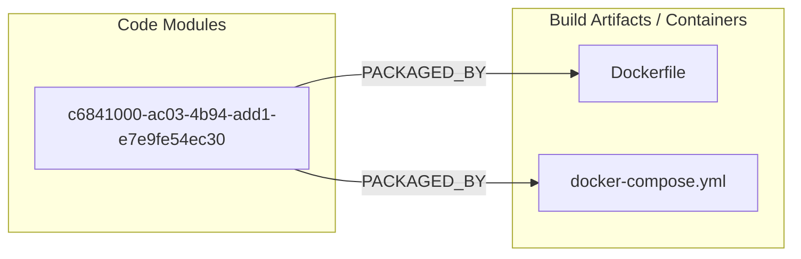

# Repository Architecture Analysis: appwrite/playground-for-python

## Metadata
- **SHA**: `5e569fc722054f6e651f2c6692a7bc92dc1b4cba`
- **Primary Ecosystem**: Python

## Quality Metrics
- **ast_engine**: tree-sitter
- **avg_cognitive_complexity**: 0.0
- **avg_cyclomatic_complexity**: 1.0
- **component_count**: 0
- **dead_code_count**: 1
- **dead_code_symbols**: 1 entry(ies)
- **duplication_pct**: 86.45
- **file_complexities**: 2 entry(ies)
- **files_analyzed**: 2
- **fitness_passed**: False
- **fitness_violation_count**: 1
- **framework**: Unknown
- **import_edges**: 13 entry(ies)
- **loc**: 393
- **max_cognitive_complexity**: 0
- **max_cyclomatic_complexity**: 1
- **sloc**: 290

## 6-Dimension Repository Scorecard

- **Overall Grade**: `C` (73.45/100)
- **Technical Debt Score**: 26.55
- **Estimated Remediation Effort**: 25.68h

| Dimension | Grade | Score | Weight | Details |
| :--- | :---: | :---: | :---: | :--- |
| Code Quality | `C` | 73.00 | 0.20 | avg_cc=1.00, max_cc=1, duplication=86.45%, dead_code=1 |
| Dependency Health | `B` | 85.00 | 0.15 | dependencies=1, outdated=0, vulnerable=0, has_lockfile=False |
| Maintainability | `A` | 94.00 | 0.15 | avg_cognitive=0.00, max_cognitive=0, fitness_violations=1, oversized_files=0 |
| Pipeline Health | `F` | 40.00 | 0.15 | workflows=0 |
| Security | `A` | 100.00 | 0.20 | vulnerabilities=0, secrets=0, pipeline_security_findings=0 |
| Test Coverage | `F` | 40.00 | 0.15 | coverage=unavailable, ci_test_job=False, test_files_detected=False |

## Architecture Fitness & Workspace Boundaries

- **[MEDIUM] `ATRUSS-ARCH-005` (COMPLEXITY_THRESHOLD)**: Repository duplication_pct (86.45) exceeds policy threshold (15.0).

## Supply Chain Dependencies, Vulnerabilities & Secrets

- **Dependencies Parsed**: 1 | **Vulnerabilities**: 0 | **Secrets**: 0

### Inventory Sample
- `appwrite` `6.0.0` (PyPI, `requirements.txt`)

## Section 7: Code-to-Cloud Deployment Traceability

- `c6841000-ac03-4b94-add1-e7e9fe54ec30` (code_module) --[PACKAGED_BY]--> `Dockerfile` (container)
- `c6841000-ac03-4b94-add1-e7e9fe54ec30` (code_module) --[PACKAGED_BY]--> `docker-compose.yml` (container)

## CI/CD Pipeline Topology

