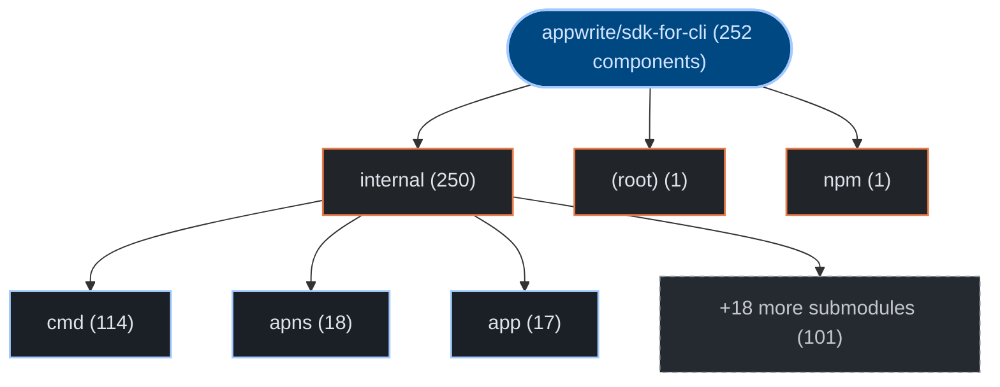
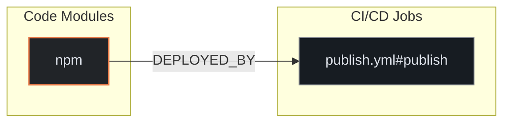
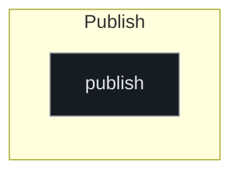

# Repository Architecture Analysis: appwrite/sdk-for-cli

## Metadata
- **SHA**: `0c01f932782178340f1d9dc7c6bb1fea22317d09`
- **Primary Ecosystem**: Go

## Quality Metrics
- **ast_engine**: tree-sitter
- **avg_cognitive_complexity**: 4.36
- **avg_cyclomatic_complexity**: 5.29
- **component_count**: 252
- **dead_code_count**: 0
- **dead_code_symbols**: 0 entry(ies)
- **duplication_pct**: 0.02
- **file_complexities**: 2 entry(ies)
- **files_analyzed**: 309
- **fitness_passed**: True
- **fitness_violation_count**: 0
- **framework**: Go Service
- **import_edges**: 3 entry(ies)
- **loc**: 117273
- **max_cognitive_complexity**: 9
- **max_cyclomatic_complexity**: 7
- **sloc**: 93183
- **test_file_count**: 99

# Architecture: appwrite/sdk-for-cli

## Context
- **Repository**: `appwrite/sdk-for-cli`
- **SHA**: `0c01f932782178340f1d9dc7c6bb1fea22317d09`
- **Ecosystem**: Go
- **Framework**: Go Service

## Building Block View

## Component Details

Showing top 60 representative components out of 252 across 3 module group(s):

- **Module `internal`** (250 components — module: 249, MODULE: 1)
- **Module `(root)`** (1 components — module: 1)
- **Module `npm`** (1 components — MODULE: 1)

- **account** (`internal/cmd/services/account.go`): module
- **activities** (`internal/cmd/services/activities.go`): module
- **adapter** (`internal/apns/appwrite/adapter.go`): module
- **adapter** (`internal/apns/expo/adapter.go`): module
- **adapter** (`internal/apns/fastlane/adapter.go`): module
- **adapter_test** (`internal/apns/appwrite/adapter_test.go`): module
- **adapter_test** (`internal/apns/expo/adapter_test.go`): module
- **adapter_test** (`internal/apns/fastlane/adapter_test.go`): module
- **advisor** (`internal/cmd/services/advisor.go`): module
- **ambient_js** (`internal/cmd/ambient_js.go`): module
- **ambient_js** (`internal/sdk/ambient_js.go`): module
- **ambient_native** (`internal/cmd/ambient_native.go`): module
- **ambient_native** (`internal/sdk/ambient_native.go`): module
- **analytics** (`internal/cmd/services/analytics.go`): module
- **analytics_test** (`internal/cmd/analytics_test.go`): module
- **api** (`internal/terminal/appwrite/api.go`): module
- **apierror_test** (`internal/client/apierror_test.go`): module
- **apns** (`internal/apns/apns.go`): module
- **apns_test** (`internal/apns/apns_test.go`): module
- **apnstest** (`internal/apns/apnstest/apnstest.go`): module
- **appid** (`internal/apns/appwrite/appid.go`): module
- **apps** (`internal/cmd/services/apps.go`): module
- **appwrite-apple-helper** (`internal/apns/expo/helper/package.json`): MODULE
- **appwrite-cli** (`npm/package.json`): MODULE
- **attributes** (`internal/schema/attributes.go`): module
- **attributes_test** (`internal/schema/attributes_test.go`): module
- **auth** (`internal/apns/appwrite/auth.go`): module
- **backups** (`internal/cmd/services/backups.go`): module
- **capture** (`internal/sdk/capture.go`): module
- **capture_test** (`internal/sdk/capture_test.go`): module
- **client** (`internal/app/client.go`): module
- **client** (`internal/client/client.go`): module
- **client** (`internal/cmd/client.go`): module
- **client** (`internal/terminal/appwrite/client.go`): module
- **client_test** (`internal/cmd/client_test.go`): module
- **client_test** (`internal/terminal/appwrite/client_test.go`): module
- **collections** (`internal/output/collections.go`): module
- **commands_host** (`internal/cmd/commands_host.go`): module
- **commands_host_stub** (`internal/cmd/commands_host_stub.go`): module
- **commands_portable** (`internal/cmd/commands_portable.go`): module
- **completion** (`internal/cmd/completion.go`): module
- **completion_test** (`internal/cmd/completion_test.go`): module
- **concurrency_test** (`internal/client/concurrency_test.go`): module
- **config_test** (`internal/config/config_test.go`): module
- **convert** (`internal/app/convert.go`): module
- **convert_test** (`internal/app/convert_test.go`): module
- **database** (`internal/schema/database.go`): module
- **databases** (`internal/cmd/services/databases.go`): module
- **deploy** (`internal/deploy/deploy.go`): module
- **deploy_test** (`internal/deploy/deploy_test.go`): module
- **deploylog** (`internal/output/deploylog.go`): module
- **deploylog_test** (`internal/output/deploylog_test.go`): module
- **detector** (`internal/generator/detector.go`): module
- **device** (`internal/auth/device.go`): module
- **device_test** (`internal/auth/device_test.go`): module
- **doc** (`internal/terminal/appwrite/doc.go`): module
- **docker** (`internal/docker/docker.go`): module
- **docker_test** (`internal/docker/docker_test.go`): module
- **documentsdb** (`internal/cmd/services/documentsdb.go`): module
- **domains** (`internal/cmd/services/domains.go`): module

## 6-Dimension Repository Scorecard

- **Overall Grade**: `D` (69.31/100)
- **Technical Debt Score**: 30.69
- **Estimated Remediation Effort**: 28.18h

| Dimension | Grade | Score | Weight | Details |
| :--- | :---: | :---: | :---: | :--- |
| Code Quality | `A` | 90.81 | 0.20 | avg_cc=5.29, max_cc=7, duplication=0.02%, dead_code=0 |
| Dependency Health | `A` | 100.00 | 0.15 | dependencies=18, outdated=0, vulnerable=0, has_lockfile=True |
| Maintainability | `A` | 100.00 | 0.15 | avg_cognitive=4.36, max_cognitive=9, fitness_violations=0, oversized_files=0 |
| Pipeline Health | `C` | 71.00 | 0.15 | workflows=1, operational_antipatterns=3, parallel_branches=False |
| Security | `F` | 0.00 | 0.20 | vulnerabilities=0, secrets=8, pipeline_security_findings=1 |
| Test Coverage | `C` | 70.00 | 0.15 | coverage=unavailable, ci_test_job=False, test_files_detected=True |

## Supply Chain Dependencies, Vulnerabilities & Secrets

- **Dependencies Parsed**: 18 | **Vulnerabilities**: 0 | **Secrets**: 8

### Secret Findings (Redacted)
- **[CRITICAL] `ATRUSS-SEC-004`** at `internal/apns/appwrite/adapter_test.go:32` (`-----BEGIN ... PRIVATE KEY----- [REDACTED]`)
- **[CRITICAL] `ATRUSS-SEC-004`** at `internal/apns/expo/adapter_test.go:34` (`-----BEGIN ... PRIVATE KEY----- [REDACTED]`)
- **[CRITICAL] `ATRUSS-SEC-004`** at `internal/apns/fastlane/adapter_test.go:37` (`-----BEGIN ... PRIVATE KEY----- [REDACTED]`)
- **[CRITICAL] `ATRUSS-SEC-004`** at `internal/cmd/services/project.go:1152` (`-----BEGIN ... PRIVATE KEY----- [REDACTED]`)
- **[HIGH] `ATRUSS-SEC-005`** at `internal/output/json_test.go:19` (`"apiKey": "stan***REDACTED***"`)
- **[HIGH] `ATRUSS-SEC-005`** at `internal/output/json_test.go:32` (`const sourceDocument = `{"name":"proj","url":"https://x.io/?a=1&b=2","nested":{"apiKey":"stan***REDACTED***"},"list":[{"secret":"short"},1,null,true]}``)
- **[HIGH] `ATRUSS-SEC-005`** at `internal/output/redact_test.go:112` (`"nested": map[string]any{"apiKey": "stan***REDACTED***"},`)
- **[HIGH] `ATRUSS-SEC-005`** at `internal/output/redact_test.go:140` (`input := map[string]any{"secret": "stan***REDACTED***"}`)

### Inventory Sample
- `charm.land/bubbles/v2` `2.2.1` (golang, `go.mod`)
- `charm.land/bubbletea/v2` `2.1.1` (golang, `go.mod`)
- `charm.land/lipgloss/v2` `2.0.6` (golang, `go.mod`)
- `github.com/appwrite/sdk-for-go/v7` `7.19.0` (golang, `go.mod`)
- `github.com/charmbracelet/colorprofile` `0.4.3` (golang, `go.mod`)
- `github.com/charmbracelet/huh` `1.0.0` (golang, `go.mod`)
- `github.com/charmbracelet/lipgloss` `1.1.0` (golang, `go.mod`)
- `github.com/charmbracelet/x/ansi` `0.11.9` (golang, `go.mod`)
- `github.com/fsnotify/fsnotify` `1.10.1` (golang, `go.mod`)
- `github.com/spf13/cobra` `1.10.2` (golang, `go.mod`)
- `github.com/spf13/pflag` `1.0.9` (golang, `go.mod`)
- `github.com/zalando/go-keyring` `0.2.6` (golang, `go.mod`)
- `golang.org/x/sync` `0.22.0` (golang, `go.mod`)
- `golang.org/x/term` `0.33.0` (golang, `go.mod`)
- `@expo/apple-utils` `2.2.1` (npm, `internal/apns/expo/helper/package-lock.json`)
- `@expo/apple-utils` `2.2.1` (npm, `internal/apns/expo/helper/package.json`)
- `github.com/charmbracelet/bubbletea` `1.3.10` (golang, `go.mod`)
- `github.com/charmbracelet/x/cellbuf` `0.0.15` (golang, `go.mod`)

## Section 7: Code-to-Cloud Deployment Traceability

- `npm` (code_module) --[DEPLOYED_BY]--> `publish.yml#publish` (ci_job)

## CI/CD Pipeline Topology

