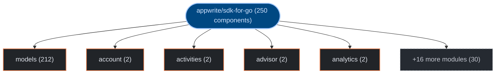
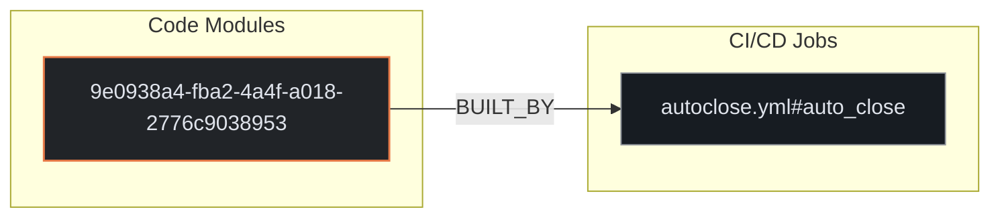
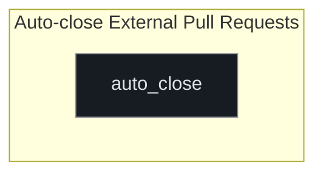

# Repository Architecture Analysis: appwrite/sdk-for-go

## Metadata
- **SHA**: `ac4b239fee3e8ad8f36b7ac179bb1a5e90f7669b`
- **Primary Ecosystem**: Go

## Quality Metrics
- **ast_engine**: fallback
- **avg_cognitive_complexity**: 0.0
- **avg_cyclomatic_complexity**: 0.0
- **component_count**: 250
- **dead_code_count**: 0
- **dead_code_symbols**: 0 entry(ies)
- **duplication_pct**: 0.0
- **file_complexities**: 0 entry(ies)
- **files_analyzed**: 754
- **fitness_passed**: True
- **fitness_violation_count**: 0
- **framework**: Unknown
- **import_edges**: 0 entry(ies)
- **loc**: 194500
- **max_cognitive_complexity**: 0
- **max_cyclomatic_complexity**: 0
- **sloc**: 167301
- **test_file_count**: 375

# Architecture: appwrite/sdk-for-go

## Context
- **Repository**: `appwrite/sdk-for-go`
- **SHA**: `ac4b239fee3e8ad8f36b7ac179bb1a5e90f7669b`
- **Ecosystem**: Go
- **Framework**: Unknown

## Building Block View

## Component Details

Showing top 60 representative components out of 250 across 21 module group(s):

- **Module `models`** (212 components — module: 212)
- **Module `account`** (2 components — module: 2)
- **Module `activities`** (2 components — module: 2)
- **Module `advisor`** (2 components — module: 2)
- **Module `analytics`** (2 components — module: 2)
- **Module `apps`** (2 components — module: 2)
- **Module `avatars`** (2 components — module: 2)
- **Module `backups`** (2 components — module: 2)
- **Module `client`** (2 components — module: 2)
- **Module `databases`** (2 components — module: 2)
- **Module `documentsdb`** (2 components — module: 2)
- **Module `domains`** (2 components — module: 2)

- **account** (`account/account.go`): module
- **account** (`models/account.go`): module
- **account_test** (`account/account_test.go`): module
- **account_test** (`models/account_test.go`): module
- **activities** (`activities/activities.go`): module
- **activities_test** (`activities/activities_test.go`): module
- **activityEvent** (`models/activityEvent.go`): module
- **activityEventList** (`models/activityEventList.go`): module
- **activityEventList_test** (`models/activityEventList_test.go`): module
- **activityEvent_test** (`models/activityEvent_test.go`): module
- **additionalResource** (`models/additionalResource.go`): module
- **additionalResource_test** (`models/additionalResource_test.go`): module
- **advisor** (`advisor/advisor.go`): module
- **advisor_test** (`advisor/advisor_test.go`): module
- **algoArgon2** (`models/algoArgon2.go`): module
- **algoArgon2_test** (`models/algoArgon2_test.go`): module
- **algoBcrypt** (`models/algoBcrypt.go`): module
- **algoBcrypt_test** (`models/algoBcrypt_test.go`): module
- **algoMd5** (`models/algoMd5.go`): module
- **algoMd5_test** (`models/algoMd5_test.go`): module
- **algoPhpass** (`models/algoPhpass.go`): module
- **algoPhpass_test** (`models/algoPhpass_test.go`): module
- **algoScrypt** (`models/algoScrypt.go`): module
- **algoScryptModified** (`models/algoScryptModified.go`): module
- **algoScryptModified_test** (`models/algoScryptModified_test.go`): module
- **algoScrypt_test** (`models/algoScrypt_test.go`): module
- **algoSha** (`models/algoSha.go`): module
- **algoSha_test** (`models/algoSha_test.go`): module
- **analytics** (`analytics/analytics.go`): module
- **analyticsMetric** (`models/analyticsMetric.go`): module
- **analyticsMetricList** (`models/analyticsMetricList.go`): module
- **analyticsMetricList_test** (`models/analyticsMetricList_test.go`): module
- **analyticsMetric_test** (`models/analyticsMetric_test.go`): module
- **analyticsProperty** (`models/analyticsProperty.go`): module
- **analyticsPropertyList** (`models/analyticsPropertyList.go`): module
- **analyticsPropertyList_test** (`models/analyticsPropertyList_test.go`): module
- **analyticsProperty_test** (`models/analyticsProperty_test.go`): module
- **analytics_test** (`analytics/analytics_test.go`): module
- **app** (`models/app.go`): module
- **appInstallation** (`models/appInstallation.go`): module
- **appInstallationList** (`models/appInstallationList.go`): module
- **appInstallationList_test** (`models/appInstallationList_test.go`): module
- **appInstallation_test** (`models/appInstallation_test.go`): module
- **appKey** (`models/appKey.go`): module
- **appKeyList** (`models/appKeyList.go`): module
- **appKeyList_test** (`models/appKeyList_test.go`): module
- **appKey_test** (`models/appKey_test.go`): module
- **appScope** (`models/appScope.go`): module
- **appScopeList** (`models/appScopeList.go`): module
- **appScopeList_test** (`models/appScopeList_test.go`): module
- **appScope_test** (`models/appScope_test.go`): module
- **appSecret** (`models/appSecret.go`): module
- **appSecretList** (`models/appSecretList.go`): module
- **appSecretList_test** (`models/appSecretList_test.go`): module
- **appSecretPlaintext** (`models/appSecretPlaintext.go`): module
- **appSecretPlaintext_test** (`models/appSecretPlaintext_test.go`): module
- **appSecret_test** (`models/appSecret_test.go`): module
- **app_test** (`models/app_test.go`): module
- **apps** (`apps/apps.go`): module
- **appsList** (`models/appsList.go`): module

## 6-Dimension Repository Scorecard

- **Overall Grade**: `C` (73.55/100)
- **Technical Debt Score**: 26.45
- **Estimated Remediation Effort**: 50.61h

| Dimension | Grade | Score | Weight | Details |
| :--- | :---: | :---: | :---: | :--- |
| Code Quality | `A` | 100.00 | 0.20 | avg_cc=0.00, max_cc=0, duplication=0.00%, dead_code=0 |
| Dependency Health | `A` | 90.00 | 0.15 | dependencies=0 (no manifests parsed) |
| Maintainability | `A` | 100.00 | 0.15 | avg_cognitive=0.00, max_cognitive=0, fitness_violations=0, oversized_files=0 |
| Pipeline Health | `A` | 97.00 | 0.15 | workflows=1, operational_antipatterns=1, parallel_branches=False |
| Security | `F` | 0.00 | 0.20 | vulnerabilities=0, secrets=21, pipeline_security_findings=1 |
| Test Coverage | `C` | 70.00 | 0.15 | coverage=unavailable, ci_test_job=False, test_files_detected=True |

## Supply Chain Dependencies, Vulnerabilities & Secrets

- **Dependencies Parsed**: 0 | **Vulnerabilities**: 0 | **Secrets**: 21

### Secret Findings (Redacted)
- **[HIGH] `ATRUSS-SEC-005`** at `account/account_test.go:609` (`"providerIdToken": "eyJh***REDACTED***"`)
- **[HIGH] `ATRUSS-SEC-005`** at `models/algoScryptModified_test.go:10` (`model := AlgoScryptModified{Type: "scryptMod", Salt: "UxLMreBr6tYyjQ==", SaltSeparator: "Bw==", SignerKey: "XyEK***REDACTED***"}`)
- **[HIGH] `ATRUSS-SEC-005`** at `models/algoScryptModified_test.go:106` (`reused := AlgoScryptModified{Type: "scryptMod", Salt: "UxLMreBr6tYyjQ==", SaltSeparator: "Bw==", SignerKey: "XyEK***REDACTED***"}`)
- **[HIGH] `ATRUSS-SEC-005`** at `models/identityList_test.go:10` (`...TM2NDE1ZTZjNGZmZjI3", ProviderIdToken: "eyJh***REDACTED***"}}}`)
- **[HIGH] `ATRUSS-SEC-005`** at `models/identityList_test.go:49` (`...TM2NDE1ZTZjNGZmZjI3", ProviderIdToken: "eyJh***REDACTED***"}}}`)
- **[HIGH] `ATRUSS-SEC-005`** at `models/identity_test.go:10` (`...TM2NDE1ZTZjNGZmZjI3", ProviderIdToken: "eyJh***REDACTED***"}`)
- **[HIGH] `ATRUSS-SEC-005`** at `models/identity_test.go:239` (`...TM2NDE1ZTZjNGZmZjI3", ProviderIdToken: "eyJh***REDACTED***"}`)
- **[CRITICAL] `ATRUSS-SEC-004`** at `models/oAuth2Apple_test.go:10` (`-----BEGIN ... PRIVATE KEY----- [REDACTED]`)
- **[HIGH] `ATRUSS-SEC-005`** at `models/oAuth2Microsoft_test.go:10` (`...bbbb-3333cccc4444", ApplicationSecret: "A1bC***REDACTED***", Prompt: []string{"test"}, Tenant: "co...`)
- **[HIGH] `ATRUSS-SEC-005`** at `models/oAuth2Microsoft_test.go:141` (`...bbbb-3333cccc4444", ApplicationSecret: "A1bC***REDACTED***", Prompt: []string{"test"}, Tenant: "co...`)
- **[HIGH] `ATRUSS-SEC-005`** at `models/resourceTokenList_test.go:10` (`...020-10-15T06:38:00.000+00:00", Secret: "eyJh***REDACTED***", AccessedAt: "2020-10-15T06:38:00.000+...`)
- **[HIGH] `ATRUSS-SEC-005`** at `models/resourceTokenList_test.go:49` (`...020-10-15T06:38:00.000+00:00", Secret: "eyJh***REDACTED***", AccessedAt: "2020-10-15T06:38:00.000+...`)
- **[HIGH] `ATRUSS-SEC-005`** at `models/resourceToken_test.go:10` (`...020-10-15T06:38:00.000+00:00", Secret: "eyJh***REDACTED***", AccessedAt: "2020-10-15T06:38:00.000+...`)
- **[HIGH] `ATRUSS-SEC-005`** at `models/resourceToken_test.go:163` (`...020-10-15T06:38:00.000+00:00", Secret: "eyJh***REDACTED***", AccessedAt: "2020-10-15T06:38:00.000+...`)
- **[CRITICAL] `ATRUSS-SEC-004`** at `project/project_test.go:871` (`-----BEGIN ... PRIVATE KEY----- [REDACTED]`)
- **[HIGH] `ATRUSS-SEC-005`** at `project/project_test.go:1611` (`"applicationSecret": "A1bC***REDACTED***",`)
- **[HIGH] `ATRUSS-SEC-005`** at `tokens/tokens_test.go:30` (`"secret": "eyJh***REDACTED***",`)
- **[HIGH] `ATRUSS-SEC-005`** at `tokens/tokens_test.go:64` (`"secret": "eyJh***REDACTED***",`)
- **[HIGH] `ATRUSS-SEC-005`** at `tokens/tokens_test.go:96` (`"secret": "eyJh***REDACTED***",`)
- **[HIGH] `ATRUSS-SEC-005`** at `tokens/tokens_test.go:128` (`"secret": "eyJh***REDACTED***",`)
- **[HIGH] `ATRUSS-SEC-005`** at `users/users_test.go:252` (`"providerIdToken": "eyJh***REDACTED***"`)

## Section 7: Code-to-Cloud Deployment Traceability

- `9e0938a4-fba2-4a4f-a018-2776c9038953` (code_module) --[BUILT_BY]--> `autoclose.yml#auto_close` (ci_job)

## CI/CD Pipeline Topology

