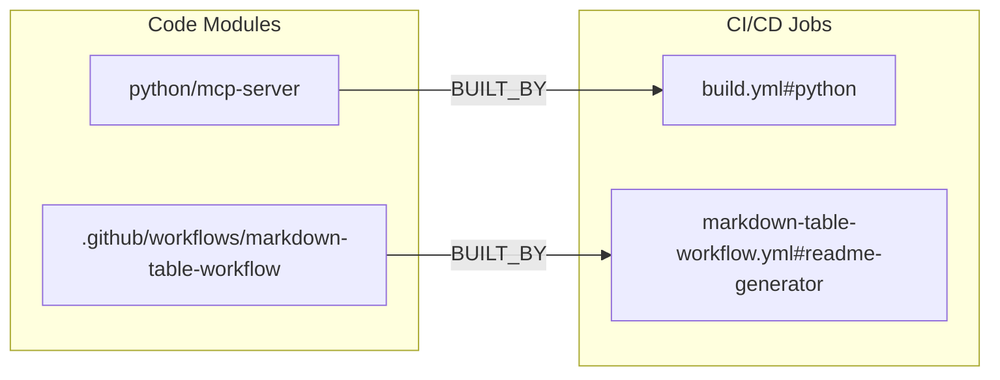
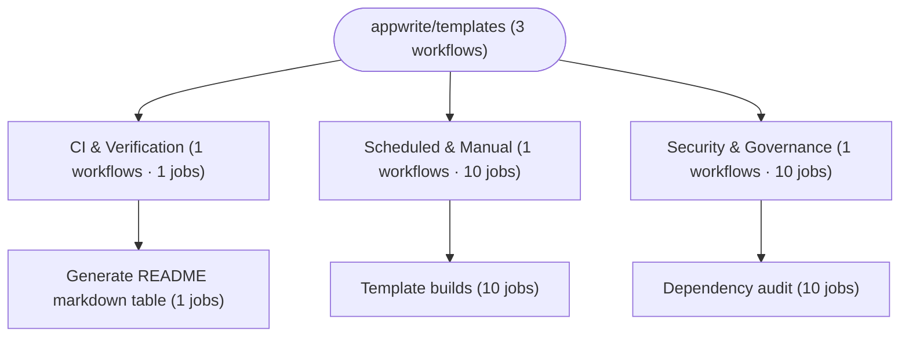

# Repository Architecture Analysis: appwrite/templates

## Metadata
- **SHA**: `d7dba0f5df33380de7c7e3a014a53b690bc20e74`
- **Primary Ecosystem**: JavaScript/TypeScript

## Quality Metrics
- **ast_engine**: tree-sitter
- **avg_cognitive_complexity**: 2.58
- **avg_cyclomatic_complexity**: 3.54
- **component_count**: 18
- **dead_code_count**: 6
- **dead_code_symbols**: 6 entry(ies)
- **duplication_pct**: 16.92
- **file_complexities**: 25 entry(ies)
- **files_analyzed**: 35
- **fitness_passed**: False
- **fitness_violation_count**: 3
- **framework**: TypeScript
- **import_edges**: 71 entry(ies)
- **loc**: 1456
- **max_cognitive_complexity**: 32
- **max_cyclomatic_complexity**: 23
- **sloc**: 1159
- **test_file_count**: 1

# Architecture: appwrite/templates

## Context
- **Repository**: `appwrite/templates`
- **SHA**: `d7dba0f5df33380de7c7e3a014a53b690bc20e74`
- **Ecosystem**: JavaScript/TypeScript
- **Framework**: TypeScript

## Building Block View

```mermaid
graph TD;
    markdown_table_workflow["markdown-table-workflow : MODULE"]
    starter_template["starter-template : MODULE"]
    sync_with_meilisearch["sync-with-meilisearch : MODULE"]
    sync_with_qdrant["sync-with-qdrant : MODULE"]
    AppwriteService["AppwriteService : SERVICE"]
    whatsapp_with_vonage["whatsapp-with-vonage : MODULE"]
    StarterTemplate["StarterTemplate : MODULE"]
    Handler["Handler : SERVICE"]
    discord["discord : module"]
    main["main : module"]
    utils["utils : module"]
    setup["setup : module"]
    discord_bot["discord-bot : MODULE"]
    github_issue_bot_template["github-issue-bot-template : MODULE"]
    GithubService["GithubService : SERVICE"]
    postgres_with_drizzle["postgres-with-drizzle : MODULE"]
    repo_root(["appwrite/templates"])
    repo_root --> AppwriteService
    repo_root --> GithubService
    repo_root --> Handler
    repo_root --> StarterTemplate
    repo_root --> discord
    repo_root --> discord_bot
    repo_root --> github_issue_bot_template
    repo_root --> main
    repo_root --> markdown_table_workflow
    repo_root --> postgres_with_drizzle
    repo_root --> setup
    repo_root --> starter_template
    repo_root --> sync_with_meilisearch
    repo_root --> sync_with_qdrant
    repo_root --> utils
    repo_root --> whatsapp_with_vonage
```

## Component Details
- **markdown-table-workflow** (`.github/workflows/markdown-table-workflow/package.json`): MODULE
- **starter-template** (`bun/starter/package.json`): MODULE
- **sync-with-meilisearch** (`bun/sync-with-meilisearch/package.json`): MODULE
- **sync-with-qdrant** (`bun/sync-with-qdrant/package.json`): MODULE
- **AppwriteService** (`bun/sync-with-qdrant/src/appwrite.ts`): SERVICE
- **whatsapp-with-vonage** (`bun/whatsapp-with-vonage/package.json`): MODULE
- **StarterTemplate** (`dotnet/starter/StarterTemplate.csproj`): MODULE
- **Handler** (`dotnet/starter/src/Index.cs`): SERVICE
- **discord** (`go/discord-command-bot/discord.go`): module
- **main** (`go/discord-command-bot/main.go`): module
- **utils** (`go/discord-command-bot/utils.go`): module
- **setup** (`go/discord-command-bot/cli/setup.go`): module
- **main** (`go/starter/main.go`): module
- **discord-bot** (`node-typescript/discord-command-bot/package.json`): MODULE
- **github-issue-bot-template** (`node-typescript/github-issue-bot/package.json`): MODULE
- **GithubService** (`node-typescript/github-issue-bot/src/github.ts`): SERVICE
- **postgres-with-drizzle** (`node-typescript/postgres-with-drizzle/package.json`): MODULE
- **starter-template** (`node-typescript/starter/package.json`): MODULE

## 6-Dimension Repository Scorecard

- **Overall Grade**: `D` (66.07/100)
- **Technical Debt Score**: 33.93
- **Estimated Remediation Effort**: 32.87h

| Dimension | Grade | Score | Weight | Details |
| :--- | :---: | :---: | :---: | :--- |
| Code Quality | `F` | 48.84 | 0.20 | avg_cc=3.54, max_cc=23, duplication=16.92%, dead_code=6 |
| Dependency Health | `A` | 100.00 | 0.15 | dependencies=1449, outdated=0, vulnerable=0, has_lockfile=True |
| Maintainability | `D` | 64.00 | 0.15 | avg_cognitive=2.58, max_cognitive=32, fitness_violations=3, oversized_files=0 |
| Pipeline Health | `F` | 24.00 | 0.15 | workflows=3, operational_antipatterns=24, parallel_branches=True |
| Security | `B` | 88.00 | 0.20 | vulnerabilities=0, secrets=0, pipeline_security_findings=1 |
| Test Coverage | `C` | 70.00 | 0.15 | coverage=unavailable, ci_test_job=False, test_files_detected=True |

## Architecture Fitness & Workspace Boundaries

- **[MEDIUM] `ATRUSS-ARCH-005` (COMPLEXITY_THRESHOLD)**: Repository duplication_pct (16.92) exceeds policy threshold (15.0).
- **[MEDIUM] `ATRUSS-ARCH-005` (COMPLEXITY_THRESHOLD)**: Repository max_cognitive_complexity (32.0) exceeds policy threshold (25.0).
- **[MEDIUM] `ATRUSS-ARCH-005` (COMPLEXITY_THRESHOLD)**: Repository max_cyclomatic_complexity (23.0) exceeds policy threshold (20.0).

## Supply Chain Dependencies, Vulnerabilities & Secrets

- **Dependencies Parsed**: 1449 | **Vulnerabilities**: 0 | **Secrets**: 0

### Inventory Sample
- `Appwrite` `0.21.2` (NuGet, `dotnet/starter/StarterTemplate.csproj`)
- `PyJWT` `2.10` (PyPI, `python/mcp-server/requirements.txt`)
- `algoliasearch` `3.0.0` (PyPI, `python/sync_with_algolia/requirements.txt`)
- `appwrite` `23.0.0` (PyPI, `python-ml/starter/requirements.txt`)
- `appwrite` `23.0.0` (PyPI, `python/starter/requirements.txt`)
- `appwrite` `23.0.0` (PyPI, `python/storage-cleaner/requirements.txt`)
- `appwrite` `23.0.0` (PyPI, `python/sync_with_algolia/requirements.txt`)
- `appwrite` `23.0.0` (PyPI, `python/sync_with_meilisearch/requirements.txt`)
- `appwrite` `23.0.0` (PyPI, `python/sync_with_qdrant/requirements.txt`)
- `appwrite` `24` (PyPI, `python/mcp-server/requirements.txt`)
- `discord-interactions` `0.4.0` (PyPI, `python/discord_command_bot/requirements.txt`)
- `mcp` `2.0.0` (PyPI, `python/mcp-server/requirements.txt`)
- `meilisearch` `0.30.0` (PyPI, `python/sync_with_meilisearch/requirements.txt`)
- `numpy` `2.0.0` (PyPI, `python-ml/generate_with_tensorflow/requirements.txt`)
- `numpy` `2.0.0` (PyPI, `python-ml/starter/requirements.txt`)
- `openai` `0.27.8` (PyPI, `python/prompt_chatgpt/requirements.txt`)
- `openai` `1.30.0` (PyPI, `python/sync_with_qdrant/requirements.txt`)
- `pyjwt` `2.8.0` (PyPI, `python/whatsapp_with_vonage/requirements.txt`)
- `qdrant-client` `1.9.0` (PyPI, `python/sync_with_qdrant/requirements.txt`)
- `requests` `2.31.0` (PyPI, `python/censor_with_redact/requirements.txt`)
- `requests` `2.31.0` (PyPI, `python/discord_command_bot/requirements.txt`)
- `requests` `2.31.0` (PyPI, `python/whatsapp_with_vonage/requirements.txt`)
- `tensorflow` `2.15.0` (PyPI, `python-ml/generate_with_tensorflow/requirements.txt`)
- `appwrite` `0.4.0` (cargo, `rust/starter/Cargo.toml`)
- `openruntimes` `1.0.2` (cargo, `rust/starter/Cargo.toml`)
- `serde_json` `1.0` (cargo, `rust/starter/Cargo.toml`)
- `tokio` `1.48` (cargo, `rust/starter/Cargo.toml`)
- `algolia/algoliasearch-client-php` `3.4` (composer, `php/sync-with-algolia/composer.json`)
- `appwrite/appwrite` `10.0` (composer, `php/sync-with-meilisearch/composer.json`)
- `appwrite/appwrite` `18.0.1` (composer, `php/starter/composer.json`)
- ... (+1419 more dependencies)

## Section 7: Code-to-Cloud Deployment Traceability

- `.github/workflows/markdown-table-workflow` (code_module) --[BUILT_BY]--> `markdown-table-workflow.yml#readme-generator` (ci_job)
- `python/mcp-server` (code_module) --[BUILT_BY]--> `build.yml#python` (ci_job)

## CI/CD Pipeline Topology

