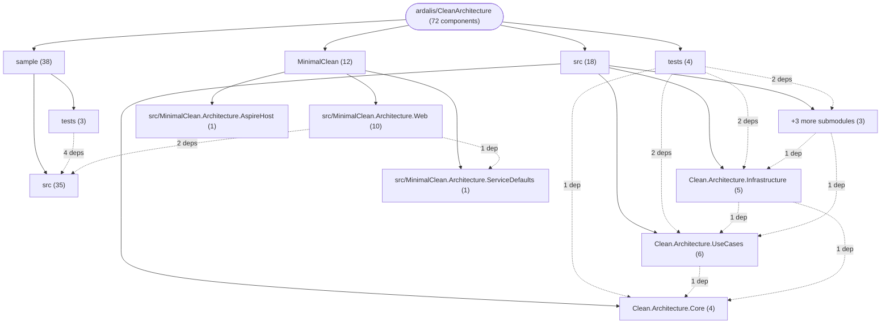
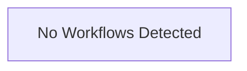

# Repository Architecture Analysis: ardalis/CleanArchitecture

## Metadata
- **SHA**: `60d9ee3a8702abce102b854ac103200928e67da9`
- **Primary Ecosystem**: .NET

## Quality Metrics
- **avg_cyclomatic_complexity**: 2.47
- **component_count**: 72
- **files_analyzed**: 814
- **framework**: ASP.NET Core
- **loc**: 26852
- **max_cyclomatic_complexity**: 13
- **sloc**: 20529

# Architecture: ardalis/CleanArchitecture

## Context
- **Repository**: `ardalis/CleanArchitecture`
- **SHA**: `60d9ee3a8702abce102b854ac103200928e67da9`
- **Ecosystem**: .NET
- **Framework**: Unknown

## Building Block View

## Component Details

Showing top 60 representative components out of 72 across 4 module group(s):

- **Module `sample`** (38 components — SERVICE: 27, MODULE: 9, DATA_ACCESS_LAYER: 2)
- **Module `src`** (18 components — SERVICE: 10, MODULE: 6, DATA_ACCESS_LAYER: 2)
- **Module `MinimalClean`** (12 components — SERVICE: 6, MODULE: 3, DATA_ACCESS_LAYER: 3)
- **Module `tests`** (4 components — MODULE: 4)

- **Clean.Architecture.FunctionalTests** (`tests/Clean.Architecture.FunctionalTests/Clean.Architecture.FunctionalTests.csproj`): MODULE (deps: Clean.Architecture.Infrastructure, Clean.Architecture.UseCases, Clean.Architecture.Web)
- **Clean.Architecture.Web** (`src/Clean.Architecture.Web/Clean.Architecture.Web.csproj`): MODULE (deps: Clean.Architecture.Infrastructure, Clean.Architecture.ServiceDefaults, Clean.Architecture.UseCases)
- **NimblePros.SampleToDo.Web** (`sample/src/NimblePros.SampleToDo.Web/NimblePros.SampleToDo.Web.csproj`): MODULE (deps: NimblePros.SampleToDo.Infrastructure, NimblePros.SampleToDo.ServiceDefaults, NimblePros.SampleToDo.UseCases)
- **Clean.Architecture.AspireHost** (`src/Clean.Architecture.AspireHost/Clean.Architecture.AspireHost.csproj`): MODULE (deps: Clean.Architecture.ServiceDefaults, Clean.Architecture.Web)
- **Clean.Architecture.Infrastructure** (`src/Clean.Architecture.Infrastructure/Clean.Architecture.Infrastructure.csproj`): MODULE (deps: Clean.Architecture.Core, Clean.Architecture.UseCases)
- **Clean.Architecture.UnitTests** (`tests/Clean.Architecture.UnitTests/Clean.Architecture.UnitTests.csproj`): MODULE (deps: Clean.Architecture.Core, Clean.Architecture.UseCases)
- **MinimalClean.Architecture.AspireHost** (`MinimalClean/src/MinimalClean.Architecture.AspireHost/MinimalClean.Architecture.AspireHost.csproj`): MODULE (deps: MinimalClean.Architecture.ServiceDefaults, MinimalClean.Architecture.Web)
- **NimblePros.SampleToDo.AspireHost** (`sample/src/NimblePros.SampleToDo.AspireHost/NimblePros.SampleToDo.AspireHost.csproj`): MODULE (deps: NimblePros.SampleToDo.ServiceDefaults, NimblePros.SampleToDo.Web)
- **NimblePros.SampleToDo.FunctionalTests** (`sample/tests/NimblePros.SampleToDo.FunctionalTests/NimblePros.SampleToDo.FunctionalTests.csproj`): MODULE (deps: NimblePros.SampleToDo.UnitTests, NimblePros.SampleToDo.Web)
- **NimblePros.SampleToDo.Infrastructure** (`sample/src/NimblePros.SampleToDo.Infrastructure/NimblePros.SampleToDo.Infrastructure.csproj`): MODULE (deps: NimblePros.SampleToDo.Core, NimblePros.SampleToDo.UseCases)
- **NimblePros.SampleToDo.IntegrationTests** (`sample/tests/NimblePros.SampleToDo.IntegrationTests/NimblePros.SampleToDo.IntegrationTests.csproj`): MODULE (deps: NimblePros.SampleToDo.Infrastructure, NimblePros.SampleToDo.UnitTests)
- **NimblePros.SampleToDo.UnitTests** (`sample/tests/NimblePros.SampleToDo.UnitTests/NimblePros.SampleToDo.UnitTests.csproj`): MODULE (deps: NimblePros.SampleToDo.Core, NimblePros.SampleToDo.UseCases)
- **AppDbContextFactory** (`MinimalClean/src/MinimalClean.Architecture.Web/Infrastructure/Data/AppDbContextFactory.cs`): DATA_ACCESS_LAYER (deps: AppDbContext)
- **Clean.Architecture.AspireTests** (`tests/Clean.Architecture.AspireTests/Clean.Architecture.AspireTests.csproj`): MODULE (deps: Clean.Architecture.AspireHost)
- **Clean.Architecture.IntegrationTests** (`tests/Clean.Architecture.IntegrationTests/Clean.Architecture.IntegrationTests.csproj`): MODULE (deps: Clean.Architecture.Infrastructure)
- **Clean.Architecture.UseCases** (`src/Clean.Architecture.UseCases/Clean.Architecture.UseCases.csproj`): MODULE (deps: Clean.Architecture.Core)
- **DeleteContributorHandler** (`sample/src/NimblePros.SampleToDo.UseCases/Contributors/Commands/Delete/DeleteContributorHandler.cs`): SERVICE (deps: DeleteContributorService)
- **DeleteContributorHandler** (`src/Clean.Architecture.UseCases/Contributors/Delete/DeleteContributorHandler.cs`): SERVICE (deps: DeleteContributorService)
- **EfRepository** (`MinimalClean/src/MinimalClean.Architecture.Web/Infrastructure/Data/EfRepository.cs`): DATA_ACCESS_LAYER (deps: AppDbContext)
- **EfRepository** (`sample/src/NimblePros.SampleToDo.Infrastructure/Data/EfRepository.cs`): DATA_ACCESS_LAYER (deps: AppDbContext)
- **EfRepository** (`src/Clean.Architecture.Infrastructure/Data/EfRepository.cs`): DATA_ACCESS_LAYER (deps: AppDbContext)
- **FakeListContributorsQueryService** (`sample/src/NimblePros.SampleToDo.Infrastructure/Data/Queries/FakeListContributorsQueryService.cs`): SERVICE (deps: ListContributorsQueryService)
- **FakeListContributorsQueryService** (`src/Clean.Architecture.Infrastructure/Data/Queries/FakeListContributorsQueryService.cs`): SERVICE (deps: ListContributorsQueryService)
- **FakeListIncompleteItemsQueryService** (`sample/src/NimblePros.SampleToDo.Infrastructure/Data/Queries/FakeListIncompleteItemsQueryService.cs`): SERVICE (deps: ListIncompleteItemsQueryService)
- **FakeListProjectsShallowQueryService** (`sample/src/NimblePros.SampleToDo.Infrastructure/Data/Queries/FakeListProjectsShallowQueryService.cs`): SERVICE (deps: ListProjectsShallowQueryService)
- **ListContributorsHandler** (`sample/src/NimblePros.SampleToDo.UseCases/Contributors/Queries/List/ListContributorsHandler.cs`): SERVICE (deps: ListContributorsQueryService)
- **ListContributorsHandler** (`src/Clean.Architecture.UseCases/Contributors/List/ListContributorsHandler.cs`): SERVICE (deps: ListContributorsQueryService)
- **ListContributorsQueryService** (`sample/src/NimblePros.SampleToDo.Infrastructure/Data/Queries/ListContributorsQueryService.cs`): SERVICE (deps: AppDbContext)
- **ListContributorsQueryService** (`src/Clean.Architecture.Infrastructure/Data/Queries/ListContributorsQueryService.cs`): SERVICE (deps: AppDbContext)
- **ListIncompleteItemsByProjectHandler** (`sample/src/NimblePros.SampleToDo.UseCases/Projects/ListIncompleteItems/ListIncompleteItemsByProjectHandler.cs`): SERVICE (deps: ListIncompleteItemsQueryService)
- **ListIncompleteItemsQueryService** (`sample/src/NimblePros.SampleToDo.Infrastructure/Data/Queries/ListIncompleteItemsQueryService.cs`): SERVICE (deps: AppDbContext)
- **ListProductsHandler** (`MinimalClean/src/MinimalClean.Architecture.Web/ProductFeatures/List/ListProductsHandler.cs`): SERVICE (deps: ListProductsQueryService)
- **ListProductsQueryService** (`MinimalClean/src/MinimalClean.Architecture.Web/Infrastructure/Data/Queries/ListProductsQueryService.cs`): SERVICE (deps: AppDbContext)
- **ListProjectsShallowHandler** (`sample/src/NimblePros.SampleToDo.UseCases/Projects/ListShallow/ListProjectsShallowHandler.cs`): SERVICE (deps: ListProjectsShallowQueryService)
- **ListProjectsShallowQueryService** (`sample/src/NimblePros.SampleToDo.Infrastructure/Data/Queries/ListProjectsShallowQueryService.cs`): SERVICE (deps: AppDbContext)
- **MinimalClean.Architecture.Web** (`MinimalClean/src/MinimalClean.Architecture.Web/MinimalClean.Architecture.Web.csproj`): MODULE (deps: MinimalClean.Architecture.ServiceDefaults)
- **NimblePros.SampleToDo.UseCases** (`sample/src/NimblePros.SampleToDo.UseCases/NimblePros.SampleToDo.UseCases.csproj`): MODULE (deps: NimblePros.SampleToDo.Core)
- **AddToCartHandler** (`MinimalClean/src/MinimalClean.Architecture.Web/CartFeatures/AddToCart/AddToCartHandler.cs`): SERVICE
- **AddToDoItemHandler** (`sample/src/NimblePros.SampleToDo.UseCases/Projects/AddToDoItem/AddToDoItemHandler.cs`): SERVICE
- **AppDbContext** (`MinimalClean/src/MinimalClean.Architecture.Web/Infrastructure/Data/AppDbContext.cs`): DATA_ACCESS_LAYER
- **AppDbContext** (`sample/src/NimblePros.SampleToDo.Infrastructure/Data/AppDbContext.cs`): DATA_ACCESS_LAYER
- **AppDbContext** (`src/Clean.Architecture.Infrastructure/Data/AppDbContext.cs`): DATA_ACCESS_LAYER
- **CheckoutHandler** (`MinimalClean/src/MinimalClean.Architecture.Web/CartFeatures/Checkout/CheckoutHandler.cs`): SERVICE
- **Clean.Architecture.Core** (`src/Clean.Architecture.Core/Clean.Architecture.Core.csproj`): MODULE
- **Clean.Architecture.ServiceDefaults** (`src/Clean.Architecture.ServiceDefaults/Clean.Architecture.ServiceDefaults.csproj`): MODULE
- **ContributorAddedToItemLoggingHandler** (`sample/src/NimblePros.SampleToDo.Core/ProjectAggregate/Handlers/ContributorAddedToItemLoggingHandler.cs`): SERVICE
- **ContributorDeletedHandler** (`sample/src/NimblePros.SampleToDo.Core/ContributorAggregate/Handlers/ContributorDeletedHandler.cs`): SERVICE
- **ContributorDeletedHandler** (`src/Clean.Architecture.Core/ContributorAggregate/Handlers/ContributorDeletedHandler.cs`): SERVICE
- **ContributorNameUpdatedEmailNotificationHandler** (`src/Clean.Architecture.Core/ContributorAggregate/Handlers/ContributorNameUpdatedEmailNotificationHandler.cs`): SERVICE
- **ContributorNameUpdatedEventLoggingHandler** (`sample/src/NimblePros.SampleToDo.Core/ContributorAggregate/Handlers/ContributorNameUpdatedEventLoggingHandler.cs`): SERVICE
- **CreateContributorHandler** (`sample/src/NimblePros.SampleToDo.UseCases/Contributors/Commands/Create/CreateContributorHandler.cs`): SERVICE
- **CreateContributorHandler** (`src/Clean.Architecture.UseCases/Contributors/Create/CreateContributorHandler.cs`): SERVICE
- **CreateProjectHandler** (`sample/src/NimblePros.SampleToDo.UseCases/Projects/Create/CreateProjectHandler.cs`): SERVICE
- **DeleteContributorService** (`sample/src/NimblePros.SampleToDo.Core/Services/DeleteContributorService.cs`): SERVICE
- **DeleteContributorService** (`src/Clean.Architecture.Core/Services/DeleteContributorService.cs`): SERVICE
- **DeleteProjectHandler** (`sample/src/NimblePros.SampleToDo.UseCases/Projects/Delete/DeleteProjectHandler.cs`): SERVICE
- **GetCartHandler** (`MinimalClean/src/MinimalClean.Architecture.Web/CartFeatures/GetById/GetCartHandler.cs`): SERVICE
- **GetContributorByIdHandler** (`sample/src/NimblePros.SampleToDo.UseCases/Contributors/Queries/GetById/GetContributorByIdHandler.cs`): SERVICE
- **GetContributorByIdHandler** (`src/Clean.Architecture.UseCases/Contributors/GetById/GetContributorByIdHandler.cs`): SERVICE
- **GetProductHandler** (`MinimalClean/src/MinimalClean.Architecture.Web/ProductFeatures/GetById/GetProductHandler.cs`): SERVICE

## CI/CD Pipeline Topology

