# Repository Architecture Analysis: argoproj/argo-cd

## Metadata
- **SHA**: `0aac46d98401a642d60bca91ddda8cc7873fc916`
- **Primary Ecosystem**: Go

## Quality Metrics
- **ast_engine**: fallback
- **avg_cognitive_complexity**: 0.0
- **avg_cyclomatic_complexity**: 0.0
- **component_count**: 280
- **dead_code_count**: 0
- **dead_code_symbols**: 0 entry(ies)
- **duplication_pct**: 0.0
- **file_complexities**: 0 entry(ies)
- **files_analyzed**: 1126
- **fitness_passed**: True
- **fitness_violation_count**: 0
- **framework**: Go Service
- **import_edges**: 0 entry(ies)
- **loc**: 549091
- **max_cognitive_complexity**: 0
- **max_cyclomatic_complexity**: 0
- **sloc**: 477110
- **test_file_count**: 1226

# Architecture: argoproj/argo-cd

## Context
- **Repository**: `argoproj/argo-cd`
- **SHA**: `0aac46d98401a642d60bca91ddda8cc7873fc916`
- **Ecosystem**: Go
- **Framework**: Go Service

## Building Block View

```mermaid
graph TD;
  classDef atlasRoot fill:#004882,stroke:#a3c9ff,stroke-width:2px,color:#d3e4ff
  classDef atlasCategory fill:#212428,stroke:#E87A48,stroke-width:1.5px,color:#dfe3eb
  classDef atlasWorkflow fill:#1b2026,stroke:#a3c9ff,stroke-width:1.5px,color:#dfe3eb
  classDef atlasJob fill:#171c22,stroke:#8d9199,stroke-width:1px,color:#dfe3eb
  classDef atlasTarget fill:#005227,stroke:#8bd99b,stroke-width:1.5px,color:#a7f6b6
  classDef atlasAlert fill:#93000a,stroke:#ffb4ab,stroke-width:1.5px,color:#ffdad6
  classDef atlasMore fill:#252a31,stroke:#8d9199,stroke-dasharray:4 4,color:#c3c6cf
    repo_root(["argoproj/argo-cd (280 components)"]):::atlasRoot
    dir_0_applicationset["applicationset (159)"]:::atlasCategory
    repo_root --> dir_0_applicationset
    sub_0_0_services["services (59)"]:::atlasWorkflow
    dir_0_applicationset --> sub_0_0_services
    sub_0_1_generators["generators (32)"]:::atlasWorkflow
    dir_0_applicationset --> sub_0_1_generators
    sub_0_2_examples["examples (27)"]:::atlasWorkflow
    dir_0_applicationset --> sub_0_2_examples
    sub_0_more["+6 more submodules (41)"]:::atlasMore
    dir_0_applicationset --> sub_0_more
    dir_1_cmd["cmd (117)"]:::atlasCategory
    repo_root --> dir_1_cmd
    sub_1_0_argocd["argocd (78)"]:::atlasWorkflow
    dir_1_cmd --> sub_1_0_argocd
    sub_1_1_util["util (13)"]:::atlasWorkflow
    dir_1_cmd --> sub_1_1_util
    sub_1_2_argocd_k8s_auth["argocd-k8s-auth (9)"]:::atlasWorkflow
    dir_1_cmd --> sub_1_2_argocd_k8s_auth
    sub_1_more["+10 more submodules (17)"]:::atlasMore
    dir_1_cmd --> sub_1_more
    dir_2_cmpserver["cmpserver (3)"]:::atlasCategory
    repo_root --> dir_2_cmpserver
    dir_3_assets["assets (1)"]:::atlasCategory
    repo_root --> dir_3_assets
```



## Component Details

Showing top 60 representative components out of 280 across 4 module group(s):

- **Module `applicationset`** (159 components — module: 159)
- **Module `cmd`** (117 components — module: 117)
- **Module `cmpserver`** (3 components — module: 3)
- **Module `assets`** (1 components — module: 1)

- **AWSCodeCommitClient** (`applicationset/services/scm_provider/mocks/AWSCodeCommitClient.go`): module
- **AWSTaggingClient** (`applicationset/services/scm_provider/mocks/AWSTaggingClient.go`): module
- **AzureDevOpsClientFactory** (`applicationset/services/scm_provider/mocks/AzureDevOpsClientFactory.go`): module
- **Chart** (`applicationset/examples/git-generator-directory/cluster-addons/prometheus-operator/Chart.yaml`): module
- **Chart** (`applicationset/examples/git-generator-directory/excludes/cluster-addons/exclude-helm-guestbook/Chart.yaml`): module
- **Chart** (`applicationset/examples/git-generator-directory/excludes/cluster-addons/prometheus-operator/Chart.yaml`): module
- **Chart** (`applicationset/examples/matrix/cluster-addons/prometheus-operator/Chart.yaml`): module
- **Client** (`applicationset/services/scm_provider/azure_devops/git/mocks/Client.go`): module
- **Generator** (`applicationset/generators/mocks/Generator.go`): module
- **Renderer** (`applicationset/utils/mocks/Renderer.go`): module
- **Repos** (`applicationset/services/mocks/Repos.go`): module
- **account** (`cmd/argocd/commands/account.go`): module
- **admin** (`cmd/argocd/commands/admin/admin.go`): module
- **admin_test** (`cmd/argocd/commands/admin/admin_test.go`): module
- **app** (`cmd/argocd/commands/admin/app.go`): module
- **app** (`cmd/argocd/commands/app.go`): module
- **app** (`cmd/util/app.go`): module
- **app_actions** (`cmd/argocd/commands/app_actions.go`): module
- **app_diff** (`cmd/argocd/commands/app_diff.go`): module
- **app_diff_test** (`cmd/argocd/commands/app_diff_test.go`): module
- **app_resource_test** (`cmd/argocd/commands/app_resource_test.go`): module
- **app_resources** (`cmd/argocd/commands/app_resources.go`): module
- **app_test** (`cmd/argocd/commands/admin/app_test.go`): module
- **app_test** (`cmd/argocd/commands/app_test.go`): module
- **app_test** (`cmd/util/app_test.go`): module
- **applicationset** (`cmd/argocd/commands/applicationset.go`): module
- **applicationset** (`cmd/util/applicationset.go`): module
- **applicationset_controller** (`applicationset/controllers/applicationset_controller.go`): module
- **applicationset_controller** (`cmd/argocd-applicationset-controller/commands/applicationset_controller.go`): module
- **applicationset_controller_test** (`applicationset/controllers/applicationset_controller_test.go`): module
- **applicationset_controller_test** (`cmd/argocd-applicationset-controller/commands/applicationset_controller_test.go`): module
- **applicationset_lister** (`applicationset/utils/applicationset_lister.go`): module
- **applicationset_test** (`cmd/argocd/commands/applicationset_test.go`): module
- **applicationset_test** (`cmd/util/applicationset_test.go`): module
- **argocd_application_controller** (`cmd/argocd-application-controller/commands/argocd_application_controller.go`): module
- **argocd_application_controller_test** (`cmd/argocd-application-controller/commands/argocd_application_controller_test.go`): module
- **argocd_cmp_server** (`cmd/argocd-cmp-server/commands/argocd_cmp_server.go`): module
- **argocd_commit_server** (`cmd/argocd-commit-server/commands/argocd_commit_server.go`): module
- **argocd_commit_server_test** (`cmd/argocd-commit-server/commands/argocd_commit_server_test.go`): module
- **argocd_dex** (`cmd/argocd-dex/commands/argocd_dex.go`): module
- **argocd_git_ask_pass** (`cmd/argocd-git-ask-pass/commands/argocd_git_ask_pass.go`): module
- **argocd_k8s_auth** (`cmd/argocd-k8s-auth/commands/argocd_k8s_auth.go`): module
- **argocd_notification** (`cmd/argocd-notification/commands/argocd_notification.go`): module
- **argocd_notification_test** (`cmd/argocd-notification/commands/argocd_notification_test.go`): module
- **argocd_repo_server** (`cmd/argocd-repo-server/commands/argocd_repo_server.go`): module
- **argocd_repo_server_test** (`cmd/argocd-repo-server/commands/argocd_repo_server_test.go`): module
- **argocd_server** (`cmd/argocd-server/commands/argocd_server.go`): module
- **argocd_server_test** (`cmd/argocd-server/commands/argocd_server_test.go`): module
- **auth** (`applicationset/services/github_app_auth/auth.go`): module
- **aws** (`cmd/argocd-k8s-auth/commands/aws.go`): module
- **aws_codecommit** (`applicationset/services/scm_provider/aws_codecommit.go`): module
- **aws_codecommit_test** (`applicationset/services/scm_provider/aws_codecommit_test.go`): module
- **aws_test** (`cmd/argocd-k8s-auth/commands/aws_test.go`): module
- **azure_cgo** (`cmd/argocd-k8s-auth/commands/azure_cgo.go`): module
- **azure_cgo_test** (`cmd/argocd-k8s-auth/commands/azure_cgo_test.go`): module
- **azure_devops** (`applicationset/services/pull_request/azure_devops.go`): module
- **azure_devops** (`applicationset/services/scm_provider/azure_devops.go`): module
- **azure_devops_test** (`applicationset/services/pull_request/azure_devops_test.go`): module
- **azure_devops_test** (`applicationset/services/scm_provider/azure_devops_test.go`): module
- **azure_no_cgo** (`cmd/argocd-k8s-auth/commands/azure_no_cgo.go`): module

## 6-Dimension Repository Scorecard

- **Overall Grade**: `D` (60.50/100)
- **Technical Debt Score**: 39.50
- **Estimated Remediation Effort**: 102.38h

| Dimension | Grade | Score | Weight | Details |
| :--- | :---: | :---: | :---: | :--- |
| Code Quality | `A` | 100.00 | 0.20 | avg_cc=0.00, max_cc=0, duplication=0.00%, dead_code=0 |
| Dependency Health | `A` | 100.00 | 0.15 | dependencies=1870, outdated=0, vulnerable=0, has_lockfile=True |
| Maintainability | `A` | 100.00 | 0.15 | avg_cognitive=0.00, max_cognitive=0, fitness_violations=0, oversized_files=0 |
| Pipeline Health | `F` | 0.00 | 0.15 | workflows=17, operational_antipatterns=58, parallel_branches=True |
| Security | `F` | 0.00 | 0.20 | vulnerabilities=0, secrets=13, pipeline_security_findings=11 |
| Test Coverage | `C` | 70.00 | 0.15 | coverage=unavailable, ci_test_job=True, test_files_detected=True |

## Supply Chain Dependencies, Vulnerabilities & Secrets

- **Dependencies Parsed**: 1870 | **Vulnerabilities**: 0 | **Secrets**: 13

### Secret Findings (Redacted)
- **[CRITICAL] `ATRUSS-SEC-004`** at `cmd/util/testdata/test.key.pem:1` (`-----BEGIN ... PRIVATE KEY----- [REDACTED]`)
- **[HIGH] `ATRUSS-SEC-005`** at `docs/developer-guide/api-docs.md:11` (`{"token":"eyJh***REDACTED***"}`)
- **[HIGH] `ATRUSS-SEC-005`** at `docs/faq.md:71` (`"admin.password": "$2a$***REDACTED***",`)
- **[CRITICAL] `ATRUSS-SEC-004`** at `docs/operator-manual/argocd-repo-creds.yaml:26` (`-----BEGIN ... PRIVATE KEY----- [REDACTED]`)
- **[CRITICAL] `ATRUSS-SEC-004`** at `docs/operator-manual/argocd-repo-creds.yaml:43` (`-----BEGIN ... PRIVATE KEY----- [REDACTED]`)
- **[CRITICAL] `ATRUSS-SEC-004`** at `docs/operator-manual/argocd-repo-creds.yaml:61` (`-----BEGIN ... PRIVATE KEY----- [REDACTED]`)
- **[CRITICAL] `ATRUSS-SEC-004`** at `docs/operator-manual/argocd-repositories.yaml:31` (`-----BEGIN ... PRIVATE KEY----- [REDACTED]`)
- **[CRITICAL] `ATRUSS-SEC-004`** at `docs/operator-manual/declarative-setup.md:223` (`-----BEGIN ... PRIVATE KEY----- [REDACTED]`)
- **[CRITICAL] `ATRUSS-SEC-004`** at `docs/operator-manual/declarative-setup.md:244` (`-----BEGIN ... PRIVATE KEY----- [REDACTED]`)
- **[CRITICAL] `ATRUSS-SEC-004`** at `docs/operator-manual/declarative-setup.md:262` (`-----BEGIN ... PRIVATE KEY----- [REDACTED]`)
- **[CRITICAL] `ATRUSS-SEC-004`** at `docs/operator-manual/declarative-setup.md:284` (`-----BEGIN ... PRIVATE KEY----- [REDACTED]`)
- **[CRITICAL] `ATRUSS-SEC-004`** at `docs/operator-manual/notifications/services/github.md:48` (`-----BEGIN ... PRIVATE KEY----- [REDACTED]`)
- **[CRITICAL] `ATRUSS-SEC-004`** at `pkg/apis/application/v1alpha1/repository_types_test.go:147` (`-----BEGIN ... PRIVATE KEY----- [REDACTED]`)

### Inventory Sample
- `jinja2` `3.1.6` (PyPI, `docs/requirements.txt`)
- `markdown` `3.11.3` (PyPI, `docs/requirements.txt`)
- `markdown_include` `0.8.1` (PyPI, `docs/requirements.txt`)
- `mkdocs` `1.6.1` (PyPI, `docs/requirements.txt`)
- `mkdocs-github-admonitions-plugin` `0.1.2` (PyPI, `docs/requirements.txt`)
- `mkdocs-material` `7.1.8` (PyPI, `docs/requirements.txt`)
- `pygments` `2.21.0` (PyPI, `docs/requirements.txt`)
- `pymdown-extensions` `13.1` (PyPI, `docs/requirements.txt`)
- `code.gitea.io/sdk/gitea` `0.25.1` (golang, `go.mod`)
- `dario.cat/mergo` `1.0.2` (golang, `go.mod`)
- `github.com/Azure/azure-sdk-for-go/sdk/azcore` `1.24.0` (golang, `go.mod`)
- `github.com/Azure/azure-sdk-for-go/sdk/azidentity` `1.15.0` (golang, `go.mod`)
- `github.com/Azure/kubelogin` `0.2.22` (golang, `go.mod`)
- `github.com/Masterminds/semver/v3` `3.4.0` (golang, `go.mod`)
- `github.com/Masterminds/sprig/v3` `3.3.0` (golang, `go.mod`)
- `github.com/TomOnTime/utfutil` `1.0.0` (golang, `go.mod`)
- `github.com/alicebob/miniredis/v2` `2.40.0` (golang, `go.mod`)
- `github.com/argoproj/argo-cd/gitops-engine/v3` `3.0.0-00010101000000-000000000000` (golang, `go.mod`)
- `github.com/argoproj/notifications-engine` `0.5.1-0.20260923204536-04b5e2683e70` (golang, `go.mod`)
- `github.com/argoproj/pkg/v2` `2.0.1` (golang, `go.mod`)
- `github.com/aws/aws-sdk-go-v2` `1.47.8` (golang, `go.mod`)
- `github.com/aws/aws-sdk-go-v2/config` `1.33.17` (golang, `go.mod`)
- `github.com/aws/aws-sdk-go-v2/credentials` `1.20.17` (golang, `go.mod`)
- `github.com/aws/aws-sdk-go-v2/service/codecommit` `1.44.6` (golang, `go.mod`)
- `github.com/aws/aws-sdk-go-v2/service/resourcegroupstaggingapi` `1.41.11` (golang, `go.mod`)
- `github.com/aws/aws-sdk-go-v2/service/sts` `1.51.9` (golang, `go.mod`)
- `github.com/aws/smithy-go` `1.28.9` (golang, `go.mod`)
- `github.com/bmatcuk/doublestar/v4` `4.10.4` (golang, `go.mod`)
- `github.com/bombsimon/logrusr/v4` `4.2.0` (golang, `go.mod`)
- `github.com/bradleyfalzon/ghinstallation/v2` `2.19.0` (golang, `go.mod`)
- ... (+1840 more dependencies)

## Section 7: Code-to-Cloud Deployment Traceability

```mermaid
flowchart LR
    classDef atlasCategory fill:#212428,stroke:#E87A48,stroke-width:1.5px,color:#dfe3eb
    classDef atlasWorkflow fill:#1b2026,stroke:#a3c9ff,stroke-width:1.5px,color:#dfe3eb
    classDef atlasJob fill:#171c22,stroke:#8d9199,stroke-width:1px,color:#dfe3eb
    classDef atlasTarget fill:#005227,stroke:#8bd99b,stroke-width:1.5px,color:#a7f6b6
    subgraph code_modules["Code Modules"]
        mod_a15d4c0b_612f_4ca3_8444_1ae36914a530["a15d4c0b-612f-4ca3-8444-1ae36914a530"]:::atlasCategory
        mod_applicationset_examples_template_override_default["applicationset/examples/template-override/default"]:::atlasCategory
        mod_cmpserver_plugin_testdata_kustomize["cmpserver/plugin/testdata/kustomize"]:::atlasCategory
        mod_docs["docs"]:::atlasCategory
        mod_examples_plugins_helm["examples/plugins/helm"]:::atlasCategory
        mod_gitops_engine["gitops-engine"]:::atlasCategory
        mod_gitops_engine_agent_manifests_base["gitops-engine/agent/manifests/base"]:::atlasCategory
        mod_hack["hack"]:::atlasCategory
        mod_hack_get_previous_release["hack/get-previous-release"]:::atlasCategory
        mod_hack_tools["hack/tools"]:::atlasCategory
        mod_manifests_base["manifests/base"]:::atlasCategory
        mod_manifests_base_application_controller["manifests/base/application-controller"]:::atlasCategory
        mod_manifests_base_applicationset_controller["manifests/base/applicationset-controller"]:::atlasCategory
        mod_manifests_base_commit_server["manifests/base/commit-server"]:::atlasCategory
        mod_manifests_base_config["manifests/base/config"]:::atlasCategory
        mod_manifests_base_dex["manifests/base/dex"]:::atlasCategory
        mod_manifests_base_notification["manifests/base/notification"]:::atlasCategory
        mod_manifests_base_redis["manifests/base/redis"]:::atlasCategory
        mod_manifests_base_repo_server["manifests/base/repo-server"]:::atlasCategory
        mod_manifests_base_server["manifests/base/server"]:::atlasCategory
        mod_manifests_cluster_rbac_application_controller["manifests/cluster-rbac/application-controller"]:::atlasCategory
        mod_manifests_cluster_rbac_applicationset_controller["manifests/cluster-rbac/applicationset-controller"]:::atlasCategory
        mod_manifests_cluster_rbac_server["manifests/cluster-rbac/server"]:::atlasCategory
        mod_manifests_ha_base["manifests/ha/base"]:::atlasCategory
        mod_reposerver_repository_testdata_app_parameters_multi["reposerver/repository/testdata/app-parameters/multi"]:::atlasCategory
        mod_test_container["test/container"]:::atlasCategory
        mod_test_e2e_multiarch_container["test/e2e/multiarch-container"]:::atlasCategory
        mod_test_e2e_testdata_helm["test/e2e/testdata/helm"]:::atlasCategory
        mod_test_e2e_testdata_https_kustomize_base_local["test/e2e/testdata/https-kustomize-base/local"]:::atlasCategory
        mod_test_e2e_testdata_https_kustomize_base_remote["test/e2e/testdata/https-kustomize-base/remote"]:::atlasCategory
        mod_test_e2e_testdata_kustomize["test/e2e/testdata/kustomize"]:::atlasCategory
        mod_test_e2e_testdata_ssh_kustomize_base_local["test/e2e/testdata/ssh-kustomize-base/local"]:::atlasCategory
        mod_test_e2e_testdata_ssh_kustomize_base_remote["test/e2e/testdata/ssh-kustomize-base/remote"]:::atlasCategory
        mod_test_manifests_base["test/manifests/base"]:::atlasCategory
        mod_test_manifests_cmp["test/manifests/cmp"]:::atlasCategory
        mod_test_remote["test/remote"]:::atlasCategory
        mod_ui["ui"]:::atlasCategory
        mod_ui_src_app["ui/src/app"]:::atlasCategory
        mod_util_cmp_testdata_app_applicationset_latest["util/cmp/testdata/app/applicationset/latest"]:::atlasCategory
        mod_util_helm_testdata_redis["util/helm/testdata/redis"]:::atlasCategory
        mod_util_helm_testdata_tests["util/helm/testdata/tests"]:::atlasCategory
        mod_util_io_files_testdata_app_applicationset_latest["util/io/files/testdata/app/applicationset/latest"]:::atlasCategory
        mod_util_kustomize_testdata_kustomization_yaml_components_components["util/kustomize/testdata/kustomization_yaml_components/components"]:::atlasCategory
        mod_util_kustomize_testdata_kustomization_yaml_components_monorepo_kustomize_apps_hello_world_base["util/kustomize/testdata/kustomization_yaml_components_monorepo/kustomize/apps/hello-world/base"]:::atlasCategory
        mod_util_kustomize_testdata_kustomization_yaml_components_monorepo_kustomize_components_all["util/kustomize/testdata/kustomization_yaml_components_monorepo/kustomize/components/all"]:::atlasCategory
    end
    subgraph build_artifacts["Build Artifacts / Containers"]
        art_Dockerfile["Dockerfile"]:::atlasWorkflow
        art_Dockerfile_dev["Dockerfile.dev"]:::atlasWorkflow
        art_Dockerfile_tilt["Dockerfile.tilt"]:::atlasWorkflow
        art_Dockerfile_ui_tilt["Dockerfile.ui.tilt"]:::atlasWorkflow
        art_hack_Dockerfile_dev_tools["hack/Dockerfile.dev-tools"]:::atlasWorkflow
        art_test_container_Dockerfile["test/container/Dockerfile"]:::atlasWorkflow
        art_test_e2e_multiarch_container_Dockerfile["test/e2e/multiarch-container/Dockerfile"]:::atlasWorkflow
        art_test_remote_Dockerfile["test/remote/Dockerfile"]:::atlasWorkflow
    end
    subgraph ci_jobs["CI/CD Jobs"]
        job_bump_major_version_yaml_prepare_release["bump-major-version.yaml#prepare-release"]:::atlasJob
        job_cherry_pick_single_yml_cherry_pick["cherry-pick-single.yml#cherry-pick"]:::atlasJob
        job_ci_build_yaml_analyze["ci-build.yaml#analyze"]:::atlasJob
        job_ci_build_yaml_build_go["ci-build.yaml#build-go"]:::atlasJob
        job_ci_build_yaml_build_ui["ci-build.yaml#build-ui"]:::atlasJob
        job_ci_build_yaml_lint_actions["ci-build.yaml#lint-actions"]:::atlasJob
        job_ci_build_yaml_lint_manifests["ci-build.yaml#lint-manifests"]:::atlasJob
        job_ci_build_yaml_shellcheck["ci-build.yaml#shellcheck"]:::atlasJob
        job_ci_build_yaml_test_e2e["ci-build.yaml#test-e2e"]:::atlasJob
        job_ci_build_yaml_test_e2e_composite_result["ci-build.yaml#test-e2e-composite-result"]:::atlasJob
        job_e2e_shard_weights_yaml_refresh["e2e-shard-weights.yaml#refresh"]:::atlasJob
        job_image_reuse_yaml_publish["image-reuse.yaml#publish"]:::atlasJob
        job_image_yaml_set_vars["image.yaml#set-vars"]:::atlasJob
        job_init_release_yaml_prepare_release["init-release.yaml#prepare-release"]:::atlasJob
        job_release_yaml_generate_sbom["release.yaml#generate-sbom"]:::atlasJob
        job_release_yaml_goreleaser["release.yaml#goreleaser"]:::atlasJob
        job_release_yaml_post_release["release.yaml#post-release"]:::atlasJob
        job_renovate_yaml_renovate["renovate.yaml#renovate"]:::atlasJob
        job_update_snyk_yaml_make_report_pr["update-snyk.yaml#make-report-pr"]:::atlasJob
    end
    subgraph runtime_envs["Runtime Environments"]
        env_kubernetes["kubernetes"]:::atlasTarget
    end
    job_ci_build_yaml_test_e2e -->|DEPLOYS_TO| env_kubernetes
    mod_a15d4c0b_612f_4ca3_8444_1ae36914a530 -->|DEPLOYED_BY| job_image_reuse_yaml_publish
    mod_a15d4c0b_612f_4ca3_8444_1ae36914a530 -->|PACKAGED_BY| art_Dockerfile
    mod_a15d4c0b_612f_4ca3_8444_1ae36914a530 -->|PACKAGED_BY| art_Dockerfile_dev
    mod_a15d4c0b_612f_4ca3_8444_1ae36914a530 -->|PACKAGED_BY| art_Dockerfile_tilt
    mod_a15d4c0b_612f_4ca3_8444_1ae36914a530 -->|PACKAGED_BY| art_Dockerfile_ui_tilt
    mod_applicationset_examples_template_override_default -->|PACKAGED_BY| art_Dockerfile
    mod_cmpserver_plugin_testdata_kustomize -->|PACKAGED_BY| art_Dockerfile
    mod_cmpserver_plugin_testdata_kustomize -->|PACKAGED_BY| art_Dockerfile_tilt
    mod_cmpserver_plugin_testdata_kustomize -->|PACKAGED_BY| art_test_container_Dockerfile
    mod_docs -->|BUILT_BY| job_update_snyk_yaml_make_report_pr
    mod_docs -->|DEPLOYED_BY| job_bump_major_version_yaml_prepare_release
    mod_examples_plugins_helm -->|PACKAGED_BY| art_Dockerfile
    mod_examples_plugins_helm -->|PACKAGED_BY| art_Dockerfile_tilt
    mod_examples_plugins_helm -->|PACKAGED_BY| art_test_container_Dockerfile
    mod_gitops_engine -->|BUILT_BY| job_ci_build_yaml_analyze
    mod_gitops_engine -->|DEPLOYED_BY| job_init_release_yaml_prepare_release
    mod_gitops_engine -->|DEPLOYED_BY| job_release_yaml_post_release
    mod_gitops_engine -->|PACKAGED_BY| art_Dockerfile
    mod_gitops_engine -->|PACKAGED_BY| art_test_container_Dockerfile
    mod_gitops_engine_agent_manifests_base -->|PACKAGED_BY| art_Dockerfile
    mod_gitops_engine_agent_manifests_base -->|PACKAGED_BY| art_Dockerfile_dev
    mod_gitops_engine_agent_manifests_base -->|PACKAGED_BY| art_hack_Dockerfile_dev_tools
    mod_hack -->|BUILT_BY| job_ci_build_yaml_lint_actions
    mod_hack -->|BUILT_BY| job_ci_build_yaml_lint_manifests
    mod_hack -->|BUILT_BY| job_ci_build_yaml_test_e2e_composite_result
    mod_hack -->|BUILT_BY| job_e2e_shard_weights_yaml_refresh
    mod_hack -->|BUILT_BY| job_renovate_yaml_renovate
    mod_hack -->|DEPLOYED_BY| job_bump_major_version_yaml_prepare_release
    mod_hack -->|DEPLOYED_BY| job_init_release_yaml_prepare_release
    mod_hack -->|DEPLOYED_BY| job_release_yaml_goreleaser
    mod_hack -->|PACKAGED_BY| art_Dockerfile
    mod_hack -->|PACKAGED_BY| art_Dockerfile_tilt
    mod_hack -->|PACKAGED_BY| art_hack_Dockerfile_dev_tools
    mod_hack -->|PACKAGED_BY| art_test_container_Dockerfile
    mod_hack_get_previous_release -->|DEPLOYED_BY| job_release_yaml_goreleaser
    mod_hack_tools -->|PACKAGED_BY| art_hack_Dockerfile_dev_tools
    mod_hack_tools -->|PACKAGED_BY| art_test_container_Dockerfile
    mod_manifests_base -->|PACKAGED_BY| art_Dockerfile
    mod_manifests_base -->|PACKAGED_BY| art_Dockerfile_dev
    mod_manifests_base -->|PACKAGED_BY| art_hack_Dockerfile_dev_tools
    mod_manifests_base_application_controller -->|PACKAGED_BY| art_Dockerfile
    mod_manifests_base_application_controller -->|PACKAGED_BY| art_Dockerfile_dev
    mod_manifests_base_application_controller -->|PACKAGED_BY| art_Dockerfile_tilt
    mod_manifests_base_applicationset_controller -->|PACKAGED_BY| art_Dockerfile
    mod_manifests_base_applicationset_controller -->|PACKAGED_BY| art_Dockerfile_dev
    mod_manifests_base_applicationset_controller -->|PACKAGED_BY| art_Dockerfile_tilt
    mod_manifests_base_commit_server -->|PACKAGED_BY| art_Dockerfile
    mod_manifests_base_commit_server -->|PACKAGED_BY| art_Dockerfile_tilt
    mod_manifests_base_config -->|PACKAGED_BY| art_Dockerfile
    mod_manifests_base_config -->|PACKAGED_BY| art_Dockerfile_tilt
    mod_manifests_base_config -->|PACKAGED_BY| art_hack_Dockerfile_dev_tools
    mod_manifests_base_config -->|PACKAGED_BY| art_test_container_Dockerfile
    mod_manifests_base_config -->|PACKAGED_BY| art_test_remote_Dockerfile
    mod_manifests_base_dex -->|PACKAGED_BY| art_Dockerfile
    mod_manifests_base_dex -->|PACKAGED_BY| art_Dockerfile_dev
    mod_manifests_base_dex -->|PACKAGED_BY| art_Dockerfile_tilt
    mod_manifests_base_notification -->|PACKAGED_BY| art_Dockerfile
    mod_manifests_base_notification -->|PACKAGED_BY| art_Dockerfile_dev
    mod_manifests_base_notification -->|PACKAGED_BY| art_Dockerfile_tilt
    mod_manifests_base_redis -->|PACKAGED_BY| art_test_container_Dockerfile
    mod_manifests_base_repo_server -->|PACKAGED_BY| art_Dockerfile
    mod_manifests_base_repo_server -->|PACKAGED_BY| art_Dockerfile_dev
    mod_manifests_base_repo_server -->|PACKAGED_BY| art_Dockerfile_tilt
    mod_manifests_base_server -->|PACKAGED_BY| art_Dockerfile
    mod_manifests_base_server -->|PACKAGED_BY| art_Dockerfile_dev
    mod_manifests_base_server -->|PACKAGED_BY| art_Dockerfile_tilt
    mod_manifests_base_server -->|PACKAGED_BY| art_test_container_Dockerfile
    mod_manifests_base_server -->|PACKAGED_BY| art_test_remote_Dockerfile
    mod_manifests_cluster_rbac_application_controller -->|PACKAGED_BY| art_Dockerfile
    mod_manifests_cluster_rbac_application_controller -->|PACKAGED_BY| art_Dockerfile_dev
    mod_manifests_cluster_rbac_application_controller -->|PACKAGED_BY| art_Dockerfile_tilt
    mod_manifests_cluster_rbac_applicationset_controller -->|PACKAGED_BY| art_Dockerfile
    mod_manifests_cluster_rbac_applicationset_controller -->|PACKAGED_BY| art_Dockerfile_dev
    mod_manifests_cluster_rbac_applicationset_controller -->|PACKAGED_BY| art_Dockerfile_tilt
    mod_manifests_cluster_rbac_server -->|PACKAGED_BY| art_Dockerfile
    mod_manifests_cluster_rbac_server -->|PACKAGED_BY| art_Dockerfile_dev
    mod_manifests_cluster_rbac_server -->|PACKAGED_BY| art_Dockerfile_tilt
    mod_manifests_cluster_rbac_server -->|PACKAGED_BY| art_test_container_Dockerfile
    mod_manifests_cluster_rbac_server -->|PACKAGED_BY| art_test_remote_Dockerfile
    mod_manifests_ha_base -->|PACKAGED_BY| art_Dockerfile
    mod_manifests_ha_base -->|PACKAGED_BY| art_Dockerfile_dev
    mod_manifests_ha_base -->|PACKAGED_BY| art_hack_Dockerfile_dev_tools
    mod_reposerver_repository_testdata_app_parameters_multi -->|PACKAGED_BY| art_Dockerfile_tilt
    mod_test_container -->|PACKAGED_BY| art_Dockerfile
    mod_test_container -->|PACKAGED_BY| art_test_container_Dockerfile
    mod_test_container -->|PACKAGED_BY| art_test_remote_Dockerfile
    mod_test_e2e_multiarch_container -->|PACKAGED_BY| art_test_e2e_multiarch_container_Dockerfile
    mod_test_e2e_testdata_helm -->|PACKAGED_BY| art_Dockerfile
    mod_test_e2e_testdata_helm -->|PACKAGED_BY| art_Dockerfile_tilt
    mod_test_e2e_testdata_helm -->|PACKAGED_BY| art_test_container_Dockerfile
    mod_test_e2e_testdata_https_kustomize_base_local -->|PACKAGED_BY| art_Dockerfile
    mod_test_e2e_testdata_https_kustomize_base_local -->|PACKAGED_BY| art_Dockerfile_dev
    mod_test_e2e_testdata_https_kustomize_base_local -->|PACKAGED_BY| art_Dockerfile_tilt
    mod_test_e2e_testdata_https_kustomize_base_local -->|PACKAGED_BY| art_test_container_Dockerfile
    mod_test_e2e_testdata_https_kustomize_base_local -->|PACKAGED_BY| art_test_remote_Dockerfile
    mod_test_e2e_testdata_https_kustomize_base_remote -->|PACKAGED_BY| art_test_remote_Dockerfile
    mod_test_e2e_testdata_kustomize -->|PACKAGED_BY| art_Dockerfile
    mod_test_e2e_testdata_kustomize -->|PACKAGED_BY| art_Dockerfile_tilt
    mod_test_e2e_testdata_kustomize -->|PACKAGED_BY| art_test_container_Dockerfile
    mod_test_e2e_testdata_ssh_kustomize_base_local -->|PACKAGED_BY| art_Dockerfile
    mod_test_e2e_testdata_ssh_kustomize_base_local -->|PACKAGED_BY| art_Dockerfile_dev
    mod_test_e2e_testdata_ssh_kustomize_base_local -->|PACKAGED_BY| art_Dockerfile_tilt
    mod_test_e2e_testdata_ssh_kustomize_base_local -->|PACKAGED_BY| art_test_container_Dockerfile
    mod_test_e2e_testdata_ssh_kustomize_base_local -->|PACKAGED_BY| art_test_remote_Dockerfile
    mod_test_e2e_testdata_ssh_kustomize_base_remote -->|PACKAGED_BY| art_test_remote_Dockerfile
    mod_test_manifests_base -->|PACKAGED_BY| art_Dockerfile
    mod_test_manifests_base -->|PACKAGED_BY| art_Dockerfile_dev
    mod_test_manifests_base -->|PACKAGED_BY| art_hack_Dockerfile_dev_tools
    mod_test_manifests_cmp -->|PACKAGED_BY| art_Dockerfile
    mod_test_remote -->|PACKAGED_BY| art_test_remote_Dockerfile
    mod_ui -->|BUILT_BY| job_cherry_pick_single_yml_cherry_pick
    mod_ui -->|BUILT_BY| job_ci_build_yaml_build_go
    mod_ui -->|BUILT_BY| job_ci_build_yaml_build_ui
    mod_ui -->|BUILT_BY| job_ci_build_yaml_shellcheck
    mod_ui -->|BUILT_BY| job_ci_build_yaml_test_e2e
    mod_ui -->|BUILT_BY| job_e2e_shard_weights_yaml_refresh
    mod_ui -->|BUILT_BY| job_image_yaml_set_vars
    mod_ui -->|BUILT_BY| job_release_yaml_generate_sbom
    mod_ui -->|DEPLOYED_BY| job_bump_major_version_yaml_prepare_release
    mod_ui -->|DEPLOYED_BY| job_init_release_yaml_prepare_release
    mod_ui -->|DEPLOYED_BY| job_release_yaml_post_release
    mod_ui -->|PACKAGED_BY| art_Dockerfile
    mod_ui -->|PACKAGED_BY| art_Dockerfile_tilt
    mod_ui -->|PACKAGED_BY| art_Dockerfile_ui_tilt
    mod_ui -->|PACKAGED_BY| art_test_container_Dockerfile
    mod_ui -->|PACKAGED_BY| art_test_remote_Dockerfile
    mod_ui_src_app -->|PACKAGED_BY| art_Dockerfile
    mod_ui_src_app -->|PACKAGED_BY| art_Dockerfile_dev
    mod_ui_src_app -->|PACKAGED_BY| art_Dockerfile_tilt
    mod_ui_src_app -->|PACKAGED_BY| art_Dockerfile_ui_tilt
    mod_ui_src_app -->|PACKAGED_BY| art_test_remote_Dockerfile
    mod_util_cmp_testdata_app_applicationset_latest -->|PACKAGED_BY| art_Dockerfile
    mod_util_cmp_testdata_app_applicationset_latest -->|PACKAGED_BY| art_Dockerfile_tilt
    mod_util_cmp_testdata_app_applicationset_latest -->|PACKAGED_BY| art_hack_Dockerfile_dev_tools
    mod_util_cmp_testdata_app_applicationset_latest -->|PACKAGED_BY| art_test_container_Dockerfile
    mod_util_cmp_testdata_app_applicationset_latest -->|PACKAGED_BY| art_test_remote_Dockerfile
    mod_util_helm_testdata_redis -->|PACKAGED_BY| art_test_container_Dockerfile
    mod_util_helm_testdata_tests -->|PACKAGED_BY| art_test_container_Dockerfile
    mod_util_helm_testdata_tests -->|PACKAGED_BY| art_test_remote_Dockerfile
    mod_util_io_files_testdata_app_applicationset_latest -->|PACKAGED_BY| art_Dockerfile
    mod_util_io_files_testdata_app_applicationset_latest -->|PACKAGED_BY| art_Dockerfile_tilt
    mod_util_io_files_testdata_app_applicationset_latest -->|PACKAGED_BY| art_hack_Dockerfile_dev_tools
    mod_util_io_files_testdata_app_applicationset_latest -->|PACKAGED_BY| art_test_container_Dockerfile
    mod_util_io_files_testdata_app_applicationset_latest -->|PACKAGED_BY| art_test_remote_Dockerfile
    mod_util_kustomize_testdata_kustomization_yaml_components_components -->|PACKAGED_BY| art_Dockerfile
    mod_util_kustomize_testdata_kustomization_yaml_components_components -->|PACKAGED_BY| art_Dockerfile_tilt
    mod_util_kustomize_testdata_kustomization_yaml_components_components -->|PACKAGED_BY| art_test_container_Dockerfile
    mod_util_kustomize_testdata_kustomization_yaml_components_components -->|PACKAGED_BY| art_test_remote_Dockerfile
    mod_util_kustomize_testdata_kustomization_yaml_components_monorepo_kustomize_apps_hello_world_base -->|PACKAGED_BY| art_Dockerfile
    mod_util_kustomize_testdata_kustomization_yaml_components_monorepo_kustomize_apps_hello_world_base -->|PACKAGED_BY| art_Dockerfile_dev
    mod_util_kustomize_testdata_kustomization_yaml_components_monorepo_kustomize_apps_hello_world_base -->|PACKAGED_BY| art_hack_Dockerfile_dev_tools
    mod_util_kustomize_testdata_kustomization_yaml_components_monorepo_kustomize_components_all -->|PACKAGED_BY| art_Dockerfile
    mod_util_kustomize_testdata_kustomization_yaml_components_monorepo_kustomize_components_all -->|PACKAGED_BY| art_Dockerfile_tilt
    mod_util_kustomize_testdata_kustomization_yaml_components_monorepo_kustomize_components_all -->|PACKAGED_BY| art_Dockerfile_ui_tilt
    mod_util_kustomize_testdata_kustomization_yaml_components_monorepo_kustomize_components_all -->|PACKAGED_BY| art_hack_Dockerfile_dev_tools
    mod_util_kustomize_testdata_kustomization_yaml_components_monorepo_kustomize_components_all -->|PACKAGED_BY| art_test_container_Dockerfile
    mod_util_kustomize_testdata_kustomization_yaml_components_monorepo_kustomize_components_all -->|PACKAGED_BY| art_test_remote_Dockerfile
    art_Dockerfile -->|BUILT_BY| job_image_reuse_yaml_publish
    art_hack_Dockerfile_dev_tools -->|BUILT_BY| job_ci_build_yaml_lint_actions
    art_hack_Dockerfile_dev_tools -->|BUILT_BY| job_ci_build_yaml_lint_manifests
    art_hack_Dockerfile_dev_tools -->|BUILT_BY| job_ci_build_yaml_test_e2e_composite_result
    art_hack_Dockerfile_dev_tools -->|BUILT_BY| job_e2e_shard_weights_yaml_refresh
    art_hack_Dockerfile_dev_tools -->|BUILT_BY| job_renovate_yaml_renovate
    art_hack_Dockerfile_dev_tools -->|DEPLOYED_BY| job_bump_major_version_yaml_prepare_release
    art_hack_Dockerfile_dev_tools -->|DEPLOYED_BY| job_init_release_yaml_prepare_release
    art_hack_Dockerfile_dev_tools -->|DEPLOYED_BY| job_release_yaml_goreleaser
```

- `ci-build.yaml#test-e2e` (ci_job) --[DEPLOYS_TO]--> `kubernetes` (environment)
- `a15d4c0b-612f-4ca3-8444-1ae36914a530` (code_module) --[DEPLOYED_BY]--> `image-reuse.yaml#publish` (ci_job)
- `a15d4c0b-612f-4ca3-8444-1ae36914a530` (code_module) --[PACKAGED_BY]--> `Dockerfile` (container)
- `a15d4c0b-612f-4ca3-8444-1ae36914a530` (code_module) --[PACKAGED_BY]--> `Dockerfile.dev` (container)
- `a15d4c0b-612f-4ca3-8444-1ae36914a530` (code_module) --[PACKAGED_BY]--> `Dockerfile.tilt` (container)
- `a15d4c0b-612f-4ca3-8444-1ae36914a530` (code_module) --[PACKAGED_BY]--> `Dockerfile.ui.tilt` (container)
- `applicationset/examples/template-override/default` (code_module) --[PACKAGED_BY]--> `Dockerfile` (container)
- `cmpserver/plugin/testdata/kustomize` (code_module) --[PACKAGED_BY]--> `Dockerfile` (container)
- `cmpserver/plugin/testdata/kustomize` (code_module) --[PACKAGED_BY]--> `Dockerfile.tilt` (container)
- `cmpserver/plugin/testdata/kustomize` (code_module) --[PACKAGED_BY]--> `test/container/Dockerfile` (container)
- `docs` (code_module) --[BUILT_BY]--> `update-snyk.yaml#make-report-pr` (ci_job)
- `docs` (code_module) --[DEPLOYED_BY]--> `bump-major-version.yaml#prepare-release` (ci_job)
- `examples/plugins/helm` (code_module) --[PACKAGED_BY]--> `Dockerfile` (container)
- `examples/plugins/helm` (code_module) --[PACKAGED_BY]--> `Dockerfile.tilt` (container)
- `examples/plugins/helm` (code_module) --[PACKAGED_BY]--> `test/container/Dockerfile` (container)
- `gitops-engine` (code_module) --[BUILT_BY]--> `ci-build.yaml#analyze` (ci_job)
- `gitops-engine` (code_module) --[DEPLOYED_BY]--> `init-release.yaml#prepare-release` (ci_job)
- `gitops-engine` (code_module) --[DEPLOYED_BY]--> `release.yaml#post-release` (ci_job)
- `gitops-engine` (code_module) --[PACKAGED_BY]--> `Dockerfile` (container)
- `gitops-engine` (code_module) --[PACKAGED_BY]--> `test/container/Dockerfile` (container)
- `gitops-engine/agent/manifests/base` (code_module) --[PACKAGED_BY]--> `Dockerfile` (container)
- `gitops-engine/agent/manifests/base` (code_module) --[PACKAGED_BY]--> `Dockerfile.dev` (container)
- `gitops-engine/agent/manifests/base` (code_module) --[PACKAGED_BY]--> `hack/Dockerfile.dev-tools` (container)
- `hack` (code_module) --[BUILT_BY]--> `ci-build.yaml#lint-actions` (ci_job)
- `hack` (code_module) --[BUILT_BY]--> `ci-build.yaml#lint-manifests` (ci_job)
- `hack` (code_module) --[BUILT_BY]--> `ci-build.yaml#test-e2e-composite-result` (ci_job)
- `hack` (code_module) --[BUILT_BY]--> `e2e-shard-weights.yaml#refresh` (ci_job)
- `hack` (code_module) --[BUILT_BY]--> `renovate.yaml#renovate` (ci_job)
- `hack` (code_module) --[DEPLOYED_BY]--> `bump-major-version.yaml#prepare-release` (ci_job)
- `hack` (code_module) --[DEPLOYED_BY]--> `init-release.yaml#prepare-release` (ci_job)
- `hack` (code_module) --[DEPLOYED_BY]--> `release.yaml#goreleaser` (ci_job)
- `hack` (code_module) --[PACKAGED_BY]--> `Dockerfile` (container)
- `hack` (code_module) --[PACKAGED_BY]--> `Dockerfile.tilt` (container)
- `hack` (code_module) --[PACKAGED_BY]--> `hack/Dockerfile.dev-tools` (container)
- `hack` (code_module) --[PACKAGED_BY]--> `test/container/Dockerfile` (container)
- `hack/get-previous-release` (code_module) --[DEPLOYED_BY]--> `release.yaml#goreleaser` (ci_job)
- `hack/tools` (code_module) --[PACKAGED_BY]--> `hack/Dockerfile.dev-tools` (container)
- `hack/tools` (code_module) --[PACKAGED_BY]--> `test/container/Dockerfile` (container)
- `manifests/base` (code_module) --[PACKAGED_BY]--> `Dockerfile` (container)
- `manifests/base` (code_module) --[PACKAGED_BY]--> `Dockerfile.dev` (container)


## CI/CD Pipeline Topology

```mermaid
graph TD;
  classDef atlasRoot fill:#004882,stroke:#a3c9ff,stroke-width:2px,color:#d3e4ff
  classDef atlasCategory fill:#212428,stroke:#E87A48,stroke-width:1.5px,color:#dfe3eb
  classDef atlasWorkflow fill:#1b2026,stroke:#a3c9ff,stroke-width:1.5px,color:#dfe3eb
  classDef atlasJob fill:#171c22,stroke:#8d9199,stroke-width:1px,color:#dfe3eb
  classDef atlasTarget fill:#005227,stroke:#8bd99b,stroke-width:1.5px,color:#a7f6b6
  classDef atlasAlert fill:#93000a,stroke:#ffb4ab,stroke-width:1.5px,color:#ffdad6
  classDef atlasMore fill:#252a31,stroke:#8d9199,stroke-dasharray:4 4,color:#c3c6cf
  pipeline_root(["argoproj/argo-cd (17 workflows)"]):::atlasRoot
  grp_0_CI___Verification["CI & Verification (5 workflows · 23 jobs)"]:::atlasCategory
  pipeline_root --> grp_0_CI___Verification
  wf_3_Cherry_Pick["Cherry Pick (2 jobs)"]:::atlasWorkflow
  grp_0_CI___Verification --> wf_3_Cherry_Pick
  job_3_find_labels["find-labels"]:::atlasJob
  job_3_cherry_pick["cherry-pick"]:::atlasJob
  wf_3_Cherry_Pick --> job_3_find_labels
  job_3_find_labels --> job_3_cherry_pick
  wf_4_Integration_tests["Integration tests (14 jobs)"]:::atlasWorkflow
  grp_0_CI___Verification --> wf_4_Integration_tests
  job_4_changes["changes"]:::atlasJob
  job_4_check_go["check-go"]:::atlasJob
  job_4_build_go["build-go"]:::atlasJob
  wf_4_Integration_tests --> job_4_changes
  job_4_changes --> job_4_check_go
  job_4_changes --> job_4_build_go
  wf_8_Image["Image (5 jobs)"]:::atlasWorkflow
  grp_0_CI___Verification --> wf_8_Image
  job_8_set_vars["set-vars"]:::atlasJob
  job_8_build_only["build-only"]:::atlasJob
  job_8_build_and_publish["build-and-publish"]:::atlasJob
  wf_8_Image --> job_8_set_vars
  job_8_set_vars --> job_8_build_only
  job_8_set_vars --> job_8_build_and_publish
  grp_1_Scheduled___Manual["Scheduled & Manual (5 workflows · 6 jobs)"]:::atlasCategory
  pipeline_root --> grp_1_Scheduled___Manual
  wf_1_Bump_major_version["Bump major version (1 jobs)"]:::atlasWorkflow
  grp_1_Scheduled___Manual --> wf_1_Bump_major_version
  job_1_prepare_release["prepare-release"]:::atlasJob
  wf_1_Bump_major_version --> job_1_prepare_release
  wf_15_Snyk_report_update["Snyk report update (2 jobs)"]:::atlasWorkflow
  grp_1_Scheduled___Manual --> wf_15_Snyk_report_update
  job_15_snyk_report["snyk-report"]:::atlasJob
  job_15_make_report_pr["make-report-pr"]:::atlasJob
  wf_15_Snyk_report_update --> job_15_snyk_report
  job_15_snyk_report --> job_15_make_report_pr
  grp_2_Release___Deploy["Release & Deploy (3 workflows · 10 jobs)"]:::atlasCategory
  pipeline_root --> grp_2_Release___Deploy
  wf_9_Init_ArgoCD_Release["Init ArgoCD Release (1 jobs)"]:::atlasWorkflow
  grp_2_Release___Deploy --> wf_9_Init_ArgoCD_Release
  job_9_prepare_release["prepare-release"]:::atlasJob
  wf_9_Init_ArgoCD_Release --> job_9_prepare_release
  wf_11_Publish_ArgoCD_Release["Publish ArgoCD Release (8 jobs)"]:::atlasWorkflow
  grp_2_Release___Deploy --> wf_11_Publish_ArgoCD_Release
  job_11_argocd_image["argocd-image"]:::atlasJob
  job_11_setup_variables["setup-variables"]:::atlasJob
  job_11_argocd_image_provenance["argocd-image-provenance"]:::atlasJob
  job_11_setup_variables --> job_11_argocd_image
  wf_11_Publish_ArgoCD_Release --> job_11_setup_variables
  job_11_setup_variables --> job_11_argocd_image_provenance
  job_11_argocd_image --> job_11_argocd_image_provenance
  grp_3_Security___Governance["Security & Governance (3 workflows · 3 jobs)"]:::atlasCategory
  pipeline_root --> grp_3_Security___Governance
  wf_14_Label_stale_issues_and_PRs["Label stale issues and PRs (1 jobs)"]:::atlasWorkflow
  grp_3_Security___Governance --> wf_14_Label_stale_issues_and_PRs
  job_14_stale["stale"]:::atlasJob
  wf_14_Label_stale_issues_and_PRs --> job_14_stale
  wf_16_GitHub_Actions_Security_Analysis["GitHub Actions Security Analysis (1 jobs)"]:::atlasWorkflow
  grp_3_Security___Governance --> wf_16_GitHub_Actions_Security_Analysis
  grp_4_Automation___Other["Automation & Other (1 workflows · 1 jobs)"]:::atlasCategory
  pipeline_root --> grp_4_Automation___Other
  wf_2_Cherry_Pick_Single["Cherry Pick Single (1 jobs)"]:::atlasWorkflow
  grp_4_Automation___Other --> wf_2_Cherry_Pick_Single
  wf_more["+7 more workflows"]:::atlasMore
  pipeline_root --> wf_more
```


