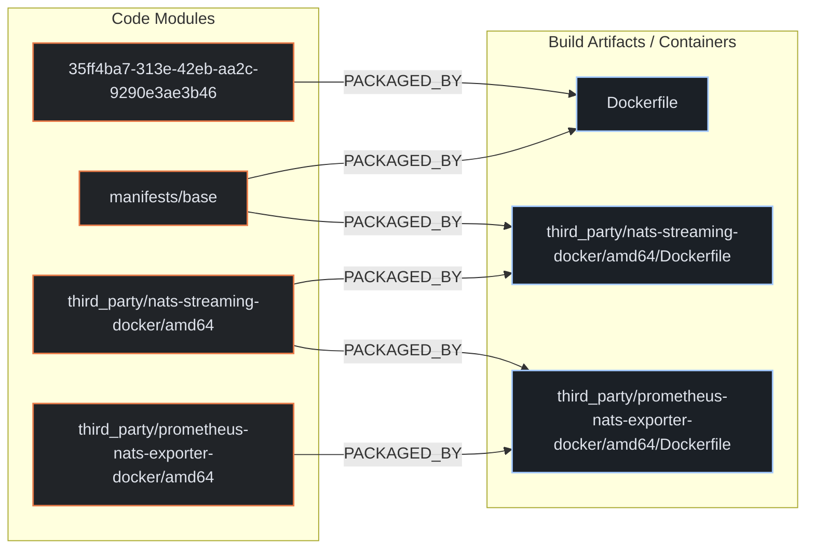

# Repository Architecture Analysis: argoproj/argo-events

## Metadata
- **SHA**: `3b39ad67cca77a6b9988d2b763eabdd7141b2655`
- **Primary Ecosystem**: Go

## Quality Metrics
- **ast_engine**: fallback
- **avg_cognitive_complexity**: 0.0
- **avg_cyclomatic_complexity**: 0.0
- **component_count**: 281
- **dead_code_count**: 0
- **dead_code_symbols**: 0 entry(ies)
- **duplication_pct**: 0.0
- **file_complexities**: 0 entry(ies)
- **files_analyzed**: 489
- **fitness_passed**: True
- **fitness_violation_count**: 0
- **framework**: Go Service
- **import_edges**: 0 entry(ies)
- **loc**: 135519
- **max_cognitive_complexity**: 0
- **max_cyclomatic_complexity**: 0
- **sloc**: 121176
- **test_file_count**: 232

# Architecture: argoproj/argo-events

## Context
- **Repository**: `argoproj/argo-events`
- **SHA**: `3b39ad67cca77a6b9988d2b763eabdd7141b2655`
- **Ecosystem**: Go
- **Framework**: Go Service

## Building Block View

```mermaid
graph TD;
  classDef atlasRoot fill:#004882,stroke:#a3c9ff,stroke-width:2px,color:#d3e4ff
  classDef atlasCategory fill:#212428,stroke:#E87A48,stroke-width:1.5px,color:#dfe3eb
  classDef atlasWorkflow fill:#1b2026,stroke:#a3c9ff,stroke-width:1.5px,color:#dfe3eb
  classDef atlasJob fill:#171c22,stroke:#8d9199,stroke-width:1px,color:#dfe3eb
  classDef atlasTarget fill:#005227,stroke:#8bd99b,stroke-width:1.5px,color:#a7f6b6
  classDef atlasAlert fill:#93000a,stroke:#ffb4ab,stroke-width:1.5px,color:#ffdad6
  classDef atlasMore fill:#252a31,stroke:#8d9199,stroke-dasharray:4 4,color:#c3c6cf
    repo_root(["argoproj/argo-events (281 components)"]):::atlasRoot
    dir_0_pkg["pkg (235)"]:::atlasCategory
    repo_root --> dir_0_pkg
    sub_0_0_eventsources["eventsources (134)"]:::atlasWorkflow
    dir_0_pkg --> sub_0_0_eventsources
    sub_0_1_apis["apis (37)"]:::atlasWorkflow
    dir_0_pkg --> sub_0_1_apis
    sub_0_2_eventbus["eventbus (35)"]:::atlasWorkflow
    dir_0_pkg --> sub_0_2_eventbus
    sub_0_more["+1 more submodules (29)"]:::atlasMore
    dir_0_pkg --> sub_0_more
    dir_1_manifests["manifests (27)"]:::atlasCategory
    repo_root --> dir_1_manifests
    sub_1_0_base["base (9)"]:::atlasWorkflow
    dir_1_manifests --> sub_1_0_base
    sub_1_1_cluster_install["cluster-install (7)"]:::atlasWorkflow
    dir_1_manifests --> sub_1_1_cluster_install
    sub_1_2_extensions["extensions (7)"]:::atlasWorkflow
    dir_1_manifests --> sub_1_2_extensions
    sub_1_more["+1 more submodules (4)"]:::atlasMore
    dir_1_manifests --> sub_1_more
    dir_2_cmd["cmd (8)"]:::atlasCategory
    repo_root --> dir_2_cmd
    dir_3_hack["hack (6)"]:::atlasCategory
    repo_root --> dir_3_hack
    dir_4_test["test (4)"]:::atlasCategory
    repo_root --> dir_4_test
    dir_other_modules["+1 more modules (1)"]:::atlasMore
    repo_root --> dir_other_modules
```

## Component Details

Showing top 60 representative components out of 281 across 6 module group(s):

- **Module `pkg`** (235 components — module: 235)
- **Module `manifests`** (27 components — module: 27)
- **Module `cmd`** (8 components — module: 8)
- **Module `hack`** (6 components — module: 6)
- **Module `test`** (4 components — module: 4)
- **Module `(root)`** (1 components — module: 1)

- **amount** (`pkg/apis/events/v1alpha1/amount.go`): module
- **appauth** (`pkg/eventsources/sources/github/appauth.go`): module
- **argo-events-aggregate-to-admin** (`manifests/cluster-install/rbac/argo-events-aggregate-to-admin.yaml`): module
- **argo-events-aggregate-to-edit** (`manifests/cluster-install/rbac/argo-events-aggregate-to-edit.yaml`): module
- **argo-events-aggregate-to-view** (`manifests/cluster-install/rbac/argo-events-aggregate-to-view.yaml`): module
- **argo-events-binding** (`manifests/cluster-install/rbac/argo-events-binding.yaml`): module
- **argo-events-cluster-role** (`manifests/cluster-install/rbac/argo-events-cluster-role.yaml`): module
- **argo-events-ns** (`test/manifests/argo-events-ns.yaml`): module
- **argo-events-role** (`manifests/namespace-install/rbac/argo-events-role.yaml`): module
- **argo-events-role-binding** (`manifests/namespace-install/rbac/argo-events-role-binding.yaml`): module
- **argo-events-sa** (`manifests/base/argo-events-sa.yaml`): module
- **argo-events-webhook-cluster-role** (`manifests/extensions/validating-webhook/rbac/argo-events-webhook-cluster-role.yaml`): module
- **argo-events-webhook-cluster-role-binding** (`manifests/extensions/validating-webhook/rbac/argo-events-webhook-cluster-role-binding.yaml`): module
- **argo-events-webhook-sa** (`manifests/extensions/validating-webhook/argo-events-webhook-sa.yaml`): module
- **argoproj.io_eventbus** (`manifests/base/crds/argoproj.io_eventbus.yaml`): module
- **argoproj.io_eventsources** (`manifests/base/crds/argoproj.io_eventsources.yaml`): module
- **argoproj.io_sensors** (`manifests/base/crds/argoproj.io_sensors.yaml`): module
- **aws** (`pkg/eventsources/common/aws/aws.go`): module
- **aws_test** (`pkg/eventsources/common/aws/aws_test.go`): module
- **backoff** (`pkg/apis/events/v1alpha1/backoff.go`): module
- **basic_auth** (`pkg/apis/events/v1alpha1/basic_auth.go`): module
- **basic_auth_strategy** (`pkg/eventsources/sources/bitbucket/basic_auth_strategy.go`): module
- **bitbucketserverclients** (`pkg/eventsources/sources/bitbucketserver/bitbucketserverclients.go`): module
- **client** (`pkg/eventsources/sources/hdfs/client.go`): module
- **clientset** (`pkg/client/clientset/versioned/clientset.go`): module
- **clientset_generated** (`pkg/client/clientset/versioned/fake/clientset_generated.go`): module
- **common** (`pkg/eventsources/common/common.go`): module
- **const** (`pkg/apis/events/v1alpha1/const.go`): module
- **container_template** (`pkg/apis/events/v1alpha1/container_template.go`): module
- **controller** (`cmd/commands/controller.go`): module
- **controller-config** (`manifests/base/controller-manager/controller-config.yaml`): module
- **controller-manager-deployment** (`manifests/base/controller-manager/controller-manager-deployment.yaml`): module
- **crds** (`hack/crds.go`): module
- **custombitbucketserverclient** (`pkg/eventsources/sources/bitbucketserver/custombitbucketserverclient.go`): module
- **doc** (`pkg/apis/events/v1alpha1/doc.go`): module
- **doc** (`pkg/client/clientset/versioned/fake/doc.go`): module
- **doc** (`pkg/client/clientset/versioned/scheme/doc.go`): module
- **doc** (`pkg/client/clientset/versioned/typed/events/v1alpha1/doc.go`): module
- **doc** (`pkg/client/clientset/versioned/typed/events/v1alpha1/fake/doc.go`): module
- **driver** (`pkg/eventbus/driver.go`): module
- **driver_test** (`pkg/eventbus/driver_test.go`): module
- **error** (`pkg/eventbus/common/error.go`): module
- **error_test** (`pkg/eventbus/common/error_test.go`): module
- **event-data** (`pkg/eventsources/events/event-data.go`): module
- **event_persist** (`pkg/eventsources/persist/event_persist.go`): module
- **event_persist_test** (`pkg/eventsources/persist/event_persist_test.go`): module
- **eventbus** (`pkg/client/clientset/versioned/typed/events/v1alpha1/eventbus.go`): module
- **eventbus** (`pkg/client/informers/externalversions/events/v1alpha1/eventbus.go`): module
- **eventbus** (`pkg/client/listers/events/v1alpha1/eventbus.go`): module
- **eventbus_types** (`pkg/apis/events/v1alpha1/eventbus_types.go`): module
- **eventbus_types_test** (`pkg/apis/events/v1alpha1/eventbus_types_test.go`): module
- **eventing** (`pkg/eventsources/eventing.go`): module
- **eventing_test** (`pkg/eventsources/eventing_test.go`): module
- **events-webhook-deployment** (`manifests/extensions/validating-webhook/events-webhook-deployment.yaml`): module
- **events-webhook-service** (`manifests/extensions/validating-webhook/events-webhook-service.yaml`): module
- **events_client** (`pkg/client/clientset/versioned/typed/events/v1alpha1/events_client.go`): module
- **eventsource** (`cmd/commands/eventsource.go`): module
- **eventsource** (`pkg/client/clientset/versioned/typed/events/v1alpha1/eventsource.go`): module
- **eventsource** (`pkg/client/informers/externalversions/events/v1alpha1/eventsource.go`): module
- **eventsource** (`pkg/client/listers/events/v1alpha1/eventsource.go`): module

## 6-Dimension Repository Scorecard

- **Overall Grade**: `D` (64.70/100)
- **Technical Debt Score**: 35.30
- **Estimated Remediation Effort**: 38.83h

| Dimension | Grade | Score | Weight | Details |
| :--- | :---: | :---: | :---: | :--- |
| Code Quality | `A` | 100.00 | 0.20 | avg_cc=0.00, max_cc=0, duplication=0.00%, dead_code=0 |
| Dependency Health | `B` | 85.00 | 0.15 | dependencies=369, outdated=0, vulnerable=0, has_lockfile=False |
| Maintainability | `A` | 100.00 | 0.15 | avg_cognitive=0.00, max_cognitive=0, fitness_violations=0, oversized_files=0 |
| Pipeline Health | `F` | 43.00 | 0.15 | workflows=8, operational_antipatterns=12, parallel_branches=True |
| Security | `F` | 0.00 | 0.20 | vulnerabilities=0, secrets=0, pipeline_security_findings=14 |
| Test Coverage | `C` | 70.00 | 0.15 | coverage=unavailable, ci_test_job=True, test_files_detected=True |

## Supply Chain Dependencies, Vulnerabilities & Secrets

- **Dependencies Parsed**: 369 | **Vulnerabilities**: 0 | **Secrets**: 0

### Inventory Sample
- `cloud.google.com/go/compute/metadata` `0.10.0` (golang, `go.mod`)
- `cloud.google.com/go/iam` `1.15.1` (golang, `go.mod`)
- `cloud.google.com/go/pubsub/v2` `2.8.1` (golang, `go.mod`)
- `dario.cat/mergo` `1.0.2` (golang, `go.mod`)
- `github.com/AdaLogics/go-fuzz-headers` `0.0.0-20221103172237-443f56ff4ba8` (golang, `go.mod`)
- `github.com/Azure/azure-event-hubs-go/v3` `3.6.2` (golang, `go.mod`)
- `github.com/Azure/azure-sdk-for-go/sdk/azidentity` `1.15.0` (golang, `go.mod`)
- `github.com/Azure/azure-sdk-for-go/sdk/messaging/azeventhubs` `1.4.0` (golang, `go.mod`)
- `github.com/Azure/azure-sdk-for-go/sdk/messaging/azservicebus` `1.11.0` (golang, `go.mod`)
- `github.com/Azure/azure-sdk-for-go/sdk/storage/azqueue` `1.0.1` (golang, `go.mod`)
- `github.com/IBM/sarama` `1.43.0` (golang, `go.mod`)
- `github.com/Knetic/govaluate` `3.0.1-0.20171022003610-9aa49832a739+incompatible` (golang, `go.mod`)
- `github.com/Masterminds/semver/v3` `3.5.0` (golang, `go.mod`)
- `github.com/Masterminds/sprig/v3` `3.3.0` (golang, `go.mod`)
- `github.com/ahmetb/gen-crd-api-reference-docs` `0.3.0` (golang, `go.mod`)
- `github.com/aliyun/aliyun-mns-go-sdk` `1.0.11` (golang, `go.mod`)
- `github.com/andygrunwald/go-gerrit` `0.0.0-20230325081502-da63a5c62d80` (golang, `go.mod`)
- `github.com/antonmedv/expr` `1.15.5` (golang, `go.mod`)
- `github.com/apache/openwhisk-client-go` `0.0.0-20190915054138-716c6f973eb2` (golang, `go.mod`)
- `github.com/apache/pulsar-client-go` `0.12.0` (golang, `go.mod`)
- `github.com/argoproj/notifications-engine` `0.4.1-0.20250309174002-87bf0576a872` (golang, `go.mod`)
- `github.com/aws/aws-msk-iam-sasl-signer-go` `1.0.4` (golang, `go.mod`)
- `github.com/aws/aws-sdk-go` `1.47.11` (golang, `go.mod`)
- `github.com/blushft/go-diagrams` `0.0.0-20201006005127-c78c821223d9` (golang, `go.mod`)
- `github.com/bradleyfalzon/ghinstallation/v2` `2.18.0` (golang, `go.mod`)
- `github.com/cloudevents/sdk-go/v2` `2.16.2` (golang, `go.mod`)
- `github.com/colinmarc/hdfs` `1.1.4-0.20180802165501-48eb8d6c34a9` (golang, `go.mod`)
- `github.com/doublerebel/bellows` `0.0.0-20160303004610-f177d92a03d3` (golang, `go.mod`)
- `github.com/eclipse/paho.mqtt.golang` `1.5.1` (golang, `go.mod`)
- `github.com/emitter-io/go/v2` `2.1.0` (golang, `go.mod`)
- ... (+339 more dependencies)

## Section 7: Code-to-Cloud Deployment Traceability

- `35ff4ba7-313e-42eb-aa2c-9290e3ae3b46` (code_module) --[PACKAGED_BY]--> `Dockerfile` (container)
- `manifests/base` (code_module) --[PACKAGED_BY]--> `Dockerfile` (container)
- `manifests/base` (code_module) --[PACKAGED_BY]--> `third_party/nats-streaming-docker/amd64/Dockerfile` (container)
- `third_party/nats-streaming-docker/amd64` (code_module) --[PACKAGED_BY]--> `third_party/nats-streaming-docker/amd64/Dockerfile` (container)
- `third_party/nats-streaming-docker/amd64` (code_module) --[PACKAGED_BY]--> `third_party/prometheus-nats-exporter-docker/amd64/Dockerfile` (container)
- `third_party/prometheus-nats-exporter-docker/amd64` (code_module) --[PACKAGED_BY]--> `third_party/prometheus-nats-exporter-docker/amd64/Dockerfile` (container)

## CI/CD Pipeline Topology

```mermaid
graph TD;
  classDef atlasRoot fill:#004882,stroke:#a3c9ff,stroke-width:2px,color:#d3e4ff
  classDef atlasCategory fill:#212428,stroke:#E87A48,stroke-width:1.5px,color:#dfe3eb
  classDef atlasWorkflow fill:#1b2026,stroke:#a3c9ff,stroke-width:1.5px,color:#dfe3eb
  classDef atlasJob fill:#171c22,stroke:#8d9199,stroke-width:1px,color:#dfe3eb
  classDef atlasTarget fill:#005227,stroke:#8bd99b,stroke-width:1.5px,color:#a7f6b6
  classDef atlasAlert fill:#93000a,stroke:#ffb4ab,stroke-width:1.5px,color:#ffdad6
  classDef atlasMore fill:#252a31,stroke:#8d9199,stroke-dasharray:4 4,color:#c3c6cf
  pipeline_root(["argoproj/argo-events (8 workflows)"]):::atlasRoot
  grp_0_CI___Verification["CI & Verification (3 workflows · 6 jobs)"]:::atlasCategory
  pipeline_root --> grp_0_CI___Verification
  wf_0_Changelog["Changelog (1 jobs)"]:::atlasWorkflow
  grp_0_CI___Verification --> wf_0_Changelog
  job_0_generate_changelog["generate_changelog"]:::atlasJob
  wf_0_Changelog --> job_0_generate_changelog
  wf_1_test["test (4 jobs)"]:::atlasWorkflow
  grp_0_CI___Verification --> wf_1_test
  job_1_codegen["codegen"]:::atlasJob
  job_1_unit_tests["unit-tests"]:::atlasJob
  job_1_lint["lint"]:::atlasJob
  wf_1_test --> job_1_codegen
  wf_1_test --> job_1_unit_tests
  wf_1_test --> job_1_lint
  wf_5_Detect_and_Trigger_Retest["Detect and Trigger Retest (1 jobs)"]:::atlasWorkflow
  grp_0_CI___Verification --> wf_5_Detect_and_Trigger_Retest
  job_5_retest["retest"]:::atlasJob
  wf_5_Detect_and_Trigger_Retest --> job_5_retest
  grp_1_Release___Deploy["Release & Deploy (2 workflows · 5 jobs)"]:::atlasCategory
  pipeline_root --> grp_1_Release___Deploy
  wf_3_gh_pages["gh-pages (1 jobs)"]:::atlasWorkflow
  grp_1_Release___Deploy --> wf_3_gh_pages
  job_3_deploy["deploy"]:::atlasJob
  wf_3_gh_pages --> job_3_deploy
  wf_4_release["release (4 jobs)"]:::atlasWorkflow
  grp_1_Release___Deploy --> wf_4_release
  job_4_build_binaries["build-binaries"]:::atlasJob
  job_4_build_push_linux_multi["build-push-linux-multi"]:::atlasJob
  job_4_bom["bom"]:::atlasJob
  wf_4_release --> job_4_build_binaries
  job_4_build_binaries --> job_4_build_push_linux_multi
  job_4_build_push_linux_multi --> job_4_bom
  grp_2_Security___Governance["Security & Governance (2 workflows · 2 jobs)"]:::atlasCategory
  pipeline_root --> grp_2_Security___Governance
  wf_2_Approve_and_enable_auto_merge_for_dependabot["Approve and enable auto-merge for dependabot (1 jobs)"]:::atlasWorkflow
  grp_2_Security___Governance --> wf_2_Approve_and_enable_auto_merge_for_dependabot
  job_2_review["review"]:::atlasJob
  wf_2_Approve_and_enable_auto_merge_for_dependabot --> job_2_review
  wf_7_Close_stale_issues_and_PRs["Close stale issues and PRs (1 jobs)"]:::atlasWorkflow
  grp_2_Security___Governance --> wf_7_Close_stale_issues_and_PRs
  job_7_stale["stale"]:::atlasJob
  wf_7_Close_stale_issues_and_PRs --> job_7_stale
  grp_3_Scheduled___Manual["Scheduled & Manual (1 workflows · 1 jobs)"]:::atlasCategory
  pipeline_root --> grp_3_Scheduled___Manual
  wf_6_Snyk["Snyk (1 jobs)"]:::atlasWorkflow
  grp_3_Scheduled___Manual --> wf_6_Snyk
  job_6_golang["golang"]:::atlasJob
  wf_6_Snyk --> job_6_golang
```

