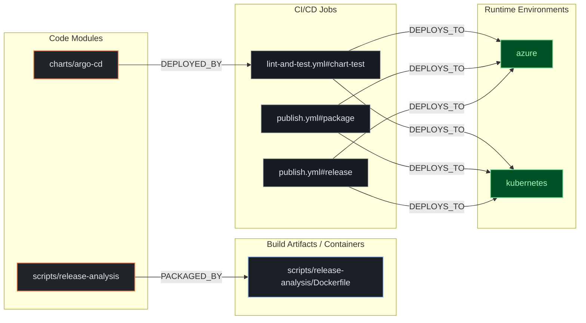

# Repository Architecture Analysis: argoproj/argo-helm

## Metadata
- **SHA**: `c947077fd0de0259fc932f996a4e4acb6763b926`
- **Primary Ecosystem**: Python

## Quality Metrics
- **ast_engine**: tree-sitter
- **avg_cognitive_complexity**: 3.89
- **avg_cyclomatic_complexity**: 3.78
- **component_count**: 297
- **dead_code_count**: 0
- **dead_code_symbols**: 0 entry(ies)
- **duplication_pct**: 0.21
- **file_complexities**: 5 entry(ies)
- **files_analyzed**: 302
- **fitness_passed**: True
- **fitness_violation_count**: 0
- **framework**: Unknown
- **import_edges**: 20 entry(ies)
- **loc**: 92035
- **max_cognitive_complexity**: 16
- **max_cyclomatic_complexity**: 11
- **sloc**: 86288

# Architecture: argoproj/argo-helm

## Context
- **Repository**: `argoproj/argo-helm`
- **SHA**: `c947077fd0de0259fc932f996a4e4acb6763b926`
- **Ecosystem**: Python
- **Framework**: Unknown

## Building Block View

```mermaid
graph TD;
  classDef atlasRoot fill:#004882,stroke:#a3c9ff,stroke-width:2px,color:#d3e4ff
  classDef atlasCategory fill:#212428,stroke:#E87A48,stroke-width:1.5px,color:#dfe3eb
  classDef atlasWorkflow fill:#1b2026,stroke:#a3c9ff,stroke-width:1.5px,color:#dfe3eb
  classDef atlasJob fill:#171c22,stroke:#8d9199,stroke-width:1px,color:#dfe3eb
  classDef atlasTarget fill:#005227,stroke:#8bd99b,stroke-width:1.5px,color:#a7f6b6
  classDef atlasAlert fill:#93000a,stroke:#ffb4ab,stroke-width:1.5px,color:#ffdad6
  classDef atlasMore fill:#252a31,stroke:#8d9199,stroke-dasharray:4 4,color:#c3c6cf
    repo_root(["argoproj/argo-helm (297 components)"]):::atlasRoot
    dir_0_charts_argo_cd["charts/argo-cd (155)"]:::atlasCategory
    repo_root --> dir_0_charts_argo_cd
    sub_0_0_templates["templates (135)"]:::atlasWorkflow
    dir_0_charts_argo_cd --> sub_0_0_templates
    sub_0_1_ci["ci (18)"]:::atlasWorkflow
    dir_0_charts_argo_cd --> sub_0_1_ci
    sub_0_2__module_root_["(module root) (2)"]:::atlasWorkflow
    dir_0_charts_argo_cd --> sub_0_2__module_root_
    dir_1_charts_argo_workflows["charts/argo-workflows (52)"]:::atlasCategory
    repo_root --> dir_1_charts_argo_workflows
    sub_1_0_templates["templates (33)"]:::atlasWorkflow
    dir_1_charts_argo_workflows --> sub_1_0_templates
    sub_1_1_ci["ci (9)"]:::atlasWorkflow
    dir_1_charts_argo_workflows --> sub_1_1_ci
    sub_1_2_files["files (8)"]:::atlasWorkflow
    dir_1_charts_argo_workflows --> sub_1_2_files
    sub_1_more["+1 more submodules (2)"]:::atlasMore
    dir_1_charts_argo_workflows --> sub_1_more
    dir_2_charts_argo_rollouts["charts/argo-rollouts (32)"]:::atlasCategory
    repo_root --> dir_2_charts_argo_rollouts
    sub_2_0_templates["templates (27)"]:::atlasWorkflow
    dir_2_charts_argo_rollouts --> sub_2_0_templates
    sub_2_1_ci["ci (3)"]:::atlasWorkflow
    dir_2_charts_argo_rollouts --> sub_2_1_ci
    sub_2_2__module_root_["(module root) (2)"]:::atlasWorkflow
    dir_2_charts_argo_rollouts --> sub_2_2__module_root_
    dir_3_charts_argo_events["charts/argo-events (21)"]:::atlasCategory
    repo_root --> dir_3_charts_argo_events
    sub_3_0_templates["templates (18)"]:::atlasWorkflow
    dir_3_charts_argo_events --> sub_3_0_templates
    sub_3_1__module_root_["(module root) (2)"]:::atlasWorkflow
    dir_3_charts_argo_events --> sub_3_1__module_root_
    sub_3_2_ci["ci (1)"]:::atlasWorkflow
    dir_3_charts_argo_events --> sub_3_2_ci
    dir_4_charts_argocd_image_updater["charts/argocd-image-updater (21)"]:::atlasCategory
    repo_root --> dir_4_charts_argocd_image_updater
    sub_4_0_templates["templates (15)"]:::atlasWorkflow
    dir_4_charts_argocd_image_updater --> sub_4_0_templates
    sub_4_1_ci["ci (4)"]:::atlasWorkflow
    dir_4_charts_argocd_image_updater --> sub_4_1_ci
    sub_4_2__module_root_["(module root) (2)"]:::atlasWorkflow
    dir_4_charts_argocd_image_updater --> sub_4_2__module_root_
    dir_other_modules["+1 more modules (16)"]:::atlasMore
    repo_root --> dir_other_modules
```

## Component Details

Showing top 60 representative components out of 297 across 6 module group(s):

- **Module `charts/argo-cd`** (155 components — module: 155)
- **Module `charts/argo-workflows`** (52 components — module: 52)
- **Module `charts/argo-rollouts`** (32 components — module: 32)
- **Module `charts/argo-events`** (21 components — module: 21)
- **Module `charts/argocd-image-updater`** (21 components — module: 21)
- **Module `charts/argocd-apps`** (16 components — module: 16)

- **Chart** (`charts/argo-cd/Chart.yaml`): module
- **Chart** (`charts/argo-events/Chart.yaml`): module
- **Chart** (`charts/argo-rollouts/Chart.yaml`): module
- **Chart** (`charts/argo-workflows/Chart.yaml`): module
- **Chart** (`charts/argocd-apps/Chart.yaml`): module
- **Chart** (`charts/argocd-image-updater/Chart.yaml`): module
- **aa-minimal-crds-values** (`charts/argo-workflows/ci/aa-minimal-crds-values.yaml`): module
- **agent-rb** (`charts/argo-workflows/templates/controller/agent-rb.yaml`): module
- **agent-role** (`charts/argo-workflows/templates/controller/agent-role.yaml`): module
- **aggregate-roles** (`charts/argo-cd/templates/aggregate-roles.yaml`): module
- **aggregate-roles** (`charts/argo-events/templates/aggregate-roles.yaml`): module
- **aggregate-roles** (`charts/argo-rollouts/templates/aggregate-roles.yaml`): module
- **analysis-run-crd** (`charts/argo-rollouts/templates/crds/analysis-run-crd.yaml`): module
- **analysis-template-crd** (`charts/argo-rollouts/templates/crds/analysis-template-crd.yaml`): module
- **applications** (`charts/argocd-apps/templates/applications.yaml`): module
- **applications-multiple-sources-values** (`charts/argocd-apps/ci/applications-multiple-sources-values.yaml`): module
- **applications-values** (`charts/argocd-apps/ci/applications-values.yaml`): module
- **applicationsets** (`charts/argocd-apps/templates/applicationsets.yaml`): module
- **applicationsets-multiple-sources-values** (`charts/argocd-apps/ci/applicationsets-multiple-sources-values.yaml`): module
- **applicationsets-progressive-syncs-values** (`charts/argocd-apps/ci/applicationsets-progressive-syncs-values.yaml`): module
- **applicationsets-values** (`charts/argocd-apps/ci/applicationsets-values.yaml`): module
- **argocd-cm** (`charts/argo-cd/templates/argocd-configs/argocd-cm.yaml`): module
- **argocd-cmd-params-cm** (`charts/argo-cd/templates/argocd-configs/argocd-cmd-params-cm.yaml`): module
- **argocd-cmp-cm** (`charts/argo-cd/templates/argocd-configs/argocd-cmp-cm.yaml`): module
- **argocd-dex-server-tls-secret** (`charts/argo-cd/templates/argocd-configs/argocd-dex-server-tls-secret.yaml`): module
- **argocd-gpg-keys-cm** (`charts/argo-cd/templates/argocd-configs/argocd-gpg-keys-cm.yaml`): module
- **argocd-notifications-cm** (`charts/argo-cd/templates/argocd-configs/argocd-notifications-cm.yaml`): module
- **argocd-notifications-secret** (`charts/argo-cd/templates/argocd-configs/argocd-notifications-secret.yaml`): module
- **argocd-rbac-cm** (`charts/argo-cd/templates/argocd-configs/argocd-rbac-cm.yaml`): module
- **argocd-repo-server-tls-secret** (`charts/argo-cd/templates/argocd-configs/argocd-repo-server-tls-secret.yaml`): module
- **argocd-secret** (`charts/argo-cd/templates/argocd-configs/argocd-secret.yaml`): module
- **argocd-server-tls-secret** (`charts/argo-cd/templates/argocd-configs/argocd-server-tls-secret.yaml`): module
- **argocd-ssh-known-hosts-cm** (`charts/argo-cd/templates/argocd-configs/argocd-ssh-known-hosts-cm.yaml`): module
- **argocd-styles-cm** (`charts/argo-cd/templates/argocd-configs/argocd-styles-cm.yaml`): module
- **argocd-tls-certs-cm** (`charts/argo-cd/templates/argocd-configs/argocd-tls-certs-cm.yaml`): module
- **argoproj.io_clusterworkflowtemplates** (`charts/argo-workflows/files/crds/minimal/argoproj.io_clusterworkflowtemplates.yaml`): module
- **argoproj.io_cronworkflows** (`charts/argo-workflows/files/crds/minimal/argoproj.io_cronworkflows.yaml`): module
- **argoproj.io_workflowartifactgctasks** (`charts/argo-workflows/files/crds/minimal/argoproj.io_workflowartifactgctasks.yaml`): module
- **argoproj.io_workfloweventbindings** (`charts/argo-workflows/files/crds/minimal/argoproj.io_workfloweventbindings.yaml`): module
- **argoproj.io_workflows** (`charts/argo-workflows/files/crds/minimal/argoproj.io_workflows.yaml`): module
- **argoproj.io_workflowtaskresults** (`charts/argo-workflows/files/crds/minimal/argoproj.io_workflowtaskresults.yaml`): module
- **argoproj.io_workflowtasksets** (`charts/argo-workflows/files/crds/minimal/argoproj.io_workflowtasksets.yaml`): module
- **argoproj.io_workflowtemplates** (`charts/argo-workflows/files/crds/minimal/argoproj.io_workflowtemplates.yaml`): module
- **artifact-gc-rb** (`charts/argo-workflows/templates/controller/artifact-gc-rb.yaml`): module
- **artifact-gc-role** (`charts/argo-workflows/templates/controller/artifact-gc-role.yaml`): module
- **artifact-repository-ref-cm** (`charts/argo-workflows/templates/controller/artifact-repository-ref-cm.yaml`): module
- **backendconfig** (`charts/argo-cd/templates/argocd-server/gke/backendconfig.yaml`): module
- **backendconfig** (`charts/argo-workflows/templates/server/gke/backendconfig.yaml`): module
- **backendtlspolicy** (`charts/argo-cd/templates/argocd-server/backendtlspolicy.yaml`): module
- **certificate** (`charts/argo-cd/templates/argocd-applicationset/certificate.yaml`): module
- **certificate** (`charts/argo-cd/templates/argocd-server/certificate.yaml`): module
- **cluster-analysis-template-crd** (`charts/argo-rollouts/templates/crds/cluster-analysis-template-crd.yaml`): module
- **cluster-secrets** (`charts/argo-cd/templates/argocd-configs/cluster-secrets.yaml`): module
- **clusterrole** (`charts/argo-cd/templates/argocd-application-controller/clusterrole.yaml`): module
- **clusterrole** (`charts/argo-cd/templates/argocd-applicationset/clusterrole.yaml`): module
- **clusterrole** (`charts/argo-cd/templates/argocd-notifications/clusterrole.yaml`): module
- **clusterrole** (`charts/argo-cd/templates/argocd-repo-server/clusterrole.yaml`): module
- **clusterrole** (`charts/argo-cd/templates/argocd-server/clusterrole.yaml`): module
- **clusterrole** (`charts/argo-cd/templates/dex/clusterrole.yaml`): module
- **clusterrole** (`charts/argo-events/templates/argo-events-webhook/clusterrole.yaml`): module

## 6-Dimension Repository Scorecard

- **Overall Grade**: `D` (65.01/100)
- **Technical Debt Score**: 34.99
- **Estimated Remediation Effort**: 28.79h

| Dimension | Grade | Score | Weight | Details |
| :--- | :---: | :---: | :---: | :--- |
| Code Quality | `A` | 96.56 | 0.20 | avg_cc=3.78, max_cc=11, duplication=0.21%, dead_code=0 |
| Dependency Health | `B` | 85.00 | 0.15 | dependencies=2, outdated=0, vulnerable=0, has_lockfile=False |
| Maintainability | `A` | 100.00 | 0.15 | avg_cognitive=3.89, max_cognitive=16, fitness_violations=0, oversized_files=0 |
| Pipeline Health | `F` | 7.00 | 0.15 | workflows=10, operational_antipatterns=20, parallel_branches=True |
| Security | `F` | 32.00 | 0.20 | vulnerabilities=0, secrets=3, pipeline_security_findings=0 |
| Test Coverage | `C` | 70.00 | 0.15 | coverage=unavailable, ci_test_job=True, test_files_detected=True |

## Supply Chain Dependencies, Vulnerabilities & Secrets

- **Dependencies Parsed**: 2 | **Vulnerabilities**: 0 | **Secrets**: 3

### Secret Findings (Redacted)
- **[HIGH] `ATRUSS-SEC-005`** at `CONTRIBUTING.md:150` (`"admin.password": "$2a$***REDACTED***",`)
- **[CRITICAL] `ATRUSS-SEC-004`** at `charts/argo-cd/values.yaml:656` (`-----BEGIN ... PRIVATE KEY----- [REDACTED]`)
- **[CRITICAL] `ATRUSS-SEC-004`** at `charts/argo-cd/values.yaml:666` (`-----BEGIN ... PRIVATE KEY----- [REDACTED]`)

### Inventory Sample
- `matplotlib` `*` (PyPI, `scripts/release-analysis/requirements.txt`)
- `requests` `*` (PyPI, `scripts/release-analysis/requirements.txt`)

## Section 7: Code-to-Cloud Deployment Traceability

- `lint-and-test.yml#chart-test` (ci_job) --[DEPLOYS_TO]--> `azure` (environment)
- `lint-and-test.yml#chart-test` (ci_job) --[DEPLOYS_TO]--> `kubernetes` (environment)
- `publish.yml#package` (ci_job) --[DEPLOYS_TO]--> `azure` (environment)
- `publish.yml#package` (ci_job) --[DEPLOYS_TO]--> `kubernetes` (environment)
- `publish.yml#release` (ci_job) --[DEPLOYS_TO]--> `azure` (environment)
- `publish.yml#release` (ci_job) --[DEPLOYS_TO]--> `kubernetes` (environment)
- `charts/argo-cd` (code_module) --[DEPLOYED_BY]--> `lint-and-test.yml#chart-test` (ci_job)
- `scripts/release-analysis` (code_module) --[PACKAGED_BY]--> `scripts/release-analysis/Dockerfile` (container)

## CI/CD Pipeline Topology

```mermaid
graph TD;
  classDef atlasRoot fill:#004882,stroke:#a3c9ff,stroke-width:2px,color:#d3e4ff
  classDef atlasCategory fill:#212428,stroke:#E87A48,stroke-width:1.5px,color:#dfe3eb
  classDef atlasWorkflow fill:#1b2026,stroke:#a3c9ff,stroke-width:1.5px,color:#dfe3eb
  classDef atlasJob fill:#171c22,stroke:#8d9199,stroke-width:1px,color:#dfe3eb
  classDef atlasTarget fill:#005227,stroke:#8bd99b,stroke-width:1.5px,color:#a7f6b6
  classDef atlasAlert fill:#93000a,stroke:#ffb4ab,stroke-width:1.5px,color:#ffdad6
  classDef atlasMore fill:#252a31,stroke:#8d9199,stroke-dasharray:4 4,color:#c3c6cf
  pipeline_root(["argoproj/argo-helm (10 workflows)"]):::atlasRoot
  grp_0_CI___Verification["CI & Verification (5 workflows · 9 jobs)"]:::atlasCategory
  pipeline_root --> grp_0_CI___Verification
  wf_0_Actions_Lint["Actions Lint (3 jobs)"]:::atlasWorkflow
  grp_0_CI___Verification --> wf_0_Actions_Lint
  job_0_actionlint["actionlint"]:::atlasJob
  job_0_shellcheck["shellcheck"]:::atlasJob
  job_0_zizmor["zizmor"]:::atlasJob
  wf_0_Actions_Lint --> job_0_actionlint
  wf_0_Actions_Lint --> job_0_shellcheck
  wf_0_Actions_Lint --> job_0_zizmor
  wf_1_Linting_and_Testing["Linting and Testing (2 jobs)"]:::atlasWorkflow
  grp_0_CI___Verification --> wf_1_Linting_and_Testing
  job_1_linter_artifacthub["linter-artifacthub"]:::atlasJob
  job_1_chart_test["chart-test"]:::atlasJob
  wf_1_Linting_and_Testing --> job_1_linter_artifacthub
  wf_1_Linting_and_Testing --> job_1_chart_test
  wf_2_PR_Lifecycle["PR Lifecycle (1 jobs)"]:::atlasWorkflow
  grp_0_CI___Verification --> wf_2_PR_Lifecycle
  job_2_lifecycle["lifecycle"]:::atlasJob
  wf_2_PR_Lifecycle --> job_2_lifecycle
  wf_3_PR_Labeling["PR Labeling (2 jobs)"]:::atlasWorkflow
  grp_0_CI___Verification --> wf_3_PR_Labeling
  job_3_triage["triage"]:::atlasJob
  job_3_size_label["size-label"]:::atlasJob
  wf_3_PR_Labeling --> job_3_triage
  wf_3_PR_Labeling --> job_3_size_label
  wf_4_Lint_PR["Lint PR (1 jobs)"]:::atlasWorkflow
  grp_0_CI___Verification --> wf_4_Lint_PR
  job_4_main["main"]:::atlasJob
  wf_4_Lint_PR --> job_4_main
  grp_1_Release___Deploy["Release & Deploy (2 workflows · 4 jobs)"]:::atlasCategory
  pipeline_root --> grp_1_Release___Deploy
  wf_5_Publish_OSPS_Baseline_results["Publish OSPS Baseline results (1 jobs)"]:::atlasWorkflow
  grp_1_Release___Deploy --> wf_5_Publish_OSPS_Baseline_results
  job_5_results["results"]:::atlasJob
  wf_5_Publish_OSPS_Baseline_results --> job_5_results
  wf_6_Chart_Publish["Chart Publish (3 jobs)"]:::atlasWorkflow
  grp_1_Release___Deploy --> wf_6_Chart_Publish
  job_6_fold["fold"]:::atlasJob
  job_6_package["package"]:::atlasJob
  job_6_release["release"]:::atlasJob
  wf_6_Chart_Publish --> job_6_fold
  job_6_fold --> job_6_package
  job_6_fold --> job_6_release
  job_6_package --> job_6_release
  grp_2_Security___Governance["Security & Governance (2 workflows · 2 jobs)"]:::atlasCategory
  pipeline_root --> grp_2_Security___Governance
  wf_8_Scorecard_supply_chain_security["Scorecard supply-chain security (1 jobs)"]:::atlasWorkflow
  grp_2_Security___Governance --> wf_8_Scorecard_supply_chain_security
  job_8_analysis["analysis"]:::atlasJob
  wf_8_Scorecard_supply_chain_security --> job_8_analysis
  wf_9_Mark_stale_issues_and_pull_requests["Mark stale issues and pull requests (1 jobs)"]:::atlasWorkflow
  grp_2_Security___Governance --> wf_9_Mark_stale_issues_and_pull_requests
  job_9_stale["stale"]:::atlasJob
  wf_9_Mark_stale_issues_and_pull_requests --> job_9_stale
  grp_3_Scheduled___Manual["Scheduled & Manual (1 workflows · 1 jobs)"]:::atlasCategory
  pipeline_root --> grp_3_Scheduled___Manual
  wf_7_Renovate["Renovate (1 jobs)"]:::atlasWorkflow
  grp_3_Scheduled___Manual --> wf_7_Renovate
  job_7_renovate["renovate"]:::atlasJob
  wf_7_Renovate --> job_7_renovate
```

