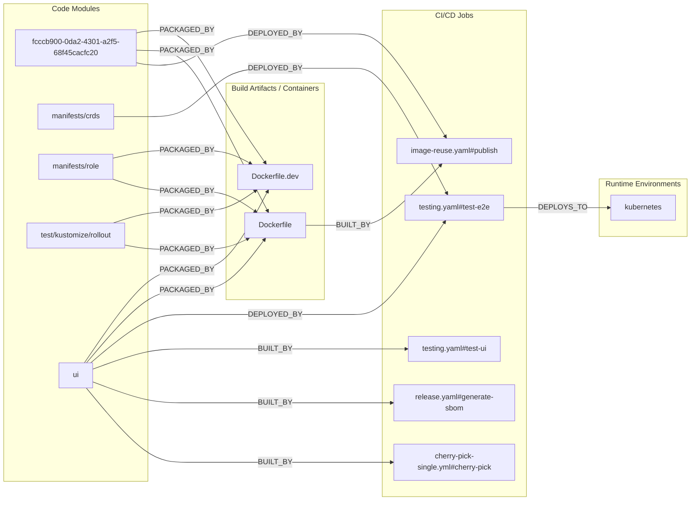
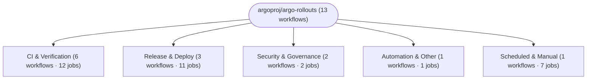

# Repository Architecture Analysis: argoproj/argo-rollouts

## Metadata
- **SHA**: `1147bc34b4ee737e1a6a40d17fff13a73909da4b`
- **Primary Ecosystem**: Go

## Quality Metrics
- **ast_engine**: tree-sitter
- **avg_cognitive_complexity**: 0.0
- **avg_cyclomatic_complexity**: 0.0
- **component_count**: 299
- **dead_code_count**: 0
- **dead_code_symbols**: 0 entry(ies)
- **duplication_pct**: 0.0
- **file_complexities**: 0 entry(ies)
- **files_analyzed**: 453
- **fitness_passed**: True
- **fitness_violation_count**: 0
- **framework**: Go Service
- **import_edges**: 0 entry(ies)
- **loc**: 229681
- **max_cognitive_complexity**: 0
- **max_cyclomatic_complexity**: 0
- **sloc**: 205463
- **test_file_count**: 272

# Architecture: argoproj/argo-rollouts

## Context
- **Repository**: `argoproj/argo-rollouts`
- **SHA**: `1147bc34b4ee737e1a6a40d17fff13a73909da4b`
- **Ecosystem**: Go
- **Framework**: Go Service

## Building Block View

```mermaid
graph TD;
    repo_root(["argoproj/argo-rollouts (299 components)"])
    dir_0_pkg["pkg (113)"]
    repo_root --> dir_0_pkg
    sub_0_0_kubectl_argo_rollouts["kubectl-argo-rollouts (55)"]
    dir_0_pkg --> sub_0_0_kubectl_argo_rollouts
    sub_0_1_client["client (37)"]
    dir_0_pkg --> sub_0_1_client
    sub_0_2_apis["apis (15)"]
    dir_0_pkg --> sub_0_2_apis
    sub_0_more["+2 more submodules (6)"]
    dir_0_pkg --> sub_0_more
    dir_1_rollout["rollout (49)"]
    repo_root --> dir_1_rollout
    sub_1_0__module_root_["(module root) (33)"]
    dir_1_rollout --> sub_1_0__module_root_
    sub_1_1_steps["steps (10)"]
    dir_1_rollout --> sub_1_1_steps
    sub_1_2_trafficrouting["trafficrouting (5)"]
    dir_1_rollout --> sub_1_2_trafficrouting
    sub_1_more["+1 more submodules (1)"]
    dir_1_rollout --> sub_1_more
    dir_2_metricproviders["metricproviders (44)"]
    repo_root --> dir_2_metricproviders
    sub_2_0_datadog["datadog (6)"]
    dir_2_metricproviders --> sub_2_0_datadog
    sub_2_1_graphite["graphite (5)"]
    dir_2_metricproviders --> sub_2_1_graphite
    sub_2_2_plugin["plugin (5)"]
    dir_2_metricproviders --> sub_2_2_plugin
    sub_2_more["+11 more submodules (28)"]
    dir_2_metricproviders --> sub_2_more
    dir_3_manifests["manifests (36)"]
    repo_root --> dir_3_manifests
    sub_3_0_notifications["notifications (11)"]
    dir_3_manifests --> sub_3_0_notifications
    sub_3_1_base["base (7)"]
    dir_3_manifests --> sub_3_1_base
    sub_3_2_crds["crds (6)"]
    dir_3_manifests --> sub_3_2_crds
    sub_3_more["+3 more submodules (12)"]
    dir_3_manifests --> sub_3_more
    dir_4_controller["controller (18)"]
    repo_root --> dir_4_controller
    sub_4_0_metrics["metrics (13)"]
    dir_4_controller --> sub_4_0_metrics
    sub_4_1__module_root_["(module root) (5)"]
    dir_4_controller --> sub_4_1__module_root_
    dir_other_modules["+8 more modules (39)"]
    repo_root --> dir_other_modules
```

## Component Details

Showing top 60 representative components out of 299 across 13 module group(s):

- **Module `pkg`** (113 components — module: 113)
- **Module `rollout`** (49 components — module: 49)
- **Module `metricproviders`** (44 components — module: 44)
- **Module `manifests`** (36 components — module: 36)
- **Module `controller`** (18 components — module: 18)
- **Module `examples`** (11 components — module: 11)
- **Module `experiments`** (10 components — module: 10)
- **Module `analysis`** (5 components — module: 5)
- **Module `ingress`** (4 components — module: 4)
- **Module `cmd`** (3 components — module: 3)
- **Module `hack`** (3 components — module: 3)
- **Module `docs`** (2 components — module: 2)

- **Chart** (`examples/helm-blue-green/Chart.yaml`): module
- **MetricsRecorder** (`controller/metrics/mocks/MetricsRecorder.go`): module
- **Provider** (`metricproviders/mocks/Provider.go`): module
- **Resolver** (`rollout/steps/plugin/mocks/Resolver.go`): module
- **StepPlugin** (`rollout/steps/plugin/mocks/StepPlugin.go`): module
- **StepPlugin** (`rollout/steps/plugin/rpc/mocks/StepPlugin.go`): module
- **TrafficRoutingReconciler** (`rollout/mocks/TrafficRoutingReconciler.go`): module
- **abort** (`pkg/kubectl-argo-rollouts/cmd/abort/abort.go`): module
- **abort_test** (`pkg/kubectl-argo-rollouts/cmd/abort/abort_test.go`): module
- **add-namespaced-flag** (`manifests/namespace-install/add-namespaced-flag.yaml`): module
- **alb** (`ingress/alb.go`): module
- **alb** (`rollout/trafficrouting/alb/alb.go`): module
- **alb_test** (`ingress/alb_test.go`): module
- **alb_test** (`rollout/trafficrouting/alb/alb_test.go`): module
- **analysis** (`analysis/analysis.go`): module
- **analysis** (`controller/metrics/analysis.go`): module
- **analysis** (`rollout/analysis.go`): module
- **analysis-run-crd** (`manifests/crds/analysis-run-crd.yaml`): module
- **analysis-template-crd** (`manifests/crds/analysis-template-crd.yaml`): module
- **analysis_test** (`analysis/analysis_test.go`): module
- **analysis_test** (`controller/metrics/analysis_test.go`): module
- **analysis_test** (`rollout/analysis_test.go`): module
- **analysis_types** (`pkg/apis/rollouts/v1alpha1/analysis_types.go`): module
- **analysisrun** (`pkg/client/clientset/versioned/typed/rollouts/v1alpha1/analysisrun.go`): module
- **analysisrun** (`pkg/client/informers/externalversions/rollouts/v1alpha1/analysisrun.go`): module
- **analysisrun** (`pkg/client/listers/rollouts/v1alpha1/analysisrun.go`): module
- **analysisrun_info** (`pkg/kubectl-argo-rollouts/info/analysisrun_info.go`): module
- **analysisrun_test** (`experiments/analysisrun_test.go`): module
- **analysistemplate** (`pkg/client/clientset/versioned/typed/rollouts/v1alpha1/analysistemplate.go`): module
- **analysistemplate** (`pkg/client/informers/externalversions/rollouts/v1alpha1/analysistemplate.go`): module
- **analysistemplate** (`pkg/client/listers/rollouts/v1alpha1/analysistemplate.go`): module
- **api** (`metricproviders/graphite/api.go`): module
- **api_test** (`metricproviders/graphite/api_test.go`): module
- **argo-rollouts-aggregate-roles** (`manifests/base/argo-rollouts-aggregate-roles.yaml`): module
- **argo-rollouts-clusterrolebinding** (`manifests/cluster-install/argo-rollouts-clusterrolebinding.yaml`): module
- **argo-rollouts-config** (`manifests/base/argo-rollouts-config.yaml`): module
- **argo-rollouts-deployment** (`manifests/base/argo-rollouts-deployment.yaml`): module
- **argo-rollouts-metrics-service** (`manifests/base/argo-rollouts-metrics-service.yaml`): module
- **argo-rollouts-notification-configmap** (`manifests/notifications/argo-rollouts-notification-configmap.yaml`): module
- **argo-rollouts-notification-secret** (`manifests/base/argo-rollouts-notification-secret.yaml`): module
- **argo-rollouts-rolebinding** (`manifests/namespace-install/argo-rollouts-rolebinding.yaml`): module
- **argo-rollouts-sa** (`manifests/base/argo-rollouts-sa.yaml`): module
- **bluegreen** (`rollout/bluegreen.go`): module
- **bluegreen_test** (`rollout/bluegreen_test.go`): module
- **canary** (`rollout/canary.go`): module
- **canary_test** (`rollout/canary_test.go`): module
- **client** (`controller/metrics/client.go`): module
- **client** (`metricproviders/plugin/client/client.go`): module
- **client** (`rollout/steps/plugin/client/client.go`): module
- **client_test** (`controller/metrics/client_test.go`): module
- **clientset** (`pkg/client/clientset/versioned/clientset.go`): module
- **clientset_generated** (`pkg/client/clientset/versioned/fake/clientset_generated.go`): module
- **cloudwatch** (`metricproviders/cloudwatch/cloudwatch.go`): module
- **cloudwatch_test** (`metricproviders/cloudwatch/cloudwatch_test.go`): module
- **cluster-analysis-template-crd** (`manifests/crds/cluster-analysis-template-crd.yaml`): module
- **clusteranalysistemplate** (`pkg/client/clientset/versioned/typed/rollouts/v1alpha1/clusteranalysistemplate.go`): module
- **clusteranalysistemplate** (`pkg/client/informers/externalversions/rollouts/v1alpha1/clusteranalysistemplate.go`): module
- **clusteranalysistemplate** (`pkg/client/listers/rollouts/v1alpha1/clusteranalysistemplate.go`): module
- **clusterrole-to-role** (`manifests/namespace-install/clusterrole-to-role.yaml`): module
- **cmd** (`pkg/kubectl-argo-rollouts/cmd/cmd.go`): module

## 6-Dimension Repository Scorecard

- **Overall Grade**: `D` (60.50/100)
- **Technical Debt Score**: 39.50
- **Estimated Remediation Effort**: 73.38h

| Dimension | Grade | Score | Weight | Details |
| :--- | :---: | :---: | :---: | :--- |
| Code Quality | `A` | 100.00 | 0.20 | avg_cc=0.00, max_cc=0, duplication=0.00%, dead_code=0 |
| Dependency Health | `A` | 100.00 | 0.15 | dependencies=1997, outdated=0, vulnerable=0, has_lockfile=True |
| Maintainability | `A` | 100.00 | 0.15 | avg_cognitive=0.00, max_cognitive=0, fitness_violations=0, oversized_files=0 |
| Pipeline Health | `F` | 0.00 | 0.15 | workflows=13, operational_antipatterns=39, parallel_branches=True |
| Security | `F` | 0.00 | 0.20 | vulnerabilities=0, secrets=6, pipeline_security_findings=17 |
| Test Coverage | `C` | 70.00 | 0.15 | coverage=unavailable, ci_test_job=True, test_files_detected=True |

## Supply Chain Dependencies, Vulnerabilities & Secrets

- **Dependencies Parsed**: 1997 | **Vulnerabilities**: 0 | **Secrets**: 6

### Secret Findings (Redacted)
- **[CRITICAL] `ATRUSS-SEC-004`** at `docs/generated/notification-services/github.md:48` (`-----BEGIN ... PRIVATE KEY----- [REDACTED]`)
- **[HIGH] `ATRUSS-SEC-005`** at `examples/rollout-secret.yaml:42` (`secretUrl: aHR0***REDACTED***`)
- **[HIGH] `ATRUSS-SEC-005`** at `test/e2e/functional/rollout-bg-analysis-withArgs.yaml:47` (`secretUrl: aHR0***REDACTED***`)
- **[HIGH] `ATRUSS-SEC-005`** at `test/e2e/functional/rollout-secret-withArgs.yaml:48` (`secretUrl: aHR0***REDACTED***`)
- **[HIGH] `ATRUSS-SEC-005`** at `test/e2e/functional/rollout-secret.yaml:37` (`secretUrl: aHR0***REDACTED***`)
- **[HIGH] `ATRUSS-SEC-005`** at `test/e2e/functional/rollout-shared-secret.yaml:43` (`secretUrl: aHR0***REDACTED***`)

### Inventory Sample
- `jinja2` `3.1.2` (PyPI, `docs/requirements.txt`)
- `markdown` `3.3.7` (PyPI, `docs/requirements.txt`)
- `markdown_include` `0.8.0` (PyPI, `docs/requirements.txt`)
- `mkdocs` `1.4.2` (PyPI, `docs/requirements.txt`)
- `mkdocs-material` `8.5.11` (PyPI, `docs/requirements.txt`)
- `pygments` `2.13.0` (PyPI, `docs/requirements.txt`)
- `github.com/argoproj/notifications-engine` `0.5.1-0.20260503100631-0cff13b8a717` (golang, `go.mod`)
- `github.com/argoproj/pkg` `0.13.6` (golang, `go.mod`)
- `github.com/aws/aws-sdk-go-v2` `1.47.3` (golang, `go.mod`)
- `github.com/aws/aws-sdk-go-v2/config` `1.33.9` (golang, `go.mod`)
- `github.com/aws/aws-sdk-go-v2/service/cloudwatch` `1.73.3` (golang, `go.mod`)
- `github.com/aws/aws-sdk-go-v2/service/elasticloadbalancingv2` `1.63.4` (golang, `go.mod`)
- `github.com/aws/smithy-go` `1.28.9` (golang, `go.mod`)
- `github.com/blang/semver` `3.5.1+incompatible` (golang, `go.mod`)
- `github.com/bombsimon/logrusr/v4` `4.2.0` (golang, `go.mod`)
- `github.com/evanphx/json-patch/v5` `5.9.11` (golang, `go.mod`)
- `github.com/expr-lang/expr` `1.17.8` (golang, `go.mod`)
- `github.com/gogo/protobuf` `1.3.2` (golang, `go.mod`)
- `github.com/golang/mock` `1.6.0` (golang, `go.mod`)
- `github.com/golang/protobuf` `1.5.4` (golang, `go.mod`)
- `github.com/google/uuid` `1.6.0` (golang, `go.mod`)
- `github.com/grpc-ecosystem/grpc-gateway` `1.16.0` (golang, `go.mod`)
- `github.com/hashicorp/go-plugin` `1.8.0` (golang, `go.mod`)
- `github.com/influxdata/influxdb-client-go/v2` `2.14.0` (golang, `go.mod`)
- `github.com/juju/ansiterm` `1.0.0` (golang, `go.mod`)
- `github.com/machinebox/graphql` `0.2.2` (golang, `go.mod`)
- `github.com/mitchellh/mapstructure` `1.5.0` (golang, `go.mod`)
- `github.com/newrelic/newrelic-client-go/v2` `2.97.5` (golang, `go.mod`)
- `github.com/prometheus/client_golang` `1.24.0` (golang, `go.mod`)
- `github.com/prometheus/client_model` `0.6.3` (golang, `go.mod`)
- ... (+1967 more dependencies)

## Section 7: Code-to-Cloud Deployment Traceability

- `testing.yaml#test-e2e` (ci_job) --[DEPLOYS_TO]--> `kubernetes` (environment)
- `fcccb900-0da2-4301-a2f5-68f45cacfc20` (code_module) --[DEPLOYED_BY]--> `image-reuse.yaml#publish` (ci_job)
- `fcccb900-0da2-4301-a2f5-68f45cacfc20` (code_module) --[PACKAGED_BY]--> `Dockerfile` (container)
- `fcccb900-0da2-4301-a2f5-68f45cacfc20` (code_module) --[PACKAGED_BY]--> `Dockerfile.dev` (container)
- `manifests/crds` (code_module) --[DEPLOYED_BY]--> `testing.yaml#test-e2e` (ci_job)
- `manifests/role` (code_module) --[PACKAGED_BY]--> `Dockerfile` (container)
- `manifests/role` (code_module) --[PACKAGED_BY]--> `Dockerfile.dev` (container)
- `test/kustomize/rollout` (code_module) --[PACKAGED_BY]--> `Dockerfile` (container)
- `test/kustomize/rollout` (code_module) --[PACKAGED_BY]--> `Dockerfile.dev` (container)
- `ui` (code_module) --[BUILT_BY]--> `cherry-pick-single.yml#cherry-pick` (ci_job)
- `ui` (code_module) --[BUILT_BY]--> `release.yaml#generate-sbom` (ci_job)
- `ui` (code_module) --[BUILT_BY]--> `testing.yaml#test-ui` (ci_job)
- `ui` (code_module) --[DEPLOYED_BY]--> `testing.yaml#test-e2e` (ci_job)
- `ui` (code_module) --[PACKAGED_BY]--> `Dockerfile` (container)
- `ui` (code_module) --[PACKAGED_BY]--> `Dockerfile.dev` (container)
- `Dockerfile` (container) --[BUILT_BY]--> `image-reuse.yaml#publish` (ci_job)

## CI/CD Pipeline Topology

