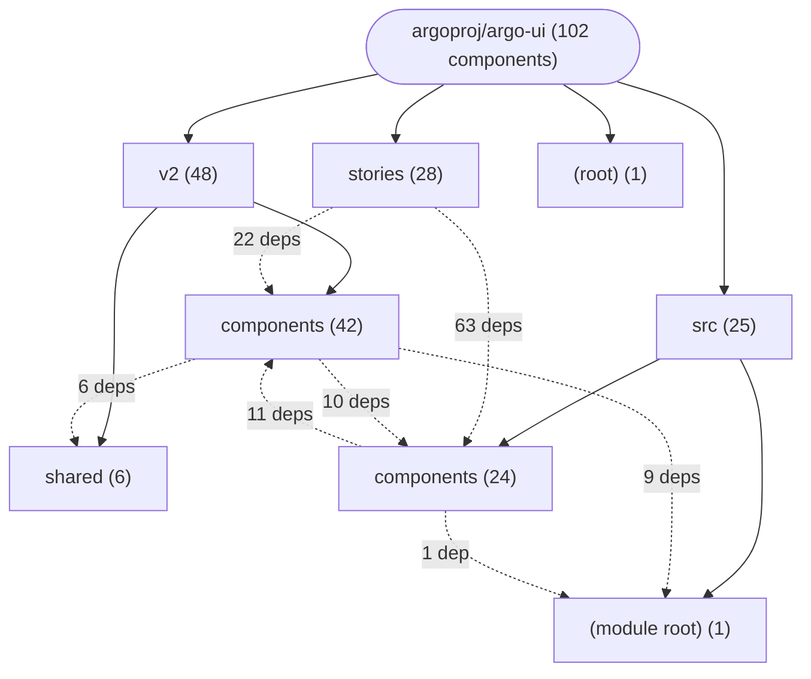
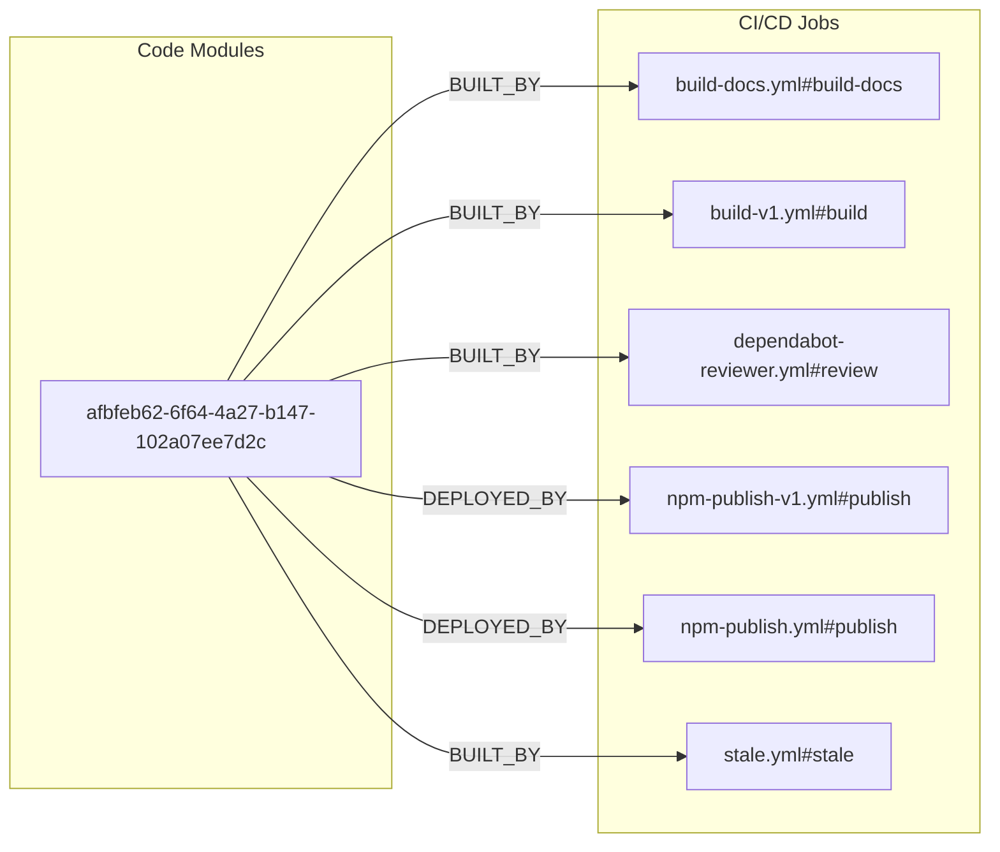
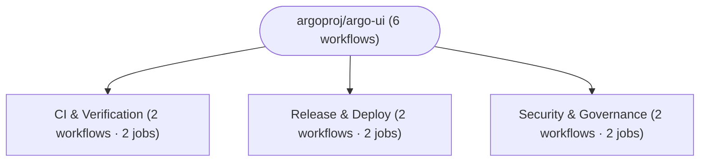

# Repository Architecture Analysis: argoproj/argo-ui

## Metadata
- **SHA**: `6fe731e4088e0dcf3cc33e9681baa4f088c30805`
- **Primary Ecosystem**: JavaScript/TypeScript

## Quality Metrics
- **ast_engine**: tree-sitter
- **avg_cognitive_complexity**: 3.58
- **avg_cyclomatic_complexity**: 3.15
- **component_count**: 102
- **dead_code_count**: 2
- **dead_code_symbols**: 2 entry(ies)
- **duplication_pct**: 61.67
- **file_complexities**: 25 entry(ies)
- **files_analyzed**: 107
- **fitness_passed**: False
- **fitness_violation_count**: 3
- **framework**: React (Vite)
- **import_edges**: 100 entry(ies)
- **loc**: 7393
- **max_cognitive_complexity**: 100
- **max_cyclomatic_complexity**: 47
- **sloc**: 6350
- **test_file_count**: 8

# Architecture: argoproj/argo-ui

## Context
- **Repository**: `argoproj/argo-ui`
- **SHA**: `6fe731e4088e0dcf3cc33e9681baa4f088c30805`
- **Ecosystem**: JavaScript/TypeScript
- **Framework**: React (Vite)

## Building Block View

## Component Details

Showing top 60 representative components out of 102 across 4 module group(s):

- **Module `v2`** (48 components — UI_COMPONENT: 48)
- **Module `stories`** (28 components — UI_COMPONENT: 28)
- **Module `src`** (25 components — UI_COMPONENT: 25)
- **Module `(root)`** (1 components — MODULE: 1)

- **AutocompleteField** (`src/components/autocomplete/autocomplete-field.tsx`): UI_COMPONENT (deps: Autocomplete, Checkbox, Form, FormField, NestedForm, RenderAutocomplete (+2 more))
- **Confirmation** (`stories/popup.stories.tsx`): UI_COMPONENT (deps: Checkbox, Form, FormField, FormSelect, NestedForm, Text (+1 more))
- **ConfirmationWithCustomFormInside** (`stories/popup.stories.tsx`): UI_COMPONENT (deps: Checkbox, Form, FormField, FormSelect, NestedForm, Text (+1 more))
- **Default** (`stories/forms.stories.tsx`): UI_COMPONENT (deps: Checkbox, Form, FormField, FormSelect, NestedForm, Text (+1 more))
- **Prompt** (`stories/popup.stories.tsx`): UI_COMPONENT (deps: Checkbox, Form, FormField, FormSelect, NestedForm, Text (+1 more))
- **PromptWithCustomSubmit** (`stories/popup.stories.tsx`): UI_COMPONENT (deps: Checkbox, Form, FormField, FormSelect, NestedForm, Text (+1 more))
- **PromptWithGreenClockIconAndCustomSubmit** (`stories/popup.stories.tsx`): UI_COMPONENT (deps: Checkbox, Form, FormField, FormSelect, NestedForm, Text (+1 more))
- **PromptWithJustHeadersAndParagraphs** (`stories/popup.stories.tsx`): UI_COMPONENT (deps: Checkbox, Form, FormField, FormSelect, NestedForm, Text (+1 more))
- **PromptWithOnlyParagraphsAdditionalTopPaddingIsOptionalForTheFirstParagraph** (`stories/popup.stories.tsx`): UI_COMPONENT (deps: Checkbox, Form, FormField, FormSelect, NestedForm, Text (+1 more))
- **PromptWithReactCheckboxThatIsCheckedByDefaultUsernameDefaultSetToAdmin** (`stories/popup.stories.tsx`): UI_COMPONENT (deps: Checkbox, Form, FormField, FormSelect, NestedForm, Text (+1 more))
- **PromptWithRedTitleAndIconWithCustomSubmit** (`stories/popup.stories.tsx`): UI_COMPONENT (deps: Checkbox, Form, FormField, FormSelect, NestedForm, Text (+1 more))
- **PromptWithYellowTitleAndIconThreeFieldsAndCustomSubmitVerticalCenterLayoutOfIcon** (`stories/popup.stories.tsx`): UI_COMPONENT (deps: Checkbox, Form, FormField, FormSelect, NestedForm, Text (+1 more))
- **FormSelect** (`src/components/form-field/form-field.tsx`): UI_COMPONENT (deps: Checkbox, Form, FormField, NestedForm, Text, TextArea)
- **FormField** (`src/components/form-field/form-field.tsx`): UI_COMPONENT (deps: Checkbox, Form, NestedForm, Text, TextArea)
- **Primary** (`v2/components/theme-div/theme-div.stories.tsx`): UI_COMPONENT (deps: ActionButton, AppContextReact, Flexy, Text, ThemeDiv)
- **InfoItem** (`v2/components/info-item/info-item.tsx`): UI_COMPONENT (deps: AppContextReact, Text, ThemeDiv, Tooltip)
- **InfoItemRow** (`v2/components/info-item/info-item.tsx`): UI_COMPONENT (deps: AppContextReact, Text, ThemeDiv, Tooltip)
- **Primary** (`v2/components/input/input.stories.tsx`): UI_COMPONENT (deps: AppContextReact, FormResetFactory, Input, Text)
- **ThemeToggle** (`v2/components/theme-toggle/theme-toggle.tsx`): UI_COMPONENT (deps: ActionButton, THEME_KEY, ThemeContext, ThemeProvider)
- **Ticker** (`v2/components/ticker/ticker.tsx`): UI_COMPONENT (deps: AppContextReact, Flexy, Text, ThemeDiv)
- **ActionButton** (`v2/components/action-button/action-button.tsx`): UI_COMPONENT (deps: EffectDiv, ThemeDiv, Tooltip)
- **Autocomplete** (`v2/components/autocomplete/autocomplete.tsx`): UI_COMPONENT (deps: FormResetFactory, Input, ThemeDiv)
- **BackgroundColor** (`stories/page.stories.tsx`): UI_COMPONENT (deps: Layout, Page, PageContext)
- **CompactNavBar** (`stories/page.stories.tsx`): UI_COMPONENT (deps: Layout, Page, PageContext)
- **CustomTopBarTitle** (`stories/page.stories.tsx`): UI_COMPONENT (deps: Layout, Page, PageContext)
- **Default** (`stories/page.stories.tsx`): UI_COMPONENT (deps: Layout, Page, PageContext)
- **Default** (`v2/components/box/box.stories.tsx`): UI_COMPONENT (deps: Box, BoxTitle, Checkbox)
- **DynamicToolbar** (`stories/page.stories.tsx`): UI_COMPONENT (deps: Layout, Page, PageContext)
- **Primary** (`v2/components/action-button/action-button.stories.tsx`): UI_COMPONENT (deps: ActionButton, AppContextReact, Text)
- **Primary** (`v2/components/effect-div/effect-div.stories.tsx`): UI_COMPONENT (deps: AppContextReact, EffectDiv, Text)
- **Primary** (`v2/components/header/header.stories.tsx`): UI_COMPONENT (deps: Brand, Header, Logo)
- **Primary** (`v2/components/tooltip/tooltip.stories.tsx`): UI_COMPONENT (deps: AppContextReact, Text, Tooltip)
- **RenderAutocomplete** (`v2/components/autocomplete/autocomplete.tsx`): UI_COMPONENT (deps: FormResetFactory, Input, ThemeDiv)
- **Secondary** (`v2/components/header/header.stories.tsx`): UI_COMPONENT (deps: Brand, Header, Logo)
- **ThemeDiv** (`v2/components/theme-div/theme-div.tsx`): UI_COMPONENT (deps: THEME_KEY, ThemeContext, ThemeProvider)
- **TopBar** (`src/components/top-bar/top-bar.tsx`): UI_COMPONENT (deps: AnchoredDropdown, Checkbox, SplitButton)
- **Default** (`stories/autocomplete.stories.tsx`): UI_COMPONENT (deps: Autocomplete, RenderAutocomplete)
- **Menu** (`v2/components/menu/menu.tsx`): UI_COMPONENT (deps: ActionButton, ThemeDiv)
- **NavBar** (`src/components/nav-bar/nav-bar.tsx`): UI_COMPONENT (deps: AppContextReact, Tooltip)
- **Primary** (`v2/components/autocomplete/autocomplete.stories.tsx`): UI_COMPONENT (deps: Autocomplete, RenderAutocomplete)
- **Primary** (`v2/components/info-item/info-item-row.stories.tsx`): UI_COMPONENT (deps: InfoItem, InfoItemRow)
- **Primary** (`v2/components/info-item/info-item.stories.tsx`): UI_COMPONENT (deps: InfoItem, InfoItemRow)
- **Primary** (`v2/components/menu/menu.stories.tsx`): UI_COMPONENT (deps: ActionButton, Menu)
- **Primary** (`v2/components/text/text.stories.tsx`): UI_COMPONENT (deps: AppContextReact, Text)
- **WithDescription** (`stories/autocomplete.stories.tsx`): UI_COMPONENT (deps: Autocomplete, RenderAutocomplete)
- **Alert** (`v2/components/alert/alert.tsx`): UI_COMPONENT (deps: ThemeDiv)
- **Box** (`v2/components/box/box.tsx`): UI_COMPONENT (deps: ThemeDiv)
- **BoxTitle** (`v2/components/box/box.tsx`): UI_COMPONENT (deps: ThemeDiv)
- **CenteredRow** (`v2/components/row/row.tsx`): UI_COMPONENT (deps: ThemeDiv)
- **Default** (`stories/dropdown.stories.tsx`): UI_COMPONENT (deps: AnchoredDropdown)
- **EffectDiv** (`v2/components/effect-div/effect-div.tsx`): UI_COMPONENT (deps: ThemeDiv)
- **Filler** (`v2/components/filler/filler.tsx`): UI_COMPONENT (deps: ThemeDiv)
- **FormResetFactory** (`v2/components/input/input.tsx`): UI_COMPONENT (deps: ThemeDiv)
- **HelpIcon** (`src/components/help-icon/help-icon.tsx`): UI_COMPONENT (deps: Tooltip)
- **Input** (`v2/components/input/input.tsx`): UI_COMPONENT (deps: ThemeDiv)
- **Layout** (`src/components/layout/layout.tsx`): UI_COMPONENT (deps: NavBar)
- **LoadingBar** (`v2/components/wait-for/wait-for.tsx`): UI_COMPONENT (deps: ThemeDiv)
- **Menu** (`stories/dropdown.stories.tsx`): UI_COMPONENT (deps: AnchoredDropdown)
- **MenuWrapper** (`stories/dropdown.stories.tsx`): UI_COMPONENT (deps: AnchoredDropdown)
- **Page** (`src/components/page/page.tsx`): UI_COMPONENT (deps: TopBar)

## 6-Dimension Repository Scorecard

- **Overall Grade**: `F` (55.63/100)
- **Technical Debt Score**: 44.37
- **Estimated Remediation Effort**: 44.93h

| Dimension | Grade | Score | Weight | Details |
| :--- | :---: | :---: | :---: | :--- |
| Code Quality | `F` | 45.40 | 0.20 | avg_cc=3.15, max_cc=47, duplication=61.67%, dead_code=2 |
| Dependency Health | `A` | 100.00 | 0.15 | dependencies=1204, outdated=0, vulnerable=0, has_lockfile=True |
| Maintainability | `F` | 57.00 | 0.15 | avg_cognitive=3.58, max_cognitive=100, fitness_violations=3, oversized_files=0 |
| Pipeline Health | `F` | 30.00 | 0.15 | workflows=6, operational_antipatterns=10, parallel_branches=False |
| Security | `F` | 40.00 | 0.20 | vulnerabilities=0, secrets=0, pipeline_security_findings=5 |
| Test Coverage | `C` | 70.00 | 0.15 | coverage=unavailable, ci_test_job=True, test_files_detected=True |

## Architecture Fitness & Workspace Boundaries

- **[MEDIUM] `ATRUSS-ARCH-005` (COMPLEXITY_THRESHOLD)**: Repository duplication_pct (61.67) exceeds policy threshold (15.0).
- **[MEDIUM] `ATRUSS-ARCH-005` (COMPLEXITY_THRESHOLD)**: Repository max_cognitive_complexity (100.0) exceeds policy threshold (25.0).
- **[MEDIUM] `ATRUSS-ARCH-005` (COMPLEXITY_THRESHOLD)**: Repository max_cyclomatic_complexity (47.0) exceeds policy threshold (20.0).

## Supply Chain Dependencies, Vulnerabilities & Secrets

- **Dependencies Parsed**: 1204 | **Vulnerabilities**: 0 | **Secrets**: 0

### Inventory Sample
- `@babel/core` `7.21.3` (npm, `package.json`)
- `@babel/core` `7.29.0` (npm, `pnpm-lock.yaml`)
- `@fortawesome/fontawesome-free` `6.2.1` (npm, `package.json`)
- `@fortawesome/fontawesome-free` `6.7.2` (npm, `pnpm-lock.yaml`)
- `@storybook/addon-actions` `8.6.17` (npm, `package.json`)
- `@storybook/addon-actions` `8.6.17` (npm, `pnpm-lock.yaml`)
- `@storybook/addon-controls` `8.6.17` (npm, `package.json`)
- `@storybook/addon-controls` `8.6.17` (npm, `pnpm-lock.yaml`)
- `@storybook/addon-essentials` `8.6.17` (npm, `package.json`)
- `@storybook/addon-essentials` `8.6.17` (npm, `pnpm-lock.yaml`)
- `@storybook/addon-links` `8.6.17` (npm, `package.json`)
- `@storybook/addon-links` `8.6.17` (npm, `pnpm-lock.yaml`)
- `@storybook/addon-webpack5-compiler-swc` `1.0.6` (npm, `package.json`)
- `@storybook/addon-webpack5-compiler-swc` `1.0.6` (npm, `pnpm-lock.yaml`)
- `@storybook/react-webpack5` `8.6.17` (npm, `package.json`)
- `@storybook/react-webpack5` `8.6.17` (npm, `pnpm-lock.yaml`)
- `@storybook/test` `8.6.17` (npm, `package.json`)
- `@storybook/test` `8.6.17` (npm, `pnpm-lock.yaml`)
- `@testing-library/dom` `10.4.0` (npm, `pnpm-lock.yaml`)
- `@testing-library/dom` `10.4.1` (npm, `package.json`)
- `@testing-library/dom` `10.4.1` (npm, `pnpm-lock.yaml`)
- `@testing-library/jest-dom` `6.5.0` (npm, `pnpm-lock.yaml`)
- `@testing-library/jest-dom` `6.9.1` (npm, `package.json`)
- `@testing-library/jest-dom` `6.9.1` (npm, `pnpm-lock.yaml`)
- `@testing-library/react` `16.3.2` (npm, `package.json`)
- `@testing-library/react` `16.3.2` (npm, `pnpm-lock.yaml`)
- `@testing-library/user-event` `14.5.2` (npm, `pnpm-lock.yaml`)
- `@testing-library/user-event` `14.6.1` (npm, `package.json`)
- `@testing-library/user-event` `14.6.1` (npm, `pnpm-lock.yaml`)
- `@types/deep-equal` `1.0.1` (npm, `package.json`)
- ... (+1174 more dependencies)

## Section 7: Code-to-Cloud Deployment Traceability

- `afbfeb62-6f64-4a27-b147-102a07ee7d2c` (code_module) --[BUILT_BY]--> `build-docs.yml#build-docs` (ci_job)
- `afbfeb62-6f64-4a27-b147-102a07ee7d2c` (code_module) --[BUILT_BY]--> `build-v1.yml#build` (ci_job)
- `afbfeb62-6f64-4a27-b147-102a07ee7d2c` (code_module) --[BUILT_BY]--> `dependabot-reviewer.yml#review` (ci_job)
- `afbfeb62-6f64-4a27-b147-102a07ee7d2c` (code_module) --[BUILT_BY]--> `stale.yml#stale` (ci_job)
- `afbfeb62-6f64-4a27-b147-102a07ee7d2c` (code_module) --[DEPLOYED_BY]--> `npm-publish-v1.yml#publish` (ci_job)
- `afbfeb62-6f64-4a27-b147-102a07ee7d2c` (code_module) --[DEPLOYED_BY]--> `npm-publish.yml#publish` (ci_job)

## CI/CD Pipeline Topology

