# Repository Architecture Analysis: argoproj/argo-workflows

## Metadata
- **SHA**: `5ecc44fcf0139214ee3c6d0fdfe5f9dca0eaf424`
- **Primary Ecosystem**: Go

## Quality Metrics
- **ast_engine**: tree-sitter
- **avg_cognitive_complexity**: 3.88
- **avg_cyclomatic_complexity**: 4.33
- **component_count**: 294
- **dead_code_count**: 0
- **dead_code_symbols**: 0 entry(ies)
- **duplication_pct**: 0.11
- **file_complexities**: 8 entry(ies)
- **files_analyzed**: 1155
- **fitness_passed**: False
- **fitness_violation_count**: 2
- **framework**: Go Service
- **import_edges**: 54 entry(ies)
- **loc**: 537200
- **max_cognitive_complexity**: 36
- **max_cyclomatic_complexity**: 30
- **sloc**: 489131
- **test_file_count**: 866

# Architecture: argoproj/argo-workflows

## Context
- **Repository**: `argoproj/argo-workflows`
- **SHA**: `5ecc44fcf0139214ee3c6d0fdfe5f9dca0eaf424`
- **Ecosystem**: Go
- **Framework**: Go Service

## Building Block View

```mermaid
graph TD;
  classDef atlasRoot fill:#004882,stroke:#a3c9ff,stroke-width:2px,color:#d3e4ff
  classDef atlasCategory fill:#212428,stroke:#E87A48,stroke-width:1.5px,color:#dfe3eb
  classDef atlasWorkflow fill:#1b2026,stroke:#a3c9ff,stroke-width:1.5px,color:#dfe3eb
  classDef atlasJob fill:#171c22,stroke:#8d9199,stroke-width:1px,color:#dfe3eb
  classDef atlasTarget fill:#005227,stroke:#8bd99b,stroke-width:1.5px,color:#a7f6b6
  classDef atlasAlert fill:#93000a,stroke:#ffb4ab,stroke-width:1.5px,color:#ffdad6
  classDef atlasMore fill:#252a31,stroke:#8d9199,stroke-dasharray:4 4,color:#c3c6cf
    repo_root(["argoproj/argo-workflows (294 components)"]):::atlasRoot
    dir_0_cmd["cmd (130)"]:::atlasCategory
    repo_root --> dir_0_cmd
    sub_0_0_argo["argo (100)"]:::atlasWorkflow
    dir_0_cmd --> sub_0_0_argo
    sub_0_1_argoexec["argoexec (29)"]:::atlasWorkflow
    dir_0_cmd --> sub_0_1_argoexec
    sub_0_2_workflow_controller["workflow-controller (1)"]:::atlasWorkflow
    dir_0_cmd --> sub_0_2_workflow_controller
    dir_1_pkg["pkg (56)"]:::atlasCategory
    repo_root --> dir_1_pkg
    sub_1_0_apiclient["apiclient (26)"]:::atlasWorkflow
    dir_1_pkg --> sub_1_0_apiclient
    sub_1_1_apiclient_http1["apiclient/http1 (13)"]:::atlasWorkflow
    dir_1_pkg --> sub_1_1_apiclient_http1
    sub_1_2_apiclient_eventsource["apiclient/eventsource (3)"]:::atlasWorkflow
    dir_1_pkg --> sub_1_2_apiclient_eventsource
    sub_1_more["+7 more submodules (14)"]:::atlasMore
    dir_1_pkg --> sub_1_more
    dir_2_manifests["manifests (42)"]:::atlasCategory
    repo_root --> dir_2_manifests
    sub_2_0_base["base (27)"]:::atlasWorkflow
    dir_2_manifests --> sub_2_0_base
    sub_2_1_cluster_install_no_crds["cluster-install-no-crds (10)"]:::atlasWorkflow
    dir_2_manifests --> sub_2_1_cluster_install_no_crds
    sub_2_2_components["components (4)"]:::atlasWorkflow
    dir_2_manifests --> sub_2_2_components
    sub_2_more["+1 more submodules (1)"]:::atlasMore
    dir_2_manifests --> sub_2_more
    dir_3_hack["hack (27)"]:::atlasCategory
    repo_root --> dir_3_hack
    sub_3_0_docs["docs (7)"]:::atlasWorkflow
    dir_3_hack --> sub_3_0_docs
    sub_3_1_api["api (6)"]:::atlasWorkflow
    dir_3_hack --> sub_3_1_api
    sub_3_2_featuregen["featuregen (5)"]:::atlasWorkflow
    dir_3_hack --> sub_3_2_featuregen
    sub_3_more["+4 more submodules (9)"]:::atlasMore
    dir_3_hack --> sub_3_more
    dir_4_persist["persist (16)"]:::atlasCategory
    repo_root --> dir_4_persist
    sub_4_0_sqldb["sqldb (14)"]:::atlasWorkflow
    dir_4_persist --> sub_4_0_sqldb
    sub_4_1_sqldb_mocks["sqldb/mocks (2)"]:::atlasWorkflow
    dir_4_persist --> sub_4_1_sqldb_mocks
    dir_other_modules["+7 more modules (23)"]:::atlasMore
    repo_root --> dir_other_modules
```

## Component Details

Showing top 60 representative components out of 294 across 12 module group(s):

- **Module `cmd`** (130 components — module: 130)
- **Module `pkg`** (56 components — module: 56)
- **Module `manifests`** (42 components — module: 42)
- **Module `hack`** (27 components — module: 27)
- **Module `persist`** (16 components — module: 16)
- **Module `config`** (14 components — module: 14)
- **Module `examples`** (3 components — module: 3)
- **Module `errors`** (2 components — module: 2)
- **Module `(root)`** (1 components — module: 1)
- **Module `.github`** (1 components — MODULE: 1)
- **Module `api`** (1 components — module: 1)
- **Module `dev`** (1 components — MODULE: 1)

- **MockWriter** (`cmd/argo/lint/mocks/MockWriter.go`): module
- **OffloadNodeStatusRepo** (`persist/sqldb/mocks/OffloadNodeStatusRepo.go`): module
- **WorkflowArchive** (`persist/sqldb/mocks/WorkflowArchive.go`): module
- **abstract-intermediary** (`pkg/apiclient/abstract-intermediary.go`): module
- **agent** (`cmd/argoexec/commands/agent.go`): module
- **apiclient** (`pkg/apiclient/apiclient.go`): module
- **apiclient_test** (`pkg/apiclient/apiclient_test.go`): module
- **archived-workflows-service-client** (`pkg/apiclient/http1/archived-workflows-service-client.go`): module
- **archived_workflow_labels** (`persist/sqldb/archived_workflow_labels.go`): module
- **archived_workflow_labels_test** (`persist/sqldb/archived_workflow_labels_test.go`): module
- **argo-kube-client** (`pkg/apiclient/argo-kube-client.go`): module
- **argo-kube-cluster-workflow-template-service-client** (`pkg/apiclient/argo-kube-cluster-workflow-template-service-client.go`): module
- **argo-kube-cron-workflow-service-client** (`pkg/apiclient/argo-kube-cron-workflow-service-client.go`): module
- **argo-kube-sync-service-client** (`pkg/apiclient/argo-kube-sync-service-client.go`): module
- **argo-kube-workflow-service-client** (`pkg/apiclient/argo-kube-workflow-service-client.go`): module
- **argo-kube-workflow-template-service-client** (`pkg/apiclient/argo-kube-workflow-template-service-client.go`): module
- **argo-server-client** (`pkg/apiclient/argo-server-client.go`): module
- **argo-server-clusterole** (`manifests/cluster-install-no-crds/argo-server-rbac/argo-server-clusterole.yaml`): module
- **argo-server-clusterolebinding** (`manifests/cluster-install-no-crds/argo-server-rbac/argo-server-clusterolebinding.yaml`): module
- **argo-server-deployment** (`manifests/base/argo-server/argo-server-deployment.yaml`): module
- **argo-server-opts** (`pkg/apiclient/argo-server-opts.go`): module
- **argo-server-opts_test** (`pkg/apiclient/argo-server-opts_test.go`): module
- **argo-server-sa** (`manifests/base/argo-server/argo-server-sa.yaml`): module
- **argo-server-service** (`manifests/base/argo-server/argo-server-service.yaml`): module
- **argo-workflows** (`dev/nix/package.json`): MODULE
- **argoproj.io_clusterworkflowtemplates** (`manifests/base/crds/full/argoproj.io_clusterworkflowtemplates.yaml`): module
- **argoproj.io_clusterworkflowtemplates** (`manifests/base/crds/minimal/argoproj.io_clusterworkflowtemplates.yaml`): module
- **argoproj.io_cronworkflows** (`manifests/base/crds/full/argoproj.io_cronworkflows.yaml`): module
- **argoproj.io_cronworkflows** (`manifests/base/crds/minimal/argoproj.io_cronworkflows.yaml`): module
- **argoproj.io_workflowartifactgctasks** (`manifests/base/crds/full/argoproj.io_workflowartifactgctasks.yaml`): module
- **argoproj.io_workflowartifactgctasks** (`manifests/base/crds/minimal/argoproj.io_workflowartifactgctasks.yaml`): module
- **argoproj.io_workfloweventbindings** (`manifests/base/crds/full/argoproj.io_workfloweventbindings.yaml`): module
- **argoproj.io_workfloweventbindings** (`manifests/base/crds/minimal/argoproj.io_workfloweventbindings.yaml`): module
- **argoproj.io_workflows** (`manifests/base/crds/full/argoproj.io_workflows.yaml`): module
- **argoproj.io_workflows** (`manifests/base/crds/minimal/argoproj.io_workflows.yaml`): module
- **argoproj.io_workflowtaskresults** (`manifests/base/crds/full/argoproj.io_workflowtaskresults.yaml`): module
- **argoproj.io_workflowtaskresults** (`manifests/base/crds/minimal/argoproj.io_workflowtaskresults.yaml`): module
- **argoproj.io_workflowtasksets** (`manifests/base/crds/full/argoproj.io_workflowtasksets.yaml`): module
- **argoproj.io_workflowtasksets** (`manifests/base/crds/minimal/argoproj.io_workflowtasksets.yaml`): module
- **argoproj.io_workflowtemplates** (`manifests/base/crds/full/argoproj.io_workflowtemplates.yaml`): module
- **argoproj.io_workflowtemplates** (`manifests/base/crds/minimal/argoproj.io_workflowtemplates.yaml`): module
- **artifact.pb** (`pkg/apiclient/artifact/artifact.pb.go`): module
- **artifact.pb.gw** (`pkg/apiclient/artifact/artifact.pb.gw.go`): module
- **artifact_plugin_init** (`cmd/argoexec/commands/artifact_plugin_init.go`): module
- **artifact_plugin_sidecar** (`cmd/argoexec/commands/artifact_plugin_sidecar.go`): module
- **backfill** (`cmd/argo/commands/cron/backfill.go`): module
- **backfill_nodes** (`persist/sqldb/backfill_nodes.go`): module
- **build** (`cmd/argo/commands/executorplugin/build.go`): module
- **cli** (`hack/docs/cli.go`): module
- **cluster-workflow-template-service-client** (`pkg/apiclient/http1/cluster-workflow-template-service-client.go`): module
- **cluster-workflow-template.pb** (`pkg/apiclient/clusterworkflowtemplate/cluster-workflow-template.pb.go`): module
- **cluster-workflow-template.pb.gw** (`pkg/apiclient/clusterworkflowtemplate/cluster-workflow-template.pb.gw.go`): module
- **common** (`cmd/argo/commands/common/common.go`): module
- **common_test** (`cmd/argo/commands/common/common_test.go`): module
- **completion** (`cmd/argo/commands/completion.go`): module
- **components** (`hack/featuregen/components.go`): module
- **config** (`config/config.go`): module
- **config** (`hack/proto-export/config.go`): module
- **config_test** (`config/config_test.go`): module
- **configdoc** (`hack/docs/configdoc.go`): module

## 6-Dimension Repository Scorecard

- **Overall Grade**: `F` (49.65/100)
- **Technical Debt Score**: 50.35
- **Estimated Remediation Effort**: 52.61h

| Dimension | Grade | Score | Weight | Details |
| :--- | :---: | :---: | :---: | :--- |
| Code Quality | `C` | 72.02 | 0.20 | avg_cc=4.33, max_cc=30, duplication=0.11%, dead_code=0 |
| Dependency Health | `A` | 100.00 | 0.15 | dependencies=841, outdated=0, vulnerable=0, has_lockfile=True |
| Maintainability | `D` | 64.00 | 0.15 | avg_cognitive=3.88, max_cognitive=36, fitness_violations=2, oversized_files=0 |
| Pipeline Health | `F` | 1.00 | 0.15 | workflows=18, operational_antipatterns=29, parallel_branches=True |
| Security | `F` | 0.00 | 0.20 | vulnerabilities=0, secrets=5, pipeline_security_findings=9 |
| Test Coverage | `C` | 70.00 | 0.15 | coverage=unavailable, ci_test_job=True, test_files_detected=True |

## Architecture Fitness & Workspace Boundaries

- **[MEDIUM] `ATRUSS-ARCH-005` (COMPLEXITY_THRESHOLD)**: Repository max_cognitive_complexity (36.0) exceeds policy threshold (25.0).
- **[MEDIUM] `ATRUSS-ARCH-005` (COMPLEXITY_THRESHOLD)**: Repository max_cyclomatic_complexity (30.0) exceeds policy threshold (20.0).

## Supply Chain Dependencies, Vulnerabilities & Secrets

- **Dependencies Parsed**: 841 | **Vulnerabilities**: 0 | **Secrets**: 5

### Secret Findings (Redacted)
- **[CRITICAL] `ATRUSS-SEC-004`** at `manifests/components/sso/dex/dex-cm.yaml:62` (`-----BEGIN ... PRIVATE KEY----- [REDACTED]`)
- **[CRITICAL] `ATRUSS-SEC-004`** at `manifests/quick-start/base/httpbin/my-httpbin-cred-secret.yaml:46` (`-----BEGIN ... PRIVATE KEY----- [REDACTED]`)
- **[HIGH] `ATRUSS-SEC-005`** at `server/auth/serviceaccount/claims_test.go:13` (`const token = "eyJh***REDACTED***"`)
- **[HIGH] `ATRUSS-SEC-005`** at `server/auth/serviceaccount/claims_test.go:19` (`const token2 = "eyJh***REDACTED***"`)
- **[HIGH] `ATRUSS-SEC-005`** at `test/e2e/azure/deploy-azurite.yaml:9` (`account-access-key: RWJ5***REDACTED***`)

### Inventory Sample
- `io.argoproj.workflow:argo-client-java` `0.0.0-SNAPSHOT` (Maven, `sdks/java/tests/pom.xml`)
- `junit:junit` `4.13.2` (Maven, `sdks/java/tests/pom.xml`)
- `mkdocs-material` `*` (PyPI, `docs/requirements.txt`)
- `mkdocs-redirects` `*` (PyPI, `docs/requirements.txt`)
- `properdocs` `1.6.7` (PyPI, `docs/requirements.txt`)
- `pymdown-extensions` `*` (PyPI, `docs/requirements.txt`)
- `cloud.google.com/go/storage` `1.68.0` (golang, `go.mod`)
- `github.com/Azure/azure-sdk-for-go/sdk/azcore` `1.23.3` (golang, `go.mod`)
- `github.com/Azure/azure-sdk-for-go/sdk/azidentity` `1.15.0` (golang, `go.mod`)
- `github.com/Azure/azure-sdk-for-go/sdk/storage/azblob` `1.8.2` (golang, `go.mod`)
- `github.com/Knetic/govaluate` `3.0.1-0.20250325060307-7625b7f8c03d+incompatible` (golang, `go.mod`)
- `github.com/Masterminds/sprig/v3` `3.3.0` (golang, `go.mod`)
- `github.com/TwiN/go-color` `1.4.1` (golang, `go.mod`)
- `github.com/XSAM/otelsql` `0.44.0` (golang, `go.mod`)
- `github.com/alibabacloud-go/tea` `1.5.4` (golang, `go.mod`)
- `github.com/aliyun/aliyun-oss-go-sdk` `3.0.2+incompatible` (golang, `go.mod`)
- `github.com/aliyun/credentials-go` `1.4.14` (golang, `go.mod`)
- `github.com/andybalholm/brotli` `1.2.7` (golang, `go.mod`)
- `github.com/argoproj/argo-events` `1.9.11` (golang, `go.mod`)
- `github.com/argoproj/argo-workflows/v4` `4.1.6` (golang, `sdks/go/alternate_auth/go.mod`)
- `github.com/argoproj/argo-workflows/v4` `4.1.6` (golang, `sdks/go/basic-workflow/go.mod`)
- `github.com/argoproj/argo-workflows/v4` `4.1.6` (golang, `sdks/go/grpc-client/go.mod`)
- `github.com/argoproj/argo-workflows/v4` `4.1.6` (golang, `sdks/go/watch-workflow/go.mod`)
- `github.com/argoproj/argo-workflows/v4` `4.1.6` (golang, `sdks/go/workflow-template/go.mod`)
- `github.com/argoproj/pkg` `0.13.7-0.20250123033407-65f2d4777bfd` (golang, `go.mod`)
- `github.com/aws/aws-sdk-go-v2/config` `1.33.13` (golang, `go.mod`)
- `github.com/aws/aws-sdk-go-v2/credentials` `1.20.13` (golang, `go.mod`)
- `github.com/aws/aws-sdk-go-v2/feature/rds/auth` `1.7.6` (golang, `go.mod`)
- `github.com/aws/aws-sdk-go-v2/service/sts` `1.51.6` (golang, `go.mod`)
- `github.com/blushft/go-diagrams` `0.0.0-20250322201119-d91ac4ca5de4` (golang, `go.mod`)
- ... (+811 more dependencies)

## Section 7: Code-to-Cloud Deployment Traceability

```mermaid
flowchart LR
    classDef atlasCategory fill:#212428,stroke:#E87A48,stroke-width:1.5px,color:#dfe3eb
    classDef atlasWorkflow fill:#1b2026,stroke:#a3c9ff,stroke-width:1.5px,color:#dfe3eb
    classDef atlasJob fill:#171c22,stroke:#8d9199,stroke-width:1px,color:#dfe3eb
    classDef atlasTarget fill:#005227,stroke:#8bd99b,stroke-width:1.5px,color:#a7f6b6
    subgraph code_modules["Code Modules"]
        mod__devcontainer_builder[".devcontainer/builder"]:::atlasCategory
        mod__github_pr_readiness[".github/pr-readiness"]:::atlasCategory
        mod_1b353365_cc1e_456b_9041_96498d34bff0["1b353365-cc1e-456b-9041-96498d34bff0"]:::atlasCategory
        mod_dev_nix["dev/nix"]:::atlasCategory
        mod_docs["docs"]:::atlasCategory
        mod_manifests_base_crds_full["manifests/base/crds/full"]:::atlasCategory
        mod_manifests_base_workflow_controller["manifests/base/workflow-controller"]:::atlasCategory
        mod_manifests_components_sso_dex["manifests/components/sso/dex"]:::atlasCategory
        mod_manifests_quick_start_base["manifests/quick-start/base"]:::atlasCategory
        mod_test_e2e_images_argosay_v1["test/e2e/images/argosay/v1"]:::atlasCategory
        mod_test_e2e_images_argosay_v2["test/e2e/images/argosay/v2"]:::atlasCategory
        mod_test_e2e_manifests_components_base["test/e2e/manifests/components/base"]:::atlasCategory
        mod_ui["ui"]:::atlasCategory
    end
    subgraph build_artifacts["Build Artifacts / Containers"]
        art__devcontainer_builder_Dockerfile[".devcontainer/builder/Dockerfile"]:::atlasWorkflow
        art_Dockerfile["Dockerfile"]:::atlasWorkflow
        art_Dockerfile_windows["Dockerfile.windows"]:::atlasWorkflow
        art_test_e2e_images_argosay_v1_Dockerfile["test/e2e/images/argosay/v1/Dockerfile"]:::atlasWorkflow
        art_test_e2e_images_argosay_v2_Dockerfile["test/e2e/images/argosay/v2/Dockerfile"]:::atlasWorkflow
    end
    subgraph ci_jobs["CI/CD Jobs"]
        job_cherry_pick_single_yml_cherry_pick["cherry-pick-single.yml#cherry-pick"]:::atlasJob
        job_ci_build_yaml_e2e_tests["ci-build.yaml#e2e-tests"]:::atlasJob
        job_ci_build_yaml_e2e_tests_composite_result["ci-build.yaml#e2e-tests-composite-result"]:::atlasJob
        job_ci_build_yaml_e2e_ui["ci-build.yaml#e2e-ui"]:::atlasJob
        job_ci_build_yaml_tests_windows["ci-build.yaml#tests-windows"]:::atlasJob
        job_ci_build_yaml_ui["ci-build.yaml#ui"]:::atlasJob
        job_devcontainer_yaml_build["devcontainer.yaml#build"]:::atlasJob
        job_docs_yaml_docs["docs.yaml#docs"]:::atlasJob
        job_pr_feature_yaml_feature_pr_handling["pr-feature.yaml#feature-pr-handling"]:::atlasJob
        job_pr_readiness_test_yaml_test["pr-readiness-test.yaml#test"]:::atlasJob
        job_release_yaml_build_linux["release.yaml#build-linux"]:::atlasJob
        job_release_yaml_build_ui["release.yaml#build-ui"]:::atlasJob
        job_release_yaml_build_windows["release.yaml#build-windows"]:::atlasJob
        job_release_yaml_publish_release["release.yaml#publish-release"]:::atlasJob
        job_retest_yaml_retest["retest.yaml#retest"]:::atlasJob
        job_snyk_yml_golang["snyk.yml#golang"]:::atlasJob
        job_snyk_yml_node["snyk.yml#node"]:::atlasJob
        job_update_gomod2nix_yml_gomod2nix["update-gomod2nix.yml#gomod2nix"]:::atlasJob
    end
    subgraph runtime_envs["Runtime Environments"]
        env_kubernetes["kubernetes"]:::atlasTarget
    end
    job_ci_build_yaml_e2e_tests -->|DEPLOYS_TO| env_kubernetes
    mod__devcontainer_builder -->|PACKAGED_BY| art__devcontainer_builder_Dockerfile
    mod__devcontainer_builder -->|PACKAGED_BY| art_Dockerfile
    mod__devcontainer_builder -->|PACKAGED_BY| art_Dockerfile_windows
    mod__github_pr_readiness -->|BUILT_BY| job_pr_readiness_test_yaml_test
    mod_1b353365_cc1e_456b_9041_96498d34bff0 -->|BUILT_BY| job_release_yaml_build_linux
    mod_1b353365_cc1e_456b_9041_96498d34bff0 -->|BUILT_BY| job_release_yaml_build_windows
    mod_1b353365_cc1e_456b_9041_96498d34bff0 -->|PACKAGED_BY| art_Dockerfile
    mod_1b353365_cc1e_456b_9041_96498d34bff0 -->|PACKAGED_BY| art_Dockerfile_windows
    mod_dev_nix -->|BUILT_BY| job_update_gomod2nix_yml_gomod2nix
    mod_docs -->|BUILT_BY| job_docs_yaml_docs
    mod_docs -->|BUILT_BY| job_pr_feature_yaml_feature_pr_handling
    mod_docs -->|PACKAGED_BY| art__devcontainer_builder_Dockerfile
    mod_manifests_base_crds_full -->|PACKAGED_BY| art_Dockerfile
    mod_manifests_base_workflow_controller -->|PACKAGED_BY| art_Dockerfile
    mod_manifests_components_sso_dex -->|PACKAGED_BY| art_Dockerfile
    mod_manifests_quick_start_base -->|PACKAGED_BY| art__devcontainer_builder_Dockerfile
    mod_manifests_quick_start_base -->|PACKAGED_BY| art_Dockerfile
    mod_manifests_quick_start_base -->|PACKAGED_BY| art_Dockerfile_windows
    mod_manifests_quick_start_base -->|PACKAGED_BY| art_test_e2e_images_argosay_v1_Dockerfile
    mod_test_e2e_images_argosay_v1 -->|PACKAGED_BY| art_Dockerfile
    mod_test_e2e_images_argosay_v1 -->|PACKAGED_BY| art_test_e2e_images_argosay_v1_Dockerfile
    mod_test_e2e_images_argosay_v1 -->|PACKAGED_BY| art_test_e2e_images_argosay_v2_Dockerfile
    mod_test_e2e_images_argosay_v2 -->|PACKAGED_BY| art_test_e2e_images_argosay_v2_Dockerfile
    mod_test_e2e_manifests_components_base -->|PACKAGED_BY| art__devcontainer_builder_Dockerfile
    mod_test_e2e_manifests_components_base -->|PACKAGED_BY| art_Dockerfile
    mod_test_e2e_manifests_components_base -->|PACKAGED_BY| art_Dockerfile_windows
    mod_test_e2e_manifests_components_base -->|PACKAGED_BY| art_test_e2e_images_argosay_v1_Dockerfile
    mod_ui -->|BUILT_BY| job_cherry_pick_single_yml_cherry_pick
    mod_ui -->|BUILT_BY| job_ci_build_yaml_e2e_tests
    mod_ui -->|BUILT_BY| job_ci_build_yaml_e2e_tests_composite_result
    mod_ui -->|BUILT_BY| job_ci_build_yaml_e2e_ui
    mod_ui -->|BUILT_BY| job_ci_build_yaml_tests_windows
    mod_ui -->|BUILT_BY| job_ci_build_yaml_ui
    mod_ui -->|BUILT_BY| job_devcontainer_yaml_build
    mod_ui -->|BUILT_BY| job_release_yaml_build_linux
    mod_ui -->|BUILT_BY| job_release_yaml_build_ui
    mod_ui -->|BUILT_BY| job_retest_yaml_retest
    mod_ui -->|BUILT_BY| job_snyk_yml_golang
    mod_ui -->|BUILT_BY| job_snyk_yml_node
    mod_ui -->|DEPLOYED_BY| job_release_yaml_build_windows
    mod_ui -->|DEPLOYED_BY| job_release_yaml_publish_release
    mod_ui -->|PACKAGED_BY| art__devcontainer_builder_Dockerfile
    mod_ui -->|PACKAGED_BY| art_Dockerfile
    mod_ui -->|PACKAGED_BY| art_Dockerfile_windows
    art_Dockerfile -->|DEPLOYED_BY| job_release_yaml_build_windows
    art_Dockerfile_windows -->|BUILT_BY| job_release_yaml_build_windows
    art_Dockerfile_windows -->|DEPLOYED_BY| job_release_yaml_build_windows
```

- `ci-build.yaml#e2e-tests` (ci_job) --[DEPLOYS_TO]--> `kubernetes` (environment)
- `.devcontainer/builder` (code_module) --[PACKAGED_BY]--> `.devcontainer/builder/Dockerfile` (container)
- `.devcontainer/builder` (code_module) --[PACKAGED_BY]--> `Dockerfile` (container)
- `.devcontainer/builder` (code_module) --[PACKAGED_BY]--> `Dockerfile.windows` (container)
- `.github/pr-readiness` (code_module) --[BUILT_BY]--> `pr-readiness-test.yaml#test` (ci_job)
- `1b353365-cc1e-456b-9041-96498d34bff0` (code_module) --[BUILT_BY]--> `release.yaml#build-linux` (ci_job)
- `1b353365-cc1e-456b-9041-96498d34bff0` (code_module) --[BUILT_BY]--> `release.yaml#build-windows` (ci_job)
- `1b353365-cc1e-456b-9041-96498d34bff0` (code_module) --[PACKAGED_BY]--> `Dockerfile` (container)
- `1b353365-cc1e-456b-9041-96498d34bff0` (code_module) --[PACKAGED_BY]--> `Dockerfile.windows` (container)
- `dev/nix` (code_module) --[BUILT_BY]--> `update-gomod2nix.yml#gomod2nix` (ci_job)
- `docs` (code_module) --[BUILT_BY]--> `docs.yaml#docs` (ci_job)
- `docs` (code_module) --[BUILT_BY]--> `pr-feature.yaml#feature-pr-handling` (ci_job)
- `docs` (code_module) --[PACKAGED_BY]--> `.devcontainer/builder/Dockerfile` (container)
- `manifests/base/crds/full` (code_module) --[PACKAGED_BY]--> `Dockerfile` (container)
- `manifests/base/workflow-controller` (code_module) --[PACKAGED_BY]--> `Dockerfile` (container)
- `manifests/components/sso/dex` (code_module) --[PACKAGED_BY]--> `Dockerfile` (container)
- `manifests/quick-start/base` (code_module) --[PACKAGED_BY]--> `.devcontainer/builder/Dockerfile` (container)
- `manifests/quick-start/base` (code_module) --[PACKAGED_BY]--> `Dockerfile` (container)
- `manifests/quick-start/base` (code_module) --[PACKAGED_BY]--> `Dockerfile.windows` (container)
- `manifests/quick-start/base` (code_module) --[PACKAGED_BY]--> `test/e2e/images/argosay/v1/Dockerfile` (container)
- `test/e2e/images/argosay/v1` (code_module) --[PACKAGED_BY]--> `Dockerfile` (container)
- `test/e2e/images/argosay/v1` (code_module) --[PACKAGED_BY]--> `test/e2e/images/argosay/v1/Dockerfile` (container)
- `test/e2e/images/argosay/v1` (code_module) --[PACKAGED_BY]--> `test/e2e/images/argosay/v2/Dockerfile` (container)
- `test/e2e/images/argosay/v2` (code_module) --[PACKAGED_BY]--> `test/e2e/images/argosay/v2/Dockerfile` (container)
- `test/e2e/manifests/components/base` (code_module) --[PACKAGED_BY]--> `.devcontainer/builder/Dockerfile` (container)
- `test/e2e/manifests/components/base` (code_module) --[PACKAGED_BY]--> `Dockerfile` (container)
- `test/e2e/manifests/components/base` (code_module) --[PACKAGED_BY]--> `Dockerfile.windows` (container)
- `test/e2e/manifests/components/base` (code_module) --[PACKAGED_BY]--> `test/e2e/images/argosay/v1/Dockerfile` (container)
- `ui` (code_module) --[BUILT_BY]--> `cherry-pick-single.yml#cherry-pick` (ci_job)
- `ui` (code_module) --[BUILT_BY]--> `ci-build.yaml#e2e-tests` (ci_job)
- `ui` (code_module) --[BUILT_BY]--> `ci-build.yaml#e2e-tests-composite-result` (ci_job)
- `ui` (code_module) --[BUILT_BY]--> `ci-build.yaml#e2e-ui` (ci_job)
- `ui` (code_module) --[BUILT_BY]--> `ci-build.yaml#tests-windows` (ci_job)
- `ui` (code_module) --[BUILT_BY]--> `ci-build.yaml#ui` (ci_job)
- `ui` (code_module) --[BUILT_BY]--> `devcontainer.yaml#build` (ci_job)
- `ui` (code_module) --[BUILT_BY]--> `release.yaml#build-linux` (ci_job)
- `ui` (code_module) --[BUILT_BY]--> `release.yaml#build-ui` (ci_job)
- `ui` (code_module) --[BUILT_BY]--> `retest.yaml#retest` (ci_job)
- `ui` (code_module) --[BUILT_BY]--> `snyk.yml#golang` (ci_job)
- `ui` (code_module) --[BUILT_BY]--> `snyk.yml#node` (ci_job)

## CI/CD Pipeline Topology

```mermaid
graph TD;
  classDef atlasRoot fill:#004882,stroke:#a3c9ff,stroke-width:2px,color:#d3e4ff
  classDef atlasCategory fill:#212428,stroke:#E87A48,stroke-width:1.5px,color:#dfe3eb
  classDef atlasWorkflow fill:#1b2026,stroke:#a3c9ff,stroke-width:1.5px,color:#dfe3eb
  classDef atlasJob fill:#171c22,stroke:#8d9199,stroke-width:1px,color:#dfe3eb
  classDef atlasTarget fill:#005227,stroke:#8bd99b,stroke-width:1.5px,color:#a7f6b6
  classDef atlasAlert fill:#93000a,stroke:#ffb4ab,stroke-width:1.5px,color:#ffdad6
  classDef atlasMore fill:#252a31,stroke:#8d9199,stroke-dasharray:4 4,color:#c3c6cf
  pipeline_root(["argoproj/argo-workflows (18 workflows)"]):::atlasRoot
  grp_0_CI___Verification["CI & Verification (13 workflows · 23 jobs)"]:::atlasCategory
  pipeline_root --> grp_0_CI___Verification
  wf_0_Changelog["Changelog (1 jobs)"]:::atlasWorkflow
  grp_0_CI___Verification --> wf_0_Changelog
  job_0_generate_changelog["generate_changelog"]:::atlasJob
  wf_0_Changelog --> job_0_generate_changelog
  wf_2_Cherry_Pick["Cherry Pick (2 jobs)"]:::atlasWorkflow
  grp_0_CI___Verification --> wf_2_Cherry_Pick
  job_2_find_labels["find-labels"]:::atlasJob
  job_2_cherry_pick["cherry-pick"]:::atlasJob
  wf_2_Cherry_Pick --> job_2_find_labels
  job_2_find_labels --> job_2_cherry_pick
  wf_3_CI["CI (10 jobs)"]:::atlasWorkflow
  grp_0_CI___Verification --> wf_3_CI
  job_3_changed_files["changed-files"]:::atlasJob
  job_3_tests["tests"]:::atlasJob
  job_3_tests_windows["tests-windows"]:::atlasJob
  wf_3_CI --> job_3_changed_files
  job_3_changed_files --> job_3_tests
  job_3_changed_files --> job_3_tests_windows
  wf_5_Dev_Container["Dev Container (1 jobs)"]:::atlasWorkflow
  grp_0_CI___Verification --> wf_5_Dev_Container
  job_5_build["build"]:::atlasJob
  wf_5_Dev_Container --> job_5_build
  wf_13_Detect_and_Trigger_Retest["Detect and Trigger Retest (1 jobs)"]:::atlasWorkflow
  grp_0_CI___Verification --> wf_13_Detect_and_Trigger_Retest
  job_13_retest["retest"]:::atlasJob
  wf_13_Detect_and_Trigger_Retest --> job_13_retest
  grp_1_Security___Governance["Security & Governance (2 workflows · 2 jobs)"]:::atlasCategory
  pipeline_root --> grp_1_Security___Governance
  wf_4_Approve_and_enable_auto_merge_for_dependabot["Approve and enable auto-merge for dependabot (1 jobs)"]:::atlasWorkflow
  grp_1_Security___Governance --> wf_4_Approve_and_enable_auto_merge_for_dependabot
  job_4_review["review"]:::atlasJob
  wf_4_Approve_and_enable_auto_merge_for_dependabot --> job_4_review
  wf_16_Mark_stale_issues_and_pull_requests["Mark stale issues and pull requests (1 jobs)"]:::atlasWorkflow
  grp_1_Security___Governance --> wf_16_Mark_stale_issues_and_pull_requests
  job_16_stale["stale"]:::atlasJob
  wf_16_Mark_stale_issues_and_pull_requests --> job_16_stale
  grp_2_Automation___Other["Automation & Other (1 workflows · 1 jobs)"]:::atlasCategory
  pipeline_root --> grp_2_Automation___Other
  wf_1_Cherry_Pick_Single["Cherry Pick Single (1 jobs)"]:::atlasWorkflow
  grp_2_Automation___Other --> wf_1_Cherry_Pick_Single
  job_1_cherry_pick["cherry-pick"]:::atlasJob
  wf_1_Cherry_Pick_Single --> job_1_cherry_pick
  grp_3_Release___Deploy["Release & Deploy (1 workflows · 8 jobs)"]:::atlasCategory
  pipeline_root --> grp_3_Release___Deploy
  wf_11_Release["Release (8 jobs)"]:::atlasWorkflow
  grp_3_Release___Deploy --> wf_11_Release
  job_11_build_linux["build-linux"]:::atlasJob
  job_11_build_windows["build-windows"]:::atlasJob
  job_11_push_images["push-images"]:::atlasJob
  wf_11_Release --> job_11_build_linux
  wf_11_Release --> job_11_build_windows
  job_11_build_linux --> job_11_push_images
  job_11_build_windows --> job_11_push_images
  grp_4_Scheduled___Manual["Scheduled & Manual (1 workflows · 2 jobs)"]:::atlasCategory
  pipeline_root --> grp_4_Scheduled___Manual
  wf_15_Snyk["Snyk (2 jobs)"]:::atlasWorkflow
  grp_4_Scheduled___Manual --> wf_15_Snyk
  job_15_golang["golang"]:::atlasJob
  job_15_node["node"]:::atlasJob
  wf_15_Snyk --> job_15_golang
  wf_15_Snyk --> job_15_node
  wf_more["+8 more workflows"]:::atlasMore
  pipeline_root --> wf_more
```

