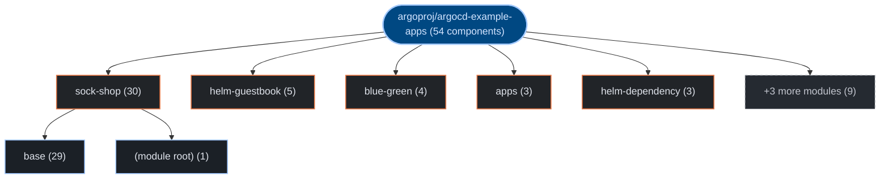

# Repository Architecture Analysis: argoproj/argocd-example-apps

## Metadata
- **SHA**: `8088f4c0d970abb09e250248cc97e35623447cb5`
- **Primary Ecosystem**: Container / Helm / IaC

## Quality Metrics
- **ast_engine**: fallback
- **avg_cognitive_complexity**: 0.0
- **avg_cyclomatic_complexity**: 0.0
- **component_count**: 54
- **dead_code_count**: 0
- **dead_code_symbols**: 0 entry(ies)
- **duplication_pct**: 0.0
- **file_complexities**: 0 entry(ies)
- **files_analyzed**: 54
- **fitness_passed**: True
- **fitness_violation_count**: 0
- **framework**: Helm Chart
- **import_edges**: 0 entry(ies)
- **loc**: 1549
- **max_cognitive_complexity**: 0
- **max_cyclomatic_complexity**: 0
- **sloc**: 1385

# Architecture: argoproj/argocd-example-apps

## Context
- **Repository**: `argoproj/argocd-example-apps`
- **SHA**: `8088f4c0d970abb09e250248cc97e35623447cb5`
- **Ecosystem**: Container / Helm / IaC
- **Framework**: Helm Chart

## Building Block View

## Component Details
- **Chart** (`apps/Chart.yaml`): module
- **values** (`apps/values.yaml`): module
- **applications** (`apps/templates/applications.yaml`): module
- **Chart** (`blue-green/Chart.yaml`): module
- **values** (`blue-green/values.yaml`): module
- **rollout** (`blue-green/templates/rollout.yaml`): module
- **services** (`blue-green/templates/services.yaml`): module
- **Chart** (`helm-dependency/Chart.yaml`): module
- **values-nomaria** (`helm-dependency/values-nomaria.yaml`): module
- **values** (`helm-dependency/values.yaml`): module
- **Chart** (`helm-guestbook/Chart.yaml`): module
- **values-production** (`helm-guestbook/values-production.yaml`): module
- **values** (`helm-guestbook/values.yaml`): module
- **deployment** (`helm-guestbook/templates/deployment.yaml`): module
- **service** (`helm-guestbook/templates/service.yaml`): module
- **guestbook-ui-deployment** (`kustomize-guestbook/guestbook-ui-deployment.yaml`): module
- **guestbook-ui-svc** (`kustomize-guestbook/guestbook-ui-svc.yaml`): module
- **kustomization** (`kustomize-guestbook/kustomization.yaml`): module
- **Chart** (`plugins/kustomized-helm/Chart.yaml`): module
- **kustomization** (`plugins/kustomized-helm/kustomization.yaml`): module
- **guestbook-deployment** (`plugins/kustomized-helm/overlays/guestbook-deployment.yaml`): module
- **kustomization** (`pre-post-sync/kustomization.yaml`): module
- **post-sync-job** (`pre-post-sync/post-sync-job.yaml`): module
- **pre-sync-job** (`pre-post-sync/pre-sync-job.yaml`): module
- **kustomization** (`sock-shop/kustomization.yaml`): module
- **carts-db-dep** (`sock-shop/base/carts-db-dep.yaml`): module
- **carts-db-svc** (`sock-shop/base/carts-db-svc.yaml`): module
- **carts-dep** (`sock-shop/base/carts-dep.yaml`): module
- **carts-svc** (`sock-shop/base/carts-svc.yaml`): module
- **catalogue-db-dep** (`sock-shop/base/catalogue-db-dep.yaml`): module
- **catalogue-db-svc** (`sock-shop/base/catalogue-db-svc.yaml`): module
- **catalogue-dep** (`sock-shop/base/catalogue-dep.yaml`): module
- **catalogue-svc** (`sock-shop/base/catalogue-svc.yaml`): module
- **front-end-dep** (`sock-shop/base/front-end-dep.yaml`): module
- **front-end-ingress** (`sock-shop/base/front-end-ingress.yaml`): module
- **front-end-svc** (`sock-shop/base/front-end-svc.yaml`): module
- **orders-db-dep** (`sock-shop/base/orders-db-dep.yaml`): module
- **orders-db-svc** (`sock-shop/base/orders-db-svc.yaml`): module
- **orders-dep** (`sock-shop/base/orders-dep.yaml`): module
- **orders-svc** (`sock-shop/base/orders-svc.yaml`): module
- **payment-dep** (`sock-shop/base/payment-dep.yaml`): module
- **payment-svc** (`sock-shop/base/payment-svc.yaml`): module
- **queue-master-dep** (`sock-shop/base/queue-master-dep.yaml`): module
- **queue-master-svc** (`sock-shop/base/queue-master-svc.yaml`): module
- **rabbitmq-dep** (`sock-shop/base/rabbitmq-dep.yaml`): module
- **rabbitmq-svc** (`sock-shop/base/rabbitmq-svc.yaml`): module
- **session-db-dep** (`sock-shop/base/session-db-dep.yaml`): module
- **session-db-svc** (`sock-shop/base/session-db-svc.yaml`): module
- **shipping-dep** (`sock-shop/base/shipping-dep.yaml`): module
- **shipping-svc** (`sock-shop/base/shipping-svc.yaml`): module
- **user-db-dep** (`sock-shop/base/user-db-dep.yaml`): module
- **user-db-svc** (`sock-shop/base/user-db-svc.yaml`): module
- **user-dep** (`sock-shop/base/user-dep.yaml`): module
- **user-svc** (`sock-shop/base/user-svc.yaml`): module

## 6-Dimension Repository Scorecard

- **Overall Grade**: `B` (80.50/100)
- **Technical Debt Score**: 19.50
- **Estimated Remediation Effort**: 4.88h

| Dimension | Grade | Score | Weight | Details |
| :--- | :---: | :---: | :---: | :--- |
| Code Quality | `A` | 100.00 | 0.20 | avg_cc=0.00, max_cc=0, duplication=0.00%, dead_code=0 |
| Dependency Health | `A` | 90.00 | 0.15 | dependencies=0 (no manifests parsed) |
| Maintainability | `A` | 100.00 | 0.15 | avg_cognitive=0.00, max_cognitive=0, fitness_violations=0, oversized_files=0 |
| Pipeline Health | `F` | 40.00 | 0.15 | workflows=0 |
| Security | `A` | 100.00 | 0.20 | vulnerabilities=0, secrets=0, pipeline_security_findings=0 |
| Test Coverage | `F` | 40.00 | 0.15 | coverage=unavailable, ci_test_job=False, test_files_detected=False |

## CI/CD Pipeline Topology

