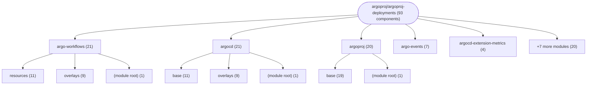
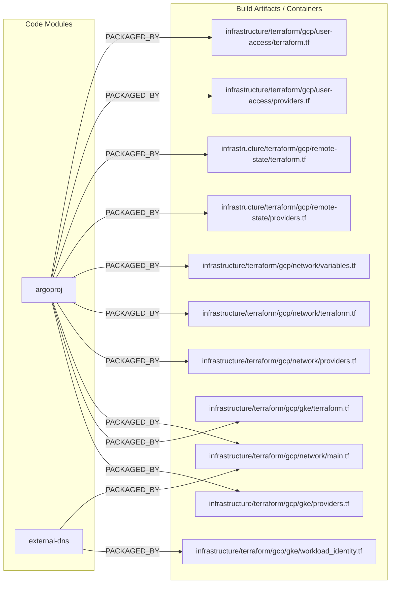

# Repository Architecture Analysis: argoproj/argoproj-deployments

## Metadata
- **SHA**: `30594a0e81ec441963348a15f920077a3cbd5362`
- **Primary Ecosystem**: Container / Helm / IaC

## Quality Metrics
- **ast_engine**: fallback
- **avg_cognitive_complexity**: 0.0
- **avg_cyclomatic_complexity**: 0.0
- **component_count**: 93
- **dead_code_count**: 0
- **dead_code_symbols**: 0 entry(ies)
- **duplication_pct**: 0.0
- **file_complexities**: 0 entry(ies)
- **files_analyzed**: 93
- **fitness_passed**: True
- **fitness_violation_count**: 0
- **framework**: Helm Chart
- **import_edges**: 0 entry(ies)
- **loc**: 1720
- **max_cognitive_complexity**: 0
- **max_cyclomatic_complexity**: 0
- **sloc**: 1613

# Architecture: argoproj/argoproj-deployments

## Context
- **Repository**: `argoproj/argoproj-deployments`
- **SHA**: `30594a0e81ec441963348a15f920077a3cbd5362`
- **Ecosystem**: Container / Helm / IaC
- **Framework**: Helm Chart

## Building Block View

## Component Details

Showing top 60 representative components out of 93 across 12 module group(s):

- **Module `argo-workflows`** (21 components — module: 21)
- **Module `argocd`** (21 components — module: 21)
- **Module `argoproj`** (20 components — module: 20)
- **Module `argo-events`** (7 components — module: 7)
- **Module `argocd-extension-metrics`** (4 components — module: 4)
- **Module `dex`** (4 components — module: 4)
- **Module `governor`** (4 components — module: 4)
- **Module `cert-manager`** (3 components — module: 3)
- **Module `cluster-config`** (3 components — module: 3)
- **Module `argo-rollouts`** (2 components — module: 2)
- **Module `argocd-image-updater`** (2 components — module: 2)
- **Module `external-dns`** (2 components — module: 2)

- **Chart** (`dex/Chart.yaml`): module
- **Chart** (`external-dns/Chart.yaml`): module
- **argo-cd** (`argoproj/base/argo-cd.yaml`): module
- **argo-cd-certificate** (`argocd/base/argo-cd-certificate.yaml`): module
- **argo-cd-cm** (`argocd/overlays/production/argo-cd-cm.yaml`): module
- **argo-cd-issuer** (`argocd/base/argo-cd-issuer.yaml`): module
- **argo-cd-ui-ingress** (`argocd/base/argo-cd-ui-ingress.yaml`): module
- **argo-events** (`argoproj/base/argo-events.yaml`): module
- **argo-ns** (`argo-workflows/resources/argo-ns.yaml`): module
- **argo-role** (`argo-workflows/overlays/argo-role.yaml`): module
- **argo-rolebinding** (`argo-workflows/overlays/argo-rolebinding.yaml`): module
- **argo-rolebinding** (`argo-workflows/resources/argo-rolebinding.yaml`): module
- **argo-rollouts** (`argoproj/base/argo-rollouts.yaml`): module
- **argo-server-deploy** (`argo-workflows/overlays/argo-server-deploy.yaml`): module
- **argo-server-ingress** (`argo-workflows/resources/argo-server-ingress.yaml`): module
- **argo-server-read-only-clusterrole** (`argo-workflows/resources/rbac/argo-server-read-only-clusterrole.yaml`): module
- **argo-server-role** (`argo-workflows/overlays/argo-server-role.yaml`): module
- **argo-server-rolebinding** (`argo-workflows/overlays/argo-server-rolebinding.yaml`): module
- **argo-server-rolebinding** (`argo-workflows/resources/argo-server-rolebinding.yaml`): module
- **argo-server-sa** (`argo-workflows/overlays/argo-server-sa.yaml`): module
- **argo-workflows** (`argoproj/base/argo-workflows.yaml`): module
- **argo-workflows-certificate** (`argo-workflows/resources/argo-workflows-certificate.yaml`): module
- **argo-workflows-issuer** (`argo-workflows/resources/argo-workflows-issuer.yaml`): module
- **argocd-cmd-params-cm** (`argocd/overlays/production/argocd-cmd-params-cm.yaml`): module
- **argocd-extension-metrics** (`argoproj/base/argocd-extension-metrics.yaml`): module
- **argocd-image-updater** (`argoproj/base/argocd-image-updater.yaml`): module
- **argocd-notifications-cm** (`argocd/overlays/production/argocd-notifications-cm.yaml`): module
- **argocd-notifications-controller-deploy** (`argocd/overlays/production/argocd-notifications-controller-deploy.yaml`): module
- **argocd-rbac-cm** (`argocd/overlays/production/argocd-rbac-cm.yaml`): module
- **argocd-server-service** (`argocd/overlays/production/argocd-server-service.yaml`): module
- **calendar-eventsource** (`argo-events/base/calendar-eventsource.yaml`): module
- **cert-manager** (`argoproj/base/cert-manager.yaml`): module
- **cert-manager-namespace** (`cert-manager/overlays/cert-manager-namespace.yaml`): module
- **certificate** (`dex/templates/certificate.yaml`): module
- **cluster-config** (`argoproj/base/cluster-config.yaml`): module
- **dex** (`argoproj/base/dex.yaml`): module
- **external-dns** (`argoproj/base/external-dns.yaml`): module
- **governor** (`argoproj/base/governor.yaml`): module
- **ingress-nginx** (`argoproj/base/ingress-nginx.yaml`): module
- **issuer** (`dex/templates/issuer.yaml`): module
- **istio-addons** (`argoproj/base/istio-addons.yaml`): module
- **istio-controlplane** (`argoproj/base/istio-controlplane.yaml`): module
- **istio-operator** (`argoproj/base/istio-operator.yaml`): module
- **kustomization** (`argo-events/kustomization.yaml`): module
- **kustomization** (`argo-rollouts/kustomization.yaml`): module
- **kustomization** (`argo-workflows/kustomization.yaml`): module
- **kustomization** (`argocd-extension-metrics/kustomization.yaml`): module
- **kustomization** (`argocd-image-updater/kustomization.yaml`): module
- **kustomization** (`argocd/base/namespaces/kustomization.yaml`): module
- **kustomization** (`argocd/kustomization.yaml`): module
- **kustomization** (`argoproj/kustomization.yaml`): module
- **kustomization** (`cert-manager/kustomization.yaml`): module
- **kustomization** (`cluster-config/kustomization.yaml`): module
- **kustomization** (`governor/kustomization.yaml`): module
- **log-sensor** (`argo-events/base/log-sensor.yaml`): module
- **metrics-extension** (`argocd/overlays/production/metrics-extension.yaml`): module
- **monitoring-namespace** (`argocd-extension-metrics/base/monitoring-namespace.yaml`): module
- **namespace** (`cluster-config/base/namespace.yaml`): module
- **operate-wf-rbac** (`argo-events/base/operate-wf-rbac.yaml`): module
- **operate-workflow-sa** (`argo-events/base/operate-workflow-sa.yaml`): module

## 6-Dimension Repository Scorecard

- **Overall Grade**: `B` (80.50/100)
- **Technical Debt Score**: 19.50
- **Estimated Remediation Effort**: 4.88h

| Dimension | Grade | Score | Weight | Details |
| :--- | :---: | :---: | :---: | :--- |
| Code Quality | `A` | 100.00 | 0.20 | avg_cc=0.00, max_cc=0, duplication=0.00%, dead_code=0 |
| Dependency Health | `A` | 90.00 | 0.15 | dependencies=0 (no manifests parsed) |
| Maintainability | `A` | 100.00 | 0.15 | avg_cognitive=0.00, max_cognitive=0, fitness_violations=0, oversized_files=0 |
| Pipeline Health | `F` | 40.00 | 0.15 | workflows=0 |
| Security | `A` | 100.00 | 0.20 | vulnerabilities=0, secrets=0, pipeline_security_findings=0 |
| Test Coverage | `F` | 40.00 | 0.15 | coverage=unavailable, ci_test_job=False, test_files_detected=False |

## Section 7: Code-to-Cloud Deployment Traceability

- `argoproj` (code_module) --[PACKAGED_BY]--> `infrastructure/terraform/gcp/gke/providers.tf` (iac)
- `argoproj` (code_module) --[PACKAGED_BY]--> `infrastructure/terraform/gcp/gke/terraform.tf` (iac)
- `argoproj` (code_module) --[PACKAGED_BY]--> `infrastructure/terraform/gcp/network/main.tf` (iac)
- `argoproj` (code_module) --[PACKAGED_BY]--> `infrastructure/terraform/gcp/network/providers.tf` (iac)
- `argoproj` (code_module) --[PACKAGED_BY]--> `infrastructure/terraform/gcp/network/terraform.tf` (iac)
- `argoproj` (code_module) --[PACKAGED_BY]--> `infrastructure/terraform/gcp/network/variables.tf` (iac)
- `argoproj` (code_module) --[PACKAGED_BY]--> `infrastructure/terraform/gcp/remote-state/providers.tf` (iac)
- `argoproj` (code_module) --[PACKAGED_BY]--> `infrastructure/terraform/gcp/remote-state/terraform.tf` (iac)
- `argoproj` (code_module) --[PACKAGED_BY]--> `infrastructure/terraform/gcp/user-access/providers.tf` (iac)
- `argoproj` (code_module) --[PACKAGED_BY]--> `infrastructure/terraform/gcp/user-access/terraform.tf` (iac)
- `external-dns` (code_module) --[PACKAGED_BY]--> `infrastructure/terraform/gcp/gke/workload_identity.tf` (iac)
- `external-dns` (code_module) --[PACKAGED_BY]--> `infrastructure/terraform/gcp/network/main.tf` (iac)

## CI/CD Pipeline Topology

