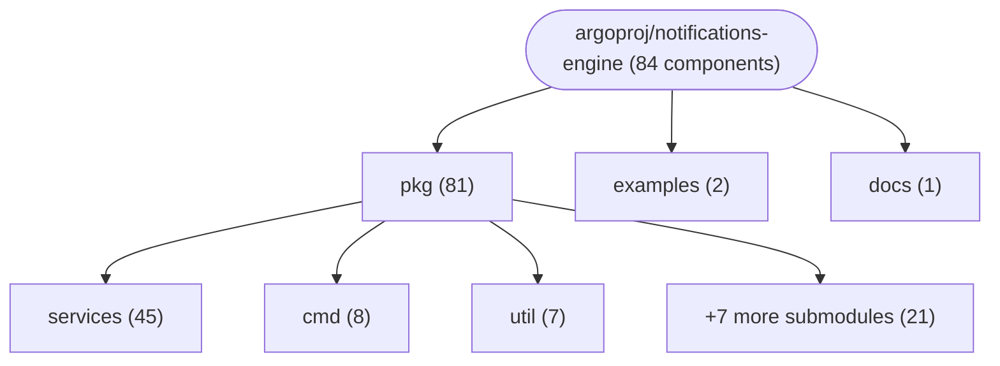
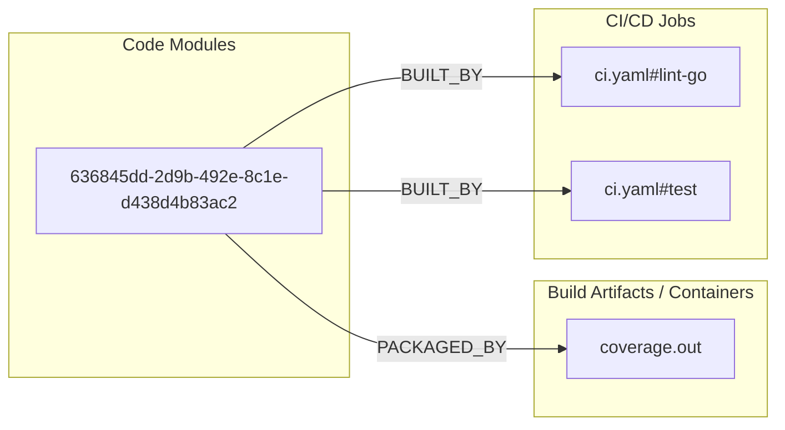
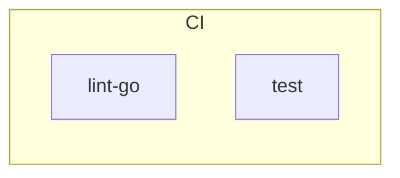

# Repository Architecture Analysis: argoproj/notifications-engine

## Metadata
- **SHA**: `0086b66d6687c9a47d0805a6a7429631bb5ac40c`
- **Primary Ecosystem**: Go

## Quality Metrics
- **ast_engine**: fallback
- **avg_cognitive_complexity**: 0.0
- **avg_cyclomatic_complexity**: 0.0
- **component_count**: 84
- **dead_code_count**: 0
- **dead_code_symbols**: 0 entry(ies)
- **duplication_pct**: 0.0
- **file_complexities**: 0 entry(ies)
- **files_analyzed**: 84
- **fitness_passed**: True
- **fitness_violation_count**: 0
- **framework**: Go Service
- **import_edges**: 0 entry(ies)
- **loc**: 14921
- **max_cognitive_complexity**: 0
- **max_cyclomatic_complexity**: 0
- **sloc**: 12475
- **test_file_count**: 34

# Architecture: argoproj/notifications-engine

## Context
- **Repository**: `argoproj/notifications-engine`
- **SHA**: `0086b66d6687c9a47d0805a6a7429631bb5ac40c`
- **Ecosystem**: Go
- **Framework**: Go Service

## Building Block View

## Component Details

Showing top 60 representative components out of 84 across 3 module group(s):

- **Module `pkg`** (81 components — module: 81)
- **Module `examples`** (2 components — module: 2)
- **Module `docs`** (1 components — module: 1)

- **alertmanager** (`pkg/services/alertmanager.go`): module
- **alertmanager_test** (`pkg/services/alertmanager_test.go`): module
- **annotations** (`pkg/subscriptions/annotations.go`): module
- **annotations_test** (`pkg/subscriptions/annotations_test.go`): module
- **api** (`pkg/api/api.go`): module
- **api** (`pkg/mocks/api.go`): module
- **api_test** (`pkg/api/api_test.go`): module
- **awssqs** (`pkg/services/awssqs.go`): module
- **awssqs_test** (`pkg/services/awssqs_test.go`): module
- **client** (`pkg/util/slack/client.go`): module
- **client** (`pkg/util/slack/mocks/client.go`): module
- **client_test** (`pkg/util/slack/client_test.go`): module
- **config** (`pkg/api/config.go`): module
- **config_test** (`pkg/api/config_test.go`): module
- **console** (`pkg/services/console.go`): module
- **context** (`pkg/cmd/context.go`): module
- **context_test** (`pkg/cmd/context_test.go`): module
- **controller** (`pkg/controller/controller.go`): module
- **controller_test** (`pkg/controller/controller_test.go`): module
- **docs** (`pkg/docs/docs.go`): module
- **email** (`pkg/services/email.go`): module
- **email_test** (`pkg/services/email_test.go`): module
- **factory** (`pkg/api/factory.go`): module
- **factory** (`pkg/mocks/factory.go`): module
- **factory_test** (`pkg/api/factory_test.go`): module
- **github** (`pkg/services/github.go`): module
- **github_test** (`pkg/services/github_test.go`): module
- **global** (`pkg/subscriptions/global.go`): module
- **googlechat** (`pkg/services/googlechat.go`): module
- **googlechat_test** (`pkg/services/googlechat_test.go`): module
- **grafana** (`pkg/services/grafana.go`): module
- **grafana_test** (`pkg/services/grafana_test.go`): module
- **logroundtripper** (`pkg/util/http/logroundtripper.go`): module
- **main** (`examples/certmanager/cli/main.go`): module
- **main** (`examples/certmanager/controller/main.go`): module
- **mattermost** (`pkg/services/mattermost.go`): module
- **mattermost_test** (`pkg/services/mattermost_test.go`): module
- **metrics** (`pkg/controller/metrics.go`): module
- **misc** (`pkg/util/misc/misc.go`): module
- **mocks** (`pkg/services/mocks/mocks.go`): module
- **nats** (`pkg/services/nats.go`): module
- **nats_test** (`pkg/services/nats_test.go`): module
- **newrelic** (`pkg/services/newrelic.go`): module
- **newrelic_test** (`pkg/services/newrelic_test.go`): module
- **opsgenie** (`pkg/services/opsgenie.go`): module
- **opsgenie_test** (`pkg/services/opsgenie_test.go`): module
- **pagerduty** (`pkg/services/pagerduty.go`): module
- **pagerduty_test** (`pkg/services/pagerduty_test.go`): module
- **pagerdutyv2** (`pkg/services/pagerdutyv2.go`): module
- **pagerdutyv2_test** (`pkg/services/pagerdutyv2_test.go`): module
- **pubsub** (`pkg/services/pubsub.go`): module
- **pubsub_test** (`pkg/services/pubsub_test.go`): module
- **pushover** (`pkg/services/pushover.go`): module
- **rocketchat** (`pkg/services/rocketchat.go`): module
- **rocketchat_test** (`pkg/services/rocketchat_test.go`): module
- **service** (`pkg/templates/service.go`): module
- **service** (`pkg/triggers/service.go`): module
- **service_test** (`pkg/templates/service_test.go`): module
- **service_test** (`pkg/triggers/service_test.go`): module
- **services** (`pkg/services/services.go`): module

## 6-Dimension Repository Scorecard

- **Overall Grade**: `C` (78.30/100)
- **Technical Debt Score**: 21.70
- **Estimated Remediation Effort**: 13.43h

| Dimension | Grade | Score | Weight | Details |
| :--- | :---: | :---: | :---: | :--- |
| Code Quality | `A` | 100.00 | 0.20 | avg_cc=0.00, max_cc=0, duplication=0.00%, dead_code=0 |
| Dependency Health | `B` | 85.00 | 0.15 | dependencies=130, outdated=0, vulnerable=0, has_lockfile=False |
| Maintainability | `A` | 100.00 | 0.15 | avg_cognitive=0.00, max_cognitive=0, fitness_violations=0, oversized_files=0 |
| Pipeline Health | `A` | 99.00 | 0.15 | workflows=1, operational_antipatterns=2, parallel_branches=True |
| Security | `F` | 26.00 | 0.20 | vulnerabilities=0, secrets=2, pipeline_security_findings=2 |
| Test Coverage | `C` | 70.00 | 0.15 | coverage=unavailable, ci_test_job=True, test_files_detected=True |

## Supply Chain Dependencies, Vulnerabilities & Secrets

- **Dependencies Parsed**: 130 | **Vulnerabilities**: 0 | **Secrets**: 2

### Secret Findings (Redacted)
- **[CRITICAL] `ATRUSS-SEC-004`** at `docs/services/github.md:48` (`-----BEGIN ... PRIVATE KEY----- [REDACTED]`)
- **[CRITICAL] `ATRUSS-SEC-004`** at `pkg/services/github_test.go:203` (`-----BEGIN ... PRIVATE KEY----- [REDACTED]`)

### Inventory Sample
- `cloud.google.com/go/pubsub` `1.49.0` (golang, `go.mod`)
- `github.com/Masterminds/sprig/v3` `3.3.0` (golang, `go.mod`)
- `github.com/OvyFlash/telegram-bot-api` `0.0.0-20241219171906-3f2ca0c14ada` (golang, `go.mod`)
- `github.com/PagerDuty/go-pagerduty` `1.8.0` (golang, `go.mod`)
- `github.com/RocketChat/Rocket.Chat.Go.SDK` `0.0.0-20240116134246-a8cbe886bab0` (golang, `go.mod`)
- `github.com/aws/aws-sdk-go-v2` `1.41.1` (golang, `go.mod`)
- `github.com/aws/aws-sdk-go-v2/config` `1.29.9` (golang, `go.mod`)
- `github.com/aws/aws-sdk-go-v2/credentials` `1.17.62` (golang, `go.mod`)
- `github.com/aws/aws-sdk-go-v2/service/sqs` `1.42.21` (golang, `go.mod`)
- `github.com/bradleyfalzon/ghinstallation/v2` `2.14.0` (golang, `go.mod`)
- `github.com/chainguard-dev/git-urls` `1.0.2` (golang, `go.mod`)
- `github.com/expr-lang/expr` `1.17.8` (golang, `go.mod`)
- `github.com/golang/mock` `1.6.0` (golang, `go.mod`)
- `github.com/google/go-cmp` `0.7.0` (golang, `go.mod`)
- `github.com/google/go-github/v69` `69.2.0` (golang, `go.mod`)
- `github.com/google/uuid` `1.6.0` (golang, `go.mod`)
- `github.com/gregdel/pushover` `1.3.1` (golang, `go.mod`)
- `github.com/hashicorp/go-retryablehttp` `0.7.7` (golang, `go.mod`)
- `github.com/nats-io/nats-server/v2` `2.11.4` (golang, `go.mod`)
- `github.com/nats-io/nats.go` `1.43.0` (golang, `go.mod`)
- `github.com/nats-io/nkeys` `0.4.11` (golang, `go.mod`)
- `github.com/opsgenie/opsgenie-go-sdk-v2` `1.2.23` (golang, `go.mod`)
- `github.com/prometheus/client_golang` `1.21.0` (golang, `go.mod`)
- `github.com/sirupsen/logrus` `1.9.4` (golang, `go.mod`)
- `github.com/slack-go/slack` `0.16.0` (golang, `go.mod`)
- `github.com/spf13/cast` `1.7.1` (golang, `go.mod`)
- `github.com/spf13/cobra` `1.9.1` (golang, `go.mod`)
- `github.com/stretchr/testify` `1.11.1` (golang, `go.mod`)
- `go.yaml.in/yaml/v3` `3.0.4` (golang, `go.mod`)
- `golang.org/x/time` `0.11.0` (golang, `go.mod`)
- ... (+100 more dependencies)

## Section 7: Code-to-Cloud Deployment Traceability

- `636845dd-2d9b-492e-8c1e-d438d4b83ac2` (code_module) --[BUILT_BY]--> `ci.yaml#lint-go` (ci_job)
- `636845dd-2d9b-492e-8c1e-d438d4b83ac2` (code_module) --[BUILT_BY]--> `ci.yaml#test` (ci_job)
- `636845dd-2d9b-492e-8c1e-d438d4b83ac2` (code_module) --[PACKAGED_BY]--> `coverage.out` (container)

## CI/CD Pipeline Topology

