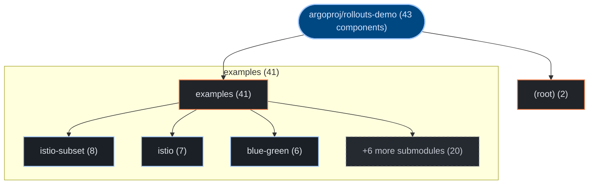
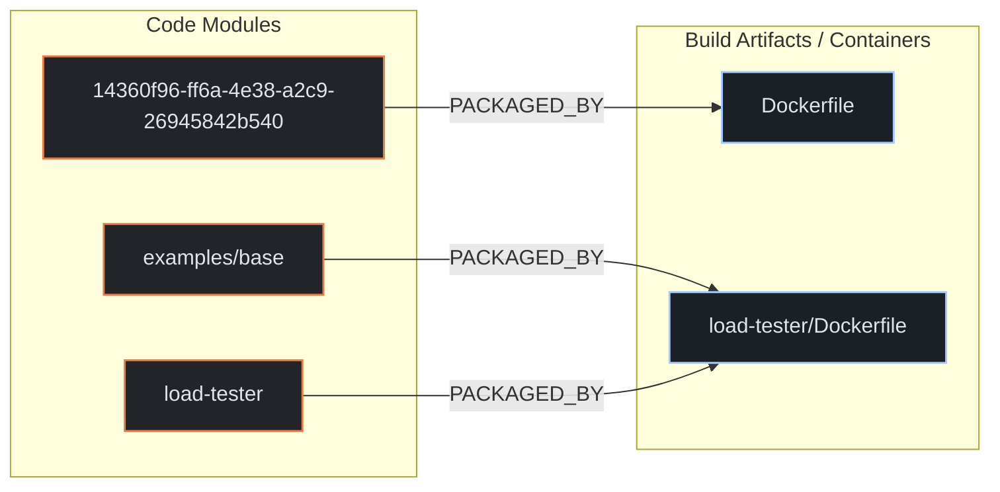

# Repository Architecture Analysis: argoproj/rollouts-demo

## Metadata
- **SHA**: `4e8c844fe9e23b7586f95b5f6b5365693cf318ad`
- **Primary Ecosystem**: Go

## Quality Metrics
- **ast_engine**: fallback
- **avg_cognitive_complexity**: 0.0
- **avg_cyclomatic_complexity**: 0.0
- **component_count**: 43
- **dead_code_count**: 0
- **dead_code_symbols**: 0 entry(ies)
- **duplication_pct**: 0.0
- **file_complexities**: 0 entry(ies)
- **files_analyzed**: 43
- **fitness_passed**: True
- **fitness_violation_count**: 0
- **framework**: Go Service
- **import_edges**: 0 entry(ies)
- **loc**: 1470
- **max_cognitive_complexity**: 0
- **max_cyclomatic_complexity**: 0
- **sloc**: 1365

# Architecture: argoproj/rollouts-demo

## Context
- **Repository**: `argoproj/rollouts-demo`
- **SHA**: `4e8c844fe9e23b7586f95b5f6b5365693cf318ad`
- **Ecosystem**: Go
- **Framework**: Go Service

## Building Block View

## Component Details
- **main** (`main.go`): module
- **tls** (`tls.go`): module
- **analysis-success-rate-wavefront** (`examples/analysis/analysis-success-rate-wavefront.yaml`): module
- **analysis-success-rate** (`examples/analysis/analysis-success-rate.yaml`): module
- **kustomization** (`examples/analysis/kustomization.yaml`): module
- **rollout-with-analysis** (`examples/analysis/rollout-with-analysis.yaml`): module
- **kustomization** (`examples/base/kustomization.yaml`): module
- **canary-ingress** (`examples/base/canary/canary-ingress.yaml`): module
- **canary-preview-ingress** (`examples/base/canary/canary-preview-ingress.yaml`): module
- **canary-preview-service** (`examples/base/canary/canary-preview-service.yaml`): module
- **canary-service** (`examples/base/canary/canary-service.yaml`): module
- **bluegreen-ingress** (`examples/blue-green/bluegreen-ingress.yaml`): module
- **bluegreen-preview-ingress** (`examples/blue-green/bluegreen-preview-ingress.yaml`): module
- **bluegreen-preview-service** (`examples/blue-green/bluegreen-preview-service.yaml`): module
- **bluegreen-rollout** (`examples/blue-green/bluegreen-rollout.yaml`): module
- **bluegreen-service** (`examples/blue-green/bluegreen-service.yaml`): module
- **kustomization** (`examples/blue-green/kustomization.yaml`): module
- **canary-rollout** (`examples/canary/canary-rollout.yaml`): module
- **kustomization** (`examples/canary/kustomization.yaml`): module
- **experiment** (`examples/experiment/experiment.yaml`): module
- **http-benchmark** (`examples/experiment/http-benchmark.yaml`): module
- **kustomization** (`examples/experiment/kustomization.yaml`): module
- **services** (`examples/experiment/services.yaml`): module
- **analysis** (`examples/istio/analysis.yaml`): module
- **gateway** (`examples/istio/gateway.yaml`): module
- **kustomization** (`examples/istio/kustomization.yaml`): module
- **namespace** (`examples/istio/namespace.yaml`): module
- **rollout** (`examples/istio/rollout.yaml`): module
- **services** (`examples/istio/services.yaml`): module
- **virtualservice** (`examples/istio/virtualservice.yaml`): module
- **analysis** (`examples/istio-subset/analysis.yaml`): module
- **destinationrule** (`examples/istio-subset/destinationrule.yaml`): module
- **gateway** (`examples/istio-subset/gateway.yaml`): module
- **kustomization** (`examples/istio-subset/kustomization.yaml`): module
- **namespace** (`examples/istio-subset/namespace.yaml`): module
- **rollout** (`examples/istio-subset/rollout.yaml`): module
- **services** (`examples/istio-subset/services.yaml`): module
- **virtualservice** (`examples/istio-subset/virtualservice.yaml`): module
- **kustomization** (`examples/preview-testing/kustomization.yaml`): module
- **preview-testing** (`examples/preview-testing/preview-testing.yaml`): module
- **ingress** (`examples/rollout-experiment/ingress.yaml`): module
- **kustomization** (`examples/rollout-experiment/kustomization.yaml`): module
- **rollout-experiment** (`examples/rollout-experiment/rollout-experiment.yaml`): module

## 6-Dimension Repository Scorecard

- **Overall Grade**: `B` (80.50/100)
- **Technical Debt Score**: 19.50
- **Estimated Remediation Effort**: 4.88h

| Dimension | Grade | Score | Weight | Details |
| :--- | :---: | :---: | :---: | :--- |
| Code Quality | `A` | 100.00 | 0.20 | avg_cc=0.00, max_cc=0, duplication=0.00%, dead_code=0 |
| Dependency Health | `A` | 90.00 | 0.15 | dependencies=0 (no manifests parsed) |
| Maintainability | `A` | 100.00 | 0.15 | avg_cognitive=0.00, max_cognitive=0, fitness_violations=0, oversized_files=0 |
| Pipeline Health | `F` | 40.00 | 0.15 | workflows=0 |
| Security | `A` | 100.00 | 0.20 | vulnerabilities=0, secrets=0, pipeline_security_findings=0 |
| Test Coverage | `F` | 40.00 | 0.15 | coverage=unavailable, ci_test_job=False, test_files_detected=False |

## Section 7: Code-to-Cloud Deployment Traceability

- `14360f96-ff6a-4e38-a2c9-26945842b540` (code_module) --[PACKAGED_BY]--> `Dockerfile` (container)
- `examples/base` (code_module) --[PACKAGED_BY]--> `load-tester/Dockerfile` (container)
- `load-tester` (code_module) --[PACKAGED_BY]--> `load-tester/Dockerfile` (container)

## CI/CD Pipeline Topology

