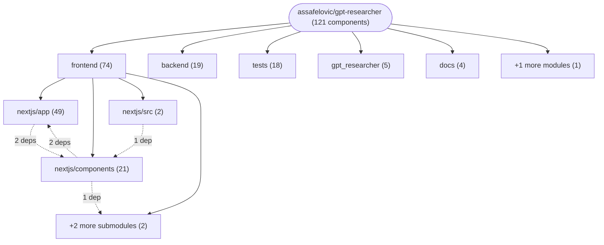
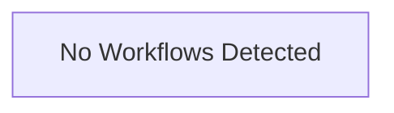

# Repository Architecture Analysis: assafelovic/gpt-researcher

## Metadata
- **SHA**: `ddd4db36208d9c8e49f3b2436efda97baecb5433`
- **Primary Ecosystem**: Python

## Quality Metrics
- **avg_cyclomatic_complexity**: 5.67
- **component_count**: 121
- **files_analyzed**: 618
- **framework**: FastAPI
- **loc**: 67874
- **max_cyclomatic_complexity**: 114
- **sloc**: 54121

# Architecture: assafelovic/gpt-researcher

## Context
- **Repository**: `assafelovic/gpt-researcher`
- **SHA**: `ddd4db36208d9c8e49f3b2436efda97baecb5433`
- **Ecosystem**: Python
- **Framework**: Unknown

## Building Block View

## Component Details

Showing top 60 representative components out of 121 across 6 module group(s):

- **Module `frontend`** (74 components — UI_COMPONENT: 69, API_ROUTE: 4, MODULE: 1)
- **Module `backend`** (19 components — API_ROUTE: 16, DATA_ACCESS_LAYER: 2, SERVICE: 1)
- **Module `tests`** (18 components — API_ROUTE: 18)
- **Module `gpt_researcher`** (5 components — SERVICE: 3, DATA_ACCESS_LAYER: 2)
- **Module `docs`** (4 components — MODULE: 3, UI_COMPONENT: 1)
- **Module `(root)`** (1 components — DATA_ACCESS_LAYER: 1)

- **RunScreen** (`frontend/nextjs/app/(gr)/_components/RunScreen.tsx`): UI_COMPONENT (deps: Arrow, ChatComposer, ChatThread, Connection, Eye, Favicon (+9 more))
- **HomeScreen** (`frontend/nextjs/app/(gr)/_components/HomeScreen.tsx`): UI_COMPONENT (deps: Arrow, Brief, Connection, Eye, Favicon, FaviconStack (+8 more))
- **Sheet** (`frontend/nextjs/app/(gr)/_components/Sheet.tsx`): UI_COMPONENT (deps: Arrow, Connection, Eye, Favicon, FaviconStack, MockMode (+5 more))
- **ArchiveScreen** (`frontend/nextjs/app/(gr)/_components/ArchiveScreen.tsx`): UI_COMPONENT (deps: Arrow, Connection, Eye, Favicon, FaviconStack, MockMode (+2 more))
- **Page** (`frontend/nextjs/app/(gr)/mocks/home/page.tsx`): UI_COMPONENT (deps: Brief, HomeScreen, MCP_STRATEGIES, MobileHomeScreen, REPORT_TYPES, SOURCES (+2 more))
- **QuestionMarks** (`frontend/nextjs/app/(gr)/_components/Stages.tsx`): UI_COMPONENT (deps: Arrow, Connection, Eye, Favicon, FaviconStack, Thumb (+1 more))
- **ResearchScreen** (`frontend/nextjs/app/(gr)/research/[id]/ResearchScreen.tsx`): UI_COMPONENT (deps: Arrow, ChatComposer, ChatThread, Connection, Eye, RunScreen (+1 more))
- **StageList** (`frontend/nextjs/app/(gr)/_components/Stages.tsx`): UI_COMPONENT (deps: Arrow, Connection, Eye, Favicon, FaviconStack, Thumb (+1 more))
- **StageStrip** (`frontend/nextjs/app/(gr)/_components/Stages.tsx`): UI_COMPONENT (deps: Arrow, Connection, Eye, Favicon, FaviconStack, Thumb (+1 more))
- **AppLayout** (`frontend/nextjs/app/(gr)/layout.tsx`): UI_COMPONENT (deps: Arrow, Connection, Eye, SettingsButton, SettingsDialog, TopBar)
- **SettingsButton** (`frontend/nextjs/app/(gr)/_components/Settings.tsx`): UI_COMPONENT (deps: Brief, MCP_STRATEGIES, REPORT_TYPES, SOURCES, SitesEditor, TONES)
- **SettingsDialog** (`frontend/nextjs/app/(gr)/_components/Settings.tsx`): UI_COMPONENT (deps: Brief, MCP_STRATEGIES, REPORT_TYPES, SOURCES, SitesEditor, TONES)
- **MockRun** (`frontend/nextjs/app/(gr)/mocks/_components/MockRun.tsx`): UI_COMPONENT (deps: Arrow, Connection, Eye, RunScreen, TopBar)
- **Arrow** (`frontend/nextjs/app/(gr)/_components/ui.tsx`): UI_COMPONENT (deps: MockMode, SettingsButton, SettingsDialog)
- **ChatBox** (`frontend/nextjs/components/Settings/ChatBox.tsx`): UI_COMPONENT (deps: AgentLogs, Report, ResearchForm)
- **ChatRequest** (`backend/server/app.py`): DATA_ACCESS_LAYER (deps: WebSocketManager, agent_discovery, chat)
- **Connection** (`frontend/nextjs/app/(gr)/_components/ui.tsx`): UI_COMPONENT (deps: MockMode, SettingsButton, SettingsDialog)
- **Eye** (`frontend/nextjs/app/(gr)/_components/ui.tsx`): UI_COMPONENT (deps: MockMode, SettingsButton, SettingsDialog)
- **ResearchForm** (`frontend/nextjs/components/Task/ResearchForm.tsx`): UI_COMPONENT (deps: DomainFilter, LayoutSelector, ToneSelector)
- **ResearchRequest** (`backend/server/app.py`): DATA_ACCESS_LAYER (deps: WebSocketManager, agent_discovery, chat)
- **Sources** (`frontend/nextjs/app/(gr)/_components/Sources.tsx`): UI_COMPONENT (deps: Favicon, FaviconStack, Thumb)
- **TopBar** (`frontend/nextjs/app/(gr)/_components/ui.tsx`): UI_COMPONENT (deps: MockMode, SettingsButton, SettingsDialog)
- **create_or_update_report** (`backend/server/app.py`): API_ROUTE (deps: WebSocketManager, agent_discovery, chat)
- **delete_file** (`backend/server/app.py`): API_ROUTE (deps: WebSocketManager, agent_discovery, chat)
- **delete_report** (`backend/server/app.py`): API_ROUTE (deps: WebSocketManager, agent_discovery, chat)
- **generate_report** (`backend/server/app.py`): API_ROUTE (deps: WebSocketManager, agent_discovery, chat)
- **get_all_reports** (`backend/server/app.py`): API_ROUTE (deps: WebSocketManager, agent_discovery, chat)
- **get_report_by_id** (`backend/server/app.py`): API_ROUTE (deps: WebSocketManager, agent_discovery, chat)
- **get_report_chat** (`backend/server/app.py`): API_ROUTE (deps: WebSocketManager, agent_discovery, chat)
- **list_files** (`backend/server/app.py`): API_ROUTE (deps: WebSocketManager, agent_discovery, chat)
- **read_report** (`backend/server/app.py`): API_ROUTE (deps: WebSocketManager, agent_discovery, chat)
- **research_report_chat** (`backend/server/app.py`): API_ROUTE (deps: WebSocketManager, agent_discovery, chat)
- **run_multi_agents** (`backend/server/app.py`): API_ROUTE (deps: WebSocketManager, agent_discovery, chat)
- **serve_frontend** (`backend/server/app.py`): API_ROUTE (deps: WebSocketManager, agent_discovery, chat)
- **update_report** (`backend/server/app.py`): API_ROUTE (deps: WebSocketManager, agent_discovery, chat)
- **upload_file** (`backend/server/app.py`): API_ROUTE (deps: WebSocketManager, agent_discovery, chat)
- **MocksLayout** (`frontend/nextjs/app/(gr)/mocks/layout.tsx`): UI_COMPONENT (deps: MockBar, MockMode)
- **Page** (`frontend/nextjs/app/(gr)/page.tsx`): UI_COMPONENT (deps: HomeScreen, MobileHomeScreen)
- **ResearchResults** (`frontend/nextjs/components/ResearchResults.tsx`): UI_COMPONENT (deps: Report, Sources)
- **agent_discovery** (`backend/server/app.py`): API_ROUTE (deps: WebSocketManager, chat)
- **chat** (`backend/server/app.py`): API_ROUTE (deps: WebSocketManager, agent_discovery)
- **ChatComposer** (`frontend/nextjs/app/(gr)/_components/Chat.tsx`): UI_COMPONENT (deps: Sheet)
- **ChatResponse** (`frontend/nextjs/components/ResearchBlocks/ChatResponse.tsx`): UI_COMPONENT (deps: Sources)
- **ChatThread** (`frontend/nextjs/app/(gr)/_components/Chat.tsx`): UI_COMPONENT (deps: Sheet)
- **GPTResearcher** (`frontend/nextjs/src/GPTResearcher.tsx`): UI_COMPONENT (deps: ResearchResults)
- **ImagesAlbum** (`frontend/nextjs/components/Images/ImagesAlbum.tsx`): UI_COMPONENT (deps: ImageModal)
- **Page** (`frontend/nextjs/app/(gr)/archive/page.tsx`): UI_COMPONENT (deps: ArchiveScreen)
- **Page** (`frontend/nextjs/app/(gr)/mocks/archive/page.tsx`): UI_COMPONENT (deps: ArchiveScreen)
- **Page** (`frontend/nextjs/app/(gr)/mocks/failed/page.tsx`): UI_COMPONENT (deps: MockRun)
- **Page** (`frontend/nextjs/app/(gr)/mocks/report/page.tsx`): UI_COMPONENT (deps: MockRun)
- **Page** (`frontend/nextjs/app/(gr)/mocks/review/page.tsx`): UI_COMPONENT (deps: MockRun)
- **Page** (`frontend/nextjs/app/(gr)/mocks/run/page.tsx`): UI_COMPONENT (deps: MockRun)
- **Page** (`frontend/nextjs/app/(gr)/research/[id]/page.tsx`): UI_COMPONENT (deps: ResearchScreen)
- **Report** (`frontend/nextjs/components/ResearchBlocks/Report.tsx`): UI_COMPONENT (deps: ResearchHistoryProvider)
- **API_[id]_route** (`frontend/nextjs/app/api/reports/[id]/route.ts`): API_ROUTE
- **API_chat_route** (`frontend/nextjs/app/api/chat/route.ts`): API_ROUTE
- **API_chat_route** (`frontend/nextjs/app/api/reports/[id]/chat/route.ts`): API_ROUTE
- **API_reports_route** (`frontend/nextjs/app/api/reports/route.ts`): API_ROUTE
- **AgentLogs** (`frontend/nextjs/components/Task/AgentLogs.tsx`): UI_COMPONENT
- **Brief** (`frontend/nextjs/app/(gr)/_components/Brief.tsx`): UI_COMPONENT

## CI/CD Pipeline Topology

