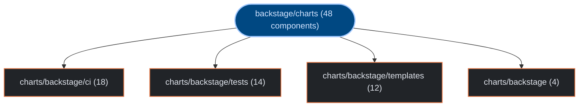
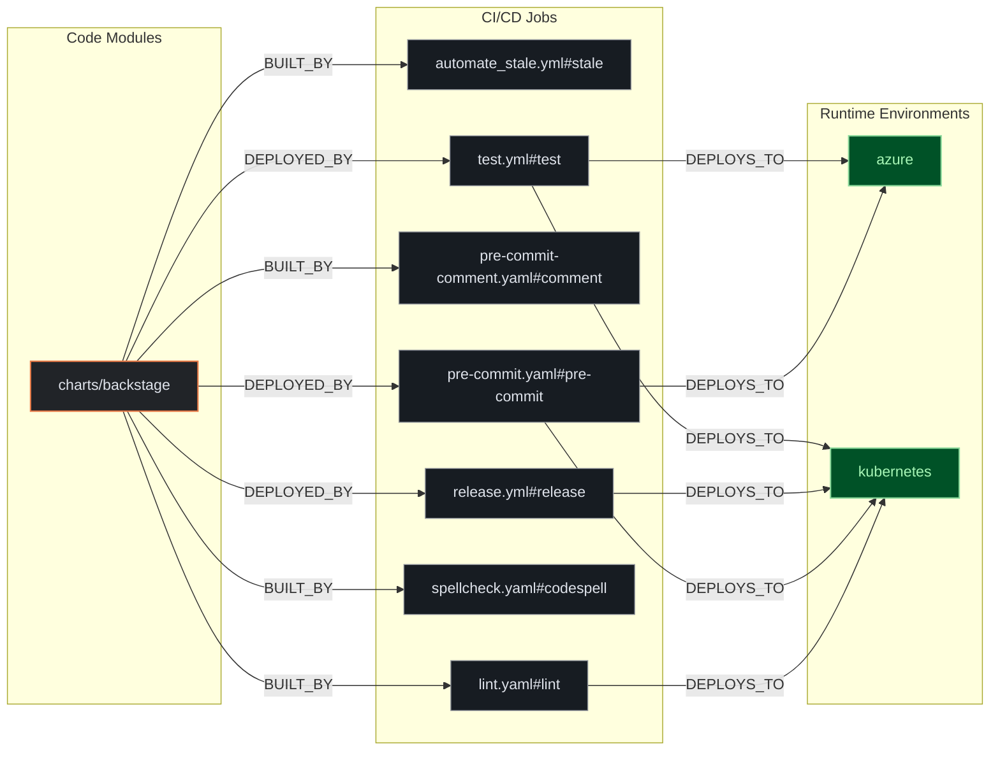

# Repository Architecture Analysis: backstage/charts

## Metadata
- **SHA**: `9487804d669853142d6f0e39cc6c838904454b90`
- **Primary Ecosystem**: Container / Helm / IaC

## Quality Metrics
- **ast_engine**: fallback
- **avg_cognitive_complexity**: 0.0
- **avg_cyclomatic_complexity**: 0.0
- **component_count**: 48
- **dead_code_count**: 0
- **dead_code_symbols**: 0 entry(ies)
- **duplication_pct**: 0.0
- **file_complexities**: 0 entry(ies)
- **files_analyzed**: 48
- **fitness_passed**: True
- **fitness_violation_count**: 0
- **framework**: Helm Chart
- **import_edges**: 0 entry(ies)
- **loc**: 2739
- **max_cognitive_complexity**: 0
- **max_cyclomatic_complexity**: 0
- **sloc**: 2234
- **test_file_count**: 14

# Architecture: backstage/charts

## Context
- **Repository**: `backstage/charts`
- **SHA**: `9487804d669853142d6f0e39cc6c838904454b90`
- **Ecosystem**: Container / Helm / IaC
- **Framework**: Helm Chart

## Building Block View

## Component Details
- **Chart** (`charts/backstage/Chart.yaml`): module
- **artifacthub-repo** (`charts/backstage/artifacthub-repo.yml`): module
- **chart_schema** (`charts/backstage/chart_schema.yaml`): module
- **values** (`charts/backstage/values.yaml`): module
- **appConfig-values** (`charts/backstage/ci/appConfig-values.yaml`): module
- **autoscaling-values** (`charts/backstage/ci/autoscaling-values.yaml`): module
- **default-values** (`charts/backstage/ci/default-values.yaml`): module
- **extraDeploy-values** (`charts/backstage/ci/extraDeploy-values.yaml`): module
- **extraVolumes-values** (`charts/backstage/ci/extraVolumes-values.yaml`): module
- **httproute-values** (`charts/backstage/ci/httproute-values.yaml`): module
- **image-digest-values** (`charts/backstage/ci/image-digest-values.yaml`): module
- **ingress-extraHosts-values** (`charts/backstage/ci/ingress-extraHosts-values.yaml`): module
- **ingress-values** (`charts/backstage/ci/ingress-values.yaml`): module
- **lifecycle-values** (`charts/backstage/ci/lifecycle-values.yaml`): module
- **postgres-generated-creds-values** (`charts/backstage/ci/postgres-generated-creds-values.yaml`): module
- **postgres-provided-creds-values** (`charts/backstage/ci/postgres-provided-creds-values.yaml`): module
- **priorityClassName-values** (`charts/backstage/ci/priorityClassName-values.yaml`): module
- **probes-values** (`charts/backstage/ci/probes-values.yaml`): module
- **service-dualstack-ip-family-values** (`charts/backstage/ci/service-dualstack-ip-family-values.yaml`): module
- **service-monitor** (`charts/backstage/ci/service-monitor.yaml`): module
- **strategy-values** (`charts/backstage/ci/strategy-values.yaml`): module
- **topologySpreadConstraints-values** (`charts/backstage/ci/topologySpreadConstraints-values.yaml`): module
- **app-config-configmap** (`charts/backstage/templates/app-config-configmap.yaml`): module
- **backstage-deployment** (`charts/backstage/templates/backstage-deployment.yaml`): module
- **extra-list** (`charts/backstage/templates/extra-list.yaml`): module
- **hpa** (`charts/backstage/templates/hpa.yaml`): module
- **httproute** (`charts/backstage/templates/httproute.yaml`): module
- **ingress** (`charts/backstage/templates/ingress.yaml`): module
- **networkpolicy-egress** (`charts/backstage/templates/networkpolicy-egress.yaml`): module
- **networkpolicy** (`charts/backstage/templates/networkpolicy.yaml`): module
- **pdb** (`charts/backstage/templates/pdb.yaml`): module
- **service** (`charts/backstage/templates/service.yaml`): module
- **serviceaccount** (`charts/backstage/templates/serviceaccount.yaml`): module
- **servicemonitor** (`charts/backstage/templates/servicemonitor.yaml`): module
- **configmap_test** (`charts/backstage/tests/configmap_test.yaml`): module
- **cross_cutting_test** (`charts/backstage/tests/cross_cutting_test.yaml`): module
- **deployment_test** (`charts/backstage/tests/deployment_test.yaml`): module
- **extra_deploy_test** (`charts/backstage/tests/extra_deploy_test.yaml`): module
- **hpa_test** (`charts/backstage/tests/hpa_test.yaml`): module
- **httproute_test** (`charts/backstage/tests/httproute_test.yaml`): module
- **ingress_test** (`charts/backstage/tests/ingress_test.yaml`): module
- **networkpolicy_egress_test** (`charts/backstage/tests/networkpolicy_egress_test.yaml`): module
- **networkpolicy_test** (`charts/backstage/tests/networkpolicy_test.yaml`): module
- **pdb_test** (`charts/backstage/tests/pdb_test.yaml`): module
- **service_test** (`charts/backstage/tests/service_test.yaml`): module
- **serviceaccount_test** (`charts/backstage/tests/serviceaccount_test.yaml`): module
- **servicemonitor_test** (`charts/backstage/tests/servicemonitor_test.yaml`): module
- **validation_test** (`charts/backstage/tests/validation_test.yaml`): module

## 6-Dimension Repository Scorecard

- **Overall Grade**: `D` (61.85/100)
- **Technical Debt Score**: 38.15
- **Estimated Remediation Effort**: 34.54h

| Dimension | Grade | Score | Weight | Details |
| :--- | :---: | :---: | :---: | :--- |
| Code Quality | `A` | 100.00 | 0.20 | avg_cc=0.00, max_cc=0, duplication=0.00%, dead_code=0 |
| Dependency Health | `A` | 90.00 | 0.15 | dependencies=0 (no manifests parsed) |
| Maintainability | `A` | 100.00 | 0.15 | avg_cognitive=0.00, max_cognitive=0, fitness_violations=0, oversized_files=0 |
| Pipeline Health | `F` | 19.00 | 0.15 | workflows=7, operational_antipatterns=10, parallel_branches=False |
| Security | `F` | 0.00 | 0.20 | vulnerabilities=0, secrets=0, pipeline_security_findings=9 |
| Test Coverage | `C` | 70.00 | 0.15 | coverage=unavailable, ci_test_job=True, test_files_detected=True |

## Section 7: Code-to-Cloud Deployment Traceability

- `lint.yaml#lint` (ci_job) --[DEPLOYS_TO]--> `kubernetes` (environment)
- `pre-commit.yaml#pre-commit` (ci_job) --[DEPLOYS_TO]--> `azure` (environment)
- `pre-commit.yaml#pre-commit` (ci_job) --[DEPLOYS_TO]--> `kubernetes` (environment)
- `release.yml#release` (ci_job) --[DEPLOYS_TO]--> `kubernetes` (environment)
- `test.yml#test` (ci_job) --[DEPLOYS_TO]--> `azure` (environment)
- `test.yml#test` (ci_job) --[DEPLOYS_TO]--> `kubernetes` (environment)
- `charts/backstage` (code_module) --[BUILT_BY]--> `automate_stale.yml#stale` (ci_job)
- `charts/backstage` (code_module) --[BUILT_BY]--> `lint.yaml#lint` (ci_job)
- `charts/backstage` (code_module) --[BUILT_BY]--> `pre-commit-comment.yaml#comment` (ci_job)
- `charts/backstage` (code_module) --[BUILT_BY]--> `spellcheck.yaml#codespell` (ci_job)
- `charts/backstage` (code_module) --[DEPLOYED_BY]--> `pre-commit.yaml#pre-commit` (ci_job)
- `charts/backstage` (code_module) --[DEPLOYED_BY]--> `release.yml#release` (ci_job)
- `charts/backstage` (code_module) --[DEPLOYED_BY]--> `test.yml#test` (ci_job)

## CI/CD Pipeline Topology

```mermaid
graph TD;
  classDef atlasRoot fill:#004882,stroke:#a3c9ff,stroke-width:2px,color:#d3e4ff
  classDef atlasCategory fill:#212428,stroke:#E87A48,stroke-width:1.5px,color:#dfe3eb
  classDef atlasWorkflow fill:#1b2026,stroke:#a3c9ff,stroke-width:1.5px,color:#dfe3eb
  classDef atlasJob fill:#171c22,stroke:#8d9199,stroke-width:1px,color:#dfe3eb
  classDef atlasTarget fill:#005227,stroke:#8bd99b,stroke-width:1.5px,color:#a7f6b6
  classDef atlasAlert fill:#93000a,stroke:#ffb4ab,stroke-width:1.5px,color:#ffdad6
  classDef atlasMore fill:#252a31,stroke:#8d9199,stroke-dasharray:4 4,color:#c3c6cf
  pipeline_root(["backstage/charts (7 workflows)"]):::atlasRoot
  grp_0_CI___Verification["CI & Verification (5 workflows · 5 jobs)"]:::atlasCategory
  pipeline_root --> grp_0_CI___Verification
  wf_1_Lint_Charts["Lint Charts (1 jobs)"]:::atlasWorkflow
  grp_0_CI___Verification --> wf_1_Lint_Charts
  job_1_lint["lint"]:::atlasJob
  wf_1_Lint_Charts --> job_1_lint
  wf_2_Pre_commit_Comment["Pre-commit Comment (1 jobs)"]:::atlasWorkflow
  grp_0_CI___Verification --> wf_2_Pre_commit_Comment
  job_2_comment["comment"]:::atlasJob
  wf_2_Pre_commit_Comment --> job_2_comment
  wf_3_Pre_commit["Pre-commit (1 jobs)"]:::atlasWorkflow
  grp_0_CI___Verification --> wf_3_Pre_commit
  job_3_pre_commit["pre-commit"]:::atlasJob
  wf_3_Pre_commit --> job_3_pre_commit
  wf_5_Codespell["Codespell (1 jobs)"]:::atlasWorkflow
  grp_0_CI___Verification --> wf_5_Codespell
  job_5_codespell["codespell"]:::atlasJob
  wf_5_Codespell --> job_5_codespell
  wf_6_Test_Charts["Test Charts (1 jobs)"]:::atlasWorkflow
  grp_0_CI___Verification --> wf_6_Test_Charts
  job_6_test["test"]:::atlasJob
  wf_6_Test_Charts --> job_6_test
  grp_1_Release___Deploy["Release & Deploy (1 workflows · 1 jobs)"]:::atlasCategory
  pipeline_root --> grp_1_Release___Deploy
  wf_4_Release_Charts["Release Charts (1 jobs)"]:::atlasWorkflow
  grp_1_Release___Deploy --> wf_4_Release_Charts
  job_4_release["release"]:::atlasJob
  wf_4_Release_Charts --> job_4_release
  grp_2_Security___Governance["Security & Governance (1 workflows · 1 jobs)"]:::atlasCategory
  pipeline_root --> grp_2_Security___Governance
  wf_0_Automate_staleness["Automate staleness (1 jobs)"]:::atlasWorkflow
  grp_2_Security___Governance --> wf_0_Automate_staleness
  job_0_stale["stale"]:::atlasJob
  wf_0_Automate_staleness --> job_0_stale
```

