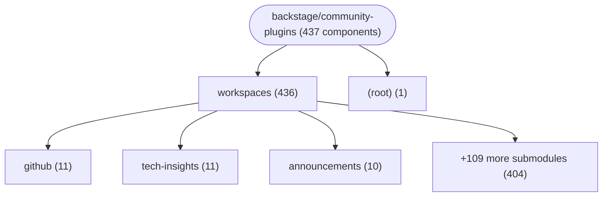
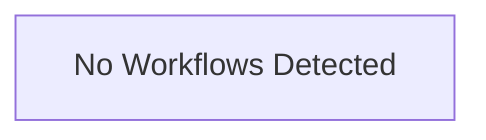

# Repository Architecture Analysis: backstage/community-plugins

## Metadata
- **SHA**: `00f220c8fafbd53fa5f885dd9854ae8b74a51e8d`
- **Primary Ecosystem**: JavaScript/TypeScript

## Quality Metrics
- **ast_engine**: tree-sitter
- **avg_cognitive_complexity**: 2.43
- **avg_cyclomatic_complexity**: 2.78
- **component_count**: 437
- **dead_code_count**: 10
- **dead_code_symbols**: 10 entry(ies)
- **duplication_pct**: 85.83
- **file_complexities**: 25 entry(ies)
- **files_analyzed**: 7391
- **fitness_passed**: False
- **fitness_violation_count**: 3
- **framework**: React (Vite)
- **import_edges**: 100 entry(ies)
- **loc**: 746159
- **max_cognitive_complexity**: 99
- **max_cyclomatic_complexity**: 61
- **sloc**: 546599
- **test_file_count**: 1171

# Architecture: backstage/community-plugins

## Context
- **Repository**: `backstage/community-plugins`
- **SHA**: `00f220c8fafbd53fa5f885dd9854ae8b74a51e8d`
- **Ecosystem**: JavaScript/TypeScript
- **Framework**: React (Vite)

## Building Block View

## Component Details

Showing top 60 representative components out of 437 across 2 module group(s):

- **Module `workspaces`** (436 components — MODULE: 436)
- **Module `(root)`** (1 components — MODULE: 1)

- **${{ values.name }}** (`workspaces/mend/examples/template/content/package.json`): MODULE
- **${{ values.name }}** (`workspaces/mta/examples/template/content/package.json`): MODULE
- **${{ values.name }}** (`workspaces/ocm/examples/template/content/package.json`): MODULE
- **${{ values.name }}** (`workspaces/rbac/examples/template/content/package.json`): MODULE
- **${{ values.name }}** (`workspaces/topology/examples/template/content/package.json`): MODULE
- **@backstage-community/backstage-plugin-catalog-backend-module-mta-entity-provider** (`workspaces/mta/plugins/catalog-backend-module-mta-entity-provider/package.json`): MODULE
- **@backstage-community/backstage-plugin-mta-backend** (`workspaces/mta/plugins/mta-backend/package.json`): MODULE
- **@backstage-community/backstage-plugin-mta-frontend** (`workspaces/mta/plugins/mta-frontend/package.json`): MODULE
- **@backstage-community/backstage-plugin-scaffolder-backend-module-mta** (`workspaces/mta/plugins/scaffolder-backend-module-mta/package.json`): MODULE
- **@backstage-community/cli** (`workspaces/repo-tools/packages/cli/package.json`): MODULE
- **@backstage-community/plugin-3scale-backend** (`workspaces/3scale/plugins/3scale-backend/package.json`): MODULE
- **@backstage-community/plugin-acr** (`workspaces/acr/plugins/acr/package.json`): MODULE
- **@backstage-community/plugin-acs** (`workspaces/acs/plugins/acs/package.json`): MODULE
- **@backstage-community/plugin-adr** (`workspaces/adr/plugins/adr/package.json`): MODULE
- **@backstage-community/plugin-adr-backend** (`workspaces/adr/plugins/adr-backend/package.json`): MODULE
- **@backstage-community/plugin-adr-common** (`workspaces/adr/plugins/adr-common/package.json`): MODULE
- **@backstage-community/plugin-agent-forge** (`workspaces/agent-forge/plugins/agent-forge/package.json`): MODULE
- **@backstage-community/plugin-airbrake** (`workspaces/airbrake/plugins/airbrake/package.json`): MODULE
- **@backstage-community/plugin-airbrake-backend** (`workspaces/airbrake/plugins/airbrake-backend/package.json`): MODULE
- **@backstage-community/plugin-akeyless** (`workspaces/akeyless/plugins/akeyless/package.json`): MODULE
- **@backstage-community/plugin-akeyless-backend** (`workspaces/akeyless/plugins/akeyless-backend/package.json`): MODULE
- **@backstage-community/plugin-akeyless-common** (`workspaces/akeyless/plugins/akeyless-common/package.json`): MODULE
- **@backstage-community/plugin-allure** (`workspaces/allure/plugins/allure/package.json`): MODULE
- **@backstage-community/plugin-analytics-module-ga4** (`workspaces/analytics/plugins/analytics-module-ga4/package.json`): MODULE
- **@backstage-community/plugin-analytics-module-matomo** (`workspaces/analytics/plugins/analytics-module-matomo/package.json`): MODULE
- **@backstage-community/plugin-analytics-module-newrelic-browser** (`workspaces/analytics/plugins/analytics-module-newrelic-browser/package.json`): MODULE
- **@backstage-community/plugin-analytics-provider-segment** (`workspaces/analytics/plugins/analytics-provider-segment/package.json`): MODULE
- **@backstage-community/plugin-announcements** (`workspaces/announcements/plugins/announcements/package.json`): MODULE
- **@backstage-community/plugin-announcements-backend** (`workspaces/announcements/plugins/announcements-backend/package.json`): MODULE
- **@backstage-community/plugin-announcements-common** (`workspaces/announcements/plugins/announcements-common/package.json`): MODULE
- **@backstage-community/plugin-announcements-node** (`workspaces/announcements/plugins/announcements-node/package.json`): MODULE
- **@backstage-community/plugin-announcements-react** (`workspaces/announcements/plugins/announcements-react/package.json`): MODULE
- **@backstage-community/plugin-apache-airflow** (`workspaces/apache-airflow/plugins/apache-airflow/package.json`): MODULE
- **@backstage-community/plugin-apiiro** (`workspaces/apiiro/plugins/apiiro/package.json`): MODULE
- **@backstage-community/plugin-apiiro-backend** (`workspaces/apiiro/plugins/apiiro-backend/package.json`): MODULE
- **@backstage-community/plugin-apiiro-common** (`workspaces/apiiro/plugins/apiiro-common/package.json`): MODULE
- **@backstage-community/plugin-apollo-explorer** (`workspaces/apollo-explorer/plugins/apollo-explorer/package.json`): MODULE
- **@backstage-community/plugin-argo-workflows** (`workspaces/argo-workflows/plugins/argo-workflows/package.json`): MODULE
- **@backstage-community/plugin-argo-workflows-backend** (`workspaces/argo-workflows/plugins/argo-workflows-backend/package.json`): MODULE
- **@backstage-community/plugin-argo-workflows-common** (`workspaces/argo-workflows/plugins/argo-workflows-common/package.json`): MODULE
- **@backstage-community/plugin-argo-workflows-react** (`workspaces/argo-workflows/plugins/argo-workflows-react/package.json`): MODULE
- **@backstage-community/plugin-argocd** (`workspaces/argocd/plugins/argocd/package.json`): MODULE
- **@backstage-community/plugin-argocd-backend** (`workspaces/argocd/plugins/argocd-backend/package.json`): MODULE
- **@backstage-community/plugin-argocd-common** (`workspaces/argocd/plugins/argocd-common/package.json`): MODULE
- **@backstage-community/plugin-argocd-node** (`workspaces/argocd/plugins/argocd-node/package.json`): MODULE
- **@backstage-community/plugin-auth-backend-module-keycloak-provider** (`workspaces/keycloak/plugins/auth-backend-module-keycloak-provider/package.json`): MODULE
- **@backstage-community/plugin-auth-backend-module-pingfederate-provider** (`workspaces/pingidentity/plugins/auth-backend-module-pingfederate-provider/package.json`): MODULE
- **@backstage-community/plugin-azure-devops** (`workspaces/azure-devops/plugins/azure-devops/package.json`): MODULE
- **@backstage-community/plugin-azure-devops-backend** (`workspaces/azure-devops/plugins/azure-devops-backend/package.json`): MODULE
- **@backstage-community/plugin-azure-devops-common** (`workspaces/azure-devops/plugins/azure-devops-common/package.json`): MODULE
- **@backstage-community/plugin-azure-resources-node** (`workspaces/azure-resources/plugins/azure-resources-node/package.json`): MODULE
- **@backstage-community/plugin-azure-sites** (`workspaces/azure-sites/plugins/azure-sites/package.json`): MODULE
- **@backstage-community/plugin-azure-sites-backend** (`workspaces/azure-sites/plugins/azure-sites-backend/package.json`): MODULE
- **@backstage-community/plugin-azure-sites-common** (`workspaces/azure-sites/plugins/azure-sites-common/package.json`): MODULE
- **@backstage-community/plugin-azure-storage-explorer** (`workspaces/azure-storage-explorer/plugins/azure-storage/package.json`): MODULE
- **@backstage-community/plugin-azure-storage-explorer-backend** (`workspaces/azure-storage-explorer/plugins/azure-storage-backend/package.json`): MODULE
- **@backstage-community/plugin-badges** (`workspaces/badges/plugins/badges/package.json`): MODULE
- **@backstage-community/plugin-badges-backend** (`workspaces/badges/plugins/badges-backend/package.json`): MODULE
- **@backstage-community/plugin-bazaar** (`workspaces/bazaar/plugins/bazaar/package.json`): MODULE
- **@backstage-community/plugin-bazaar-backend** (`workspaces/bazaar/plugins/bazaar-backend/package.json`): MODULE

## 6-Dimension Repository Scorecard

- **Overall Grade**: `D` (61.55/100)
- **Technical Debt Score**: 38.45
- **Estimated Remediation Effort**: 51.78h

| Dimension | Grade | Score | Weight | Details |
| :--- | :---: | :---: | :---: | :--- |
| Code Quality | `F` | 30.00 | 0.20 | avg_cc=2.78, max_cc=61, duplication=85.83%, dead_code=10 |
| Dependency Health | `A` | 90.00 | 0.15 | dependencies=0 (no manifests parsed) |
| Maintainability | `F` | 37.00 | 0.15 | avg_cognitive=2.43, max_cognitive=99, fitness_violations=3, oversized_files=12 |
| Pipeline Health | `F` | 40.00 | 0.15 | workflows=0 |
| Security | `A` | 100.00 | 0.20 | vulnerabilities=0, secrets=0, pipeline_security_findings=0 |
| Test Coverage | `C` | 70.00 | 0.15 | coverage=unavailable, ci_test_job=False, test_files_detected=True |

## Architecture Fitness & Workspace Boundaries

- **[MEDIUM] `ATRUSS-ARCH-005` (COMPLEXITY_THRESHOLD)**: Repository duplication_pct (85.83) exceeds policy threshold (15.0).
- **[MEDIUM] `ATRUSS-ARCH-005` (COMPLEXITY_THRESHOLD)**: Repository max_cognitive_complexity (99.0) exceeds policy threshold (25.0).
- **[MEDIUM] `ATRUSS-ARCH-005` (COMPLEXITY_THRESHOLD)**: Repository max_cyclomatic_complexity (61.0) exceeds policy threshold (20.0).

## CI/CD Pipeline Topology

