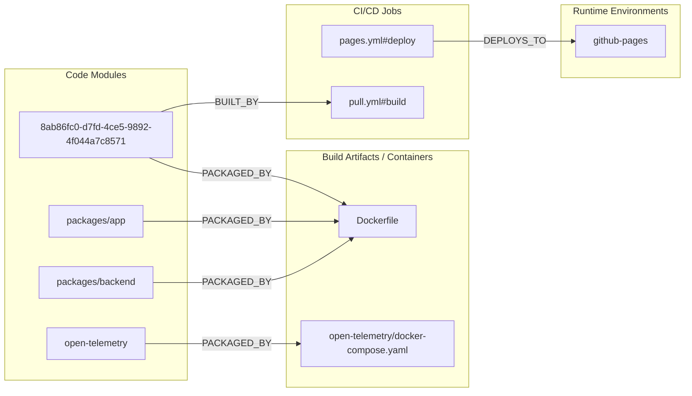
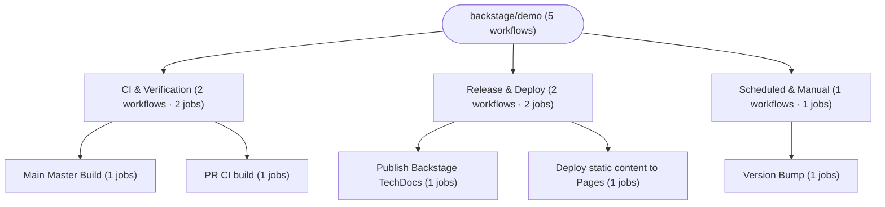

# Repository Architecture Analysis: backstage/demo

## Metadata
- **SHA**: `5c798227dd84439b7ebc7454321e29a5eb3200ec`
- **Primary Ecosystem**: JavaScript/TypeScript

## Quality Metrics
- **ast_engine**: tree-sitter
- **avg_cognitive_complexity**: 0.63
- **avg_cyclomatic_complexity**: 1.56
- **component_count**: 15
- **dead_code_count**: 0
- **dead_code_symbols**: 0 entry(ies)
- **duplication_pct**: 58.75
- **file_complexities**: 25 entry(ies)
- **files_analyzed**: 49
- **fitness_passed**: False
- **fitness_violation_count**: 1
- **framework**: React (Vite)
- **import_edges**: 100 entry(ies)
- **loc**: 1784
- **max_cognitive_complexity**: 5
- **max_cyclomatic_complexity**: 6
- **sloc**: 1514
- **test_file_count**: 2

# Architecture: backstage/demo

## Context
- **Repository**: `backstage/demo`
- **SHA**: `5c798227dd84439b7ebc7454321e29a5eb3200ec`
- **Ecosystem**: JavaScript/TypeScript
- **Framework**: React (Vite)

## Building Block View

```mermaid
graph TD;
    root["root : MODULE"]
    app["app : MODULE"]
    backend["backend : MODULE"]
    _internal_plugin_catalog_backend_module_example_processor["@internal/plugin-catalog-backend-module-example-processor : MODULE"]
    _internal_plugin_notifications_tester_backend["@internal/plugin-notifications-tester-backend : MODULE"]
    ApertureLogoFull["ApertureLogoFull : UI_COMPONENT"]
    ApertureLogoIcon["ApertureLogoIcon : UI_COMPONENT"]
    SidebarContent["SidebarContent : UI_COMPONENT"]
    SidebarLogo["SidebarLogo : UI_COMPONENT"]
    NotificationSettings["NotificationSettings : UI_COMPONENT"]
    POST_test["POST_test : API_ROUTE"]
    docker_compose["docker-compose : module"]
    prometheus["prometheus : module"]
    dashboards["dashboards : module"]
    prometheus_datasource["prometheus-datasource : module"]
    repo_root(["backstage/demo"])
    repo_root --> NotificationSettings
    repo_root --> POST_test
    repo_root --> _internal_plugin_catalog_backend_module_example_processor
    repo_root --> _internal_plugin_notifications_tester_backend
    repo_root --> app
    repo_root --> backend
    repo_root --> dashboards
    repo_root --> docker_compose
    repo_root --> prometheus
    repo_root --> prometheus_datasource
    repo_root --> root
    SidebarContent --> SidebarLogo
    SidebarLogo --> ApertureLogoFull
    SidebarLogo --> ApertureLogoIcon
```

## Component Details
- **root** (`package.json`): MODULE
- **app** (`packages/app/package.json`): MODULE
- **backend** (`packages/backend/package.json`): MODULE
- **@internal/plugin-catalog-backend-module-example-processor** (`plugins/catalog-backend-module-example-processor/package.json`): MODULE
- **@internal/plugin-notifications-tester-backend** (`plugins/notifications-tester-backend/package.json`): MODULE
- **ApertureLogoFull** (`packages/app/src/components/Root/ApertureLogoFull.tsx`): UI_COMPONENT
- **ApertureLogoIcon** (`packages/app/src/components/Root/ApertureLogoIcon.tsx`): UI_COMPONENT
- **SidebarContent** (`packages/app/src/components/Root/Sidebar.tsx`): UI_COMPONENT (deps: SidebarLogo)
- **SidebarLogo** (`packages/app/src/components/Root/SidebarLogo.tsx`): UI_COMPONENT (deps: ApertureLogoFull, ApertureLogoIcon)
- **NotificationSettings** (`packages/app/src/components/settings/NotificationSettings.tsx`): UI_COMPONENT
- **POST_test** (`plugins/notifications-tester-backend/src/router.ts`): API_ROUTE
- **docker-compose** (`open-telemetry/docker-compose.yaml`): module
- **prometheus** (`open-telemetry/prometheus.yml`): module
- **dashboards** (`open-telemetry/dashboards/dashboards.yml`): module
- **prometheus-datasource** (`open-telemetry/datasources/prometheus-datasource.yml`): module

## 6-Dimension Repository Scorecard

- **Overall Grade**: `D` (68.60/100)
- **Technical Debt Score**: 31.40
- **Estimated Remediation Effort**: 34.60h

| Dimension | Grade | Score | Weight | Details |
| :--- | :---: | :---: | :---: | :--- |
| Code Quality | `C` | 75.00 | 0.20 | avg_cc=1.56, max_cc=6, duplication=58.75%, dead_code=0 |
| Dependency Health | `B` | 85.00 | 0.15 | dependencies=124, outdated=0, vulnerable=0, has_lockfile=False |
| Maintainability | `A` | 94.00 | 0.15 | avg_cognitive=0.63, max_cognitive=5, fitness_violations=1, oversized_files=0 |
| Pipeline Health | `F` | 39.00 | 0.15 | workflows=5, operational_antipatterns=8, parallel_branches=False |
| Security | `F` | 52.00 | 0.20 | vulnerabilities=0, secrets=0, pipeline_security_findings=4 |
| Test Coverage | `C` | 70.00 | 0.15 | coverage=unavailable, ci_test_job=False, test_files_detected=True |

## Architecture Fitness & Workspace Boundaries

- **[MEDIUM] `ATRUSS-ARCH-005` (COMPLEXITY_THRESHOLD)**: Repository duplication_pct (58.75) exceeds policy threshold (15.0).

### Workspace Packages
- **app** (`packages/app`, react_ts_js, yarn)
- **backend** (`packages/backend`, react_ts_js, yarn) -> internal deps: `@internal/plugin-catalog-backend-module-example-processor, @internal/plugin-notifications-tester-backend, app`
- **@internal/plugin-catalog-backend-module-example-processor** (`plugins/catalog-backend-module-example-processor`, react_ts_js, yarn)
- **@internal/plugin-notifications-tester-backend** (`plugins/notifications-tester-backend`, react_ts_js, yarn)

## Supply Chain Dependencies, Vulnerabilities & Secrets

- **Dependencies Parsed**: 124 | **Vulnerabilities**: 0 | **Secrets**: 0

### Inventory Sample
- `@backstage-community/plugin-badges` `1.0.0` (npm, `packages/app/package.json`)
- `@backstage-community/plugin-badges-backend` `0.28.0` (npm, `packages/backend/package.json`)
- `@backstage-community/plugin-cost-insights` `0.32.0` (npm, `packages/app/package.json`)
- `@backstage-community/plugin-explore` `1.0.0` (npm, `packages/app/package.json`)
- `@backstage-community/plugin-explore-backend` `0.16.0` (npm, `packages/backend/package.json`)
- `@backstage-community/plugin-github-actions` `1.0.0` (npm, `packages/app/package.json`)
- `@backstage-community/plugin-graphiql` `0.21.0` (npm, `packages/app/package.json`)
- `@backstage-community/plugin-search-backend-module-explore` `0.11.0` (npm, `packages/backend/package.json`)
- `@backstage-community/plugin-tech-radar` `1.6.0` (npm, `packages/app/package.json`)
- `@backstage-community/plugin-todo` `0.26.0` (npm, `packages/app/package.json`)
- `@backstage-community/plugin-todo-backend` `0.27.0` (npm, `packages/backend/package.json`)
- `@backstage/backend-defaults` `*` (npm, `packages/backend/package.json`)
- `@backstage/backend-plugin-api` `*` (npm, `packages/backend/package.json`)
- `@backstage/backend-plugin-api` `*` (npm, `plugins/catalog-backend-module-example-processor/package.json`)
- `@backstage/backend-plugin-api` `*` (npm, `plugins/notifications-tester-backend/package.json`)
- `@backstage/catalog-model` `*` (npm, `plugins/catalog-backend-module-example-processor/package.json`)
- `@backstage/cli` `*` (npm, `package.json`)
- `@backstage/cli` `*` (npm, `packages/app/package.json`)
- `@backstage/cli` `*` (npm, `packages/backend/package.json`)
- `@backstage/cli` `*` (npm, `plugins/catalog-backend-module-example-processor/package.json`)
- `@backstage/cli` `*` (npm, `plugins/notifications-tester-backend/package.json`)
- `@backstage/cli-defaults` `*` (npm, `package.json`)
- `@backstage/config` `*` (npm, `plugins/notifications-tester-backend/package.json`)
- `@backstage/core-app-api` `*` (npm, `packages/app/package.json`)
- `@backstage/core-compat-api` `*` (npm, `packages/app/package.json`)
- `@backstage/core-components` `*` (npm, `packages/app/package.json`)
- `@backstage/core-plugin-api` `*` (npm, `packages/app/package.json`)
- `@backstage/e2e-test-utils` `*` (npm, `package.json`)
- `@backstage/frontend-defaults` `*` (npm, `packages/app/package.json`)
- `@backstage/frontend-plugin-api` `*` (npm, `packages/app/package.json`)
- ... (+94 more dependencies)

## Section 7: Code-to-Cloud Deployment Traceability

- `pages.yml#deploy` (ci_job) --[DEPLOYS_TO]--> `github-pages` (environment)
- `8ab86fc0-d7fd-4ce5-9892-4f044a7c8571` (code_module) --[BUILT_BY]--> `pull.yml#build` (ci_job)
- `8ab86fc0-d7fd-4ce5-9892-4f044a7c8571` (code_module) --[PACKAGED_BY]--> `Dockerfile` (container)
- `open-telemetry` (code_module) --[PACKAGED_BY]--> `open-telemetry/docker-compose.yaml` (container)
- `packages/app` (code_module) --[PACKAGED_BY]--> `Dockerfile` (container)
- `packages/backend` (code_module) --[PACKAGED_BY]--> `Dockerfile` (container)

## CI/CD Pipeline Topology

