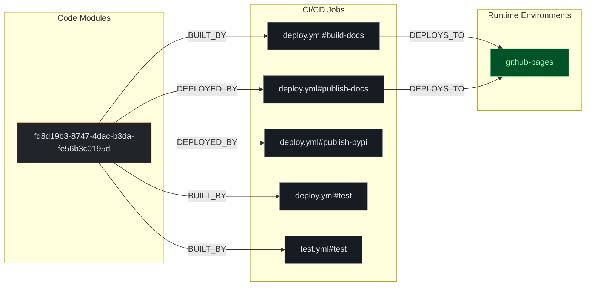
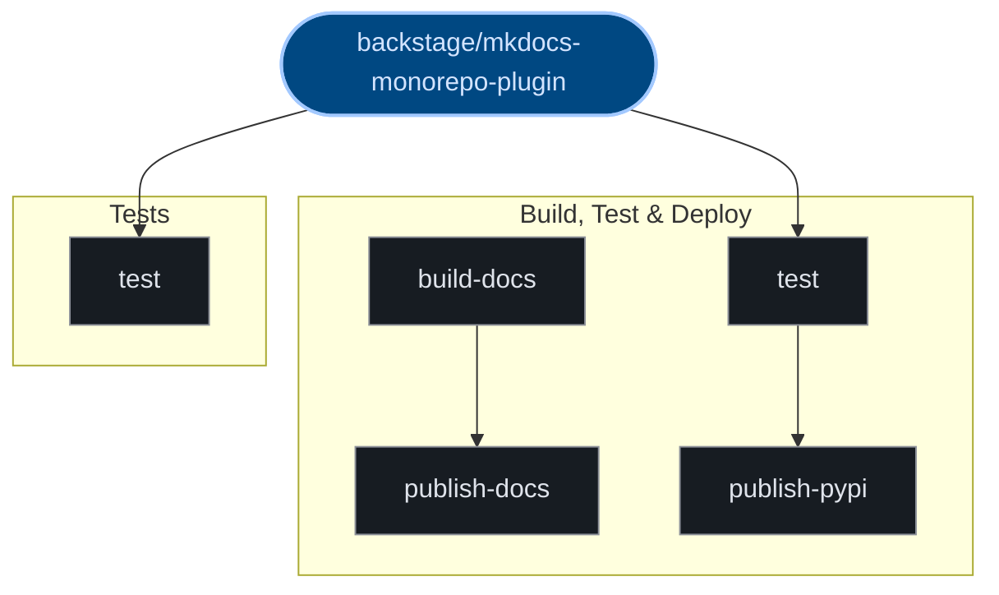

# Repository Architecture Analysis: backstage/mkdocs-monorepo-plugin

## Metadata
- **SHA**: `f62ae22e387c1cb2ef358a0a74926400d3d8021f`
- **Primary Ecosystem**: Python

## Quality Metrics
- **ast_engine**: tree-sitter
- **avg_cognitive_complexity**: 4.37
- **avg_cyclomatic_complexity**: 2.8
- **component_count**: 0
- **dead_code_count**: 0
- **dead_code_symbols**: 0 entry(ies)
- **duplication_pct**: 40.97
- **file_complexities**: 8 entry(ies)
- **files_analyzed**: 8
- **fitness_passed**: False
- **fitness_violation_count**: 2
- **framework**: Unknown
- **import_edges**: 37 entry(ies)
- **loc**: 712
- **max_cognitive_complexity**: 51
- **max_cyclomatic_complexity**: 18
- **sloc**: 516
- **test_file_count**: 158

## 6-Dimension Repository Scorecard

- **Overall Grade**: `C` (72.80/100)
- **Technical Debt Score**: 27.20
- **Estimated Remediation Effort**: 25.99h

| Dimension | Grade | Score | Weight | Details |
| :--- | :---: | :---: | :---: | :--- |
| Code Quality | `C` | 70.50 | 0.20 | avg_cc=2.80, max_cc=18, duplication=40.97%, dead_code=0 |
| Dependency Health | `B` | 85.00 | 0.15 | dependencies=6, outdated=0, vulnerable=0, has_lockfile=False |
| Maintainability | `D` | 63.00 | 0.15 | avg_cognitive=4.37, max_cognitive=51, fitness_violations=2, oversized_files=0 |
| Pipeline Health | `C` | 72.00 | 0.15 | workflows=2, operational_antipatterns=7, parallel_branches=True |
| Security | `C` | 76.00 | 0.20 | vulnerabilities=0, secrets=0, pipeline_security_findings=2 |
| Test Coverage | `C` | 70.00 | 0.15 | coverage=unavailable, ci_test_job=True, test_files_detected=True |

## Architecture Fitness & Workspace Boundaries

- **[MEDIUM] `ATRUSS-ARCH-005` (COMPLEXITY_THRESHOLD)**: Repository duplication_pct (40.97) exceeds policy threshold (15.0).
- **[MEDIUM] `ATRUSS-ARCH-005` (COMPLEXITY_THRESHOLD)**: Repository max_cognitive_complexity (51.0) exceeds policy threshold (25.0).

## Supply Chain Dependencies, Vulnerabilities & Secrets

- **Dependencies Parsed**: 6 | **Vulnerabilities**: 0 | **Secrets**: 0

### Inventory Sample
- `flake8` `7.2.0` (PyPI, `requirements.txt`)
- `importlib-metadata` `8.7.0` (PyPI, `requirements.txt`)
- `mkdocs` `1.6.1` (PyPI, `requirements.txt`)
- `mkdocs-git-authors-plugin` `0.9.5` (PyPI, `requirements.txt`)
- `mkdocs-git-revision-date-localized-plugin` `1.4.7` (PyPI, `requirements.txt`)
- `python-slugify` `8.0.4` (PyPI, `requirements.txt`)

## Section 7: Code-to-Cloud Deployment Traceability

- `deploy.yml#build-docs` (ci_job) --[DEPLOYS_TO]--> `github-pages` (environment)
- `deploy.yml#publish-docs` (ci_job) --[DEPLOYS_TO]--> `github-pages` (environment)
- `fd8d19b3-8747-4dac-b3da-fe56b3c0195d` (code_module) --[BUILT_BY]--> `deploy.yml#build-docs` (ci_job)
- `fd8d19b3-8747-4dac-b3da-fe56b3c0195d` (code_module) --[BUILT_BY]--> `deploy.yml#test` (ci_job)
- `fd8d19b3-8747-4dac-b3da-fe56b3c0195d` (code_module) --[BUILT_BY]--> `test.yml#test` (ci_job)
- `fd8d19b3-8747-4dac-b3da-fe56b3c0195d` (code_module) --[DEPLOYED_BY]--> `deploy.yml#publish-docs` (ci_job)
- `fd8d19b3-8747-4dac-b3da-fe56b3c0195d` (code_module) --[DEPLOYED_BY]--> `deploy.yml#publish-pypi` (ci_job)

## CI/CD Pipeline Topology

