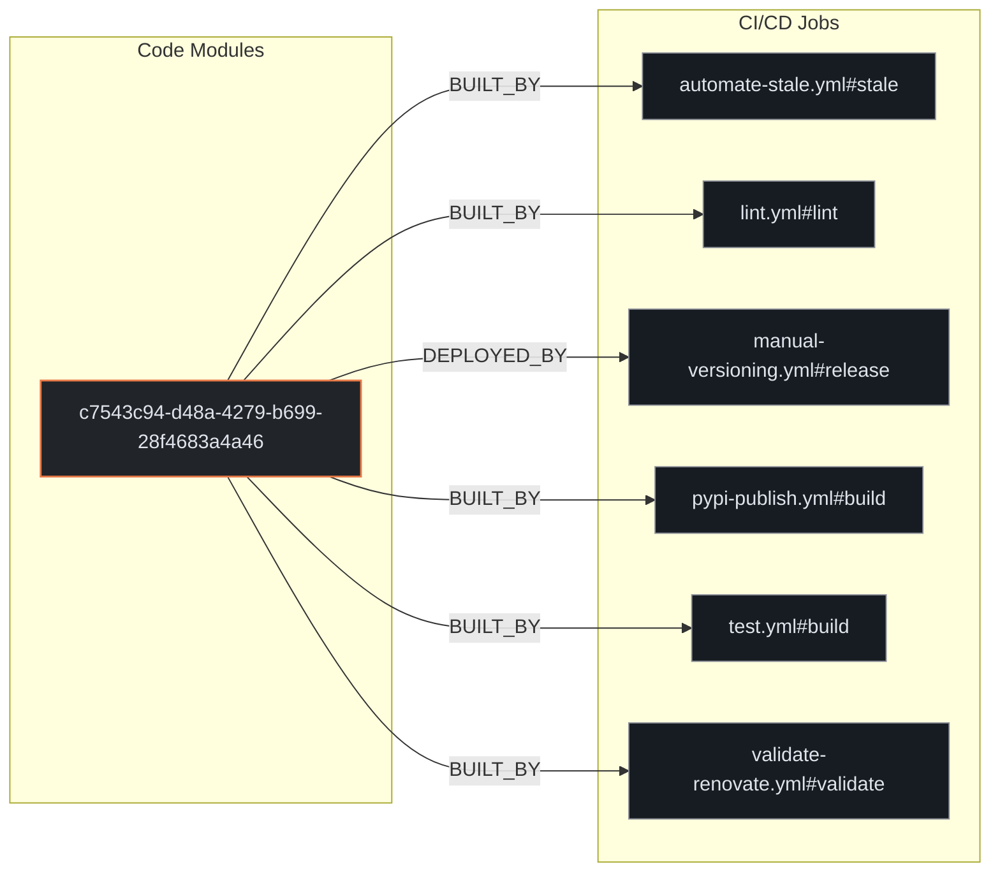

# Repository Architecture Analysis: backstage/mkdocs-techdocs-core

## Metadata
- **SHA**: `b49be63efe680c8f67c180da3522a07f2a6982de`
- **Primary Ecosystem**: Python

## Quality Metrics
- **ast_engine**: tree-sitter
- **avg_cognitive_complexity**: 0.89
- **avg_cyclomatic_complexity**: 1.68
- **component_count**: 0
- **dead_code_count**: 0
- **dead_code_symbols**: 0 entry(ies)
- **duplication_pct**: 70.45
- **file_complexities**: 3 entry(ies)
- **files_analyzed**: 3
- **fitness_passed**: False
- **fitness_violation_count**: 1
- **framework**: Unknown
- **import_edges**: 22 entry(ies)
- **loc**: 401
- **max_cognitive_complexity**: 17
- **max_cyclomatic_complexity**: 14
- **sloc**: 335
- **test_file_count**: 1

## 6-Dimension Repository Scorecard

- **Overall Grade**: `F` (59.85/100)
- **Technical Debt Score**: 40.15
- **Estimated Remediation Effort**: 49.13h

| Dimension | Grade | Score | Weight | Details |
| :--- | :---: | :---: | :---: | :--- |
| Code Quality | `C` | 75.00 | 0.20 | avg_cc=1.68, max_cc=14, duplication=70.45%, dead_code=0 |
| Dependency Health | `B` | 85.00 | 0.15 | dependencies=12, outdated=0, vulnerable=0, has_lockfile=False |
| Maintainability | `A` | 94.00 | 0.15 | avg_cognitive=0.89, max_cognitive=17, fitness_violations=1, oversized_files=0 |
| Pipeline Health | `F` | 50.00 | 0.15 | workflows=6, operational_antipatterns=9, parallel_branches=False |
| Security | `F` | 0.00 | 0.20 | vulnerabilities=0, secrets=0, pipeline_security_findings=11 |
| Test Coverage | `C` | 70.00 | 0.15 | coverage=unavailable, ci_test_job=False, test_files_detected=True |

## Architecture Fitness & Workspace Boundaries

- **[MEDIUM] `ATRUSS-ARCH-005` (COMPLEXITY_THRESHOLD)**: Repository duplication_pct (70.45) exceeds policy threshold (15.0).

## Supply Chain Dependencies, Vulnerabilities & Secrets

- **Dependencies Parsed**: 12 | **Vulnerabilities**: 0 | **Secrets**: 0

### Inventory Sample
- `Markdown` `3.2` (PyPI, `requirements.txt`)
- `click` `*` (PyPI, `requirements.txt`)
- `markdown-graphviz-inline` `1.1.3` (PyPI, `requirements.txt`)
- `mdx_truly_sane_lists` `1.3` (PyPI, `requirements.txt`)
- `mkdocs` `1.6` (PyPI, `requirements.txt`)
- `mkdocs-github-admonitions-plugin` `0.1.1` (PyPI, `requirements.txt`)
- `mkdocs-material` `9.7.7` (PyPI, `requirements.txt`)
- `mkdocs-monorepo-plugin` `1.1.2` (PyPI, `requirements.txt`)
- `mkdocs-redirects` `1.2.3` (PyPI, `requirements.txt`)
- `plantuml-markdown` `3.11.3` (PyPI, `requirements.txt`)
- `pygments` `2.21.0` (PyPI, `requirements.txt`)
- `pymdown-extensions` `12.3` (PyPI, `requirements.txt`)

## Section 7: Code-to-Cloud Deployment Traceability

- `c7543c94-d48a-4279-b699-28f4683a4a46` (code_module) --[BUILT_BY]--> `automate-stale.yml#stale` (ci_job)
- `c7543c94-d48a-4279-b699-28f4683a4a46` (code_module) --[BUILT_BY]--> `lint.yml#lint` (ci_job)
- `c7543c94-d48a-4279-b699-28f4683a4a46` (code_module) --[BUILT_BY]--> `pypi-publish.yml#build` (ci_job)
- `c7543c94-d48a-4279-b699-28f4683a4a46` (code_module) --[BUILT_BY]--> `test.yml#build` (ci_job)
- `c7543c94-d48a-4279-b699-28f4683a4a46` (code_module) --[BUILT_BY]--> `validate-renovate.yml#validate` (ci_job)
- `c7543c94-d48a-4279-b699-28f4683a4a46` (code_module) --[DEPLOYED_BY]--> `manual-versioning.yml#release` (ci_job)

## CI/CD Pipeline Topology

```mermaid
graph TD;
  classDef atlasRoot fill:#004882,stroke:#a3c9ff,stroke-width:2px,color:#d3e4ff
  classDef atlasCategory fill:#212428,stroke:#E87A48,stroke-width:1.5px,color:#dfe3eb
  classDef atlasWorkflow fill:#1b2026,stroke:#a3c9ff,stroke-width:1.5px,color:#dfe3eb
  classDef atlasJob fill:#171c22,stroke:#8d9199,stroke-width:1px,color:#dfe3eb
  classDef atlasTarget fill:#005227,stroke:#8bd99b,stroke-width:1.5px,color:#a7f6b6
  classDef atlasAlert fill:#93000a,stroke:#ffb4ab,stroke-width:1.5px,color:#ffdad6
  classDef atlasMore fill:#252a31,stroke:#8d9199,stroke-dasharray:4 4,color:#c3c6cf
  pipeline_root(["backstage/mkdocs-techdocs-core (6 workflows)"]):::atlasRoot
  subgraph sg_grp_0_CI___Verification["CI & Verification (3 workflows · 3 jobs)"]
    direction TB
    subgraph sg_wf_1_Lint_using_PSF_s_black_linter["Lint using PSF's black linter (1 jobs)"]
      direction TB
      wf_1_Lint_using_PSF_s_black_linter(["Trigger: Lint using PSF's black linter"]):::atlasWorkflow
      job_1_lint["lint"]:::atlasJob
      wf_1_Lint_using_PSF_s_black_linter --> job_1_lint
    end
    pipeline_root --> wf_1_Lint_using_PSF_s_black_linter
    subgraph sg_wf_4_ci_python_unittest["ci-python-unittest (1 jobs)"]
      direction TB
      wf_4_ci_python_unittest(["Trigger: ci-python-unittest"]):::atlasWorkflow
      job_4_build["build"]:::atlasJob
      wf_4_ci_python_unittest --> job_4_build
    end
    pipeline_root --> wf_4_ci_python_unittest
    subgraph sg_wf_5_Validate_the_renovate_configuration["Validate the renovate configuration (1 jobs)"]
      direction TB
      wf_5_Validate_the_renovate_configuration(["Trigger: Validate the renovate configuration"]):::atlasWorkflow
      job_5_validate["validate"]:::atlasJob
      wf_5_Validate_the_renovate_configuration --> job_5_validate
    end
    pipeline_root --> wf_5_Validate_the_renovate_configuration
  end
  subgraph sg_grp_1_Release___Deploy["Release & Deploy (1 workflows · 1 jobs)"]
    direction TB
    subgraph sg_wf_3_TechDocs_PyPI_Publish_main_branch["TechDocs PyPI Publish main branch (1 jobs)"]
      direction TB
      wf_3_TechDocs_PyPI_Publish_main_branch(["Trigger: TechDocs PyPI Publish main branch"]):::atlasWorkflow
      job_3_build["build"]:::atlasJob
      wf_3_TechDocs_PyPI_Publish_main_branch --> job_3_build
    end
    pipeline_root --> wf_3_TechDocs_PyPI_Publish_main_branch
  end
  subgraph sg_grp_2_Scheduled___Manual["Scheduled & Manual (1 workflows · 1 jobs)"]
    direction TB
    subgraph sg_wf_2_manual_versioning["manual-versioning (1 jobs)"]
      direction TB
      wf_2_manual_versioning(["Trigger: manual-versioning"]):::atlasWorkflow
      job_2_release["release"]:::atlasJob
      wf_2_manual_versioning --> job_2_release
    end
    pipeline_root --> wf_2_manual_versioning
  end
  subgraph sg_grp_3_Security___Governance["Security & Governance (1 workflows · 1 jobs)"]
    direction TB
    subgraph sg_wf_0_Close_Stale_Issues_and_PRs_Automatically["Close Stale Issues and PRs Automatically (1 jobs)"]
      direction TB
      wf_0_Close_Stale_Issues_and_PRs_Automatically(["Trigger: Close Stale Issues and PRs Automatically"]):::atlasWorkflow
      job_0_stale["stale"]:::atlasJob
      wf_0_Close_Stale_Issues_and_PRs_Automatically --> job_0_stale
    end
    pipeline_root --> wf_0_Close_Stale_Issues_and_PRs_Automatically
  end
```

