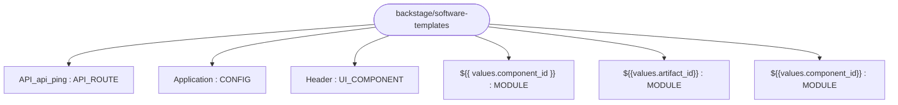
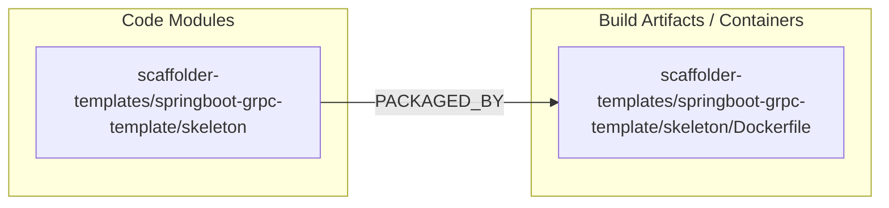
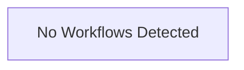

# Repository Architecture Analysis: backstage/software-templates

## Metadata
- **SHA**: `318927c03bd9d191a16852ed330b8553d5e3a986`
- **Primary Ecosystem**: JavaScript/TypeScript

## Quality Metrics
- **ast_engine**: tree-sitter
- **avg_cognitive_complexity**: 0.33
- **avg_cyclomatic_complexity**: 1.11
- **component_count**: 6
- **dead_code_count**: 0
- **dead_code_symbols**: 0 entry(ies)
- **duplication_pct**: 0.0
- **file_complexities**: 21 entry(ies)
- **files_analyzed**: 21
- **fitness_passed**: True
- **fitness_violation_count**: 0
- **framework**: Next.js
- **import_edges**: 44 entry(ies)
- **loc**: 245
- **max_cognitive_complexity**: 2
- **max_cyclomatic_complexity**: 3
- **sloc**: 193
- **test_file_count**: 3

# Architecture: backstage/software-templates

## Context
- **Repository**: `backstage/software-templates`
- **SHA**: `318927c03bd9d191a16852ed330b8553d5e3a986`
- **Ecosystem**: JavaScript/TypeScript
- **Framework**: Next.js

## Building Block View

## Component Details
- **${{values.component_id}}** (`scaffolder-templates/create-react-app/skeleton/package.json`): MODULE
- **${{ values.component_id }}** (`scaffolder-templates/react-ssr-template/skeleton/package.json`): MODULE
- **Header** (`scaffolder-templates/react-ssr-template/skeleton/src/components/Header.tsx`): UI_COMPONENT
- **API_api_ping** (`scaffolder-templates/react-ssr-template/skeleton/src/pages/api/ping.ts`): API_ROUTE
- **${{values.artifact_id}}** (`scaffolder-templates/springboot-grpc-template/skeleton/pom.xml`): MODULE
- **Application** (`scaffolder-templates/springboot-grpc-template/skeleton/src/main/java/com/example/${{values.java_package_name}}/Application.java`): CONFIG

## 6-Dimension Repository Scorecard

- **Overall Grade**: `B` (84.25/100)
- **Technical Debt Score**: 15.75
- **Estimated Remediation Effort**: 3.94h

| Dimension | Grade | Score | Weight | Details |
| :--- | :---: | :---: | :---: | :--- |
| Code Quality | `A` | 100.00 | 0.20 | avg_cc=1.11, max_cc=3, duplication=0.00%, dead_code=0 |
| Dependency Health | `B` | 85.00 | 0.15 | dependencies=31, outdated=0, vulnerable=0, has_lockfile=False |
| Maintainability | `A` | 100.00 | 0.15 | avg_cognitive=0.33, max_cognitive=2, fitness_violations=0, oversized_files=0 |
| Pipeline Health | `F` | 40.00 | 0.15 | workflows=0 |
| Security | `A` | 100.00 | 0.20 | vulnerabilities=0, secrets=0, pipeline_security_findings=0 |
| Test Coverage | `C` | 70.00 | 0.15 | coverage=unavailable, ci_test_job=False, test_files_detected=True |

## Supply Chain Dependencies, Vulnerabilities & Secrets

- **Dependencies Parsed**: 31 | **Vulnerabilities**: 0 | **Secrets**: 0

### Inventory Sample
- `io.github.lognet:grpc-spring-boot-starter` `3.5.1` (Maven, `scaffolder-templates/springboot-grpc-template/skeleton/pom.xml`)
- `org.apache.tomcat:annotations-api` `6.0.53` (Maven, `scaffolder-templates/springboot-grpc-template/skeleton/pom.xml`)
- `org.springframework.boot:spring-boot-starter-test` `*` (Maven, `scaffolder-templates/springboot-grpc-template/skeleton/pom.xml`)
- `@spotify/tsconfig` `5.0.0` (npm, `scaffolder-templates/react-ssr-template/skeleton/package.json`)
- `@spotify/web-scripts` `5.0.0` (npm, `scaffolder-templates/react-ssr-template/skeleton/package.json`)
- `@testing-library/jest-dom` `5.11.4` (npm, `scaffolder-templates/create-react-app/skeleton/package.json`)
- `@testing-library/react` `11.1.0` (npm, `scaffolder-templates/create-react-app/skeleton/package.json`)
- `@testing-library/react` `8.0.1` (npm, `scaffolder-templates/react-ssr-template/skeleton/package.json`)
- `@testing-library/user-event` `12.1.10` (npm, `scaffolder-templates/create-react-app/skeleton/package.json`)
- `@types/jest` `26.0.15` (npm, `scaffolder-templates/create-react-app/skeleton/package.json`)
- `@types/node` `12.0.0` (npm, `scaffolder-templates/create-react-app/skeleton/package.json`)
- `@types/node` `14.14.32` (npm, `scaffolder-templates/react-ssr-template/skeleton/package.json`)
- `@types/react` `16.8.7` (npm, `scaffolder-templates/react-ssr-template/skeleton/package.json`)
- `@types/react` `17.0.0` (npm, `scaffolder-templates/create-react-app/skeleton/package.json`)
- `@types/react-dom` `16.8.2` (npm, `scaffolder-templates/react-ssr-template/skeleton/package.json`)
- `@types/react-dom` `17.0.0` (npm, `scaffolder-templates/create-react-app/skeleton/package.json`)
- `@types/styled-components` `4.1.18` (npm, `scaffolder-templates/react-ssr-template/skeleton/package.json`)
- `@zeit/next-typescript` `1.1.1` (npm, `scaffolder-templates/react-ssr-template/skeleton/package.json`)
- `babel-plugin-styled-components` `1.10.6` (npm, `scaffolder-templates/react-ssr-template/skeleton/package.json`)
- `husky` `2.7.0` (npm, `scaffolder-templates/react-ssr-template/skeleton/package.json`)
- `jest-junit` `8.0.0` (npm, `scaffolder-templates/react-ssr-template/skeleton/package.json`)
- `next` `9.1.1` (npm, `scaffolder-templates/react-ssr-template/skeleton/package.json`)
- `react` `16.8.5` (npm, `scaffolder-templates/react-ssr-template/skeleton/package.json`)
- `react` `17.0.2` (npm, `scaffolder-templates/create-react-app/skeleton/package.json`)
- `react-dom` `16.8.5` (npm, `scaffolder-templates/react-ssr-template/skeleton/package.json`)
- `react-dom` `17.0.2` (npm, `scaffolder-templates/create-react-app/skeleton/package.json`)
- `react-scripts` `4.0.3` (npm, `scaffolder-templates/create-react-app/skeleton/package.json`)
- `styled-components` `4.3.2` (npm, `scaffolder-templates/react-ssr-template/skeleton/package.json`)
- `typescript` `3.9.2` (npm, `scaffolder-templates/react-ssr-template/skeleton/package.json`)
- `typescript` `4.1.2` (npm, `scaffolder-templates/create-react-app/skeleton/package.json`)
- ... (+1 more dependencies)

## Section 7: Code-to-Cloud Deployment Traceability

- `scaffolder-templates/springboot-grpc-template/skeleton` (code_module) --[PACKAGED_BY]--> `scaffolder-templates/springboot-grpc-template/skeleton/Dockerfile` (container)

## CI/CD Pipeline Topology

