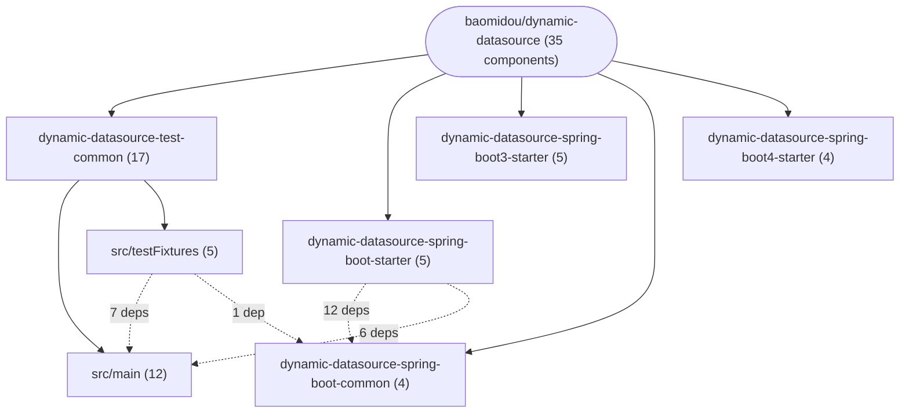

# Repository Architecture Analysis: baomidou/dynamic-datasource

## Metadata
- **SHA**: `23904d5585e4279e484db8a872eca633c298792d`
- **Primary Ecosystem**: Java

## Quality Metrics
- **avg_cyclomatic_complexity**: 4.2
- **component_count**: 35
- **files_analyzed**: 377
- **framework**: Spring Boot
- **loc**: 34811
- **max_cyclomatic_complexity**: 386
- **sloc**: 19745

# Architecture: baomidou/dynamic-datasource

## Context
- **Repository**: `baomidou/dynamic-datasource`
- **SHA**: `23904d5585e4279e484db8a872eca633c298792d`
- **Ecosystem**: Java
- **Framework**: Unknown

## Building Block View

## Component Details
- **DynamicDataSourceAssistConfiguration** (`dynamic-datasource-spring-boot-common/src/main/java/com/baomidou/dynamic/datasource/spring/boot/autoconfigure/DynamicDataSourceAssistConfiguration.java`): CONFIG (deps: DynamicDataSourceProperties)
- **DynamicDataSourceCreatorAutoConfiguration** (`dynamic-datasource-spring-boot-common/src/main/java/com/baomidou/dynamic/datasource/spring/boot/autoconfigure/DynamicDataSourceCreatorAutoConfiguration.java`): CONFIG (deps: DynamicDataSourceProperties)
- **DynamicDataSourceEndpointAutoConfiguration** (`dynamic-datasource-spring-boot-common/src/main/java/com/baomidou/dynamic/datasource/spring/boot/autoconfigure/DynamicDataSourceEndpointAutoConfiguration.java`): CONFIG (deps: DynamicDataSourceProperties)
- **DynamicDataSourceProperties** (`dynamic-datasource-spring-boot-common/src/main/java/com/baomidou/dynamic/datasource/spring/boot/autoconfigure/DynamicDataSourceProperties.java`): CONFIG
- **DruidDynamicDataSourceConfiguration** (`dynamic-datasource-spring-boot-starter/src/main/java/com/baomidou/dynamic/datasource/spring/boot/autoconfigure/DruidDynamicDataSourceConfiguration.java`): CONFIG
- **DynamicDataSourceAopConfiguration** (`dynamic-datasource-spring-boot-starter/src/main/java/com/baomidou/dynamic/datasource/spring/boot/autoconfigure/DynamicDataSourceAopConfiguration.java`): CONFIG (deps: DynamicDataSourceProperties)
- **DynamicDataSourceAutoConfiguration** (`dynamic-datasource-spring-boot-starter/src/main/java/com/baomidou/dynamic/datasource/spring/boot/autoconfigure/DynamicDataSourceAutoConfiguration.java`): CONFIG (deps: DruidDynamicDataSourceConfiguration, DynamicDataSourceAopConfiguration, DynamicDataSourceAssistConfiguration, DynamicDataSourceCreatorAutoConfiguration, DynamicDataSourceProperties)
- **UserController** (`dynamic-datasource-spring-boot-starter/src/test/java/com/baomidou/dynamic/datasource/common/controller/UserController.java`): API_ROUTE (deps: UserService)
- **SPELApplication** (`dynamic-datasource-spring-boot-starter/src/test/java/com/baomidou/dynamic/datasource/common/v1/SPELTest.java`): CONFIG (deps: UserService)
- **DruidDynamicDataSourceConfiguration** (`dynamic-datasource-spring-boot3-starter/src/main/java/com/baomidou/dynamic/datasource/spring/boot/autoconfigure/DruidDynamicDataSourceConfiguration.java`): CONFIG
- **DynamicDataSourceAopConfiguration** (`dynamic-datasource-spring-boot3-starter/src/main/java/com/baomidou/dynamic/datasource/spring/boot/autoconfigure/DynamicDataSourceAopConfiguration.java`): CONFIG (deps: DynamicDataSourceProperties)
- **DynamicDataSourceAutoConfiguration** (`dynamic-datasource-spring-boot3-starter/src/main/java/com/baomidou/dynamic/datasource/spring/boot/autoconfigure/DynamicDataSourceAutoConfiguration.java`): CONFIG (deps: DruidDynamicDataSourceConfiguration, DynamicDataSourceAopConfiguration, DynamicDataSourceAssistConfiguration, DynamicDataSourceCreatorAutoConfiguration, DynamicDataSourceProperties)
- **UserController** (`dynamic-datasource-spring-boot3-starter/src/test/java/com/baomidou/dynamic/datasource/common/controller/UserController.java`): API_ROUTE (deps: UserService)
- **SPELApplication** (`dynamic-datasource-spring-boot3-starter/src/test/java/com/baomidou/dynamic/datasource/common/v3/SPELTest.java`): CONFIG (deps: UserService)
- **DynamicDataSourceAopConfiguration** (`dynamic-datasource-spring-boot4-starter/src/main/java/com/baomidou/dynamic/datasource/spring/boot/autoconfigure/DynamicDataSourceAopConfiguration.java`): CONFIG (deps: DynamicDataSourceProperties)
- **DynamicDataSourceAutoConfiguration** (`dynamic-datasource-spring-boot4-starter/src/main/java/com/baomidou/dynamic/datasource/spring/boot/autoconfigure/DynamicDataSourceAutoConfiguration.java`): CONFIG (deps: DynamicDataSourceAopConfiguration, DynamicDataSourceAssistConfiguration, DynamicDataSourceCreatorAutoConfiguration, DynamicDataSourceProperties)
- **UserController** (`dynamic-datasource-spring-boot4-starter/src/test/java/com/baomidou/dynamic/datasource/common/controller/UserController.java`): API_ROUTE (deps: UserService)
- **SPELApplication** (`dynamic-datasource-spring-boot4-starter/src/test/java/com/baomidou/dynamic/datasource/common/v4/SPELTest.java`): CONFIG (deps: UserService)
- **SchoolService** (`dynamic-datasource-test-common/src/main/java/com/baomidou/dynamic/datasource/common/service/nest/SchoolService.java`): SERVICE (deps: StudentService, TeacherService)
- **StudentService** (`dynamic-datasource-test-common/src/main/java/com/baomidou/dynamic/datasource/common/service/nest/StudentService.java`): SERVICE
- **TeacherService** (`dynamic-datasource-test-common/src/main/java/com/baomidou/dynamic/datasource/common/service/nest/TeacherService.java`): SERVICE
- **UserService** (`dynamic-datasource-test-common/src/main/java/com/baomidou/dynamic/datasource/common/service/spel/UserService.java`): SERVICE
- **AccountService** (`dynamic-datasource-test-common/src/main/java/com/baomidou/dynamic/datasource/common/service/tx/AccountService.java`): SERVICE
- **NoConnectionService** (`dynamic-datasource-test-common/src/main/java/com/baomidou/dynamic/datasource/common/service/tx/NoConnectionService.java`): SERVICE
- **NonDatabaseConnectionService** (`dynamic-datasource-test-common/src/main/java/com/baomidou/dynamic/datasource/common/service/tx/NonDatabaseConnectionService.java`): SERVICE (deps: NoConnectionService)
- **OrderService** (`dynamic-datasource-test-common/src/main/java/com/baomidou/dynamic/datasource/common/service/tx/OrderService.java`): SERVICE (deps: AccountService, ProductService)
- **ProductService** (`dynamic-datasource-test-common/src/main/java/com/baomidou/dynamic/datasource/common/service/tx/ProductService.java`): SERVICE
- **PropagationInnerService** (`dynamic-datasource-test-common/src/main/java/com/baomidou/dynamic/datasource/common/service/tx/PropagationInnerService.java`): SERVICE
- **PropagationOuterService** (`dynamic-datasource-test-common/src/main/java/com/baomidou/dynamic/datasource/common/service/tx/PropagationOuterService.java`): SERVICE (deps: PropagationInnerService)
- **TxProbeQueryService** (`dynamic-datasource-test-common/src/main/java/com/baomidou/dynamic/datasource/common/service/tx/TxProbeQueryService.java`): SERVICE
- **AddRemoveDatasourceApplication** (`dynamic-datasource-test-common/src/testFixtures/java/com/baomidou/dynamic/datasource/common/base/AbstractAddRemoveDatasourceTest.java`): CONFIG
- **AutoConfigurationApplication** (`dynamic-datasource-test-common/src/testFixtures/java/com/baomidou/dynamic/datasource/common/base/AbstractAutoConfigurationBindingTest.java`): CONFIG (deps: DynamicDataSourceProperties)
- **DsTransactionalApplication** (`dynamic-datasource-test-common/src/testFixtures/java/com/baomidou/dynamic/datasource/common/base/AbstractDsTransactionalTest.java`): CONFIG (deps: AccountService, NonDatabaseConnectionService, OrderService, ProductService)
- **LoadDatasourceFromJDBCApplication** (`dynamic-datasource-test-common/src/testFixtures/java/com/baomidou/dynamic/datasource/common/base/AbstractLoadDatasourceFromJDBCTest.java`): CONFIG
- **NestApplication** (`dynamic-datasource-test-common/src/testFixtures/java/com/baomidou/dynamic/datasource/common/base/AbstractNestDataSourceTest.java`): CONFIG (deps: SchoolService, StudentService, TeacherService)

## CI/CD Pipeline Topology

