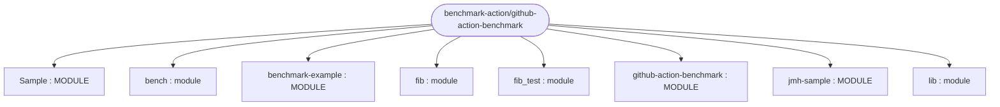
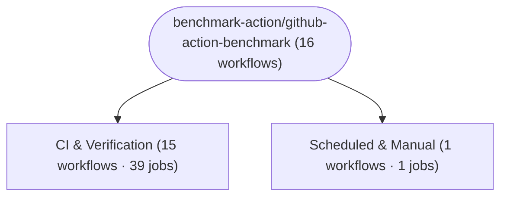

# Repository Architecture Analysis: benchmark-action/github-action-benchmark

## Metadata
- **SHA**: `84ec6ea748925b6580796c05ce7a1c8fd0d15f3b`
- **Primary Ecosystem**: JavaScript/TypeScript

## Quality Metrics
- **ast_engine**: tree-sitter
- **avg_cognitive_complexity**: 1.03
- **avg_cyclomatic_complexity**: 1.7
- **component_count**: 10
- **dead_code_count**: 0
- **dead_code_symbols**: 0 entry(ies)
- **duplication_pct**: 68.83
- **file_complexities**: 25 entry(ies)
- **files_analyzed**: 46
- **fitness_passed**: False
- **fitness_violation_count**: 2
- **framework**: TypeScript
- **import_edges**: 100 entry(ies)
- **loc**: 6523
- **max_cognitive_complexity**: 44
- **max_cyclomatic_complexity**: 19
- **sloc**: 5730
- **test_file_count**: 45

# Architecture: benchmark-action/github-action-benchmark

## Context
- **Repository**: `benchmark-action/github-action-benchmark`
- **SHA**: `84ec6ea748925b6580796c05ce7a1c8fd0d15f3b`
- **Ecosystem**: JavaScript/TypeScript
- **Framework**: TypeScript

## Building Block View

## Component Details
- **benchmark-example** (`examples/benchmarkjs/package.json`): MODULE
- **github-action-benchmark** (`package.json`): MODULE
- **Sample** (`examples/benchmarkdotnet/Sample.csproj`): MODULE
- **bench** (`examples/criterion-rs/benches/bench.rs`): module
- **lib** (`examples/criterion-rs/src/lib.rs`): module
- **fib** (`examples/go/fib.go`): module
- **fib_test** (`examples/go/fib_test.go`): module
- **jmh-sample** (`examples/java/pom.xml`): MODULE
- **bench** (`examples/rust/benches/bench.rs`): module
- **lib** (`examples/rust/src/lib.rs`): module

## 6-Dimension Repository Scorecard

- **Overall Grade**: `F` (46.50/100)
- **Technical Debt Score**: 53.50
- **Estimated Remediation Effort**: 104.64h

| Dimension | Grade | Score | Weight | Details |
| :--- | :---: | :---: | :---: | :--- |
| Code Quality | `D` | 69.00 | 0.20 | avg_cc=1.70, max_cc=19, duplication=68.83%, dead_code=0 |
| Dependency Health | `A` | 100.00 | 0.15 | dependencies=573, outdated=0, vulnerable=0, has_lockfile=True |
| Maintainability | `F` | 48.00 | 0.15 | avg_cognitive=1.03, max_cognitive=44, fitness_violations=2, oversized_files=3 |
| Pipeline Health | `F` | 0.00 | 0.15 | workflows=16, operational_antipatterns=42, parallel_branches=True |
| Security | `F` | 0.00 | 0.20 | vulnerabilities=0, secrets=0, pipeline_security_findings=32 |
| Test Coverage | `C` | 70.00 | 0.15 | coverage=unavailable, ci_test_job=True, test_files_detected=True |

## Architecture Fitness & Workspace Boundaries

- **[MEDIUM] `ATRUSS-ARCH-005` (COMPLEXITY_THRESHOLD)**: Repository duplication_pct (68.83) exceeds policy threshold (15.0).
- **[MEDIUM] `ATRUSS-ARCH-005` (COMPLEXITY_THRESHOLD)**: Repository max_cognitive_complexity (44.0) exceeds policy threshold (25.0).

## Supply Chain Dependencies, Vulnerabilities & Secrets

- **Dependencies Parsed**: 573 | **Vulnerabilities**: 0 | **Secrets**: 0

### Inventory Sample
- `org.openjdk.jmh:jmh-core` `1.29` (Maven, `examples/java/pom.xml`)
- `org.openjdk.jmh:jmh-generator-annprocess` `1.29` (Maven, `examples/java/pom.xml`)
- `BenchmarkDotNet` `0.13.1` (NuGet, `examples/benchmarkdotnet/Sample.csproj`)
- `atomicwrites` `1.3.0` (PyPI, `examples/pytest/requirements.txt`)
- `attrs` `19.3.0` (PyPI, `examples/pytest/requirements.txt`)
- `importlib-metadata` `0.23` (PyPI, `examples/pytest/requirements.txt`)
- `more-itertools` `7.2.0` (PyPI, `examples/pytest/requirements.txt`)
- `packaging` `19.2` (PyPI, `examples/pytest/requirements.txt`)
- `pluggy` `0.13.0` (PyPI, `examples/pytest/requirements.txt`)
- `py` `1.10.0` (PyPI, `examples/pytest/requirements.txt`)
- `py-cpuinfo` `5.0.0` (PyPI, `examples/pytest/requirements.txt`)
- `pyparsing` `2.4.5` (PyPI, `examples/pytest/requirements.txt`)
- `pytest` `5.2.4` (PyPI, `examples/pytest/requirements.txt`)
- `pytest-benchmark` `3.2.2` (PyPI, `examples/pytest/requirements.txt`)
- `six` `1.13.0` (PyPI, `examples/pytest/requirements.txt`)
- `wcwidth` `0.1.7` (PyPI, `examples/pytest/requirements.txt`)
- `zipp` `3.19.1` (PyPI, `examples/pytest/requirements.txt`)
- `criterion` `*` (cargo, `examples/criterion-rs/Cargo.toml`)
- `@actions/core` `1.11.1` (npm, `package-lock.json`)
- `@actions/core` `1.11.1` (npm, `package.json`)
- `@actions/exec` `1.1.1` (npm, `package-lock.json`)
- `@actions/exec` `1.1.1` (npm, `package.json`)
- `@actions/github` `5.1.1` (npm, `package-lock.json`)
- `@actions/github` `5.1.1` (npm, `package.json`)
- `@actions/io` `1.1.2` (npm, `package-lock.json`)
- `@actions/io` `1.1.2` (npm, `package.json`)
- `@types/acorn` `4.0.5` (npm, `package-lock.json`)
- `@types/acorn` `4.0.5` (npm, `package.json`)
- `@types/cheerio` `0.22.16` (npm, `package-lock.json`)
- `@types/cheerio` `0.22.16` (npm, `package.json`)
- ... (+543 more dependencies)

## Section 7: Code-to-Cloud Deployment Traceability

```mermaid
flowchart LR
    subgraph code_modules["Code Modules"]
        mod_examples_benchmarkdotnet["examples/benchmarkdotnet"]
        mod_examples_benchmarkjs["examples/benchmarkjs"]
        mod_examples_criterion_rs["examples/criterion-rs"]
        mod_examples_go["examples/go"]
        mod_examples_java["examples/java"]
        mod_examples_pytest["examples/pytest"]
        mod_examples_rust["examples/rust"]
    end
    subgraph ci_jobs["CI/CD Jobs"]
        job_benchmarkdotnet_yml_benchmark["benchmarkdotnet.yml#benchmark"]
        job_benchmarkjs_yml_benchmark["benchmarkjs.yml#benchmark"]
        job_ci_results_repo_yml_benchmarkdotnet_framework["ci-results-repo.yml#benchmarkdotnet-framework"]
        job_ci_results_repo_yml_benchmarkjs["ci-results-repo.yml#benchmarkjs"]
        job_ci_results_repo_yml_go["ci-results-repo.yml#go"]
        job_ci_results_repo_yml_java_jmh["ci-results-repo.yml#java-jmh"]
        job_ci_results_repo_yml_only_alert_with_cache["ci-results-repo.yml#only-alert-with-cache"]
        job_ci_results_repo_yml_pytest_benchmark["ci-results-repo.yml#pytest-benchmark"]
        job_ci_results_repo_yml_rust["ci-results-repo.yml#rust"]
        job_ci_results_repo_yml_rust_criterion_rs_framework["ci-results-repo.yml#rust-criterion-rs-framework"]
        job_ci_yml_benchmarkdotnet_framework["ci.yml#benchmarkdotnet-framework"]
        job_ci_yml_benchmarkjs["ci.yml#benchmarkjs"]
        job_ci_yml_go["ci.yml#go"]
        job_ci_yml_java_jmh["ci.yml#java-jmh"]
        job_ci_yml_only_alert_with_cache["ci.yml#only-alert-with-cache"]
        job_ci_yml_pytest_benchmark["ci.yml#pytest-benchmark"]
        job_ci_yml_rust["ci.yml#rust"]
        job_ci_yml_rust_criterion_rs_framework["ci.yml#rust-criterion-rs-framework"]
        job_commit_comment_yml_benchmark["commit-comment.yml#benchmark"]
        job_go_yml_benchmark["go.yml#benchmark"]
        job_java_yml_benchmark["java.yml#benchmark"]
        job_minimal_yml_benchmark["minimal.yml#benchmark"]
        job_pytest_yml_benchmark["pytest.yml#benchmark"]
        job_rust_criterion_rs_yml_benchmark["rust-criterion-rs.yml#benchmark"]
        job_rust_yml_benchmark["rust.yml#benchmark"]
    end
    mod_examples_benchmarkdotnet -->|BUILT_BY| job_benchmarkdotnet_yml_benchmark
    mod_examples_benchmarkdotnet -->|BUILT_BY| job_ci_results_repo_yml_benchmarkdotnet_framework
    mod_examples_benchmarkdotnet -->|BUILT_BY| job_ci_yml_benchmarkdotnet_framework
    mod_examples_benchmarkjs -->|BUILT_BY| job_benchmarkjs_yml_benchmark
    mod_examples_benchmarkjs -->|BUILT_BY| job_ci_results_repo_yml_benchmarkjs
    mod_examples_benchmarkjs -->|BUILT_BY| job_ci_yml_benchmarkjs
    mod_examples_criterion_rs -->|BUILT_BY| job_ci_results_repo_yml_rust_criterion_rs_framework
    mod_examples_criterion_rs -->|BUILT_BY| job_ci_yml_rust_criterion_rs_framework
    mod_examples_criterion_rs -->|BUILT_BY| job_rust_criterion_rs_yml_benchmark
    mod_examples_go -->|BUILT_BY| job_ci_results_repo_yml_go
    mod_examples_go -->|BUILT_BY| job_ci_results_repo_yml_only_alert_with_cache
    mod_examples_go -->|BUILT_BY| job_ci_yml_go
    mod_examples_go -->|BUILT_BY| job_ci_yml_only_alert_with_cache
    mod_examples_go -->|BUILT_BY| job_commit_comment_yml_benchmark
    mod_examples_go -->|BUILT_BY| job_go_yml_benchmark
    mod_examples_go -->|BUILT_BY| job_minimal_yml_benchmark
    mod_examples_java -->|BUILT_BY| job_ci_results_repo_yml_java_jmh
    mod_examples_java -->|BUILT_BY| job_ci_yml_java_jmh
    mod_examples_java -->|BUILT_BY| job_java_yml_benchmark
    mod_examples_pytest -->|BUILT_BY| job_ci_results_repo_yml_pytest_benchmark
    mod_examples_pytest -->|BUILT_BY| job_ci_yml_pytest_benchmark
    mod_examples_pytest -->|BUILT_BY| job_pytest_yml_benchmark
    mod_examples_rust -->|BUILT_BY| job_ci_results_repo_yml_rust
    mod_examples_rust -->|BUILT_BY| job_ci_yml_rust
    mod_examples_rust -->|BUILT_BY| job_rust_yml_benchmark
```

- `examples/benchmarkdotnet` (code_module) --[BUILT_BY]--> `benchmarkdotnet.yml#benchmark` (ci_job)
- `examples/benchmarkdotnet` (code_module) --[BUILT_BY]--> `ci-results-repo.yml#benchmarkdotnet-framework` (ci_job)
- `examples/benchmarkdotnet` (code_module) --[BUILT_BY]--> `ci.yml#benchmarkdotnet-framework` (ci_job)
- `examples/benchmarkjs` (code_module) --[BUILT_BY]--> `benchmarkjs.yml#benchmark` (ci_job)
- `examples/benchmarkjs` (code_module) --[BUILT_BY]--> `ci-results-repo.yml#benchmarkjs` (ci_job)
- `examples/benchmarkjs` (code_module) --[BUILT_BY]--> `ci.yml#benchmarkjs` (ci_job)
- `examples/criterion-rs` (code_module) --[BUILT_BY]--> `ci-results-repo.yml#rust-criterion-rs-framework` (ci_job)
- `examples/criterion-rs` (code_module) --[BUILT_BY]--> `ci.yml#rust-criterion-rs-framework` (ci_job)
- `examples/criterion-rs` (code_module) --[BUILT_BY]--> `rust-criterion-rs.yml#benchmark` (ci_job)
- `examples/go` (code_module) --[BUILT_BY]--> `ci-results-repo.yml#go` (ci_job)
- `examples/go` (code_module) --[BUILT_BY]--> `ci-results-repo.yml#only-alert-with-cache` (ci_job)
- `examples/go` (code_module) --[BUILT_BY]--> `ci.yml#go` (ci_job)
- `examples/go` (code_module) --[BUILT_BY]--> `ci.yml#only-alert-with-cache` (ci_job)
- `examples/go` (code_module) --[BUILT_BY]--> `commit-comment.yml#benchmark` (ci_job)
- `examples/go` (code_module) --[BUILT_BY]--> `go.yml#benchmark` (ci_job)
- `examples/go` (code_module) --[BUILT_BY]--> `minimal.yml#benchmark` (ci_job)
- `examples/java` (code_module) --[BUILT_BY]--> `ci-results-repo.yml#java-jmh` (ci_job)
- `examples/java` (code_module) --[BUILT_BY]--> `ci.yml#java-jmh` (ci_job)
- `examples/java` (code_module) --[BUILT_BY]--> `java.yml#benchmark` (ci_job)
- `examples/pytest` (code_module) --[BUILT_BY]--> `ci-results-repo.yml#pytest-benchmark` (ci_job)
- `examples/pytest` (code_module) --[BUILT_BY]--> `ci.yml#pytest-benchmark` (ci_job)
- `examples/pytest` (code_module) --[BUILT_BY]--> `pytest.yml#benchmark` (ci_job)
- `examples/rust` (code_module) --[BUILT_BY]--> `ci-results-repo.yml#rust` (ci_job)
- `examples/rust` (code_module) --[BUILT_BY]--> `ci.yml#rust` (ci_job)
- `examples/rust` (code_module) --[BUILT_BY]--> `rust.yml#benchmark` (ci_job)

## CI/CD Pipeline Topology

