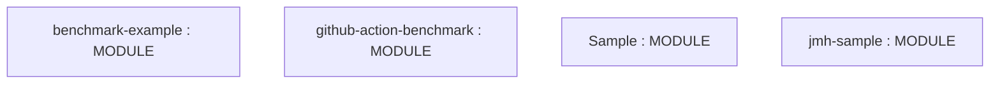
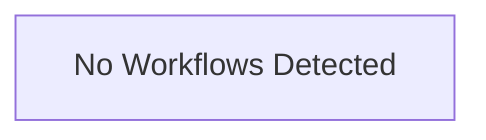

# Repository Architecture Analysis: benchmark-action/github-action-benchmark

## Metadata
- **SHA**: `84ec6ea748925b6580796c05ce7a1c8fd0d15f3b`
- **Primary Ecosystem**: JavaScript/TypeScript

## Quality Metrics
- **avg_cyclomatic_complexity**: 5.6
- **component_count**: 4
- **files_analyzed**: 42
- **framework**: TypeScript
- **loc**: 6427
- **max_cyclomatic_complexity**: 79
- **sloc**: 5653

# Architecture: benchmark-action/github-action-benchmark

## Context
- **Repository**: `benchmark-action/github-action-benchmark`
- **SHA**: `84ec6ea748925b6580796c05ce7a1c8fd0d15f3b`
- **Ecosystem**: JavaScript/TypeScript
- **Framework**: Unknown

## Building Block View

## Component Details
- **benchmark-example** (`examples/benchmarkjs/package.json`): MODULE
- **github-action-benchmark** (`package.json`): MODULE
- **Sample** (`examples/benchmarkdotnet/Sample.csproj`): MODULE
- **jmh-sample** (`examples/java/pom.xml`): MODULE

## CI/CD Pipeline Topology

