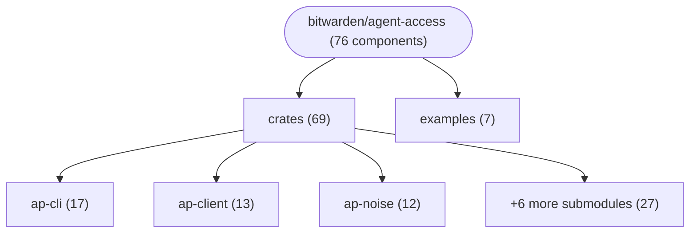
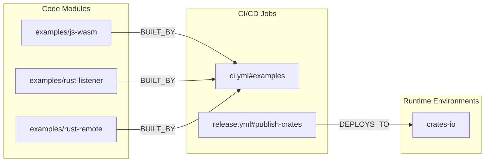
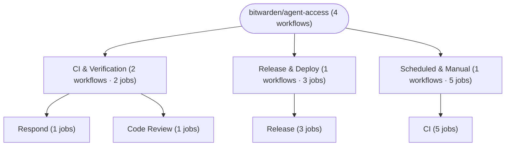

# Repository Architecture Analysis: bitwarden/agent-access

## Metadata
- **SHA**: `512756278c41d19314b462ca978c40d29c51bd36`
- **Primary Ecosystem**: Rust

## Quality Metrics
- **ast_engine**: fallback
- **avg_cognitive_complexity**: 0.0
- **avg_cyclomatic_complexity**: 0.0
- **component_count**: 76
- **dead_code_count**: 0
- **dead_code_symbols**: 0 entry(ies)
- **duplication_pct**: 0.0
- **file_complexities**: 0 entry(ies)
- **files_analyzed**: 76
- **fitness_passed**: True
- **fitness_violation_count**: 0
- **framework**: Rust Cargo
- **import_edges**: 0 entry(ies)
- **loc**: 20280
- **max_cognitive_complexity**: 0
- **max_cyclomatic_complexity**: 0
- **sloc**: 14020
- **test_file_count**: 4

# Architecture: bitwarden/agent-access

## Context
- **Repository**: `bitwarden/agent-access`
- **SHA**: `512756278c41d19314b462ca978c40d29c51bd36`
- **Ecosystem**: Rust
- **Framework**: Rust Cargo

## Building Block View

## Component Details

Showing top 60 representative components out of 76 across 2 module group(s):

- **Module `crates`** (69 components — module: 69)
- **Module `examples`** (7 components — module: 7)

- **adapters** (`crates/ap-uniffi/src/adapters.rs`): module
- **auth** (`crates/ap-relay-protocol/src/auth.rs`): module
- **bitwarden** (`crates/ap-cli/src/providers/bitwarden.rs`): module
- **callbacks** (`crates/ap-uniffi/src/callbacks.rs`): module
- **ciphersuite** (`crates/ap-noise/src/ciphersuite.rs`): module
- **client** (`examples/js-wasm/src/client.rs`): module
- **client_integration** (`crates/ap-relay/tests/client_integration.rs`): module
- **compat** (`crates/ap-client/src/compat.rs`): module
- **config** (`crates/ap-relay-client/src/config.rs`): module
- **connect** (`crates/ap-cli/src/command/connect.rs`): module
- **connection** (`crates/ap-relay/src/connection.rs`): module
- **connection_storage** (`crates/ap-cli/src/storage/connection_storage.rs`): module
- **connections** (`crates/ap-cli/src/command/connections.rs`): module
- **error** (`crates/ap-client/src/error.rs`): module
- **error** (`crates/ap-noise/src/error.rs`): module
- **error** (`crates/ap-relay-protocol/src/error.rs`): module
- **error** (`crates/ap-uniffi/src/error.rs`): module
- **example** (`crates/ap-cli/src/providers/example.rs`): module
- **fingerprint_basic_handshake** (`crates/ap-noise/examples/fingerprint_basic_handshake.rs`): module
- **flat_error** (`crates/ap-error/src/flat_error.rs`): module
- **handler** (`crates/ap-relay/src/server/handler.rs`): module
- **handshake** (`crates/ap-noise/src/handshake.rs`): module
- **identity_storage** (`crates/ap-cli/src/storage/identity_storage.rs`): module
- **integration** (`crates/ap-uniffi/tests/integration.rs`): module
- **lib** (`crates/ap-client/src/lib.rs`): module
- **lib** (`crates/ap-error-macro/src/lib.rs`): module
- **lib** (`crates/ap-error/src/lib.rs`): module
- **lib** (`crates/ap-noise/src/lib.rs`): module
- **lib** (`crates/ap-relay-client/src/lib.rs`): module
- **lib** (`crates/ap-relay-protocol/src/lib.rs`): module
- **lib** (`crates/ap-relay/src/lib.rs`): module
- **lib** (`crates/ap-uniffi/src/lib.rs`): module
- **lib** (`examples/js-wasm/src/lib.rs`): module
- **listen** (`crates/ap-cli/src/command/listen.rs`): module
- **main** (`crates/ap-cli/src/main.rs`): module
- **main** (`crates/ap-relay/src/main.rs`): module
- **main** (`examples/rust-listener/src/main.rs`): module
- **main** (`examples/rust-remote/src/main.rs`): module
- **memory_connection_store** (`crates/ap-client/src/memory_connection_store.rs`): module
- **memory_psk_store** (`crates/ap-client/src/memory_psk_store.rs`): module
- **messages** (`crates/ap-relay-protocol/src/messages.rs`): module
- **mod** (`crates/ap-cli/src/command/mod.rs`): module
- **mod** (`crates/ap-cli/src/providers/mod.rs`): module
- **mod** (`crates/ap-cli/src/storage/mod.rs`): module
- **mod** (`crates/ap-client/src/clients/mod.rs`): module
- **mod** (`crates/ap-relay/src/server/mod.rs`): module
- **multidevice_transport** (`crates/ap-noise/examples/multidevice_transport.rs`): module
- **output** (`crates/ap-cli/src/command/output.rs`): module
- **packet** (`crates/ap-noise/src/packet.rs`): module
- **pairing** (`crates/ap-client/tests/pairing.rs`): module
- **persistence** (`crates/ap-noise/src/persistence.rs`): module
- **protocol_client** (`crates/ap-relay-client/src/protocol_client.rs`): module
- **psk** (`crates/ap-noise/src/psk.rs`): module
- **psk_basic_handshake** (`crates/ap-noise/examples/psk_basic_handshake.rs`): module
- **psk_storage** (`crates/ap-cli/src/storage/psk_storage.rs`): module
- **relay** (`crates/ap-client/src/relay.rs`): module
- **relay_client** (`examples/js-wasm/src/relay_client.rs`): module
- **relay_server** (`crates/ap-relay/src/server/relay_server.rs`): module
- **remote_client** (`crates/ap-client/src/clients/remote_client.rs`): module
- **remote_client** (`crates/ap-uniffi/src/remote_client.rs`): module

## 6-Dimension Repository Scorecard

- **Overall Grade**: `B` (88.15/100)
- **Technical Debt Score**: 11.85
- **Estimated Remediation Effort**: 10.96h

| Dimension | Grade | Score | Weight | Details |
| :--- | :---: | :---: | :---: | :--- |
| Code Quality | `A` | 100.00 | 0.20 | avg_cc=0.00, max_cc=0, duplication=0.00%, dead_code=0 |
| Dependency Health | `A` | 100.00 | 0.15 | dependencies=1110, outdated=0, vulnerable=0, has_lockfile=True |
| Maintainability | `A` | 100.00 | 0.15 | avg_cognitive=0.00, max_cognitive=0, fitness_violations=0, oversized_files=0 |
| Pipeline Health | `F` | 51.00 | 0.15 | workflows=4, operational_antipatterns=12, parallel_branches=True |
| Security | `A` | 100.00 | 0.20 | vulnerabilities=0, secrets=0, pipeline_security_findings=0 |
| Test Coverage | `C` | 70.00 | 0.15 | coverage=unavailable, ci_test_job=True, test_files_detected=True |

## Architecture Fitness & Workspace Boundaries

### Workspace Packages
- **ap-cli** (`crates/ap-cli`, rust, cargo) -> internal deps: `ap-client, ap-noise, ap-relay-client, ap-relay-protocol`
- **ap-client** (`crates/ap-client`, rust, cargo) -> internal deps: `ap-error, ap-noise, ap-relay, ap-relay-client, ap-relay-protocol`
- **ap-error** (`crates/ap-error`, rust, cargo) -> internal deps: `ap-error-macro`
- **ap-error-macro** (`crates/ap-error-macro`, rust, cargo)
- **ap-noise** (`crates/ap-noise`, rust, cargo) -> internal deps: `ap-error`
- **ap-relay** (`crates/ap-relay`, rust, cargo) -> internal deps: `ap-relay-client, ap-relay-protocol`
- **ap-relay-client** (`crates/ap-relay-client`, rust, cargo) -> internal deps: `ap-relay-protocol`
- **ap-relay-protocol** (`crates/ap-relay-protocol`, rust, cargo) -> internal deps: `ap-error`
- **ap-uniffi** (`crates/ap-uniffi`, rust, cargo) -> internal deps: `ap-client, ap-noise, ap-relay, ap-relay-client, ap-relay-protocol`

## Supply Chain Dependencies, Vulnerabilities & Secrets

- **Dependencies Parsed**: 1110 | **Vulnerabilities**: 0 | **Secrets**: 0

### Inventory Sample
- `ap-client` `*` (cargo, `crates/ap-cli/Cargo.toml`)
- `ap-client` `*` (cargo, `crates/ap-uniffi/Cargo.toml`)
- `ap-client` `*` (cargo, `examples/js-wasm/Cargo.toml`)
- `ap-client` `*` (cargo, `examples/rust-listener/Cargo.toml`)
- `ap-client` `*` (cargo, `examples/rust-remote/Cargo.toml`)
- `ap-error` `*` (cargo, `crates/ap-client/Cargo.toml`)
- `ap-error` `*` (cargo, `crates/ap-noise/Cargo.toml`)
- `ap-error` `*` (cargo, `crates/ap-relay-protocol/Cargo.toml`)
- `ap-error-macro` `*` (cargo, `crates/ap-error/Cargo.toml`)
- `ap-noise` `*` (cargo, `crates/ap-cli/Cargo.toml`)
- `ap-noise` `*` (cargo, `crates/ap-client/Cargo.toml`)
- `ap-noise` `*` (cargo, `crates/ap-uniffi/Cargo.toml`)
- `ap-noise` `*` (cargo, `examples/js-wasm/Cargo.toml`)
- `ap-relay-client` `*` (cargo, `crates/ap-cli/Cargo.toml`)
- `ap-relay-client` `*` (cargo, `crates/ap-client/Cargo.toml`)
- `ap-relay-client` `*` (cargo, `crates/ap-uniffi/Cargo.toml`)
- `ap-relay-client` `*` (cargo, `examples/js-wasm/Cargo.toml`)
- `ap-relay-protocol` `*` (cargo, `crates/ap-cli/Cargo.toml`)
- `ap-relay-protocol` `*` (cargo, `crates/ap-client/Cargo.toml`)
- `ap-relay-protocol` `*` (cargo, `crates/ap-relay-client/Cargo.toml`)
- `ap-relay-protocol` `*` (cargo, `crates/ap-relay/Cargo.toml`)
- `ap-relay-protocol` `*` (cargo, `crates/ap-uniffi/Cargo.toml`)
- `ap-relay-protocol` `*` (cargo, `examples/js-wasm/Cargo.toml`)
- `async-trait` `*` (cargo, `crates/ap-cli/Cargo.toml`)
- `async-trait` `*` (cargo, `crates/ap-client/Cargo.toml`)
- `async-trait` `0.1` (cargo, `crates/ap-uniffi/Cargo.toml`)
- `async-trait` `0.1` (cargo, `examples/js-wasm/Cargo.toml`)
- `base64` `*` (cargo, `crates/ap-client/Cargo.toml`)
- `base64` `*` (cargo, `crates/ap-noise/Cargo.toml`)
- `base64` `0.22` (cargo, `examples/js-wasm/Cargo.toml`)
- ... (+1080 more dependencies)

## Section 7: Code-to-Cloud Deployment Traceability

- `release.yml#publish-crates` (ci_job) --[DEPLOYS_TO]--> `crates-io` (environment)
- `examples/js-wasm` (code_module) --[BUILT_BY]--> `ci.yml#examples` (ci_job)
- `examples/rust-listener` (code_module) --[BUILT_BY]--> `ci.yml#examples` (ci_job)
- `examples/rust-remote` (code_module) --[BUILT_BY]--> `ci.yml#examples` (ci_job)

## CI/CD Pipeline Topology

