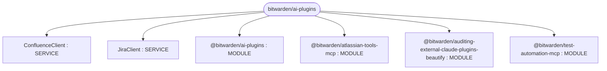
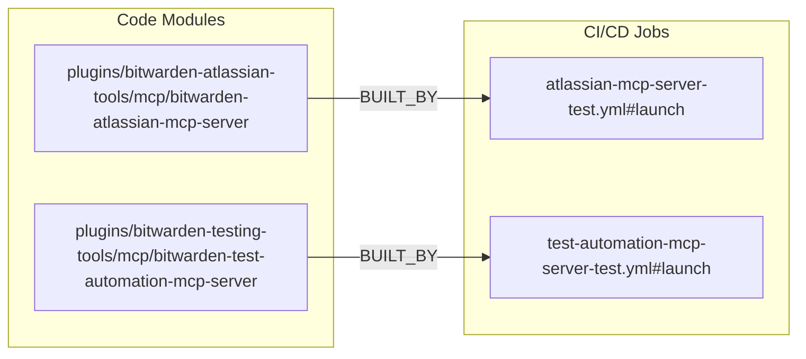
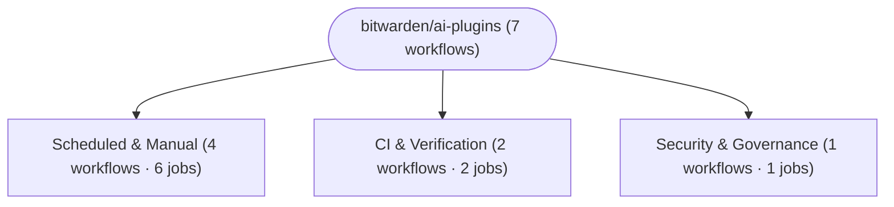

# Repository Architecture Analysis: bitwarden/ai-plugins

## Metadata
- **SHA**: `c0fb6f6d22cefcef0311a47d5b5a6856297e94fa`
- **Primary Ecosystem**: JavaScript/TypeScript

## Quality Metrics
- **ast_engine**: tree-sitter
- **avg_cognitive_complexity**: 4.54
- **avg_cyclomatic_complexity**: 4.3
- **component_count**: 6
- **dead_code_count**: 1
- **dead_code_symbols**: 1 entry(ies)
- **duplication_pct**: 83.43
- **file_complexities**: 25 entry(ies)
- **files_analyzed**: 72
- **fitness_passed**: False
- **fitness_violation_count**: 3
- **framework**: TypeScript
- **import_edges**: 100 entry(ies)
- **loc**: 14675
- **max_cognitive_complexity**: 137
- **max_cyclomatic_complexity**: 98
- **sloc**: 11670
- **test_file_count**: 37

# Architecture: bitwarden/ai-plugins

## Context
- **Repository**: `bitwarden/ai-plugins`
- **SHA**: `c0fb6f6d22cefcef0311a47d5b5a6856297e94fa`
- **Ecosystem**: JavaScript/TypeScript
- **Framework**: TypeScript

## Building Block View

## Component Details
- **@bitwarden/ai-plugins** (`package.json`): MODULE
- **@bitwarden/atlassian-tools-mcp** (`plugins/bitwarden-atlassian-tools/mcp/bitwarden-atlassian-mcp-server/package.json`): MODULE
- **@bitwarden/auditing-external-claude-plugins-beautify** (`plugins/bitwarden-security-engineer/skills/auditing-external-claude-plugins/scripts/package.json`): MODULE
- **@bitwarden/test-automation-mcp** (`plugins/bitwarden-testing-tools/mcp/bitwarden-test-automation-mcp-server/package.json`): MODULE
- **ConfluenceClient** (`plugins/bitwarden-atlassian-tools/mcp/bitwarden-atlassian-mcp-server/src/confluence/client.ts`): SERVICE
- **JiraClient** (`plugins/bitwarden-atlassian-tools/mcp/bitwarden-atlassian-mcp-server/src/jira/client.ts`): SERVICE

## 6-Dimension Repository Scorecard

- **Overall Grade**: `F` (53.56/100)
- **Technical Debt Score**: 46.44
- **Estimated Remediation Effort**: 53.05h

| Dimension | Grade | Score | Weight | Details |
| :--- | :---: | :---: | :---: | :--- |
| Code Quality | `F` | 42.80 | 0.20 | avg_cc=4.30, max_cc=98, duplication=83.43%, dead_code=1 |
| Dependency Health | `A` | 100.00 | 0.15 | dependencies=39, outdated=0, vulnerable=0, has_lockfile=True |
| Maintainability | `F` | 52.00 | 0.15 | avg_cognitive=4.54, max_cognitive=137, fitness_violations=3, oversized_files=1 |
| Pipeline Health | `C` | 78.00 | 0.15 | workflows=7, operational_antipatterns=9, parallel_branches=True |
| Security | `F` | 0.00 | 0.20 | vulnerabilities=0, secrets=3, pipeline_security_findings=4 |
| Test Coverage | `C` | 70.00 | 0.15 | coverage=unavailable, ci_test_job=True, test_files_detected=True |

## Architecture Fitness & Workspace Boundaries

- **[MEDIUM] `ATRUSS-ARCH-005` (COMPLEXITY_THRESHOLD)**: Repository duplication_pct (83.43) exceeds policy threshold (15.0).
- **[MEDIUM] `ATRUSS-ARCH-005` (COMPLEXITY_THRESHOLD)**: Repository max_cognitive_complexity (137.0) exceeds policy threshold (25.0).
- **[MEDIUM] `ATRUSS-ARCH-005` (COMPLEXITY_THRESHOLD)**: Repository max_cyclomatic_complexity (98.0) exceeds policy threshold (20.0).

## Supply Chain Dependencies, Vulnerabilities & Secrets

- **Dependencies Parsed**: 39 | **Vulnerabilities**: 0 | **Secrets**: 3

### Secret Findings (Redacted)
- **[CRITICAL] `ATRUSS-SEC-004`** at `plugins/bitwarden-security-engineer/skills/detecting-secrets/SKILL.md:16` (`-----BEGIN ... PRIVATE KEY----- [REDACTED]`)
- **[CRITICAL] `ATRUSS-SEC-003`** at `plugins/bitwarden-security-engineer/skills/detecting-secrets/SKILL.md:40` (`var apiKey = "sk-p***REDACTED***";`)
- **[CRITICAL] `ATRUSS-SEC-003`** at `plugins/bitwarden-security-engineer/skills/detecting-secrets/SKILL.md:59` (`"apiKey": "sk-p***REDACTED***"`)

### Inventory Sample
- `@modelcontextprotocol/sdk` `1.32.0` (npm, `plugins/bitwarden-atlassian-tools/mcp/bitwarden-atlassian-mcp-server/package.json`)
- `@modelcontextprotocol/sdk` `1.32.0` (npm, `plugins/bitwarden-testing-tools/mcp/bitwarden-test-automation-mcp-server/package.json`)
- `@types/node` `24.13.3` (npm, `plugins/bitwarden-atlassian-tools/mcp/bitwarden-atlassian-mcp-server/package.json`)
- `@types/node` `24.13.3` (npm, `plugins/bitwarden-testing-tools/mcp/bitwarden-test-automation-mcp-server/package.json`)
- `axios` `1.20.0` (npm, `plugins/bitwarden-atlassian-tools/mcp/bitwarden-atlassian-mcp-server/package.json`)
- `corepack` `0.36.0` (npm, `package.json`)
- `corepack` `0.36.0` (npm, `plugins/bitwarden-atlassian-tools/mcp/bitwarden-atlassian-mcp-server/package.json`)
- `corepack` `0.36.0` (npm, `plugins/bitwarden-testing-tools/mcp/bitwarden-test-automation-mcp-server/package.json`)
- `cspell` `10.2.2` (npm, `package.json`)
- `husky` `9.1.7` (npm, `package.json`)
- `js-beautify` `2.0.3` (npm, `plugins/bitwarden-security-engineer/skills/auditing-external-claude-plugins/scripts/package-lock.json`)
- `js-beautify` `2.0.3` (npm, `plugins/bitwarden-security-engineer/skills/auditing-external-claude-plugins/scripts/package.json`)
- `lint-staged` `17.5.0` (npm, `package.json`)
- `marked` `16.4.2` (npm, `plugins/bitwarden-atlassian-tools/mcp/bitwarden-atlassian-mcp-server/package.json`)
- `marklassian` `1.2.1` (npm, `plugins/bitwarden-atlassian-tools/mcp/bitwarden-atlassian-mcp-server/package.json`)
- `prettier` `3.9.6` (npm, `package.json`)
- `typescript` `7.0.2` (npm, `plugins/bitwarden-atlassian-tools/mcp/bitwarden-atlassian-mcp-server/package.json`)
- `typescript` `7.0.2` (npm, `plugins/bitwarden-testing-tools/mcp/bitwarden-test-automation-mcp-server/package.json`)
- `vitest` `5.0.2` (npm, `plugins/bitwarden-atlassian-tools/mcp/bitwarden-atlassian-mcp-server/package.json`)
- `vitest` `5.0.2` (npm, `plugins/bitwarden-testing-tools/mcp/bitwarden-test-automation-mcp-server/package.json`)
- `zod` `4.6.6` (npm, `plugins/bitwarden-atlassian-tools/mcp/bitwarden-atlassian-mcp-server/package.json`)
- `zod` `4.6.6` (npm, `plugins/bitwarden-testing-tools/mcp/bitwarden-test-automation-mcp-server/package.json`)
- `@one-ini/wasm` `0.2.1` (npm, `plugins/bitwarden-security-engineer/skills/auditing-external-claude-plugins/scripts/package-lock.json`)
- `abbrev` `5.0.0` (npm, `plugins/bitwarden-security-engineer/skills/auditing-external-claude-plugins/scripts/package-lock.json`)
- `balanced-match` `4.0.4` (npm, `plugins/bitwarden-security-engineer/skills/auditing-external-claude-plugins/scripts/package-lock.json`)
- `brace-expansion` `5.0.12` (npm, `plugins/bitwarden-security-engineer/skills/auditing-external-claude-plugins/scripts/package-lock.json`)
- `commander` `14.0.3` (npm, `plugins/bitwarden-security-engineer/skills/auditing-external-claude-plugins/scripts/package-lock.json`)
- `config-chain` `1.1.13` (npm, `plugins/bitwarden-security-engineer/skills/auditing-external-claude-plugins/scripts/package-lock.json`)
- `editorconfig` `3.0.2` (npm, `plugins/bitwarden-security-engineer/skills/auditing-external-claude-plugins/scripts/package-lock.json`)
- `glob` `13.0.6` (npm, `plugins/bitwarden-security-engineer/skills/auditing-external-claude-plugins/scripts/package-lock.json`)
- ... (+9 more dependencies)

## Section 7: Code-to-Cloud Deployment Traceability

- `plugins/bitwarden-atlassian-tools/mcp/bitwarden-atlassian-mcp-server` (code_module) --[BUILT_BY]--> `atlassian-mcp-server-test.yml#launch` (ci_job)
- `plugins/bitwarden-testing-tools/mcp/bitwarden-test-automation-mcp-server` (code_module) --[BUILT_BY]--> `test-automation-mcp-server-test.yml#launch` (ci_job)

## CI/CD Pipeline Topology

