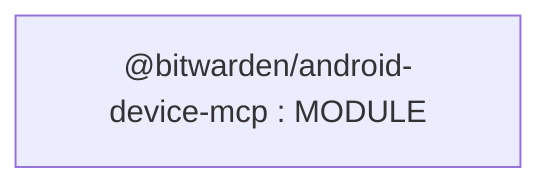
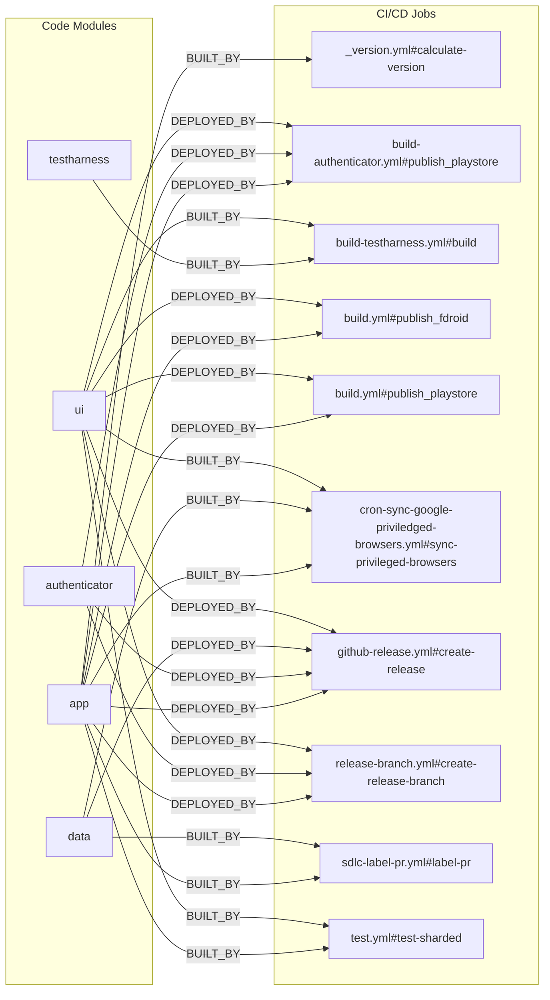
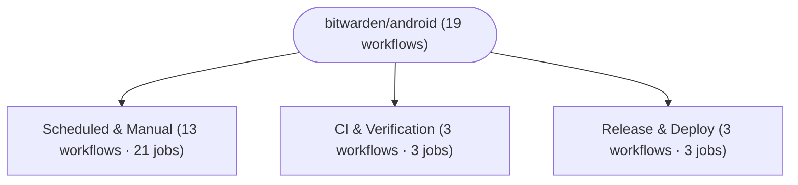

# Repository Architecture Analysis: bitwarden/android

## Metadata
- **SHA**: `d173d6837108f92e192f5ecf944aa250d72a0861`
- **Primary Ecosystem**: Java

## Quality Metrics
- **ast_engine**: tree-sitter
- **avg_cognitive_complexity**: 2.4
- **avg_cyclomatic_complexity**: 6.27
- **component_count**: 1
- **dead_code_count**: 6
- **dead_code_symbols**: 6 entry(ies)
- **duplication_pct**: 96.08
- **file_complexities**: 25 entry(ies)
- **files_analyzed**: 2521
- **fitness_passed**: False
- **fitness_violation_count**: 3
- **framework**: Unknown
- **import_edges**: 100 entry(ies)
- **loc**: 442746
- **max_cognitive_complexity**: 106
- **max_cyclomatic_complexity**: 327
- **sloc**: 361865
- **test_file_count**: 637

# Architecture: bitwarden/android

## Context
- **Repository**: `bitwarden/android`
- **SHA**: `d173d6837108f92e192f5ecf944aa250d72a0861`
- **Ecosystem**: Java
- **Framework**: Unknown

## Building Block View

## Component Details
- **@bitwarden/android-device-mcp** (`.claude/mcp/android-device-server/package.json`): MODULE

## 6-Dimension Repository Scorecard

- **Overall Grade**: `F` (33.78/100)
- **Technical Debt Score**: 66.22
- **Estimated Remediation Effort**: 144.77h

| Dimension | Grade | Score | Weight | Details |
| :--- | :---: | :---: | :---: | :--- |
| Code Quality | `F` | 24.92 | 0.20 | avg_cc=6.27, max_cc=327, duplication=96.08%, dead_code=6 |
| Dependency Health | `B` | 85.00 | 0.15 | dependencies=14, outdated=0, vulnerable=0, has_lockfile=False |
| Maintainability | `F` | 37.00 | 0.15 | avg_cognitive=2.40, max_cognitive=106, fitness_violations=3, oversized_files=15 |
| Pipeline Health | `F` | 0.00 | 0.15 | workflows=19, operational_antipatterns=34, parallel_branches=True |
| Security | `F` | 0.00 | 0.20 | vulnerabilities=0, secrets=7, pipeline_security_findings=28 |
| Test Coverage | `C` | 70.00 | 0.15 | coverage=unavailable, ci_test_job=True, test_files_detected=True |

## Architecture Fitness & Workspace Boundaries

- **[MEDIUM] `ATRUSS-ARCH-005` (COMPLEXITY_THRESHOLD)**: Repository duplication_pct (96.08) exceeds policy threshold (15.0).
- **[MEDIUM] `ATRUSS-ARCH-005` (COMPLEXITY_THRESHOLD)**: Repository max_cognitive_complexity (106.0) exceeds policy threshold (25.0).
- **[MEDIUM] `ATRUSS-ARCH-005` (COMPLEXITY_THRESHOLD)**: Repository max_cyclomatic_complexity (327.0) exceeds policy threshold (20.0).

## Supply Chain Dependencies, Vulnerabilities & Secrets

- **Dependencies Parsed**: 14 | **Vulnerabilities**: 0 | **Secrets**: 7

### Secret Findings (Redacted)
- **[HIGH] `ATRUSS-SEC-005`** at `app/src/main/kotlin/com/x8bit/bitwarden/data/credentials/manager/CredentialManagerPendingIntentManagerImpl.kt:125` (`private const val CREATE_PASSKEY_ACTION = "com.***REDACTED***"`)
- **[HIGH] `ATRUSS-SEC-005`** at `app/src/main/kotlin/com/x8bit/bitwarden/data/credentials/manager/CredentialManagerPendingIntentManagerImpl.kt:127` (`private const val GET_PASSKEY_ACTION = "com.***REDACTED***"`)
- **[HIGH] `ATRUSS-SEC-005`** at `app/src/main/kotlin/com/x8bit/bitwarden/data/credentials/manager/CredentialManagerPendingIntentManagerImpl.kt:128` (`private const val CREATE_PASSWORD_ACTION = "com.***REDACTED***"`)
- **[HIGH] `ATRUSS-SEC-005`** at `app/src/main/kotlin/com/x8bit/bitwarden/data/credentials/manager/CredentialManagerPendingIntentManagerImpl.kt:129` (`private const val GET_PASSWORD_ACTION = "com.***REDACTED***"`)
- **[HIGH] `ATRUSS-SEC-005`** at `app/src/standardDebug/google-services.json:24` (`"current_key": "AIza***REDACTED***"`)
- **[HIGH] `ATRUSS-SEC-005`** at `app/src/test/kotlin/com/x8bit/bitwarden/data/platform/datasource/network/ssl/CertificateManagerTest.kt:730` (`keyUri = "cert***REDACTED***",`)
- **[HIGH] `ATRUSS-SEC-005`** at `authenticator/src/debug/google-services.json:18` (`"current_key": "AIza***REDACTED***"`)

### Inventory Sample
- `abbrev` `0.1.2` (gem, `Gemfile`)
- `csv` `3.3.5` (gem, `Gemfile`)
- `fastlane` `2.236.1` (gem, `Gemfile`)
- `logger` `1.7.0` (gem, `Gemfile`)
- `mutex_m` `0.3.0` (gem, `Gemfile`)
- `nkf` `0.2.0` (gem, `Gemfile`)
- `ostruct` `0.6.3` (gem, `Gemfile`)
- `time` `0.4.2` (gem, `Gemfile`)
- `@modelcontextprotocol/sdk` `1.27.1` (npm, `.claude/mcp/android-device-server/package.json`)
- `@types/node` `20.19.35` (npm, `.claude/mcp/android-device-server/package.json`)
- `fast-xml-parser` `4.5.0` (npm, `.claude/mcp/android-device-server/package.json`)
- `typescript` `5.8.3` (npm, `.claude/mcp/android-device-server/package.json`)
- `vitest` `3.1.1` (npm, `.claude/mcp/android-device-server/package.json`)
- `zod` `3.24.2` (npm, `.claude/mcp/android-device-server/package.json`)

## Section 7: Code-to-Cloud Deployment Traceability

- `app` (code_module) --[BUILT_BY]--> `_version.yml#calculate-version` (ci_job)
- `app` (code_module) --[BUILT_BY]--> `cron-sync-google-priviledged-browsers.yml#sync-privileged-browsers` (ci_job)
- `app` (code_module) --[BUILT_BY]--> `sdlc-label-pr.yml#label-pr` (ci_job)
- `app` (code_module) --[BUILT_BY]--> `test.yml#test-sharded` (ci_job)
- `app` (code_module) --[DEPLOYED_BY]--> `build-authenticator.yml#publish_playstore` (ci_job)
- `app` (code_module) --[DEPLOYED_BY]--> `build.yml#publish_fdroid` (ci_job)
- `app` (code_module) --[DEPLOYED_BY]--> `build.yml#publish_playstore` (ci_job)
- `app` (code_module) --[DEPLOYED_BY]--> `github-release.yml#create-release` (ci_job)
- `app` (code_module) --[DEPLOYED_BY]--> `release-branch.yml#create-release-branch` (ci_job)
- `authenticator` (code_module) --[DEPLOYED_BY]--> `build-authenticator.yml#publish_playstore` (ci_job)
- `authenticator` (code_module) --[DEPLOYED_BY]--> `github-release.yml#create-release` (ci_job)
- `authenticator` (code_module) --[DEPLOYED_BY]--> `release-branch.yml#create-release-branch` (ci_job)
- `data` (code_module) --[BUILT_BY]--> `cron-sync-google-priviledged-browsers.yml#sync-privileged-browsers` (ci_job)
- `data` (code_module) --[BUILT_BY]--> `sdlc-label-pr.yml#label-pr` (ci_job)
- `data` (code_module) --[DEPLOYED_BY]--> `github-release.yml#create-release` (ci_job)
- `testharness` (code_module) --[BUILT_BY]--> `build-testharness.yml#build` (ci_job)
- `ui` (code_module) --[BUILT_BY]--> `build-testharness.yml#build` (ci_job)
- `ui` (code_module) --[BUILT_BY]--> `cron-sync-google-priviledged-browsers.yml#sync-privileged-browsers` (ci_job)
- `ui` (code_module) --[BUILT_BY]--> `test.yml#test-sharded` (ci_job)
- `ui` (code_module) --[DEPLOYED_BY]--> `build-authenticator.yml#publish_playstore` (ci_job)
- `ui` (code_module) --[DEPLOYED_BY]--> `build.yml#publish_fdroid` (ci_job)
- `ui` (code_module) --[DEPLOYED_BY]--> `build.yml#publish_playstore` (ci_job)
- `ui` (code_module) --[DEPLOYED_BY]--> `github-release.yml#create-release` (ci_job)
- `ui` (code_module) --[DEPLOYED_BY]--> `release-branch.yml#create-release-branch` (ci_job)

## CI/CD Pipeline Topology

