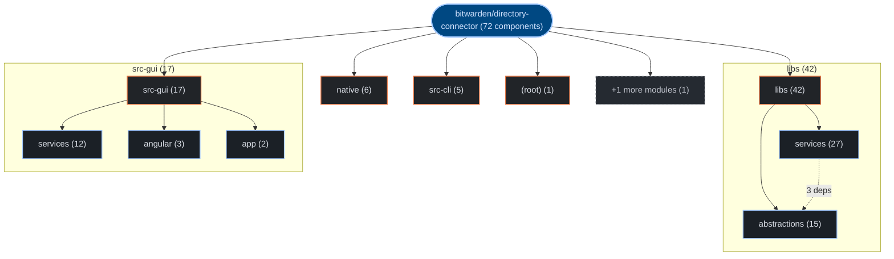
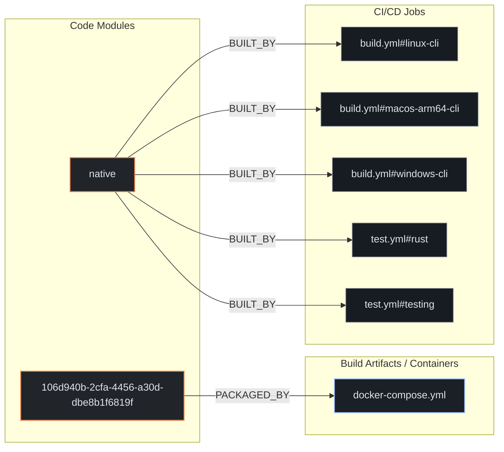

# Repository Architecture Analysis: bitwarden/directory-connector

## Metadata
- **SHA**: `de6d86f26d3c4be07153476f2a6bdfaa796af0c3`
- **Primary Ecosystem**: JavaScript/TypeScript

## Quality Metrics
- **ast_engine**: tree-sitter
- **avg_cognitive_complexity**: 2.39
- **avg_cyclomatic_complexity**: 2.83
- **component_count**: 72
- **dead_code_count**: 15
- **dead_code_symbols**: 15 entry(ies)
- **duplication_pct**: 73.43
- **file_complexities**: 25 entry(ies)
- **files_analyzed**: 234
- **fitness_passed**: False
- **fitness_violation_count**: 53
- **framework**: Angular
- **import_edges**: 100 entry(ies)
- **loc**: 20703
- **max_cognitive_complexity**: 66
- **max_cyclomatic_complexity**: 36
- **sloc**: 16683
- **test_file_count**: 27

# Architecture: bitwarden/directory-connector

## Context
- **Repository**: `bitwarden/directory-connector`
- **SHA**: `de6d86f26d3c4be07153476f2a6bdfaa796af0c3`
- **Ecosystem**: JavaScript/TypeScript
- **Framework**: Angular

## Building Block View

## Component Details

Showing top 60 representative components out of 72 across 6 module group(s):

- **Module `libs`** (42 components — SERVICE: 42)
- **Module `src-gui`** (17 components — SERVICE: 17)
- **Module `native`** (6 components — module: 5, MODULE: 1)
- **Module `src-cli`** (5 components — SERVICE: 4, MODULE: 1)
- **Module `(root)`** (1 components — MODULE: 1)
- **Module `utils`** (1 components — SERVICE: 1)

- **EntraIdDirectoryService** (`libs/services/directory-services/entra-id-directory.service.ts`): SERVICE (deps: BaseDirectoryService, DefaultStateService, GSuiteDirectoryService, LdapDirectoryService, OktaDirectoryService, OneLoginDirectoryService (+1 more))
- **OktaDirectoryService** (`libs/services/directory-services/okta-directory.service.ts`): SERVICE (deps: BaseDirectoryService, DefaultStateService, EntraIdDirectoryService, GSuiteDirectoryService, LdapDirectoryService, OneLoginDirectoryService (+1 more))
- **OneLoginDirectoryService** (`libs/services/directory-services/onelogin-directory.service.ts`): SERVICE (deps: BaseDirectoryService, DefaultStateService, EntraIdDirectoryService, GSuiteDirectoryService, LdapDirectoryService, OktaDirectoryService (+1 more))
- **DefaultDirectoryFactoryService** (`libs/services/directory-factory.service.ts`): SERVICE (deps: EntraIdDirectoryService, GSuiteDirectoryService, LdapDirectoryService, OktaDirectoryService, OneLoginDirectoryService)
- **GSuiteDirectoryService** (`libs/services/directory-services/gsuite-directory.service.ts`): SERVICE (deps: BaseDirectoryService, EntraIdDirectoryService, LdapDirectoryService, OktaDirectoryService, OneLoginDirectoryService)
- **LdapDirectoryService** (`libs/services/directory-services/ldap-directory.service.ts`): SERVICE (deps: EntraIdDirectoryService, GSuiteDirectoryService, OktaDirectoryService, OneLoginDirectoryService)
- **TestableService** (`libs/services/state-service/stateMigration.service.spec.ts`): SERVICE (deps: StateMigrationService)
- **@bitwarden/directory-connector** (`package.json`): MODULE
- **@bitwarden/directory-connector** (`src-cli/package.json`): MODULE
- **ApiService** (`libs/abstractions/api.service.ts`): SERVICE
- **ApiService** (`libs/services/api.service.ts`): SERVICE
- **AppIdService** (`libs/abstractions/appId.service.ts`): SERVICE
- **AppIdService** (`libs/services/appId.service.ts`): SERVICE
- **AuthGuardService** (`src-gui/app/services/auth-guard.service.ts`): SERVICE
- **AuthService** (`libs/abstractions/auth.service.ts`): SERVICE
- **AuthService** (`libs/services/auth.service.ts`): SERVICE
- **BaseDirectoryService** (`libs/services/baseDirectory.service.ts`): SERVICE
- **BroadcasterService** (`libs/abstractions/broadcaster.service.ts`): SERVICE
- **BroadcasterService** (`libs/services/broadcaster.service.ts`): SERVICE
- **BroadcasterService** (`src-gui/angular/services/broadcaster.service.ts`): SERVICE
- **CliPlatformUtilsService** (`src-cli/services/cliPlatformUtils.service.ts`): SERVICE
- **ConsoleLogService** (`libs/services/consoleLog.service.ts`): SERVICE
- **ConsoleLogService** (`src-cli/services/consoleLog.service.ts`): SERVICE
- **CryptoFunctionService** (`libs/abstractions/cryptoFunction.service.ts`): SERVICE
- **DefaultEnvironmentService** (`libs/services/environment/environment.service.ts`): SERVICE
- **DefaultStateService** (`libs/services/state-service/default-state.service.ts`): SERVICE
- **DirectoryFactoryService** (`libs/abstractions/directory-factory.service.ts`): SERVICE
- **ElectronLogService** (`src-gui/services/electron/electronLog.service.ts`): SERVICE
- **ElectronMainMessagingService** (`src-gui/services/electron/electronMainMessaging.service.ts`): SERVICE
- **ElectronStorageService** (`src-gui/services/electron/electronStorage.service.ts`): SERVICE
- **EnvironmentService** (`libs/abstractions/environment.service.ts`): SERVICE
- **FakeStorageService** (`utils/fakeStorageService.ts`): SERVICE
- **I18nService** (`libs/abstractions/i18n.service.ts`): SERVICE
- **I18nService** (`libs/services/baseI18n.service.ts`): SERVICE
- **I18nService** (`libs/services/i18n.service.ts`): SERVICE
- **LaunchGuardService** (`src-gui/app/services/launch-guard.service.ts`): SERVICE
- **LogService** (`libs/abstractions/log.service.ts`): SERVICE
- **LowdbStorageService** (`libs/services/baseLowdbStorage.service.ts`): SERVICE
- **LowdbStorageService** (`libs/services/lowdbStorage.service.ts`): SERVICE
- **MainPlatformUtilsService** (`src-gui/services/electron/mainPlatformUtils.service.ts`): SERVICE
- **MessagingService** (`libs/abstractions/messaging.service.ts`): SERVICE
- **ModalService** (`src-gui/angular/services/modal.service.ts`): SERVICE
- **NativeSecureStorageService** (`libs/services/nativeSecureStorage.service.ts`): SERVICE
- **NodeApiService** (`libs/services/nodeApi.service.ts`): SERVICE
- **NodeApiService** (`src-cli/services/node/nodeApi.service.ts`): SERVICE
- **NodeCryptoFunctionService** (`libs/services/nodeCryptoFunction.service.ts`): SERVICE
- **NodeCryptoFunctionService** (`src-cli/services/node/nodeCryptoFunction.service.ts`): SERVICE
- **NoopMessagingService** (`libs/services/noopMessaging.service.ts`): SERVICE
- **PlatformUtilsService** (`libs/abstractions/platformUtils.service.ts`): SERVICE
- **RendererAuthService** (`src-gui/services/electron/rendererAuth.service.ts`): SERVICE
- **RendererI18nService** (`src-gui/services/electron/rendererI18n.service.ts`): SERVICE
- **RendererLogService** (`src-gui/services/electron/rendererLog.service.ts`): SERVICE
- **RendererMessagingService** (`src-gui/services/electron/rendererMessaging.service.ts`): SERVICE
- **RendererPlatformUtilsService** (`src-gui/services/electron/rendererPlatformUtils.service.ts`): SERVICE
- **RendererSecureStorageService** (`src-gui/services/electron/rendererSecureStorage.service.ts`): SERVICE
- **RendererStorageService** (`src-gui/services/electron/rendererStorage.service.ts`): SERVICE
- **RendererSyncService** (`src-gui/services/electron/rendererSync.service.ts`): SERVICE
- **SecureStorageService** (`libs/abstractions/storage.service.ts`): SERVICE
- **StateMigrationService** (`libs/services/state-service/stateMigration.service.ts`): SERVICE
- **StateService** (`libs/abstractions/state.service.ts`): SERVICE

## 6-Dimension Repository Scorecard

- **Overall Grade**: `F` (36.00/100)
- **Technical Debt Score**: 64.00
- **Estimated Remediation Effort**: 233.94h

| Dimension | Grade | Score | Weight | Details |
| :--- | :---: | :---: | :---: | :--- |
| Code Quality | `F` | 30.00 | 0.20 | avg_cc=2.83, max_cc=36, duplication=73.43%, dead_code=15 |
| Dependency Health | `A` | 100.00 | 0.15 | dependencies=2263, outdated=0, vulnerable=0, has_lockfile=True |
| Maintainability | `F` | 0.00 | 0.15 | avg_cognitive=2.39, max_cognitive=66, fitness_violations=53, oversized_files=4 |
| Pipeline Health | `F` | 30.00 | 0.15 | workflows=11, operational_antipatterns=23, parallel_branches=True |
| Security | `F` | 0.00 | 0.20 | vulnerabilities=0, secrets=7, pipeline_security_findings=25 |
| Test Coverage | `C` | 70.00 | 0.15 | coverage=unavailable, ci_test_job=True, test_files_detected=True |

## Architecture Fitness & Workspace Boundaries

- **[HIGH] `ATRUSS-ARCH-004` (CIRCULAR_DEPENDENCY)**: Circular dependency detected between architectural components. (EntraIdDirectoryService -> GSuiteDirectoryService -> EntraIdDirectoryService)
- **[HIGH] `ATRUSS-ARCH-004` (CIRCULAR_DEPENDENCY)**: Circular dependency detected between architectural components. (EntraIdDirectoryService -> GSuiteDirectoryService -> LdapDirectoryService -> EntraIdDirectoryService)
- **[HIGH] `ATRUSS-ARCH-004` (CIRCULAR_DEPENDENCY)**: Circular dependency detected between architectural components. (EntraIdDirectoryService -> GSuiteDirectoryService -> LdapDirectoryService -> OktaDirectoryService -> EntraIdDirectoryService)
- **[HIGH] `ATRUSS-ARCH-004` (CIRCULAR_DEPENDENCY)**: Circular dependency detected between architectural components. (EntraIdDirectoryService -> GSuiteDirectoryService -> LdapDirectoryService -> OktaDirectoryService -> OneLoginDirectoryService -> EntraIdDirectoryService)
- **[HIGH] `ATRUSS-ARCH-004` (CIRCULAR_DEPENDENCY)**: Circular dependency detected between architectural components. (EntraIdDirectoryService -> GSuiteDirectoryService -> LdapDirectoryService -> OneLoginDirectoryService -> EntraIdDirectoryService)
- **[HIGH] `ATRUSS-ARCH-004` (CIRCULAR_DEPENDENCY)**: Circular dependency detected between architectural components. (EntraIdDirectoryService -> GSuiteDirectoryService -> LdapDirectoryService -> OneLoginDirectoryService -> OktaDirectoryService -> EntraIdDirectoryService)
- **[HIGH] `ATRUSS-ARCH-004` (CIRCULAR_DEPENDENCY)**: Circular dependency detected between architectural components. (EntraIdDirectoryService -> GSuiteDirectoryService -> OktaDirectoryService -> EntraIdDirectoryService)
- **[HIGH] `ATRUSS-ARCH-004` (CIRCULAR_DEPENDENCY)**: Circular dependency detected between architectural components. (EntraIdDirectoryService -> GSuiteDirectoryService -> OktaDirectoryService -> LdapDirectoryService -> EntraIdDirectoryService)
- **[HIGH] `ATRUSS-ARCH-004` (CIRCULAR_DEPENDENCY)**: Circular dependency detected between architectural components. (EntraIdDirectoryService -> GSuiteDirectoryService -> OktaDirectoryService -> LdapDirectoryService -> OneLoginDirectoryService -> EntraIdDirectoryService)
- **[HIGH] `ATRUSS-ARCH-004` (CIRCULAR_DEPENDENCY)**: Circular dependency detected between architectural components. (EntraIdDirectoryService -> GSuiteDirectoryService -> OktaDirectoryService -> OneLoginDirectoryService -> EntraIdDirectoryService)
- **[HIGH] `ATRUSS-ARCH-004` (CIRCULAR_DEPENDENCY)**: Circular dependency detected between architectural components. (EntraIdDirectoryService -> GSuiteDirectoryService -> OktaDirectoryService -> OneLoginDirectoryService -> LdapDirectoryService -> EntraIdDirectoryService)
- **[HIGH] `ATRUSS-ARCH-004` (CIRCULAR_DEPENDENCY)**: Circular dependency detected between architectural components. (EntraIdDirectoryService -> GSuiteDirectoryService -> OneLoginDirectoryService -> EntraIdDirectoryService)
- **[HIGH] `ATRUSS-ARCH-004` (CIRCULAR_DEPENDENCY)**: Circular dependency detected between architectural components. (EntraIdDirectoryService -> GSuiteDirectoryService -> OneLoginDirectoryService -> LdapDirectoryService -> EntraIdDirectoryService)
- **[HIGH] `ATRUSS-ARCH-004` (CIRCULAR_DEPENDENCY)**: Circular dependency detected between architectural components. (EntraIdDirectoryService -> GSuiteDirectoryService -> OneLoginDirectoryService -> LdapDirectoryService -> OktaDirectoryService -> EntraIdDirectoryService)
- **[HIGH] `ATRUSS-ARCH-004` (CIRCULAR_DEPENDENCY)**: Circular dependency detected between architectural components. (EntraIdDirectoryService -> GSuiteDirectoryService -> OneLoginDirectoryService -> OktaDirectoryService -> EntraIdDirectoryService)
- **[HIGH] `ATRUSS-ARCH-004` (CIRCULAR_DEPENDENCY)**: Circular dependency detected between architectural components. (EntraIdDirectoryService -> GSuiteDirectoryService -> OneLoginDirectoryService -> OktaDirectoryService -> LdapDirectoryService -> EntraIdDirectoryService)
- **[HIGH] `ATRUSS-ARCH-004` (CIRCULAR_DEPENDENCY)**: Circular dependency detected between architectural components. (EntraIdDirectoryService -> LdapDirectoryService -> EntraIdDirectoryService)
- **[HIGH] `ATRUSS-ARCH-004` (CIRCULAR_DEPENDENCY)**: Circular dependency detected between architectural components. (EntraIdDirectoryService -> LdapDirectoryService -> GSuiteDirectoryService -> EntraIdDirectoryService)
- **[HIGH] `ATRUSS-ARCH-004` (CIRCULAR_DEPENDENCY)**: Circular dependency detected between architectural components. (EntraIdDirectoryService -> LdapDirectoryService -> GSuiteDirectoryService -> OktaDirectoryService -> EntraIdDirectoryService)
- **[HIGH] `ATRUSS-ARCH-004` (CIRCULAR_DEPENDENCY)**: Circular dependency detected between architectural components. (EntraIdDirectoryService -> LdapDirectoryService -> GSuiteDirectoryService -> OktaDirectoryService -> OneLoginDirectoryService -> EntraIdDirectoryService)
- **[HIGH] `ATRUSS-ARCH-004` (CIRCULAR_DEPENDENCY)**: Circular dependency detected between architectural components. (EntraIdDirectoryService -> LdapDirectoryService -> GSuiteDirectoryService -> OneLoginDirectoryService -> EntraIdDirectoryService)
- **[HIGH] `ATRUSS-ARCH-004` (CIRCULAR_DEPENDENCY)**: Circular dependency detected between architectural components. (EntraIdDirectoryService -> LdapDirectoryService -> GSuiteDirectoryService -> OneLoginDirectoryService -> OktaDirectoryService -> EntraIdDirectoryService)
- **[HIGH] `ATRUSS-ARCH-004` (CIRCULAR_DEPENDENCY)**: Circular dependency detected between architectural components. (EntraIdDirectoryService -> LdapDirectoryService -> OktaDirectoryService -> EntraIdDirectoryService)
- **[HIGH] `ATRUSS-ARCH-004` (CIRCULAR_DEPENDENCY)**: Circular dependency detected between architectural components. (EntraIdDirectoryService -> LdapDirectoryService -> OktaDirectoryService -> GSuiteDirectoryService -> EntraIdDirectoryService)
- **[HIGH] `ATRUSS-ARCH-004` (CIRCULAR_DEPENDENCY)**: Circular dependency detected between architectural components. (EntraIdDirectoryService -> LdapDirectoryService -> OktaDirectoryService -> GSuiteDirectoryService -> OneLoginDirectoryService -> EntraIdDirectoryService)
- **[HIGH] `ATRUSS-ARCH-004` (CIRCULAR_DEPENDENCY)**: Circular dependency detected between architectural components. (EntraIdDirectoryService -> LdapDirectoryService -> OktaDirectoryService -> OneLoginDirectoryService -> EntraIdDirectoryService)
- **[HIGH] `ATRUSS-ARCH-004` (CIRCULAR_DEPENDENCY)**: Circular dependency detected between architectural components. (EntraIdDirectoryService -> LdapDirectoryService -> OktaDirectoryService -> OneLoginDirectoryService -> GSuiteDirectoryService -> EntraIdDirectoryService)
- **[HIGH] `ATRUSS-ARCH-004` (CIRCULAR_DEPENDENCY)**: Circular dependency detected between architectural components. (EntraIdDirectoryService -> LdapDirectoryService -> OneLoginDirectoryService -> EntraIdDirectoryService)
- **[HIGH] `ATRUSS-ARCH-004` (CIRCULAR_DEPENDENCY)**: Circular dependency detected between architectural components. (EntraIdDirectoryService -> LdapDirectoryService -> OneLoginDirectoryService -> GSuiteDirectoryService -> EntraIdDirectoryService)
- **[HIGH] `ATRUSS-ARCH-004` (CIRCULAR_DEPENDENCY)**: Circular dependency detected between architectural components. (EntraIdDirectoryService -> LdapDirectoryService -> OneLoginDirectoryService -> GSuiteDirectoryService -> OktaDirectoryService -> EntraIdDirectoryService)
- **[HIGH] `ATRUSS-ARCH-004` (CIRCULAR_DEPENDENCY)**: Circular dependency detected between architectural components. (EntraIdDirectoryService -> LdapDirectoryService -> OneLoginDirectoryService -> OktaDirectoryService -> EntraIdDirectoryService)
- **[HIGH] `ATRUSS-ARCH-004` (CIRCULAR_DEPENDENCY)**: Circular dependency detected between architectural components. (EntraIdDirectoryService -> LdapDirectoryService -> OneLoginDirectoryService -> OktaDirectoryService -> GSuiteDirectoryService -> EntraIdDirectoryService)
- **[HIGH] `ATRUSS-ARCH-004` (CIRCULAR_DEPENDENCY)**: Circular dependency detected between architectural components. (EntraIdDirectoryService -> OktaDirectoryService -> EntraIdDirectoryService)
- **[HIGH] `ATRUSS-ARCH-004` (CIRCULAR_DEPENDENCY)**: Circular dependency detected between architectural components. (EntraIdDirectoryService -> OktaDirectoryService -> GSuiteDirectoryService -> EntraIdDirectoryService)
- **[HIGH] `ATRUSS-ARCH-004` (CIRCULAR_DEPENDENCY)**: Circular dependency detected between architectural components. (EntraIdDirectoryService -> OktaDirectoryService -> GSuiteDirectoryService -> LdapDirectoryService -> EntraIdDirectoryService)
- **[HIGH] `ATRUSS-ARCH-004` (CIRCULAR_DEPENDENCY)**: Circular dependency detected between architectural components. (EntraIdDirectoryService -> OktaDirectoryService -> GSuiteDirectoryService -> LdapDirectoryService -> OneLoginDirectoryService -> EntraIdDirectoryService)
- **[HIGH] `ATRUSS-ARCH-004` (CIRCULAR_DEPENDENCY)**: Circular dependency detected between architectural components. (EntraIdDirectoryService -> OktaDirectoryService -> GSuiteDirectoryService -> OneLoginDirectoryService -> EntraIdDirectoryService)
- **[HIGH] `ATRUSS-ARCH-004` (CIRCULAR_DEPENDENCY)**: Circular dependency detected between architectural components. (EntraIdDirectoryService -> OktaDirectoryService -> GSuiteDirectoryService -> OneLoginDirectoryService -> LdapDirectoryService -> EntraIdDirectoryService)
- **[HIGH] `ATRUSS-ARCH-004` (CIRCULAR_DEPENDENCY)**: Circular dependency detected between architectural components. (EntraIdDirectoryService -> OktaDirectoryService -> LdapDirectoryService -> EntraIdDirectoryService)
- **[HIGH] `ATRUSS-ARCH-004` (CIRCULAR_DEPENDENCY)**: Circular dependency detected between architectural components. (EntraIdDirectoryService -> OktaDirectoryService -> LdapDirectoryService -> GSuiteDirectoryService -> EntraIdDirectoryService)
- ... (+13 more fitness violations)

## Supply Chain Dependencies, Vulnerabilities & Secrets

- **Dependencies Parsed**: 2263 | **Vulnerabilities**: 0 | **Secrets**: 7

### Secret Findings (Redacted)
- **[HIGH] `ATRUSS-SEC-005`** at `.github/workflows/build.yml:652` (`APP_STORE_CONNECT_AUTH_KEY_PATH: ~/pr***REDACTED***`)
- **[HIGH] `ATRUSS-SEC-005`** at `.github/workflows/build.yml:796` (`APP_STORE_CONNECT_AUTH_KEY_PATH: ~/pr***REDACTED***`)
- **[CRITICAL] `ATRUSS-SEC-004`** at `libs/services/directory-services/gsuite-directory.service.spec.ts:41` (`-----BEGIN ... PRIVATE KEY----- [REDACTED]`)
- **[CRITICAL] `ATRUSS-SEC-004`** at `libs/services/state-service/stateMigration.service.spec.ts:321` (`-----BEGIN ... PRIVATE KEY----- [REDACTED]`)
- **[CRITICAL] `ATRUSS-SEC-004`** at `libs/services/state-service/stateMigration.service.spec.ts:327` (`-----BEGIN ... PRIVATE KEY----- [REDACTED]`)
- **[CRITICAL] `ATRUSS-SEC-004`** at `libs/services/state-service/stateMigration.service.spec.ts:1134` (`-----BEGIN ... PRIVATE KEY----- [REDACTED]`)
- **[CRITICAL] `ATRUSS-SEC-004`** at `native/src/encoding.rs:143` (`-----BEGIN ... PRIVATE KEY----- [REDACTED]`)

### Inventory Sample
- `anyhow` `1.0.100` (cargo, `native/Cargo.toml`)
- `desktop_core` `*` (cargo, `native/Cargo.toml`)
- `napi` `3` (cargo, `native/Cargo.toml`)
- `napi-derive` `3` (cargo, `native/Cargo.toml`)
- `@angular-eslint/eslint-plugin-template` `22.1.0` (npm, `package-lock.json`)
- `@angular-eslint/eslint-plugin-template` `22.1.0` (npm, `package.json`)
- `@angular-eslint/template-parser` `22.1.0` (npm, `package-lock.json`)
- `@angular-eslint/template-parser` `22.1.0` (npm, `package.json`)
- `@angular/animations` `21.2.25` (npm, `package-lock.json`)
- `@angular/animations` `21.2.25` (npm, `package.json`)
- `@angular/build` `21.2.25` (npm, `package-lock.json`)
- `@angular/build` `21.2.25` (npm, `package.json`)
- `@angular/cdk` `21.2.14` (npm, `package-lock.json`)
- `@angular/cdk` `21.2.14` (npm, `package.json`)
- `@angular/common` `21.2.25` (npm, `package-lock.json`)
- `@angular/common` `21.2.25` (npm, `package.json`)
- `@angular/compiler` `21.2.25` (npm, `package-lock.json`)
- `@angular/compiler` `21.2.25` (npm, `package.json`)
- `@angular/compiler-cli` `21.2.25` (npm, `package-lock.json`)
- `@angular/compiler-cli` `21.2.25` (npm, `package.json`)
- `@angular/core` `21.2.25` (npm, `package-lock.json`)
- `@angular/core` `21.2.25` (npm, `package.json`)
- `@angular/forms` `21.2.25` (npm, `package-lock.json`)
- `@angular/forms` `21.2.25` (npm, `package.json`)
- `@angular/platform-browser` `21.2.25` (npm, `package-lock.json`)
- `@angular/platform-browser` `21.2.25` (npm, `package.json`)
- `@angular/router` `21.2.25` (npm, `package-lock.json`)
- `@angular/router` `21.2.25` (npm, `package.json`)
- `@electron/notarize` `3.1.1` (npm, `package-lock.json`)
- `@electron/notarize` `3.1.1` (npm, `package.json`)
- ... (+2233 more dependencies)

## Section 7: Code-to-Cloud Deployment Traceability

- `106d940b-2cfa-4456-a30d-dbe8b1f6819f` (code_module) --[PACKAGED_BY]--> `docker-compose.yml` (container)
- `native` (code_module) --[BUILT_BY]--> `build.yml#linux-cli` (ci_job)
- `native` (code_module) --[BUILT_BY]--> `build.yml#macos-arm64-cli` (ci_job)
- `native` (code_module) --[BUILT_BY]--> `build.yml#windows-cli` (ci_job)
- `native` (code_module) --[BUILT_BY]--> `test.yml#rust` (ci_job)
- `native` (code_module) --[BUILT_BY]--> `test.yml#testing` (ci_job)

## CI/CD Pipeline Topology

```mermaid
graph TD;
  classDef atlasRoot fill:#004882,stroke:#a3c9ff,stroke-width:2px,color:#d3e4ff
  classDef atlasCategory fill:#212428,stroke:#E87A48,stroke-width:1.5px,color:#dfe3eb
  classDef atlasWorkflow fill:#1b2026,stroke:#a3c9ff,stroke-width:1.5px,color:#dfe3eb
  classDef atlasJob fill:#171c22,stroke:#8d9199,stroke-width:1px,color:#dfe3eb
  classDef atlasTarget fill:#005227,stroke:#8bd99b,stroke-width:1.5px,color:#a7f6b6
  classDef atlasAlert fill:#93000a,stroke:#ffb4ab,stroke-width:1.5px,color:#ffdad6
  classDef atlasMore fill:#252a31,stroke:#8d9199,stroke-dasharray:4 4,color:#c3c6cf
  pipeline_root(["bitwarden/directory-connector (11 workflows)"]):::atlasRoot
  subgraph sg_grp_0_Scheduled___Manual["Scheduled & Manual (6 workflows · 14 jobs)"]
    direction TB
    subgraph sg_wf_1_Build_PR["Build PR (1 jobs)"]
      direction TB
      wf_1_Build_PR(["Trigger: Build PR"]):::atlasWorkflow
      job_1_build["build"]:::atlasJob
      wf_1_Build_PR --> job_1_build
    end
    pipeline_root --> wf_1_Build_PR
    subgraph sg_wf_3_Build["Build (8 jobs)"]
      direction TB
      wf_3_Build(["Trigger: Build"]):::atlasWorkflow
      job_3_setup["setup"]:::atlasJob
      job_3_linux_cli["linux-cli"]:::atlasJob
      job_3_macos_arm64_cli["macos-arm64-cli"]:::atlasJob
      wf_3_Build --> job_3_setup
      job_3_setup --> job_3_linux_cli
      job_3_setup --> job_3_macos_arm64_cli
    end
    pipeline_root --> wf_3_Build
    subgraph sg_wf_5_Integration_Testing["Integration Testing (1 jobs)"]
      direction TB
      wf_5_Integration_Testing(["Trigger: Integration Testing"]):::atlasWorkflow
      job_5_testing["testing"]:::atlasJob
      wf_5_Integration_Testing --> job_5_testing
    end
    pipeline_root --> wf_5_Integration_Testing
    subgraph sg_wf_6_Lint["Lint (1 jobs)"]
      direction TB
      wf_6_Lint(["Trigger: Lint"]):::atlasWorkflow
      job_6_lint["lint"]:::atlasJob
      wf_6_Lint --> job_6_lint
    end
    pipeline_root --> wf_6_Lint
    subgraph sg_wf_9_Testing["Testing (2 jobs)"]
      direction TB
      wf_9_Testing(["Trigger: Testing"]):::atlasWorkflow
      job_9_testing["testing"]:::atlasJob
      job_9_rust["rust"]:::atlasJob
      wf_9_Testing --> job_9_testing
      wf_9_Testing --> job_9_rust
    end
    pipeline_root --> wf_9_Testing
  end
  subgraph sg_grp_1_CI___Verification["CI & Verification (5 workflows · 7 jobs)"]
    direction TB
    subgraph sg_wf_0_Label_PR["Label PR (1 jobs)"]
      direction TB
      wf_0_Label_PR(["Trigger: Label PR"]):::atlasWorkflow
      job_0_label["label"]:::atlasJob
      wf_0_Label_PR --> job_0_label
    end
    pipeline_root --> wf_0_Label_PR
    subgraph sg_wf_2_Build__Fork_PR_["Build (Fork PR) (3 jobs)"]
      direction TB
      wf_2_Build__Fork_PR_(["Trigger: Build (Fork PR)"]):::atlasWorkflow
      job_2_check_run["check-run"]:::atlasJob
      job_2_remove_label["remove-label"]:::atlasJob
      job_2_run_workflow["run-workflow"]:::atlasJob
      wf_2_Build__Fork_PR_ --> job_2_check_run
      job_2_check_run --> job_2_remove_label
      job_2_check_run --> job_2_run_workflow
    end
    pipeline_root --> wf_2_Build__Fork_PR_
    subgraph sg_wf_4_SDLC___Enforce_PR_labels["SDLC / Enforce PR labels (1 jobs)"]
      direction TB
      wf_4_SDLC___Enforce_PR_labels(["Trigger: SDLC / Enforce PR labels"]):::atlasWorkflow
      job_4_enforce_label["enforce-label"]:::atlasJob
      wf_4_SDLC___Enforce_PR_labels --> job_4_enforce_label
    end
    pipeline_root --> wf_4_SDLC___Enforce_PR_labels
    subgraph sg_wf_7_Respond["Respond (1 jobs)"]
      direction TB
      wf_7_Respond(["Trigger: Respond"]):::atlasWorkflow
      job_7_respond["respond"]:::atlasJob
      wf_7_Respond --> job_7_respond
    end
    pipeline_root --> wf_7_Respond
    subgraph sg_wf_8_Code_Review["Code Review (1 jobs)"]
      direction TB
      wf_8_Code_Review(["Trigger: Code Review"]):::atlasWorkflow
      job_8_review["review"]:::atlasJob
      wf_8_Code_Review --> job_8_review
    end
    pipeline_root --> wf_8_Code_Review
  end
  wf_more["+1 more workflows"]:::atlasMore
  pipeline_root --> wf_more
```

