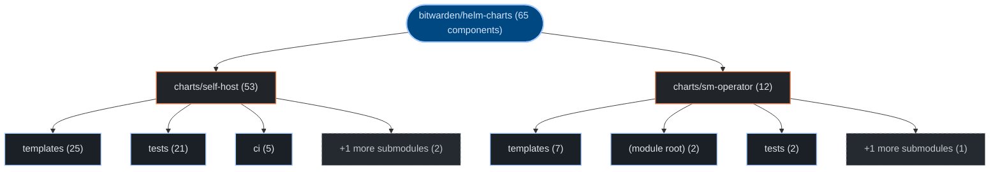
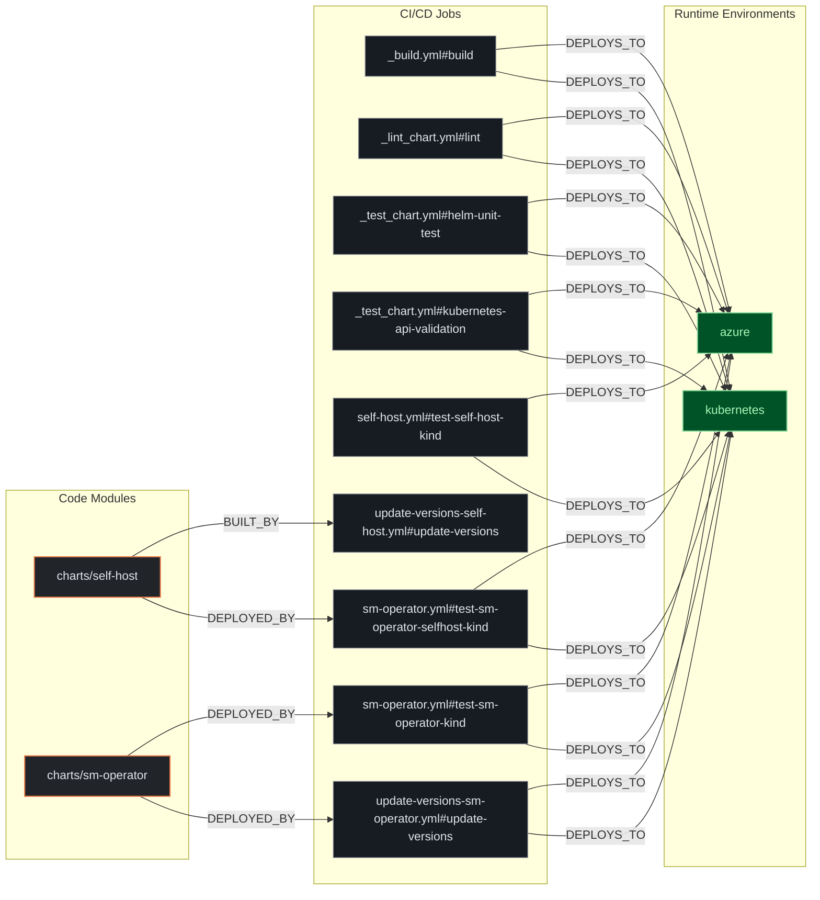

# Repository Architecture Analysis: bitwarden/helm-charts

## Metadata
- **SHA**: `948dd179794ae669bb7ee0460dd50803d617bd62`
- **Primary Ecosystem**: Container / Helm / IaC

## Quality Metrics
- **ast_engine**: fallback
- **avg_cognitive_complexity**: 0.0
- **avg_cyclomatic_complexity**: 0.0
- **component_count**: 65
- **dead_code_count**: 0
- **dead_code_symbols**: 0 entry(ies)
- **duplication_pct**: 0.0
- **file_complexities**: 0 entry(ies)
- **files_analyzed**: 65
- **fitness_passed**: True
- **fitness_violation_count**: 0
- **framework**: Helm Chart
- **import_edges**: 0 entry(ies)
- **loc**: 9797
- **max_cognitive_complexity**: 0
- **max_cyclomatic_complexity**: 0
- **sloc**: 8609
- **test_file_count**: 23

# Architecture: bitwarden/helm-charts

## Context
- **Repository**: `bitwarden/helm-charts`
- **SHA**: `948dd179794ae669bb7ee0460dd50803d617bd62`
- **Ecosystem**: Container / Helm / IaC
- **Framework**: Helm Chart

## Building Block View

## Component Details

Showing top 60 representative components out of 65 across 2 module group(s):

- **Module `charts/self-host`** (53 components — module: 53)
- **Module `charts/sm-operator`** (12 components — module: 12)

- **Chart** (`charts/self-host/Chart.yaml`): module
- **Chart** (`charts/sm-operator/Chart.yaml`): module
- **admin** (`charts/self-host/templates/admin.yaml`): module
- **api** (`charts/self-host/templates/api.yaml`): module
- **attachments** (`charts/self-host/templates/attachments.yaml`): module
- **bitwardensecret-crd** (`charts/sm-operator/templates/bitwardensecret-crd.yaml`): module
- **bitwardensecret_crd_test** (`charts/sm-operator/tests/bitwardensecret_crd_test.yaml`): module
- **ca_certificates_test** (`charts/self-host/tests/ca_certificates_test.yaml`): module
- **component_extras_test** (`charts/self-host/tests/component_extras_test.yaml`): module
- **component_image_test** (`charts/self-host/tests/component_image_test.yaml`): module
- **configMap** (`charts/sm-operator/templates/configMap.yaml`): module
- **configmap_test** (`charts/self-host/tests/configmap_test.yaml`): module
- **configmap_test** (`charts/sm-operator/tests/configmap_test.yaml`): module
- **deployment** (`charts/sm-operator/templates/deployment.yaml`): module
- **distributed_cache_test** (`charts/self-host/tests/distributed_cache_test.yaml`): module
- **dns_config_test** (`charts/self-host/tests/dns_config_test.yaml`): module
- **events** (`charts/self-host/templates/events.yaml`): module
- **hook_extras_test** (`charts/self-host/tests/hook_extras_test.yaml`): module
- **httproute** (`charts/self-host/templates/httproute.yaml`): module
- **httproute_test** (`charts/self-host/tests/httproute_test.yaml`): module
- **icons** (`charts/self-host/templates/icons.yaml`): module
- **identity** (`charts/self-host/templates/identity.yaml`): module
- **image_pull_secrets_test** (`charts/self-host/tests/image_pull_secrets_test.yaml`): module
- **ingress** (`charts/self-host/templates/ingress.yaml`): module
- **ingress_test** (`charts/self-host/tests/ingress_test.yaml`): module
- **leader-election-rbac** (`charts/sm-operator/templates/leader-election-rbac.yaml`): module
- **manager-rbac** (`charts/sm-operator/templates/manager-rbac.yaml`): module
- **metrics-service** (`charts/sm-operator/templates/metrics-service.yaml`): module
- **mssql** (`charts/self-host/templates/mssql.yaml`): module
- **notifications** (`charts/self-host/templates/notifications.yaml`): module
- **post-delete-hook** (`charts/self-host/templates/post-delete-hook.yaml`): module
- **post-install-db-migrator-job** (`charts/self-host/templates/post-install-db-migrator-job.yaml`): module
- **post-install-raw-manifests** (`charts/self-host/templates/post-install-raw-manifests.yaml`): module
- **post_install_db_migrator_test** (`charts/self-host/tests/post_install_db_migrator_test.yaml`): module
- **pre-install-db-migrator-job** (`charts/self-host/templates/pre-install-db-migrator-job.yaml`): module
- **pre-install-hook-configmap** (`charts/self-host/templates/pre-install-hook-configmap.yaml`): module
- **pre-install-job** (`charts/self-host/templates/pre-install-job.yaml`): module
- **pre-install-raw-manifests** (`charts/self-host/templates/pre-install-raw-manifests.yaml`): module
- **pre-install-secret-keys** (`charts/self-host/templates/pre-install-secret-keys.yaml`): module
- **pre-install-secret-sql** (`charts/self-host/templates/pre-install-secret-sql.yaml`): module
- **pre-install-service-acc** (`charts/self-host/templates/pre-install-service-acc.yaml`): module
- **pre_install_db_migrator_test** (`charts/self-host/tests/pre_install_db_migrator_test.yaml`): module
- **pre_install_job_test** (`charts/self-host/tests/pre_install_job_test.yaml`): module
- **probe_timing_test** (`charts/self-host/tests/probe_timing_test.yaml`): module
- **raw_manifests_test** (`charts/self-host/tests/raw_manifests_test.yaml`): module
- **scaling_test** (`charts/self-host/tests/scaling_test.yaml`): module
- **scim** (`charts/self-host/templates/scim.yaml`): module
- **secret_csi_test** (`charts/self-host/tests/secret_csi_test.yaml`): module
- **secrets_custom_test** (`charts/self-host/tests/secrets_custom_test.yaml`): module
- **security_context_test** (`charts/self-host/tests/security_context_test.yaml`): module
- **serviceaccount** (`charts/sm-operator/templates/serviceaccount.yaml`): module
- **sso** (`charts/self-host/templates/sso.yaml`): module
- **test-byos-values** (`charts/self-host/ci/test-byos-values.yaml`): module
- **test-gateway-values** (`charts/self-host/ci/test-gateway-values.yaml`): module
- **test-postgres-values** (`charts/self-host/ci/test-postgres-values.yaml`): module
- **test-restricted-values** (`charts/self-host/ci/test-restricted-values.yaml`): module
- **test-values** (`charts/self-host/ci/test-values.yaml`): module
- **test-values** (`charts/sm-operator/ci/test-values.yaml`): module
- **values** (`charts/self-host/values.yaml`): module
- **values** (`charts/sm-operator/values.yaml`): module

## 6-Dimension Repository Scorecard

- **Overall Grade**: `F` (59.00/100)
- **Technical Debt Score**: 41.00
- **Estimated Remediation Effort**: 71.75h

| Dimension | Grade | Score | Weight | Details |
| :--- | :---: | :---: | :---: | :--- |
| Code Quality | `A` | 100.00 | 0.20 | avg_cc=0.00, max_cc=0, duplication=0.00%, dead_code=0 |
| Dependency Health | `A` | 90.00 | 0.15 | dependencies=0 (no manifests parsed) |
| Maintainability | `A` | 100.00 | 0.15 | avg_cognitive=0.00, max_cognitive=0, fitness_violations=0, oversized_files=0 |
| Pipeline Health | `F` | 0.00 | 0.15 | workflows=13, operational_antipatterns=39, parallel_branches=True |
| Security | `F` | 0.00 | 0.20 | vulnerabilities=0, secrets=0, pipeline_security_findings=17 |
| Test Coverage | `C` | 70.00 | 0.15 | coverage=unavailable, ci_test_job=True, test_files_detected=True |

## Section 7: Code-to-Cloud Deployment Traceability

- `_build.yml#build` (ci_job) --[DEPLOYS_TO]--> `azure` (environment)
- `_build.yml#build` (ci_job) --[DEPLOYS_TO]--> `kubernetes` (environment)
- `_lint_chart.yml#lint` (ci_job) --[DEPLOYS_TO]--> `azure` (environment)
- `_lint_chart.yml#lint` (ci_job) --[DEPLOYS_TO]--> `kubernetes` (environment)
- `_test_chart.yml#helm-unit-test` (ci_job) --[DEPLOYS_TO]--> `azure` (environment)
- `_test_chart.yml#helm-unit-test` (ci_job) --[DEPLOYS_TO]--> `kubernetes` (environment)
- `_test_chart.yml#kubernetes-api-validation` (ci_job) --[DEPLOYS_TO]--> `azure` (environment)
- `_test_chart.yml#kubernetes-api-validation` (ci_job) --[DEPLOYS_TO]--> `kubernetes` (environment)
- `self-host.yml#test-self-host-kind` (ci_job) --[DEPLOYS_TO]--> `azure` (environment)
- `self-host.yml#test-self-host-kind` (ci_job) --[DEPLOYS_TO]--> `kubernetes` (environment)
- `sm-operator.yml#test-sm-operator-kind` (ci_job) --[DEPLOYS_TO]--> `azure` (environment)
- `sm-operator.yml#test-sm-operator-kind` (ci_job) --[DEPLOYS_TO]--> `kubernetes` (environment)
- `sm-operator.yml#test-sm-operator-selfhost-kind` (ci_job) --[DEPLOYS_TO]--> `azure` (environment)
- `sm-operator.yml#test-sm-operator-selfhost-kind` (ci_job) --[DEPLOYS_TO]--> `kubernetes` (environment)
- `update-versions-sm-operator.yml#update-versions` (ci_job) --[DEPLOYS_TO]--> `azure` (environment)
- `update-versions-sm-operator.yml#update-versions` (ci_job) --[DEPLOYS_TO]--> `kubernetes` (environment)
- `charts/self-host` (code_module) --[BUILT_BY]--> `update-versions-self-host.yml#update-versions` (ci_job)
- `charts/self-host` (code_module) --[DEPLOYED_BY]--> `sm-operator.yml#test-sm-operator-selfhost-kind` (ci_job)
- `charts/sm-operator` (code_module) --[DEPLOYED_BY]--> `sm-operator.yml#test-sm-operator-kind` (ci_job)
- `charts/sm-operator` (code_module) --[DEPLOYED_BY]--> `update-versions-sm-operator.yml#update-versions` (ci_job)

## CI/CD Pipeline Topology

```mermaid
graph TD;
  classDef atlasRoot fill:#004882,stroke:#a3c9ff,stroke-width:2px,color:#d3e4ff
  classDef atlasCategory fill:#212428,stroke:#E87A48,stroke-width:1.5px,color:#dfe3eb
  classDef atlasWorkflow fill:#1b2026,stroke:#a3c9ff,stroke-width:1.5px,color:#dfe3eb
  classDef atlasJob fill:#171c22,stroke:#8d9199,stroke-width:1px,color:#dfe3eb
  classDef atlasTarget fill:#005227,stroke:#8bd99b,stroke-width:1.5px,color:#a7f6b6
  classDef atlasAlert fill:#93000a,stroke:#ffb4ab,stroke-width:1.5px,color:#ffdad6
  classDef atlasMore fill:#252a31,stroke:#8d9199,stroke-dasharray:4 4,color:#c3c6cf
  pipeline_root(["bitwarden/helm-charts (13 workflows)"]):::atlasRoot
  grp_0_CI___Verification["CI & Verification (8 workflows · 14 jobs)"]:::atlasCategory
  pipeline_root --> grp_0_CI___Verification
  wf_2__test["_test (2 jobs)"]:::atlasWorkflow
  grp_0_CI___Verification --> wf_2__test
  job_2_kubernetes_api_validation["kubernetes-api-validation"]:::atlasJob
  job_2_helm_unit_test["helm-unit-test"]:::atlasJob
  wf_2__test --> job_2_kubernetes_api_validation
  wf_2__test --> job_2_helm_unit_test
  wf_4_CD["CD (4 jobs)"]:::atlasWorkflow
  grp_0_CI___Verification --> wf_4_CD
  job_4_detect["detect"]:::atlasJob
  job_4_version_bump["version-bump"]:::atlasJob
  job_4_wait_for_build["wait-for-build"]:::atlasJob
  wf_4_CD --> job_4_detect
  job_4_detect --> job_4_version_bump
  job_4_detect --> job_4_wait_for_build
  job_4_version_bump --> job_4_wait_for_build
  wf_5_Enforce_PR_labels["Enforce PR labels (2 jobs)"]:::atlasWorkflow
  grp_0_CI___Verification --> wf_5_Enforce_PR_labels
  job_5_enforce_labels["enforce-labels"]:::atlasJob
  job_5_enforce_version_label["enforce-version-label"]:::atlasJob
  wf_5_Enforce_PR_labels --> job_5_enforce_labels
  wf_5_Enforce_PR_labels --> job_5_enforce_version_label
  wf_7_Code_Review["Code Review (1 jobs)"]:::atlasWorkflow
  grp_0_CI___Verification --> wf_7_Code_Review
  job_7_review["review"]:::atlasJob
  wf_7_Code_Review --> job_7_review
  wf_10_Test_Helm_Charts__Fork_PR_["Test Helm Charts (Fork PR) (2 jobs)"]:::atlasWorkflow
  grp_0_CI___Verification --> wf_10_Test_Helm_Charts__Fork_PR_
  job_10_check_run["check-run"]:::atlasJob
  job_10_run_sm_operator_workflow["run-sm-operator-workflow"]:::atlasJob
  wf_10_Test_Helm_Charts__Fork_PR_ --> job_10_check_run
  job_10_check_run --> job_10_run_sm_operator_workflow
  grp_1_Scheduled___Manual["Scheduled & Manual (4 workflows · 11 jobs)"]:::atlasCategory
  pipeline_root --> grp_1_Scheduled___Manual
  wf_8_Self_Host["Self Host (4 jobs)"]:::atlasWorkflow
  grp_1_Scheduled___Manual --> wf_8_Self_Host
  job_8_lint_self_host["lint-self-host"]:::atlasJob
  job_8_test_self_host["test-self-host"]:::atlasJob
  job_8_test_self_host_kind["test-self-host-kind"]:::atlasJob
  wf_8_Self_Host --> job_8_lint_self_host
  wf_8_Self_Host --> job_8_test_self_host
  wf_8_Self_Host --> job_8_test_self_host_kind
  wf_9_SM_Operator["SM Operator (5 jobs)"]:::atlasWorkflow
  grp_1_Scheduled___Manual --> wf_9_SM_Operator
  job_9_lint_sm_operator["lint-sm-operator"]:::atlasJob
  job_9_test_sm_operator["test-sm-operator"]:::atlasJob
  job_9_test_sm_operator_kind["test-sm-operator-kind"]:::atlasJob
  wf_9_SM_Operator --> job_9_lint_sm_operator
  wf_9_SM_Operator --> job_9_test_sm_operator
  wf_9_SM_Operator --> job_9_test_sm_operator_kind
  wf_11_Update_Versions___Self_Host["Update Versions - Self Host (1 jobs)"]:::atlasWorkflow
  grp_1_Scheduled___Manual --> wf_11_Update_Versions___Self_Host
  wf_12_Update_Versions___SM_Operator["Update Versions - SM Operator (1 jobs)"]:::atlasWorkflow
  grp_1_Scheduled___Manual --> wf_12_Update_Versions___SM_Operator
  grp_2_Automation___Other["Automation & Other (1 workflows · 1 jobs)"]:::atlasCategory
  pipeline_root --> grp_2_Automation___Other
  wf_3__version_bump["_version-bump (1 jobs)"]:::atlasWorkflow
  grp_2_Automation___Other --> wf_3__version_bump
  wf_more["+3 more workflows"]:::atlasMore
  pipeline_root --> wf_more
```

