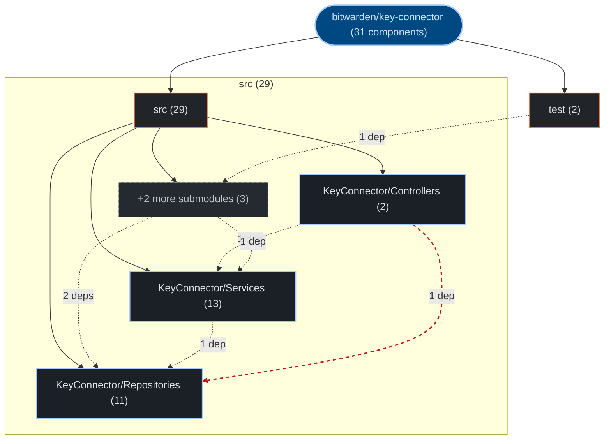
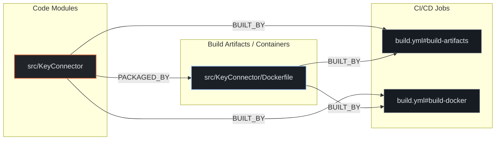
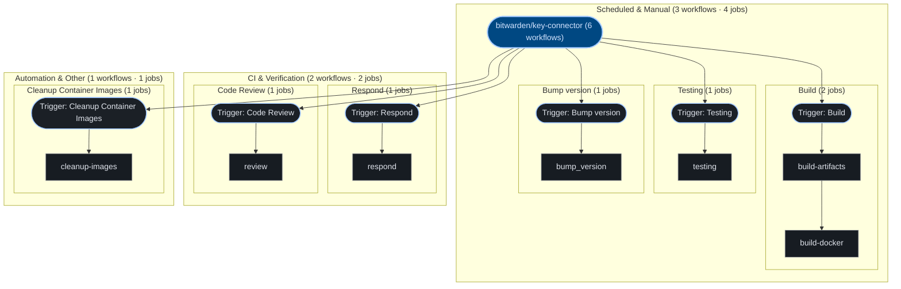

# Repository Architecture Analysis: bitwarden/key-connector

## Metadata
- **SHA**: `a41978a24fb9ebaf357ca13c4b525e46d103b574`
- **Primary Ecosystem**: .NET

## Quality Metrics
- **ast_engine**: tree-sitter
- **avg_cognitive_complexity**: 0.38
- **avg_cyclomatic_complexity**: 1.33
- **component_count**: 31
- **dead_code_count**: 16
- **dead_code_symbols**: 16 entry(ies)
- **duplication_pct**: 80.0
- **file_complexities**: 25 entry(ies)
- **files_analyzed**: 81
- **fitness_passed**: False
- **fitness_violation_count**: 22
- **framework**: ASP.NET Core
- **import_edges**: 100 entry(ies)
- **loc**: 5453
- **max_cognitive_complexity**: 16
- **max_cyclomatic_complexity**: 13
- **sloc**: 4590
- **test_file_count**: 20

# Architecture: bitwarden/key-connector

## Context
- **Repository**: `bitwarden/key-connector`
- **SHA**: `a41978a24fb9ebaf357ca13c4b525e46d103b574`
- **Ecosystem**: .NET
- **Framework**: ASP.NET Core

## Building Block View

## Component Details
- **KeyConnector** (`src/KeyConnector/KeyConnector.csproj`): MODULE
- **KeyConnector.Tests** (`test/KeyConnector.Tests/KeyConnector.Tests.csproj`): MODULE (deps: KeyConnector)
- **MiscController** (`src/KeyConnector/Controllers/MiscController.cs`): API_ROUTE
- **UserKeysController** (`src/KeyConnector/Controllers/UserKeysController.cs`): API_ROUTE (deps: CryptoService, UserKeyRepository)
- **DatabaseMigrationHostedService** (`src/KeyConnector/HostedServices/DatabaseMigrationHostedService.cs`): SERVICE (deps: DatabaseContext)
- **TransferToHostedService** (`src/KeyConnector/HostedServices/TransferToHostedService.cs`): SERVICE (deps: CryptoService, UserKeyRepository)
- **ApplicationDataRepository** (`src/KeyConnector/Repositories/EntityFramework/ApplicationDataRepository.cs`): DATA_ACCESS_LAYER (deps: BaseRepository)
- **BaseRepository** (`src/KeyConnector/Repositories/EntityFramework/BaseRepository.cs`): DATA_ACCESS_LAYER (deps: DatabaseContext)
- **DatabaseContext** (`src/KeyConnector/Repositories/EntityFramework/DatabaseContext.cs`): DATA_ACCESS_LAYER
- **SqlServerDatabaseContextFactory** (`src/KeyConnector/Repositories/EntityFramework/DatabaseContextFactory.cs`): DATA_ACCESS_LAYER (deps: MySqlDatabaseContextFactory, PostgreSqlDatabaseContextFactory, SqliteDatabaseContextFactory)
- **PostgreSqlDatabaseContextFactory** (`src/KeyConnector/Repositories/EntityFramework/DatabaseContextFactory.cs`): DATA_ACCESS_LAYER (deps: MySqlDatabaseContextFactory, SqlServerDatabaseContextFactory, SqliteDatabaseContextFactory)
- **MySqlDatabaseContextFactory** (`src/KeyConnector/Repositories/EntityFramework/DatabaseContextFactory.cs`): DATA_ACCESS_LAYER (deps: PostgreSqlDatabaseContextFactory, SqlServerDatabaseContextFactory, SqliteDatabaseContextFactory)
- **SqliteDatabaseContextFactory** (`src/KeyConnector/Repositories/EntityFramework/DatabaseContextFactory.cs`): DATA_ACCESS_LAYER (deps: MySqlDatabaseContextFactory, PostgreSqlDatabaseContextFactory, SqlServerDatabaseContextFactory)
- **UserKeyRepository** (`src/KeyConnector/Repositories/EntityFramework/UserKeyRepository.cs`): DATA_ACCESS_LAYER (deps: BaseRepository)
- **ApplicationDataRepository** (`src/KeyConnector/Repositories/JsonFile/ApplicationDataRepository.cs`): DATA_ACCESS_LAYER
- **Repository** (`src/KeyConnector/Repositories/JsonFile/Repository.cs`): DATA_ACCESS_LAYER
- **UserKeyRepository** (`src/KeyConnector/Repositories/JsonFile/UserKeyRepository.cs`): DATA_ACCESS_LAYER (deps: Repository)
- **AzureKeyVaultCertificateProviderService** (`src/KeyConnector/Services/CertificateProviders/AzureKeyVaultCertificateProviderService.cs`): SERVICE
- **AzureStorageCertificateProviderService** (`src/KeyConnector/Services/CertificateProviders/AzureStorageCertificateProviderService.cs`): SERVICE
- **FilesystemCertificateProviderService** (`src/KeyConnector/Services/CertificateProviders/FilesystemCertificateProviderService.cs`): SERVICE
- **HashicorpVaultCertificateProviderService** (`src/KeyConnector/Services/CertificateProviders/HashicorpVaultCertificateProviderService.cs`): SERVICE
- **StoreCertificateProviderService** (`src/KeyConnector/Services/CertificateProviders/StoreCertificateProviderService.cs`): SERVICE
- **CryptoFunctionService** (`src/KeyConnector/Services/Crypto/CryptoFunctionService.cs`): SERVICE
- **CryptoService** (`src/KeyConnector/Services/Crypto/CryptoService.cs`): SERVICE (deps: ApplicationDataRepository, CryptoFunctionService)
- **AwsKmsRsaKeyService** (`src/KeyConnector/Services/RsaKey/AwsKmsRsaKeyService.cs`): SERVICE
- **AzureKeyVaultRsaKeyService** (`src/KeyConnector/Services/RsaKey/AzureKeyVaultRsaKeyService.cs`): SERVICE
- **GoogleCloudKmsRsaKeyService** (`src/KeyConnector/Services/RsaKey/GoogleCloudKmsRsaKeyService.cs`): SERVICE
- **LocalCertificateRsaKeyService** (`src/KeyConnector/Services/RsaKey/LocalCertificateRsaKeyService.cs`): SERVICE (deps: CryptoFunctionService)
- **Pkcs11RsaKeyService** (`src/KeyConnector/Services/RsaKey/Pkcs11RsaKeyService.cs`): SERVICE (deps: CryptoFunctionService)
- **RsaHealthCheckService** (`src/KeyConnector/Services/RsaKey/RsaHealthCheckService.cs`): SERVICE
- **MockOidcHandler** (`test/KeyConnector.Tests/Helpers/JwtTestHelper.cs`): SERVICE

## 6-Dimension Repository Scorecard

- **Overall Grade**: `F` (43.40/100)
- **Technical Debt Score**: 56.60
- **Estimated Remediation Effort**: 126.65h

| Dimension | Grade | Score | Weight | Details |
| :--- | :---: | :---: | :---: | :--- |
| Code Quality | `F` | 55.00 | 0.20 | avg_cc=1.33, max_cc=13, duplication=80.00%, dead_code=16 |
| Dependency Health | `B` | 85.00 | 0.15 | dependencies=32, outdated=0, vulnerable=0, has_lockfile=False |
| Maintainability | `F` | 0.00 | 0.15 | avg_cognitive=0.38, max_cognitive=16, fitness_violations=22, oversized_files=1 |
| Pipeline Health | `D` | 61.00 | 0.15 | workflows=6, operational_antipatterns=9, parallel_branches=False |
| Security | `F` | 0.00 | 0.20 | vulnerabilities=0, secrets=8, pipeline_security_findings=10 |
| Test Coverage | `C` | 70.00 | 0.15 | coverage=unavailable, ci_test_job=True, test_files_detected=True |

## Architecture Fitness & Workspace Boundaries

- **[HIGH] `ATRUSS-ARCH-001` (LAYER_VIOLATION)**: API_ROUTE cannot directly import DATA_ACCESS_LAYER when SERVICE components exist. (UserKeysController -> UserKeyRepository)
- **[HIGH] `ATRUSS-ARCH-004` (CIRCULAR_DEPENDENCY)**: Circular dependency detected between architectural components. (MySqlDatabaseContextFactory -> PostgreSqlDatabaseContextFactory -> MySqlDatabaseContextFactory)
- **[HIGH] `ATRUSS-ARCH-004` (CIRCULAR_DEPENDENCY)**: Circular dependency detected between architectural components. (MySqlDatabaseContextFactory -> PostgreSqlDatabaseContextFactory -> SqlServerDatabaseContextFactory -> MySqlDatabaseContextFactory)
- **[HIGH] `ATRUSS-ARCH-004` (CIRCULAR_DEPENDENCY)**: Circular dependency detected between architectural components. (MySqlDatabaseContextFactory -> PostgreSqlDatabaseContextFactory -> SqlServerDatabaseContextFactory -> SqliteDatabaseContextFactory -> MySqlDatabaseContextFactory)
- **[HIGH] `ATRUSS-ARCH-004` (CIRCULAR_DEPENDENCY)**: Circular dependency detected between architectural components. (MySqlDatabaseContextFactory -> PostgreSqlDatabaseContextFactory -> SqliteDatabaseContextFactory -> MySqlDatabaseContextFactory)
- **[HIGH] `ATRUSS-ARCH-004` (CIRCULAR_DEPENDENCY)**: Circular dependency detected between architectural components. (MySqlDatabaseContextFactory -> PostgreSqlDatabaseContextFactory -> SqliteDatabaseContextFactory -> SqlServerDatabaseContextFactory -> MySqlDatabaseContextFactory)
- **[HIGH] `ATRUSS-ARCH-004` (CIRCULAR_DEPENDENCY)**: Circular dependency detected between architectural components. (MySqlDatabaseContextFactory -> SqlServerDatabaseContextFactory -> MySqlDatabaseContextFactory)
- **[HIGH] `ATRUSS-ARCH-004` (CIRCULAR_DEPENDENCY)**: Circular dependency detected between architectural components. (MySqlDatabaseContextFactory -> SqlServerDatabaseContextFactory -> PostgreSqlDatabaseContextFactory -> MySqlDatabaseContextFactory)
- **[HIGH] `ATRUSS-ARCH-004` (CIRCULAR_DEPENDENCY)**: Circular dependency detected between architectural components. (MySqlDatabaseContextFactory -> SqlServerDatabaseContextFactory -> PostgreSqlDatabaseContextFactory -> SqliteDatabaseContextFactory -> MySqlDatabaseContextFactory)
- **[HIGH] `ATRUSS-ARCH-004` (CIRCULAR_DEPENDENCY)**: Circular dependency detected between architectural components. (MySqlDatabaseContextFactory -> SqlServerDatabaseContextFactory -> SqliteDatabaseContextFactory -> MySqlDatabaseContextFactory)
- **[HIGH] `ATRUSS-ARCH-004` (CIRCULAR_DEPENDENCY)**: Circular dependency detected between architectural components. (MySqlDatabaseContextFactory -> SqlServerDatabaseContextFactory -> SqliteDatabaseContextFactory -> PostgreSqlDatabaseContextFactory -> MySqlDatabaseContextFactory)
- **[HIGH] `ATRUSS-ARCH-004` (CIRCULAR_DEPENDENCY)**: Circular dependency detected between architectural components. (MySqlDatabaseContextFactory -> SqliteDatabaseContextFactory -> MySqlDatabaseContextFactory)
- **[HIGH] `ATRUSS-ARCH-004` (CIRCULAR_DEPENDENCY)**: Circular dependency detected between architectural components. (MySqlDatabaseContextFactory -> SqliteDatabaseContextFactory -> PostgreSqlDatabaseContextFactory -> MySqlDatabaseContextFactory)
- **[HIGH] `ATRUSS-ARCH-004` (CIRCULAR_DEPENDENCY)**: Circular dependency detected between architectural components. (MySqlDatabaseContextFactory -> SqliteDatabaseContextFactory -> PostgreSqlDatabaseContextFactory -> SqlServerDatabaseContextFactory -> MySqlDatabaseContextFactory)
- **[HIGH] `ATRUSS-ARCH-004` (CIRCULAR_DEPENDENCY)**: Circular dependency detected between architectural components. (MySqlDatabaseContextFactory -> SqliteDatabaseContextFactory -> SqlServerDatabaseContextFactory -> MySqlDatabaseContextFactory)
- **[HIGH] `ATRUSS-ARCH-004` (CIRCULAR_DEPENDENCY)**: Circular dependency detected between architectural components. (MySqlDatabaseContextFactory -> SqliteDatabaseContextFactory -> SqlServerDatabaseContextFactory -> PostgreSqlDatabaseContextFactory -> MySqlDatabaseContextFactory)
- **[HIGH] `ATRUSS-ARCH-004` (CIRCULAR_DEPENDENCY)**: Circular dependency detected between architectural components. (PostgreSqlDatabaseContextFactory -> SqlServerDatabaseContextFactory -> PostgreSqlDatabaseContextFactory)
- **[HIGH] `ATRUSS-ARCH-004` (CIRCULAR_DEPENDENCY)**: Circular dependency detected between architectural components. (PostgreSqlDatabaseContextFactory -> SqlServerDatabaseContextFactory -> SqliteDatabaseContextFactory -> PostgreSqlDatabaseContextFactory)
- **[HIGH] `ATRUSS-ARCH-004` (CIRCULAR_DEPENDENCY)**: Circular dependency detected between architectural components. (PostgreSqlDatabaseContextFactory -> SqliteDatabaseContextFactory -> PostgreSqlDatabaseContextFactory)
- **[HIGH] `ATRUSS-ARCH-004` (CIRCULAR_DEPENDENCY)**: Circular dependency detected between architectural components. (PostgreSqlDatabaseContextFactory -> SqliteDatabaseContextFactory -> SqlServerDatabaseContextFactory -> PostgreSqlDatabaseContextFactory)
- **[HIGH] `ATRUSS-ARCH-004` (CIRCULAR_DEPENDENCY)**: Circular dependency detected between architectural components. (SqlServerDatabaseContextFactory -> SqliteDatabaseContextFactory -> SqlServerDatabaseContextFactory)
- **[MEDIUM] `ATRUSS-ARCH-005` (COMPLEXITY_THRESHOLD)**: Repository duplication_pct (80.0) exceeds policy threshold (15.0).

## Supply Chain Dependencies, Vulnerabilities & Secrets

- **Dependencies Parsed**: 32 | **Vulnerabilities**: 0 | **Secrets**: 8

### Secret Findings (Redacted)
- **[HIGH] `ATRUSS-SEC-005`** at `test/KeyConnector.Tests/Controllers/UserKeysControllerAuthIntegrationTests.cs:20` (`private const string _testKey = "dGVz***REDACTED***";`)
- **[HIGH] `ATRUSS-SEC-005`** at `test/KeyConnector.Tests/Controllers/UserKeysControllerIntegrationTests.cs:18` (`private const string _testKey = "dGVz***REDACTED***";`)
- **[HIGH] `ATRUSS-SEC-005`** at `test/KeyConnector.Tests/Controllers/UserKeysControllerIntegrationTests.cs:19` (`private const string _testUpdatedKey = "dGVz***REDACTED***";`)
- **[HIGH] `ATRUSS-SEC-005`** at `test/KeyConnector.Tests/Controllers/UserKeysControllerTests.cs:20` (`private const string _testEncryptedKey = "frh6***REDACTED***";`)
- **[HIGH] `ATRUSS-SEC-005`** at `test/KeyConnector.Tests/Controllers/UserKeysControllerTests.cs:21` (`private const string _testUpdatedEncryptedKey = "JrxB***REDACTED***";`)
- **[HIGH] `ATRUSS-SEC-005`** at `test/KeyConnector.Tests/Controllers/UserKeysControllerTests.cs:22` (`private const string _testKey = "dGVz***REDACTED***";`)
- **[HIGH] `ATRUSS-SEC-005`** at `test/KeyConnector.Tests/Controllers/UserKeysControllerTests.cs:23` (`private const string _testUpdatedKey = "dGVz***REDACTED***";`)
- **[CRITICAL] `ATRUSS-SEC-004`** at `test/KeyConnector.Tests/Resources/test-jwt-signing-key.pem:1` (`-----BEGIN ... PRIVATE KEY----- [REDACTED]`)

### Inventory Sample
- `AWSSDK.KeyManagementService` `3.7.2.6` (NuGet, `src/KeyConnector/KeyConnector.csproj`)
- `Azure.Identity` `1.11.4` (NuGet, `src/KeyConnector/KeyConnector.csproj`)
- `Azure.Security.KeyVault.Certificates` `4.5.1` (NuGet, `src/KeyConnector/KeyConnector.csproj`)
- `Azure.Security.KeyVault.Keys` `4.5.0` (NuGet, `src/KeyConnector/KeyConnector.csproj`)
- `Azure.Security.KeyVault.Secrets` `4.5.0` (NuGet, `src/KeyConnector/KeyConnector.csproj`)
- `Azure.Storage.Blobs` `12.19.1` (NuGet, `src/KeyConnector/KeyConnector.csproj`)
- `Google.Cloud.Kms.V1` `3.7.0` (NuGet, `src/KeyConnector/KeyConnector.csproj`)
- `JsonFlatFileDataStore` `2.4.2` (NuGet, `src/KeyConnector/KeyConnector.csproj`)
- `Microsoft.AspNetCore.Authentication.JwtBearer` `10.0.8` (NuGet, `src/KeyConnector/KeyConnector.csproj`)
- `Microsoft.AspNetCore.Authentication.JwtBearer` `10.0.8` (NuGet, `test/KeyConnector.Tests/KeyConnector.Tests.csproj`)
- `Microsoft.AspNetCore.Mvc.Testing` `10.0.8` (NuGet, `test/KeyConnector.Tests/KeyConnector.Tests.csproj`)
- `Microsoft.EntityFrameworkCore.Design` `8.0.27` (NuGet, `src/KeyConnector/KeyConnector.csproj`)
- `Microsoft.EntityFrameworkCore.Relational` `8.0.27` (NuGet, `src/KeyConnector/KeyConnector.csproj`)
- `Microsoft.EntityFrameworkCore.SqlServer` `8.0.27` (NuGet, `src/KeyConnector/KeyConnector.csproj`)
- `Microsoft.EntityFrameworkCore.Sqlite` `8.0.27` (NuGet, `src/KeyConnector/KeyConnector.csproj`)
- `Microsoft.NET.Test.Sdk` `18.6.0` (NuGet, `test/KeyConnector.Tests/KeyConnector.Tests.csproj`)
- `NSubstitute` `5.3.0` (NuGet, `test/KeyConnector.Tests/KeyConnector.Tests.csproj`)
- `Npgsql.EntityFrameworkCore.PostgreSQL` `8.0.11` (NuGet, `src/KeyConnector/KeyConnector.csproj`)
- `Pkcs11Interop` `5.1.2` (NuGet, `src/KeyConnector/KeyConnector.csproj`)
- `Pomelo.EntityFrameworkCore.MySql` `8.0.3` (NuGet, `src/KeyConnector/KeyConnector.csproj`)
- `Serilog.AspNetCore` `10.0.0` (NuGet, `src/KeyConnector/KeyConnector.csproj`)
- `Serilog.Settings.Configuration` `10.0.0` (NuGet, `src/KeyConnector/KeyConnector.csproj`)
- `Serilog.Sinks.Console` `6.1.1` (NuGet, `src/KeyConnector/KeyConnector.csproj`)
- `Serilog.Sinks.File` `7.0.0` (NuGet, `src/KeyConnector/KeyConnector.csproj`)
- `Testcontainers.MariaDb` `4.12.0` (NuGet, `test/KeyConnector.Tests/KeyConnector.Tests.csproj`)
- `Testcontainers.MsSql` `4.12.0` (NuGet, `test/KeyConnector.Tests/KeyConnector.Tests.csproj`)
- `Testcontainers.MySql` `4.12.0` (NuGet, `test/KeyConnector.Tests/KeyConnector.Tests.csproj`)
- `Testcontainers.PostgreSql` `4.12.0` (NuGet, `test/KeyConnector.Tests/KeyConnector.Tests.csproj`)
- `VaultSharp` `1.7.0` (NuGet, `src/KeyConnector/KeyConnector.csproj`)
- `coverlet.collector` `10.0.1` (NuGet, `test/KeyConnector.Tests/KeyConnector.Tests.csproj`)
- ... (+2 more dependencies)

## Section 7: Code-to-Cloud Deployment Traceability

- `src/KeyConnector` (code_module) --[BUILT_BY]--> `build.yml#build-artifacts` (ci_job)
- `src/KeyConnector` (code_module) --[BUILT_BY]--> `build.yml#build-docker` (ci_job)
- `src/KeyConnector` (code_module) --[PACKAGED_BY]--> `src/KeyConnector/Dockerfile` (container)
- `src/KeyConnector/Dockerfile` (container) --[BUILT_BY]--> `build.yml#build-artifacts` (ci_job)
- `src/KeyConnector/Dockerfile` (container) --[BUILT_BY]--> `build.yml#build-docker` (ci_job)

## CI/CD Pipeline Topology

