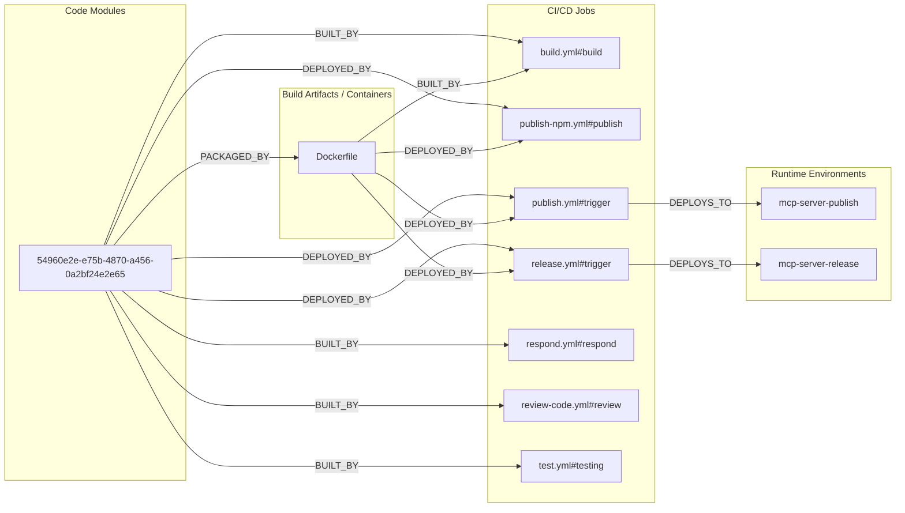
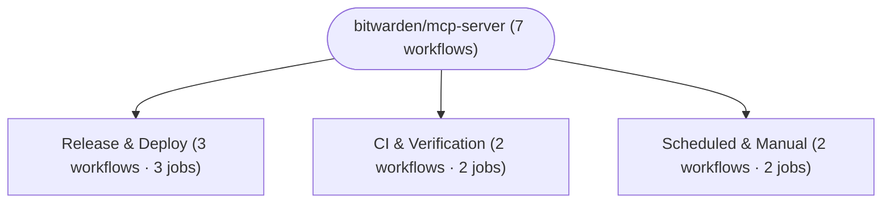

# Repository Architecture Analysis: bitwarden/mcp-server

## Metadata
- **SHA**: `5420d90269e455be16804dc77a28288a652e8374`
- **Primary Ecosystem**: JavaScript/TypeScript

## Quality Metrics
- **ast_engine**: tree-sitter
- **avg_cognitive_complexity**: 5.95
- **avg_cyclomatic_complexity**: 6.64
- **component_count**: 1
- **dead_code_count**: 0
- **dead_code_symbols**: 0 entry(ies)
- **duplication_pct**: 92.3
- **file_complexities**: 25 entry(ies)
- **files_analyzed**: 31
- **fitness_passed**: False
- **fitness_violation_count**: 3
- **framework**: TypeScript
- **import_edges**: 100 entry(ies)
- **loc**: 14215
- **max_cognitive_complexity**: 148
- **max_cyclomatic_complexity**: 148
- **sloc**: 11621
- **test_file_count**: 11

# Architecture: bitwarden/mcp-server

## Context
- **Repository**: `bitwarden/mcp-server`
- **SHA**: `5420d90269e455be16804dc77a28288a652e8374`
- **Ecosystem**: JavaScript/TypeScript
- **Framework**: TypeScript

## Building Block View

## Component Details
- **@bitwarden/mcp-server** (`package.json`): MODULE

## 6-Dimension Repository Scorecard

- **Overall Grade**: `F` (44.11/100)
- **Technical Debt Score**: 55.89
- **Estimated Remediation Effort**: 71.93h

| Dimension | Grade | Score | Weight | Details |
| :--- | :---: | :---: | :---: | :--- |
| Code Quality | `F` | 35.44 | 0.20 | avg_cc=6.64, max_cc=148, duplication=92.30%, dead_code=0 |
| Dependency Health | `A` | 100.00 | 0.15 | dependencies=724, outdated=0, vulnerable=0, has_lockfile=True |
| Maintainability | `F` | 34.15 | 0.15 | avg_cognitive=5.95, max_cognitive=148, fitness_violations=3, oversized_files=9 |
| Pipeline Health | `F` | 0.00 | 0.15 | workflows=7, operational_antipatterns=13, parallel_branches=False |
| Security | `F` | 32.00 | 0.20 | vulnerabilities=0, secrets=0, pipeline_security_findings=5 |
| Test Coverage | `C` | 70.00 | 0.15 | coverage=unavailable, ci_test_job=True, test_files_detected=True |

## Architecture Fitness & Workspace Boundaries

- **[MEDIUM] `ATRUSS-ARCH-005` (COMPLEXITY_THRESHOLD)**: Repository duplication_pct (92.3) exceeds policy threshold (15.0).
- **[MEDIUM] `ATRUSS-ARCH-005` (COMPLEXITY_THRESHOLD)**: Repository max_cognitive_complexity (148.0) exceeds policy threshold (25.0).
- **[MEDIUM] `ATRUSS-ARCH-005` (COMPLEXITY_THRESHOLD)**: Repository max_cyclomatic_complexity (148.0) exceeds policy threshold (20.0).

## Supply Chain Dependencies, Vulnerabilities & Secrets

- **Dependencies Parsed**: 724 | **Vulnerabilities**: 0 | **Secrets**: 0

### Inventory Sample
- `@eslint/js` `10.0.1` (npm, `package-lock.json`)
- `@eslint/js` `10.0.1` (npm, `package.json`)
- `@jest/globals` `30.4.1` (npm, `package-lock.json`)
- `@jest/globals` `30.4.1` (npm, `package.json`)
- `@modelcontextprotocol/inspector` `2.8.0` (npm, `package-lock.json`)
- `@modelcontextprotocol/inspector` `2.8.0` (npm, `package.json`)
- `@modelcontextprotocol/sdk` `1.32.0` (npm, `package-lock.json`)
- `@modelcontextprotocol/sdk` `1.32.0` (npm, `package.json`)
- `@types/jest` `30.0.0` (npm, `package-lock.json`)
- `@types/jest` `30.0.0` (npm, `package.json`)
- `@types/node` `24.13.2` (npm, `package-lock.json`)
- `@types/node` `24.13.2` (npm, `package.json`)
- `eslint` `10.6.0` (npm, `package-lock.json`)
- `eslint` `10.6.0` (npm, `package.json`)
- `globals` `17.7.0` (npm, `package-lock.json`)
- `globals` `17.7.0` (npm, `package.json`)
- `husky` `9.1.7` (npm, `package-lock.json`)
- `husky` `9.1.7` (npm, `package.json`)
- `jest` `30.4.2` (npm, `package-lock.json`)
- `jest` `30.4.2` (npm, `package.json`)
- `jest-junit` `17.0.0` (npm, `package-lock.json`)
- `jest-junit` `17.0.0` (npm, `package.json`)
- `lint-staged` `17.0.8` (npm, `package-lock.json`)
- `lint-staged` `17.0.8` (npm, `package.json`)
- `prettier` `3.9.4` (npm, `package-lock.json`)
- `prettier` `3.9.4` (npm, `package.json`)
- `shx` `0.4.0` (npm, `package-lock.json`)
- `shx` `0.4.0` (npm, `package.json`)
- `ts-jest` `29.4.11` (npm, `package-lock.json`)
- `ts-jest` `29.4.11` (npm, `package.json`)
- ... (+694 more dependencies)

## Section 7: Code-to-Cloud Deployment Traceability

- `publish.yml#trigger` (ci_job) --[DEPLOYS_TO]--> `mcp-server-publish` (environment)
- `release.yml#trigger` (ci_job) --[DEPLOYS_TO]--> `mcp-server-release` (environment)
- `54960e2e-e75b-4870-a456-0a2bf24e2e65` (code_module) --[BUILT_BY]--> `build.yml#build` (ci_job)
- `54960e2e-e75b-4870-a456-0a2bf24e2e65` (code_module) --[BUILT_BY]--> `respond.yml#respond` (ci_job)
- `54960e2e-e75b-4870-a456-0a2bf24e2e65` (code_module) --[BUILT_BY]--> `review-code.yml#review` (ci_job)
- `54960e2e-e75b-4870-a456-0a2bf24e2e65` (code_module) --[BUILT_BY]--> `test.yml#testing` (ci_job)
- `54960e2e-e75b-4870-a456-0a2bf24e2e65` (code_module) --[DEPLOYED_BY]--> `publish-npm.yml#publish` (ci_job)
- `54960e2e-e75b-4870-a456-0a2bf24e2e65` (code_module) --[DEPLOYED_BY]--> `publish.yml#trigger` (ci_job)
- `54960e2e-e75b-4870-a456-0a2bf24e2e65` (code_module) --[DEPLOYED_BY]--> `release.yml#trigger` (ci_job)
- `54960e2e-e75b-4870-a456-0a2bf24e2e65` (code_module) --[PACKAGED_BY]--> `Dockerfile` (container)
- `Dockerfile` (container) --[BUILT_BY]--> `build.yml#build` (ci_job)
- `Dockerfile` (container) --[DEPLOYED_BY]--> `publish-npm.yml#publish` (ci_job)
- `Dockerfile` (container) --[DEPLOYED_BY]--> `publish.yml#trigger` (ci_job)
- `Dockerfile` (container) --[DEPLOYED_BY]--> `release.yml#trigger` (ci_job)

## CI/CD Pipeline Topology

