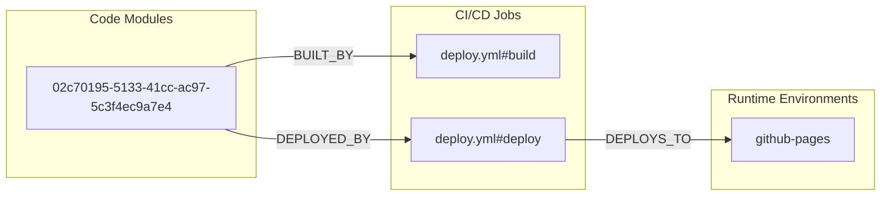
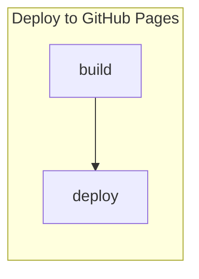

# Repository Architecture Analysis: bitwarden/passkeys-index

## Metadata
- **SHA**: `25acc4a1560d18dbbf205701d614441349f48378`
- **Primary Ecosystem**: JavaScript/TypeScript

## Quality Metrics
- **ast_engine**: tree-sitter
- **avg_cognitive_complexity**: 1.64
- **avg_cyclomatic_complexity**: 1.91
- **component_count**: 2
- **dead_code_count**: 0
- **dead_code_symbols**: 0 entry(ies)
- **duplication_pct**: 35.31
- **file_complexities**: 7 entry(ies)
- **files_analyzed**: 7
- **fitness_passed**: False
- **fitness_violation_count**: 1
- **framework**: Astro
- **import_edges**: 10 entry(ies)
- **loc**: 151
- **max_cognitive_complexity**: 9
- **max_cyclomatic_complexity**: 6
- **sloc**: 132

# Architecture: bitwarden/passkeys-index

## Context
- **Repository**: `bitwarden/passkeys-index`
- **SHA**: `25acc4a1560d18dbbf205701d614441349f48378`
- **Ecosystem**: JavaScript/TypeScript
- **Framework**: Astro

## Building Block View

## Component Details
- **site** (`package.json`): MODULE
- **API_v1_data.json** (`src/pages/api/v1/data.json.ts`): API_ROUTE

## 6-Dimension Repository Scorecard

- **Overall Grade**: `C` (79.25/100)
- **Technical Debt Score**: 20.75
- **Estimated Remediation Effort**: 17.25h

| Dimension | Grade | Score | Weight | Details |
| :--- | :---: | :---: | :---: | :--- |
| Code Quality | `C` | 75.00 | 0.20 | avg_cc=1.91, max_cc=6, duplication=35.31%, dead_code=0 |
| Dependency Health | `B` | 85.00 | 0.15 | dependencies=11, outdated=0, vulnerable=0, has_lockfile=False |
| Maintainability | `A` | 94.00 | 0.15 | avg_cognitive=1.64, max_cognitive=9, fitness_violations=1, oversized_files=0 |
| Pipeline Health | `C` | 76.00 | 0.15 | workflows=1, operational_antipatterns=4, parallel_branches=False |
| Security | `A` | 100.00 | 0.20 | vulnerabilities=0, secrets=0, pipeline_security_findings=0 |
| Test Coverage | `F` | 40.00 | 0.15 | coverage=unavailable, ci_test_job=False, test_files_detected=False |

## Architecture Fitness & Workspace Boundaries

- **[MEDIUM] `ATRUSS-ARCH-005` (COMPLEXITY_THRESHOLD)**: Repository duplication_pct (35.31) exceeds policy threshold (15.0).

## Supply Chain Dependencies, Vulnerabilities & Secrets

- **Dependencies Parsed**: 11 | **Vulnerabilities**: 0 | **Secrets**: 0

### Inventory Sample
- `@astrojs/check` `0.9.10` (npm, `package.json`)
- `@astrojs/mdx` `7.0.5` (npm, `package.json`)
- `@fontsource/dm-sans` `5.1.0` (npm, `package.json`)
- `astro` `7.2.8` (npm, `package.json`)
- `astro-seo` `0.8.4` (npm, `package.json`)
- `autoprefixer` `10.5.4` (npm, `package.json`)
- `classnames` `2.5.1` (npm, `package.json`)
- `marked` `15.0.4` (npm, `package.json`)
- `postcss` `8.5.25` (npm, `package.json`)
- `tailwindcss` `3.4.17` (npm, `package.json`)
- `typescript` `5.7.2` (npm, `package.json`)

## Section 7: Code-to-Cloud Deployment Traceability

- `deploy.yml#deploy` (ci_job) --[DEPLOYS_TO]--> `github-pages` (environment)
- `02c70195-5133-41cc-ac97-5c3f4ec9a7e4` (code_module) --[BUILT_BY]--> `deploy.yml#build` (ci_job)
- `02c70195-5133-41cc-ac97-5c3f4ec9a7e4` (code_module) --[DEPLOYED_BY]--> `deploy.yml#deploy` (ci_job)

## CI/CD Pipeline Topology

